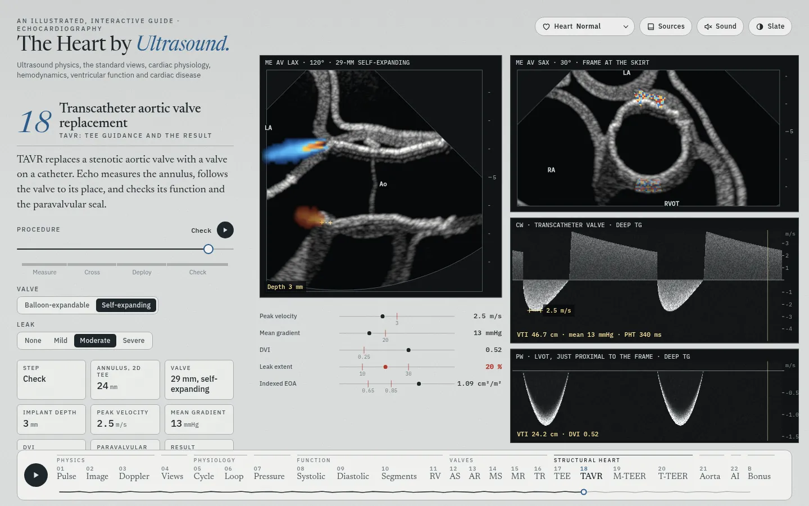
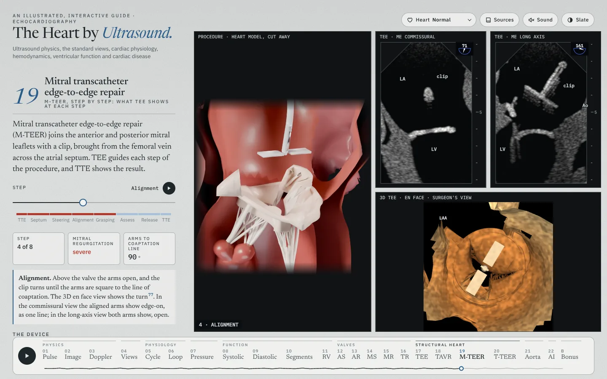
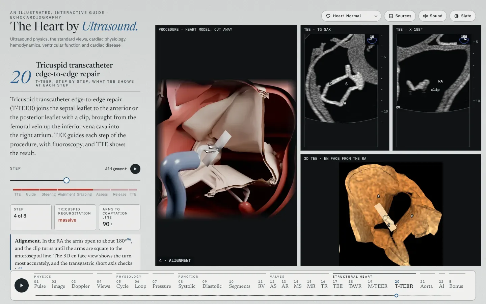

# Development

This file holds the developer notes of *The Heart by Ultrasound*. [README.md](README.md) describes the site for clinicians.

## Hidden chapters

Hidden chapters keep their code and come back with a flag in `src/order.js`: the report (`SHOW_REPORT`), Planes (`SHOW_PLANES`), Automated measurements (`SHOW_MEASURE`) and Shock (`SHOW_SHOCK`). Constriction and the IVC were chapters of their own (`SHOW_CONSTRICT`, `SHOW_IVC`); B5 and 07 now show them. In 11, the PH calculator and the ESC/ERS probability of PH are hidden (`SHOW_CALC` and `SHOW_PROB` in `src/ch/rv.js`).

## How it works

- **One heart.** One heart mesh, one set of view planes, one echo renderer and one cycle model serve every chapter. Every chapter but 07 cuts its echo views from the mesh. A chapter's disease is a shape target on the mesh, weighted so that the image shows the size that the text prints (the `*cal.js` tables). The mesh, the pencil renderer and the 3D stage come from *The Amyloid Heart*.
- **Valve hinges.** The valve model leaves gaps between some leaflet hinges and the walls. For example, it has no aortomitral curtain between the anterior mitral leaflet and the aortic root. Membranes join each hinge to the wall in the echo views and in the 3D model (`src/gl/skirts.js`). At the mitral and tricuspid annuli, the aortomitral curtain among them, a membrane is wall: it has the wall's echo and 3D look and the atrial wall's thickness (2.8 mm on the left, 3.2 mm on the right). At an aortic or pulmonary cusp it is thin valve tissue. The tricuspid ring sits at the RA–RV junction. The measurements leave the membranes out, so the `*cal.js` tables stay valid. `tools/hinges.mjs` finds the hinges once and keeps them in `assets/hinges.json`.
- **Free probe (04).** The probe slides over the skin of the body figure's torso (`src/torso.js`) on the straightest path, and turns with the chest's curve, so it keeps its angle to the skin. Tilt and rock turn it on its face at the skin. The sliders reach 35 cm, tilt 90° and rock 180°, so every view reaches every view that the panel names, in each heart (`tools/free-reach.mjs`). Near a view, the transducer takes that view's depth under the skin, so the image on arrival is the view (`src/freeprobe.js`).
- **Echo images.** `src/bmode.js` forms every frame: echogenicity by structure, specular surfaces, speckle that moves with the wall, beam blur, near-field clutter, noise, time-gain and log compression. Color jets come from a model of their flow (`jet()` in `src/echo2d.js`). A scanner-style color format is kept and off (`JETS` in `src/jets.js`).
- **Values.** Each severity page runs a one-slider model set inside the guideline bands. It rounds each value to its printed decimals and grades from the rounded values, so a value on screen never contradicts its grade (`shown` in `src/sev.js`). Each page models one lesion, as the guidelines grade one lesion at a time.
- **State.** One store (`src/state.js`) holds each chapter's own keys and a few shared keys (`SHARED`). A chapter's controls and Play change only its own keys.

## Text

The text reads as a clinical echocardiography text: third person, with the chamber, view, method and unit named. Each concept has one home chapter, and other chapters link to it. A chapter holds 1,100 words or fewer; 07 and B5 join two chapters and hold 1,700 or fewer. A structural heart procedure chapter, such as 18 (TAVR), may hold more: its steps, its imaging and its criteria need the room.

## Run it

```
python3 -m http.server 8000
```

Open <http://localhost:8000/>. There is no build step: ES modules, a canvas sketch layer (rough.js) and a WebGL pencil renderer (three.js). The libraries and their licenses are in `vendor/`.

## Code

```
index.html        the page, the chapter text, the dialogs and the preload block
src/main.js       the chapter engine: controls, readouts, citations, the tour, the chapter bar
src/order.js      the chapter order and numbers, the bonus chapters, the hidden chapters
src/state.js      the store: each chapter's own keys and the shared keys
src/ch/*.js       one module per chapter
src/sev.js        severity pages: tracks, grade bands, Play, the measurement strip
src/echo.js       view planes and echo views cut from the mesh, with the disease targets
src/echo2d.js     parametric views (07), LV tracing, color jets, measurement boxes
src/bmode.js      B-mode and M-mode image formation
src/meshpanel.js  an echo view cut from the mesh in a chapter's figure
src/*cal.js       target weights against printed values, for each heart
src/gl/           the 3D stage, the disease hearts (phenomesh.js), each chapter's mesh additions
src/music.js      the site's sound (Web Audio)
src/norms.js      normal values and integrated grades
src/refs.js       references
src/idbcache.js   the model's fields in IndexedDB, from one visit to the next
assets/           heart mesh, landmarks, valve hinges, poster, favicon
video/            the views video, the chapter videos and the intro
video/renders/    the T-TEER chapter video and reel cuts, kept in git
tools/            checks and video tools; tools/score/ the soundtracks, tools/voice/ the voice-over,
                  tools/blender/ the M-TEER and T-TEER procedure frames (Python),
                  tools/shorts/ the vertical explainer reels,
                  tools/tavr-video/ the TAVR procedure video (Blender)
archive/          markup of hidden chapters, not loaded by the site
```

## Checks

| Command | What it checks |
| --- | --- |
| `node tools/check-state.mjs` | Each chapter changes only its own state keys |
| `node tools/preload.mjs --check` | The preload block of `index.html` lists every module (105) |
| `node tools/stress-volumes.mjs --check` | Bonus chapter B1's stored LV volumes match the mesh |
| `node tools/hinges.mjs --check` | The stored valve hinges (`assets/hinges.json`) match the model |
| `node tools/free-reach.mjs` | In 04, from every view, the free probe reaches every view the panel names within the sliders' ranges, in each heart |
| `node --input-type=module --check < src/echo.js` | A module parses (`node --check src/echo.js` does not check ES modules in `.js` files) |
| `node tools/loadtime.mjs [keys]` | The load time of each chapter |
| `node tools/track-fit.mjs` | Each step name fits its part of a chapter video's progress line |

Before a merge, every chapter is opened in Chromium at phone and desktop sizes. Each pull request lists the checks it ran.

## Load time

Every chapter loads about 115 files: 7.9 MB, or 4.1 MB with gzip, of which the heart model is 2.3 MB. The valve hinges add 147 KB, or 30 KB with gzip. Five changes cut the wait: grade bands built on first use, one chapter warmed at a time, a stored table of the stress volumes, `modulepreload` links with an early model download, and the model's fields kept in IndexedDB. In local tests the median first image fell from 2.92 s to 1.98 s. A next visit shows the heaviest chapters in 0.96 to 1.18 s.

## Videos

The site's own code draws every video in headless Chromium. The soundtrack is *Bright pulse* (`tools/score/pulse.py`), synthesized in Python (`tools/score/synth.py`) at −15 LUFS. The videos go to `video/out/`, which git ignores. `video/renders/` keeps the T-TEER chapter video and the two T-TEER reel cuts in git, with the reel's storyboard and Blender frame sheet. A `git pull` gets them. Cloudflare Pages deploys the whole repository and rejects any file over 25 MiB, so each file in `video/renders/` must stay under that size.

- **Views video** (`video/index.html`): the standard views of 04 in three panes. Cut A, the full tour (2:24); B, the core views with the nine planes (1:09), the video of chapter 04; C, a quick cut (0:38); D, vertical (1:06).
- **Chapter videos** (`video/chapter.html?ch=<key>`): one for each chapter, 0:39 to 2:16. The steps and captions are in `video/chapters.js`.
- **M-TEER with a voice-over** (`?ch=mteer-vo`, 2:36): the figure of chapter 19 with a narrator. ElevenLabs speaks the script (`video/vo/mteer.json`, the premade voice Eric) and gives the time of each spoken letter, so the caption lights each word as it is spoken (`tools/voice/vo.py`). The Bright pulse bed ducks 15 dB under the voice (`tools/voice/mix.py`). Both M-TEER videos show the procedure pane as Blender frames along the steps (`tools/blender/`).
- **T-TEER reel** (`video/shorts/tteer/`): a vertical explainer, 1080 × 1920 and 77 s, with a voice and without one. `claims.yaml` gives the source of each spoken line and each number on screen, and `script.yaml` the beats. Blender renders the procedure in 64 frames along the steps; the T-TEER chapter video gives the TEE and TTE panes in step with them. ElevenLabs (the stock voice Brian) speaks the lines and times each word for the captions, and `tools/shorts/` composes, mixes and checks the two cuts (`qa.py`: length, loudness, captions, safe zones, copy, claims and the loop).
- **Intro** (`video/reel.js`): 89 s, a title card, one clip from each of ten chapters, and the end card.
- **TAVR procedure** (`tools/tavr-video/`): 64 s. The TEE views of the TAVR and TEE chapters take most of it: the annulus, the valve's position, its depth as the balloon fills, the leak and effusion checks. Blender (Cycles) shots on a CC0 body show the femoral access, the wires, the delivery and the closure. The frame is the chapter videos'. The build is in `tools/tavr-video/README.md`.

Serve the repository root on port 8790, then:

```
python3 tools/score/pulse.py as video/out/chapter-as.wav
node tools/render-video.mjs --ch=as --audio=video/out/chapter-as.wav
node tools/render-video.mjs --ch=all --jobs=3 --audio=auto
node tools/render-video.mjs --cut=A --jobs=3 --audio=video/out/echo-views-A.wav
node tools/render-video.mjs --reel --jobs=3 --audio=auto
node tools/storyboard.mjs --ch=as
```

The M-TEER frames and voice-over. The voice needs an ElevenLabs API key in the environment; it is never written to a file:

```
node tools/blender/export.mjs --frames=seq --out=video/out/mteer/mesh_seq
python tools/blender/render.py --mesh video/out/mteer/mesh_seq --out video/out/mteer/seq --res 560 --aspect 1.17 --samples 10
node tools/blender/export.mjs --frames=stills --out=video/out/mteer/mesh_stills
python tools/blender/render.py --mesh video/out/mteer/mesh_stills --out video/out/mteer/stills
ELEVENLABS_API_KEY=... python tools/voice/vo.py video/vo/mteer.json
python tools/voice/mix.py mteer-vo video/out/chapter-mteer-vo.wav
node tools/render-video.mjs --ch=mteer-vo --audio=video/out/chapter-mteer-vo.wav
```

The T-TEER stills and reel. `voice.py` reads the ElevenLabs key from the environment or from `~/.config/elevenlabs/key`, outside the repository, and stops before its spend passes $4:

```
node tools/blender/export.mjs --ch=tteer --frames=stills --out=video/out/tteer/mesh_stills
python tools/blender/render.py --mesh video/out/tteer/mesh_stills --out video/out/tteer/stills --res 800 --samples 32 --bounces 5
node tools/blender/export.mjs --ch=tteer --frames=video/shorts/tteer/frames.json --out=video/out/shorts/tteer/mesh
python tools/blender/render.py --mesh video/out/shorts/tteer/mesh --out video/out/shorts/tteer/frames3d --res 1010 --aspect 1.0693 --samples 12 --bounces 4 --fieldk 1.3 --shift-y 0.08
python3 tools/shorts/voice.py video/shorts/tteer/script.yaml video/out/shorts/tteer/audio
python3 tools/shorts/compose.py plan video/shorts/tteer/script.yaml
node tools/shorts/panes.mjs --ch=tteer
python3 tools/shorts/music.py video/shorts/tteer/script.yaml
python3 tools/shorts/compose.py render video/shorts/tteer/script.yaml
python3 tools/shorts/compose.py render video/shorts/tteer/script.yaml --novoice
python3 tools/shorts/qa.py video/shorts/tteer/script.yaml video/out/shorts/tteer/out/tteer-voice.mp4
python3 tools/shorts/qa.py video/shorts/tteer/script.yaml video/out/shorts/tteer/out/tteer-novoice.mp4 --novoice
python3 tools/shorts/compose.py storyboard video/shorts/tteer/script.yaml
```

To update `video/renders/`, copy the reel files and encode the chapter video again. A two-pass encode at 1.9 Mb/s from the CRF 16 master keeps the chapter video under the 25 MiB limit:

```
cp video/out/shorts/tteer/out/tteer-voice.mp4 video/out/shorts/tteer/out/tteer-novoice.mp4 video/renders/
cp video/out/shorts/tteer/out/storyboard.png video/renders/tteer-storyboard.png
cp video/out/shorts/tteer/out/frames3d.png video/renders/tteer-frames3d.png
X="-c:v libx264 -preset slow -b:v 1900k -pix_fmt yuv420p -color_primaries bt709 -color_trc bt709 -colorspace bt709 -color_range tv"
ffmpeg -y -i video/out/chapter-tteer.mp4 $X -pass 1 -an -f mp4 /dev/null
ffmpeg -y -i video/out/chapter-tteer.mp4 $X -pass 2 -c:a copy -movflags +faststart video/renders/chapter-tteer.mp4
```

Rendering needs Node 22, Playwright with Chromium, ffmpeg, and Python 3 with numpy and scipy. The M-TEER frames need Blender's Python module (`pip install bpy`); the voice-over needs soundfile and an ElevenLabs API key, or, with the engine `kokoro`, kokoro-onnx and faster-whisper with their models (`tools/voice/vo.py`).

## Screenshots

`docs/screenshots/` holds 43 screenshots: 41 at 1440 × 900 and 2 at 390 × 844. The README shows `planes.webp`. Take a chapter's screenshot again when its figure changes.

| | | |
| --- | --- | --- |
|  |  |  |
|  |  |  |
|  |  |  |
|  |  |  |
|  |  |  |
|  |  |  |
|  |  |  |
|  |  |  |
|  |  |  |
|  |  |  |
|  |  | |

  

## Deploy

`main` deploys to Cloudflare Pages and serves <https://intro2echo.com>. Each pull request gets a preview at `<branch>.echodemo.pages.dev`.

## History

The merged pull requests and the git log hold each change and its checks. The README before #112, with every dated entry and check, is in git history: `git show f08774a:README.md`.
