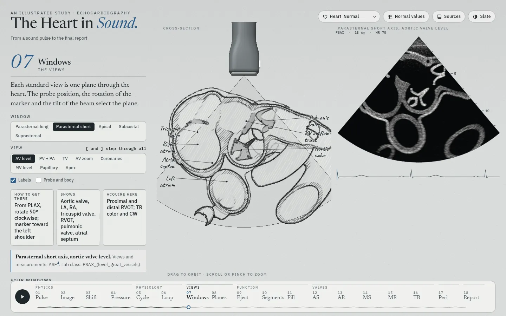
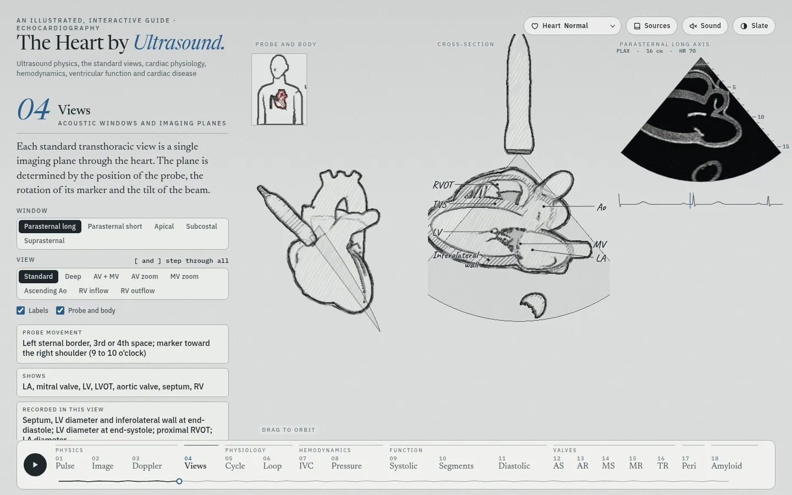
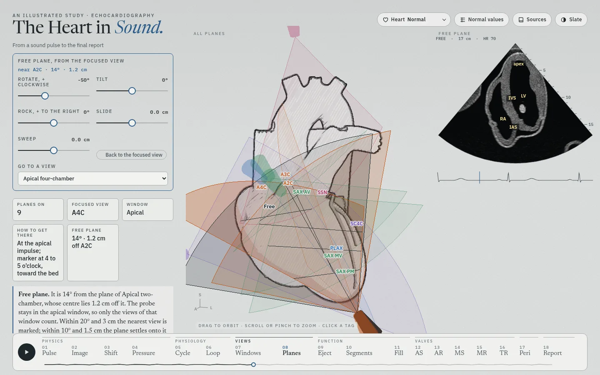

# The Heart in Sound

An illustrated, interactive study of echocardiography for trainees: ultrasound physics and Doppler, cardiac physiology, the standard views, ventricular function, valve disease, the pericardium and cardiac amyloidosis. Eighteen chapters in seven parts. Chapters 11 to 18 each follow one disease from normal to its end stage: one slider that plays when the page opens, and several views that change together. A menu in the header changes the heart that every chapter shows: normal, cardiac amyloidosis, ischemic cardiomyopathy, a Barlow mitral valve with severe regurgitation, or a bicuspid aortic valve with severe stenosis. Every guideline value carries its source.


## Chapters

| Part | Chapter | The figure |
| --- | --- | --- |
| Physics | 01 Pulse | One scan line: pulse, echoes, A-mode, wavelength and axial resolution, attenuation by tissue |
| | 02 Image | A sector image built line by line, with a sweep whose speed follows the frame rate; four artifacts |
| | 03 Shift | Doppler equation, beam angle, Nyquist limit, pulsed, continuous and color Doppler |
| | 04 Pressure | Stroke volume from LVOT area × VTI; RV systolic pressure from the TR jet and the IVC |
| Physiology | 05 Cycle | Wiggers diagram with ECG, heart sounds, mitral and LVOT Doppler, and the four-chamber frame at the cursor |
| | 06 Loop | Pressure–volume loop: ESPVR, EDPVR, arterial elastance, EF = Ees ÷ (Ees + Ea) |
| Views | 07 Windows | 35 standard views: the heart cut on the imaging plane and labeled (or whole, with the plane through it), and the echo view that plane cuts from the same mesh; the plane moves from view to view as a probe does |
| | 08 Planes | All standard view planes in one heart: crossings, parallel stacks, which views show a structure, and a free plane that settles onto the nearest standard view and moves to any view on request |
| Function | 09 Eject | Biplane method of disks: apical four- and two-chamber echo views with the traced border and disks, each above the disk model of the same LV; foreshortening; TAPSE, S′ and fractional area change |
| | 10 Segments | Buttons on the figure occlude the LAD, RCA or circumflex: its territory turns hypokinetic, akinetic or dyskinetic on the 17-segment bull's-eye, which draws the artery with its block, and in the apical four-, two- and three-chamber views, echo cine sectors cut from the heart mesh in which each segment moves by its score. The text names the walls to watch in each view. Any segment can also be scored by tapping it; the wall motion score index follows |
| | 11 Fill | Diastolic dysfunction, normal to restrictive: four-chamber view with the LA to scale, mitral inflow, tissue Doppler, pulmonary veins, LA strain, TR jet, and the 2025 ASE algorithm run live |
| Valves | 12 Aortic stenosis | Normal valve to severe stenosis, then LV failure and low flow: PLAX with hypertrophy, short-axis orifice to scale, CW and LVOT Doppler, mitral inflow |
| | 13 Aortic regurgitation | Mild to severe with LV dysfunction: jet width in the LVOT, pressure half-time, descending aorta reversal, LVOT VTI, LV dilation |
| | 14 Mitral stenosis | Normal valve to severe rheumatic stenosis: apical four-chamber view with doming leaflets, the LA to scale and the color inflow jet with its flow convergence at 40 cm/s; pressure half-time, the gradient at any heart rate, PA pressure, planimetry |
| | 15 Mitral regurgitation | Mild to severe with LV dysfunction: color jet at 60 cm/s, or the PISA zoomed with the baseline shifted; CW jet, pulmonary vein flow reversal, E wave, LV and LA dilation. Under the Barlow heart the leak starts in mid-systole until it is severe |
| | 16 Tricuspid regurgitation | Mild to torrential: color jet at 60 cm/s or the PISA at 28 cm/s; RV, annulus and RA dilation, hepatic vein reversal, IVC, septal flattening, a jet that slows and turns laminar at the torrential end |
| Pericardium | 17 Pericardium | No effusion through mild, moderate and severe (large) effusion to tamponade: four-chamber view with the fluid round the heart, the RA and RV folding in and the septum moving with each breath; mitral, tricuspid and hepatic vein Doppler over a breath; PLAX with the fluid in front of the descending aorta; IVC M-mode |
| Cardiomyopathy | 18 Cardiac amyloidosis | Normal heart to advanced amyloid cardiomyopathy: the parasternal long axis at end-diastole with calipers and the apical four-chamber view, both cut from the heart mesh at the chosen amyloid burden; mitral inflow and septal tissue Doppler; the 17-segment strain bull's-eye; the ESC 2021 echo criteria and the multiparametric score, run live |

The report chapter (four simulated cases in the ASE 2025 structure) is hidden: `SHOW_REPORT` in `src/chapters.js`. Its module and markup stay, and it comes back as chapter 19.

| | | |
| --- | --- | --- |
|  |  |  |
|  |  |  |
|  |  |  |
|  |  |  |
|  |  |  |

On a phone the figure sits above the text and stays in view while the text scrolls:

 

## The heart shown

The **Heart** menu in the header sets the heart for the whole page, and the page keeps the choice between visits. A note under the title says what the heart shows.

- **The mesh changes shape.** The 3D heart, and every echo view cut from it (chapters 02, 05, 07, 08 and 10), take the chosen heart. Chapter 18 cuts its views from the model's own normal-to-amyloid shape at the page's burden, whatever heart the menu shows (`setBurden` in `src/echo.js`). Amyloidosis is the model's own amyloid state. The other three are built from the normal mesh the first time they are chosen (`src/gl/phenomesh.js`, a few seconds; the note says so while it runs): each moves the walls, valves and chambers and scales the systolic motion by segment.
  - **Ischemic cardiomyopathy**: a large LAD infarct. The LV dilates to 222 mL with an EF of 25%, the LAD territory is thin and akinetic, the apex bulges a little in systole, the rest is hypokinetic, and the mitral leaflets are pulled toward the apex.
  - **Barlow mitral valve**: thick, redundant leaflets that billow into the LA, a wide annulus, a large LA, and an LV of 183 mL with an EF of 67%.
  - **Bicuspid aortic valve**: the right and left cusps fused along a raphe; the valve domes and opens as a slit. The LV walls thicken to 12.5 mm and the ascending aorta widens to 3.9 cm.
- **The 2D views draw the heart's valves** (`setHeart` in `src/echo2d.js`). Under the bicuspid heart the short axis shows two cusps, a raphe and a slit, and the long axis closes off-centre. Under the Barlow heart the mitral leaflets are 3 mm thick and 30% longer, and in systole they billow up to 1 cm past the annulus. Walls and chamber sizes stay each page's own.
- **Chapters open at the heart's values** (`src/pheno.js`). Eject opens at the heart's volumes and EF, Segments at the LAD occlusion, Fill at the heart's diastolic grade, and the heart's own valve page at its severity (aortic valve area 0.76 cm²; mitral EROA 0.46 cm²). The pericardium page opens at a 7 mm effusion and the amyloid page at full burden under amyloidosis. The other valve pages open with no lesion, the amyloid page opens normal under the other disease hearts, and no page plays on its own.
- **The report** (hidden) has a case for each heart, with its button next to the four standard cases.
- **Sizes.** The LV volumes come from 50 short-axis slices of each shape. The slices read 6% over the model's own normal volumes (118 and 42 mL against 112 and 39), so each heart's values are scaled by 0.945.
- **Limits.** The severity pages keep their own LV models, so a page can show values that differ from the heart's (the MR page gives an EF of 64% under the Barlow heart, the mesh 67%).

| | | |
| --- | --- | --- |
|  |  |  |

## Views and the lab's annotation classes

Chapter 07 covers the ASE comprehensive transthoracic views (Mitchell 2019, Tables 2.1–2.27). Each view carries the class name from the lab's annotation list (`lab` in `src/views.js`), for example `PLAX_IVS_LVPW_LVIDD`, `PSAX_(level_great_vessels)_focus_on_PV_and_PA`, `Subcostal_IVC`, `SSN_aortic_arch`. Six views have no class in that list: the coronary artery origins, the zoomed tricuspid valve, LV apex and aortic valve (apical), the zoomed atrial septum (subcostal) and the suprasternal short axis.

- **The plane moves between views.** A change of view turns the plane along the shortest rotation while the point it images slides across, so neighbouring views are small moves: the tricuspid valve view leans 2° further than the aortic valve level and steers onto the valve, and the abdominal aorta is 7° from the IVC plane.
- **The great-vessel short axis (ASE 2019, Table 2, rows 2.7–2.10).** The probe lies in front of the aortic root, a little to its left; the beam runs back, a little to the right and down. At the aortic valve the plane passes through the shut cusps where they meet and leans 28° from square to the root, toward the patient's right and a little back. Square to the root, it would pass above this model's left atrium; in the ASE images the left atrium lies directly behind the valve at this level. Leaning, it shows what ASE lists: the RVOT across the front from the tricuspid to the pulmonic valve, the valve in the middle, the right atrium on the left, the left atrium below and the atrial septum between. The zoomed valve view is square to the root, so the shut cusps meet in a Y, with the right coronary cusp at the top, the left on the right and the non-coronary cusp at the lower left. Tilted 1.4 cm up the root and leaning 27°, the plane shows the aorta above its valve in cross-section, the pulmonic valve, the trunk and both branches.
- **The aortic valve model is turned 60°.** As supplied, the valve model faced its commissures, not its sinuses, toward the coronary origins. Turned 60° about its own axis (the model has three-fold symmetry), the right coronary cusp faces the RVOT and each coronary artery leaves its own sinus. The targets that carry the root's own motion (systole, amyloid) are split: an affine fit, which is the root's motion, stays where it is, and only the valve's own change turns.
- **Cross-section, labels, probe and body.** The 3D heart is cut on the view plane and seen square to it, turned as the echo is (probe at the top). **Labels** names the structures in the margin of the model, as in *The Amyloid Heart*; the echo sector carries no labels. **Probe and body** shows the whole heart from the front, head up, with the plane and the probe, and a body key in the corner (`src/gl/bodykey.js`): the patient turned as the camera is, drawn in pencil like the heart, the body as an outline. The body has adult male proportions (chest 33 cm across and 26 cm deep). The heart inside is the model's own mesh, in red pencil, and beats with it. It lies about three-quarters left of the midline, with the apex 8.5 cm from the midline. The probe sits on the skin at the view's window, with its sector toward the heart and its cable hanging. The transducer (`src/gl/probe3d.js`) is a phased-array probe drawn to scale: a 2.6 × 1.7 cm head with a lens and an index marker on the screen-right side, 13 cm from the lens to the cable. The probe and the body key go through the same pencil passes as the heart (`tools` and `renderInset` in `src/gl/pencil.js`): graphite outlines and hatching, darker where a part is darker (the lens, the cable).
- **The pulmonic valve.** The RV outflow view runs along the valve's own axis (the principal axis of the valve mesh), turned 10° about it and 3 mm to one side, so it crosses two cusps and the line where they meet: shut, they meet in the middle; open, they lie along the walls of the trunk, which runs on toward the bifurcation. In this model the pulmonary trunk runs 42° out of the aortic short axis and rises steeply to the bifurcation. The model's left main runs through a gap in the mesh beside the valve, so the RV outflow view leaves the coronary arteries out, and any coronary section that lies inside a blood pool, clear of the walls, is dropped in every view.
- **Below the diaphragm.** The heart model ends at the diaphragm. For the subcostal views, `src/abdomen.js` adds simple shapes to the echo only: a liver moulded to the underside of the heart, the IVC down through it, two hepatic veins, the abdominal aorta with the celiac trunk and the superior mesenteric artery, and the spine. The subcostal four-chamber plane in this model passes above the liver, so that view keeps a liver layer in the near field.






Chapter 08 shows the planes together. The apical views share the LV long axis; the model places the two-chamber plane about 60° from the four- and three-chamber planes, as the ASE rotation describes. The short-axis levels form a parallel stack. The structure table lists what ASE names for each view.

**Free plane.** Five controls move a plane away from the focused view as a probe moves: rotate about the beam, tilt across the plane, rock within it, slide along it and sweep across it. The echo pane shows what the plane cuts, and *Square to the plane* turns the heart to face it. The probe stays in the focused view's window, so only the standard views of that window count; the apical four-chamber plane lies 4° from the subcostal one in this model, but the two are different views. The nearest view is judged by the angle between the planes, with the marker on the same side, and how far that view's centre lies off the free plane: within 20° and 3 cm it is marked, and within 10° and 1.5 cm the plane settles onto it when the control is let go. The same plane turned 180° is flagged as mirrored, not taken as the view. The textbook turns work: the four-chamber plane rotated 60° counterclockwise settles on the two-chamber view and 120° on the three-chamber view, and the long axis rotated 90° clockwise on the short axis at the mitral valve.

**Moves to a view.** *Back to the focused view* eases the controls to zero in steps: slide and sweep first, then tilt and rock, then rotate, each over 1.4–4 s by the size of the move, on the clock and not the frame count. *Go to a view* lists every standard view by window. In the same window the new view becomes the focused view, the controls are counted from it (an exact inverse of the rotate–tilt–rock order), and they ease to zero. For another window the probe first returns to the focused view, then the plane moves to the new window in 2.6 s; the 3D fan follows the echo plane.



## The severity pages (chapters 11 to 18)

- **One slider per disease.** It runs from normal to the end stage. The bands under it show where the grade changes; the page computes them from its own model, so a band starts where the values cross the guideline cut-off.
- **Play** moves the slider through the whole course and starts again. It starts when the page opens; any control stops it. The beat runs all the time; there is no cine switch.
- **Several views change together.** A 2D view drawn to scale (a caliper on the screen reads the value in the text), three or four Doppler strips with a cursor at the same moment of the beat, a strip of measurements against their cut-offs, and the guideline table with the current column marked.
- **Grades and stages.** Regurgitation follows ASE 2017 (Zoghbi), with EACVI 2022 for massive and torrential TR; aortic stenosis follows Baumgartner 2017; mitral stenosis follows ASE 2023 (Pandian); diastolic function follows ASE 2025 (Nagueh). The LV and atrial consequences follow the ACC/AHA 2020 stages (Otto), for example stage C2 in MR at LVEF ≤60% or end-systolic diameter ≥40 mm. Effusion size follows ESC 2015 and 2025 (<10, 10–20, >20 mm at end-diastole); the echo signs of tamponade follow ASE 2013 (Klein) and ESC 2025 (Schulz-Menger). The amyloid bands follow the ESC 2021 echo criteria (Garcia-Pavia): an unexplained wall of 12 mm or more, plus two of three findings (grade 2 or worse diastolic dysfunction; septal s′, e′ and a′ all below 5 cm/s; GLS below 15% in absolute value) or a multiparametric score of 8 or more (Boldrini 2020).
- **What the model is.** The orifice or valve area drives the numbers (PISA, continuity equation, pressure half-time = 220 ÷ area); the chamber sizes, vein flows and pressures follow illustrative tracks set inside the guideline bands. In the pericardium page the effusion drives the pressure in the sac; tamponade starts where that pressure reaches the RA pressure, and the right heart then folds in during its relaxation. In the amyloid page the burden blends the heart mesh from its normal to its amyloid corner: the walls, cavity, atria, valves, atrial septum, RV wall and pericardial space come from the mesh (the calipers measure IVSd 9.0 to 16.8 mm, LVIDd 46.8 to 39.8 mm and PWd 8.9 to 15.0 mm), and the Doppler, strain and filling values follow a track from normal to grade 3 filling set inside the cited ranges. They are teaching values, not patient data.

## The echo images

Every echo image is simulated. The anatomy comes from sections of the heart mesh (chapters 02, 05, 07, 08, 10 and 18) or from parametric views drawn to scale (chapters 09 and 11 to 17). One renderer, `src/bmode.js`, turns either into a scanner frame:

- **Echogenicity.** Each structure has a level in dB against myocardium: blood about −60, leaflets +15 (to +21 when thickened), chordae +4, pericardium +16, calcium +22 with an acoustic shadow behind it; the coronary arteries sit in bright epicardial fat.
- **Specular surfaces.** A surface is brightest where the beam meets it head-on (cos⁴ of the angle). Walls that run along the beam, such as the atrial septum in the four-chamber view, stay faint.
- **Speckle.** Random scatterers ride with each structure from end-diastole, and the beam blur comes after, each frame. The speckle moves with the wall, and the grain keeps its size while the wall shortens and thickens.
- **Beam blur.** 0.6 mm along the beam (two cycles at 3.4 MHz). Across it, 0.8 mm near the probe, then 1.3 mm at 10 cm: a 2.5 cm aperture in harmonic imaging, the 1.7 MHz transmit beam squared times the 3.4 MHz receive beam.
- **Structures into the image.** A small rasterizer fills each structure into the beam grid with its exact coverage, so a leaflet or a chord thinner than a sample keeps part of its strength instead of dropping out.
- **Near field and noise.** Chest-wall layers, reverberation clutter over the first 2 cm below them, and electronic noise that rises with depth and changes each frame while the cine runs.
- **Display.** Light speckle reduction (a fifth of each sample is the local mean; two fifths in a zoomed view), time-gain with a small loss left at depth, darker sector edges, log compression over 56 dB, then scan conversion at the screen's own pixel density. The views draw about 30 frames a second.
- **Valves in the parametric views.** Each leaflet keeps its length and swings about its hinge; closed, the leaflets meet in a zone of contact up to 8 mm long and stay on the ventricular side of the annulus, which narrows about 15% in systole. Rheumatic stenosis holds the tips, so the anterior leaflet domes and the short posterior leaflet cannot move. Regurgitation leaves a gap at closure; the aortic cusps open along the sinus walls, or dome when stiff. Chordae run from the papillary muscles to the leaflets and fade when slack in diastole.
- **Anatomy in the parametric views.** Papillary muscles and chordae, apical trabeculae, the moderator band, pulmonary vein openings, the pericardium, the coronary sinus and the descending aorta. The walls stay at the model's values on the measuring line, so the calipers read what the page reports.
- **Pericardium.** In the four-chamber view the sac follows the convex envelope of the ventricles' outer walls, 1.3 mm out: it wraps the apex and bridges the interventricular groove, which epicardial fat fills; an RV wall that collapses in tamponade pulls away from it. In the long axis it runs behind the posterior wall, round the coronary sinus in the atrioventricular groove and behind the LA, in front of the descending aorta, at least 1.3 mm from each. In the views cut from the mesh, any point of the pericardium that falls inside a wall moves out to the wall's surface.
- **Effusion.** Fluid widens the pericardial space most over the free walls and the apex and least at the atrioventricular grooves; grey lung and mediastinum lie outside the sac, so the fluid shows as a dark band. In the parasternal long axis the fluid thins out at the atrioventricular groove in front of the descending aorta. A swinging heart rocks about the middle of the atrioventricular plane inside a sac that stays put: the apex travels farthest, and the grooves, where the fluid is thinnest, hardly move sideways.
- **Regional wall motion.** In chapter 10 each vertex of the LV wall belongs to one of the 17 segments, placed from the LV long axis and the apical planes. Its systolic motion scales by the segment's score: normal 100%, hypokinetic 45%, akinetic 0 and dyskinetic −35% (outward). The pericardium over a segment moves with it.
- **Biplane tracing (chapter 09).** The four- and two-chamber views trace the border of the compacted myocardium, close it with a straight line across the mitral annulus and take L from the middle of that line to the farthest point of the border (Lang 2015). The disk drawing under each view is the same LV, with one width profile (`lvWidth` in `src/echo2d.js`). Its cross-section is an ellipse, 0.94 as wide in the two-chamber view as in the four-chamber view, with the area of the circle in the model's volume. At 120 mL and an EF of 60%, the model LV shortens 15% along its axis and 33% across it, the annulus narrows 12%, and the wall thickens so that the muscle keeps its volume.
- **Color Doppler.** The color box stays in place through the beat and shows all the flow in it: mitral and tricuspid inflow (E, then A), flow toward the outflow tracts, pulmonary vein and caval inflow, and the lesion's jet with its flow convergence. Each color sample takes the scanner's pulse-pair estimate. The phase between pulses gives the velocity along the beam and wraps past the Nyquist limit; a spread of velocities in the sample (turbulence) makes the phase random, which gives the mosaic and the green variance tag. Flow below 10% of the Nyquist limit shows no color (the wall filter), bright tissue keeps its grey, and the color comes 20 frames a second on beam lines 0.8° apart, interpolated onto the screen.
- **Jets.** A jet keeps its vena contracta width past the orifice, then widens to a flame with a slow blue rim and slows as 1/distance (Zoghbi 2017); one that reaches the far wall spreads along it and comes back along the side walls, in red. Its color area follows the page's model: the share of the LA as drawn for MR, cm² for TR. Jets show at a Nyquist limit of 60 cm/s. The PISA setting zooms on the valve and shifts the baseline toward the jet (MR 30 cm/s, TR 28 cm/s), turns variance off, and measures the radius along the beam.

*The Amyloid Heart* got its realistic views from the sculpted mesh; it drew them with flat textures and white outlines. This site keeps the mesh and adds the image formation above.

## Sources and data

- Guideline values come from ASE, EACVI, BSE, ACC/AHA, ESC and ESC/ERS documents; the main ones are Lang 2015 (chamber quantification), Mitchell 2019 (comprehensive TTE), Zoghbi 2017 (regurgitation), Baumgartner 2017 (aortic stenosis), Otto 2020 (valve disease), Pandian 2023 (rheumatic mitral stenosis), Nagueh 2025 (diastolic function), Mukherjee 2025 (right heart), Thomas 2025 (strain), Klein 2013, Adler 2015 and Schulz-Menger 2025 (pericardium), Garcia-Pavia 2021 and Moody 2023 (cardiac amyloidosis) and Taub 2025 (reporting). The full list, with DOI and PubMed links, opens from **Sources** on the page (`src/refs.js`).
- Each reference was checked against PubMed and Crossref before use. Where sources disagree, the page follows the current guideline.
- The figures run simple models set to agree with these sources. The diastolic values and the Doppler and strain values of the amyloid page are illustrative, not patient data. All images are simulated; there are no patient images.
- Normal values for the **Normal values** dialog and the grading helpers live in one place: `src/norms.js`.

## How it is built

A static site with no build step: ES modules, a canvas sketch layer (`src/sketch.js`, rough.js) and a WebGL pencil renderer for the 3D heart (three.js). Echo views are live cross-sections of the heart mesh (`src/echo.js`) or parametric views (`src/echo2d.js`), imaged by `src/bmode.js`. The heart mesh, pencil renderer and 3D stage are adapted from *The Amyloid Heart*. Vendored libraries and their licenses are in `vendor/`.

```
index.html          page, chapter text, dialogs
src/main.js         chapter engine: controls, readouts, citations, tour, keyboard
src/ch/*.js         one module per chapter
src/sev.js          severity pages: keyframe tracks, grade bands, Play, measurement strip
src/bmode.js        B-mode and M-mode image formation for every echo view
src/abdomen.js      liver, IVC, hepatic veins, abdominal aorta and spine for the subcostal echo views
src/echo2d.js       parametric echo views drawn to scale (A4C, A2C, PLAX, three short-axis levels, IVC M-mode), the biplane tracing and the flow in each color view
src/cflow.js        color Doppler: flow elements, pulse-pair estimate, wall filter, tissue priority, scan conversion
src/views.js        view catalog: planes, lab classes, structures, probe moves
src/echo.js         plane geometry, plane changes, cross-sections and the echo views cut from the heart mesh
src/cyclemodel.js   one heartbeat (pressures, volume, valve events)
src/norms.js        normal values and cut-offs
src/refs.js         references
assets/             heart mesh (JSON), anatomy landmarks, poster image
```

## Run it

Serve the folder with any static server, for example:

```
python3 -m http.server 8000
```

Then open <http://localhost:8000/>. A chapter can be opened directly: `#planes`, `#fill`, `#amyloid`.

Keys: ← → change chapter, space plays the tour, [ and ] step the views in chapters 07 and 08. In chapter 07 they run through every view of every window: after a window's last view comes the next window's first. A chapter opens directly by its key, for example `#as`, `#mr`, `#tr`, `#peri`, `#amyloid`.

## Checks run before this commit

- Every module parsed as an ES module (`node --experimental-default-type=module --check`). Plain `node --check` treats these files as CommonJS and passes them without parsing them fully; it missed a duplicate declaration during this change, which the module-mode check caught.
- All 18 chapters at 1440 × 900 and 390 × 844: no console errors, no horizontal scroll, every citation numbered. Each severity page is playing when it opens.
- Layout audit in a headless browser with the page's own fonts, at 14 screen sizes from 320 × 640 to 1920 × 1080: 44 states at each size (every chapter; each severity page, and the amyloid page, at none, the middle and the end stage; both dialogs; a disease heart's note), and 75 more at 390, 820 and 1440 px (other settings, all 35 chapter 07 views, the four disease hearts on six chapters). It reads every line of text on the page and every string drawn on a canvas, and checks for text on text, text cut by its box or the canvas edge, text covered by another element (three points on each line, and at the end of the scroll under the bottom bar) and sideways scroll. The last run found none of these, and no page errors.
- Every chapter's tour steps run, and the Play button advances chapters. On the severity pages any control stops Play.
- Amyloid page: at every 2% step of the burden the calipers on the mesh read within 0.047 mm of the page's IVSd, LVIDd and PWd. Over the burden the wall reaches 12 mm at 40%, the ESC criteria are met from 55% (grade 2 filling and GLS below 15%), the 5-5-5 sign appears from 80% and the score reaches 10 at 100%. Under the amyloid heart the page opens at 100% and holds; under the other disease hearts at 0%. Layout audit of the page and of the MS page at all 14 sizes: no findings.
- Mitral stenosis in four chambers: frames over a beat at four grades. The color box covers the LA within 3.5 cm of the annulus and the inflow, not the right heart.
- The probe and the body key in pencil: all 18 chapters at 1440 × 900 and 390 × 844 with no page errors, and chapter 07 in both themes, with Probe and body in the parasternal, apical and subcostal windows; the probe leaves the shared stage when chapter 07 closes, so chapter 08 shows none.
- Chapter order and labels: the valve chapters run aortic stenosis, aortic regurgitation, mitral stenosis, mitral regurgitation, tricuspid regurgitation (12 to 16), and every chapter header's number matches its place in the navigation. The part labels carry no numerals; a part of one chapter shows only its rule, so no label is cut off at 1024 or 1440 px. The page text names no chapter outside the chapter headers (the report's links to chapters are off, `SHOW_LINKS` in `src/ch/report.js`).
- Segments: the page opens normal. The LAD, RCA and LCX buttons on the figure set their territories (segments 1, 2, 7, 8, 13, 14, 17; 3, 4, 9, 10, 15; 5, 6, 11, 12, 16), and the text names the walls per view (for the RCA: A4C, the basal and mid inferoseptal segments; A2C, the whole inferior wall; A3C, normal). A tap on the bull's-eye scores a segment at desktop and phone width. 47 fps on the desktop layout and 60 on the phone layout (headless, software rendering). Dark theme checked.
- Pericardium against myocardium, measured point by point. In the parametric four-chamber view, before this change the line ran 0.4 cm inside the apical wall; now no point of it lies inside a wall at any contraction, effusion (none to 2.2 cm), RV collapse or septal shift, and it stays at least 1.0 mm from the epicardium. With the swing the pericardium page pairs with each effusion (up to 0.7 cm at 2.3 cm of fluid), the walls stay at least 3.5 mm inside the sac. In the long axis, no point lies inside the posterior wall, the coronary sinus, the LA wall or the descending aorta, with at least 1.3 mm of clearance. In the mesh views (A4C, A2C, A3C, PLAX, PSAX, subcostal four-chamber) at eight moments of the beat, the overlap fell from up to 0.27 cm (normal) and 0.40 cm (dyskinetic segments in chapter 10) to at most 0.06 cm, below the beam's lateral resolution.
- Pericardium model swept at 2,001 points: the grades come in order, the pressure in the sac stays at or above the RA pressure through tamponade, and no sign of tamponade turns on before the tamponade grade.
- Free-plane moves: the inverse of the rotate–tilt–rock order is exact to 4 × 10⁻¹⁴ over 200 random poses. From (rotate −50°, tilt 12°, rock −15°, slide 1.5 cm, sweep −1.0 cm), *Back to the focused view* brought slide and sweep to zero at 1.8 s, tilt and rock at 2.9 s and rotation at 3.6 s (planned: 1.6, 2.7 and 3.5 s). The headless browser drew 4.2 frames a second, so each step came at most one frame late. *Go to a view* re-counted a pose 20° off the four-chamber view as 42°, 8.5°, −10.1° from the two-chamber view, then eased to it; a move to the long axis crossed windows. The picker fits at 390 px.
- Eject: the biplane volume traced on the two echo views equals the model volume within 0.1% at 360 states (EDV 50 to 320 mL, EF 10 to 75%, walls 6 to 20 mm, foreshortening 0 and 15%; end-diastole, mid-systole and end-systole). Before the apical LV length was made exact, the four-chamber view ran up to 0.2 cm long when the septum was thick. Each echo panel now keeps its own last frame, and the page draws 53 frames a second on the desktop layout and 56 on the phone layout (headless; 38 before). The pericardium check above, run again after the basal wall taper: no point inside a wall, at least 1.0 mm clear.
- Image: the sweep takes 125 frame times, so 1.2 s a frame at 100 fps and 3.7 s at 33 fps, and the label says so.
- Great-vessel short axis against ASE 2019 (Table 2, rows 2.7–2.9), view by view: at the aortic valve level the RVOT lies across the front, the tricuspid valve at the upper left, the pulmonic valve at the right, the right atrium on the left, the left atrium below the valve with the atrial septum between; the zoomed valve shows the right coronary cusp at the top, the left on the right and the non-coronary cusp at the lower left; one level up the aorta is round and the trunk runs down its right side to both branches. Before this change the beam reached the root from the patient's left side (6.7 cm left of the valve, 2.7 cm in front), and the plane cut the cusps below where they meet.
- Aortic valve turn: after the turn the cusp bellies lie at −75°, 45° and 165° round the root, the left main origin within 5° of the left coronary cusp's centre and the right coronary origin 11° from the right coronary cusp's centre (before: both at commissures), and the valve's outer radius is unchanged (1.15 cm). Parasternal long axis, five-chamber and three-chamber frames compared before and after.
- Citation audit: every cited id resolves to a reference, and every id used in live text also appears in the static text.
- Earlier checks, still valid: plane changes rendered frame by frame; the free plane settles onto the two-chamber view at −60°, the three-chamber view at −120° and, from the long axis, the short axis at +90°, and a plane from another window never settles; echo images at 1× and 2× device scale; model checks of the diastolic algorithm, aortic stenosis, the mitral gradient across heart rates and the pressure–volume presets.
