# The Heart by Ultrasound

An illustrated, interactive guide to echocardiography: ultrasound physics and Doppler, cardiac physiology, the standard views, ventricular function, valvular disease, pericardial disease and cardiac amyloidosis. Seventeen chapters in seven parts. Chapters 10 to 17 each follow one disease from normal to its end stage: one slider that plays when the page opens, and several views that change together. A menu in the header changes the heart that every chapter shows: normal, cardiac amyloidosis, ischemic cardiomyopathy, a Barlow mitral valve with severe regurgitation, or a bicuspid aortic valve with severe stenosis. Every guideline value carries its source.

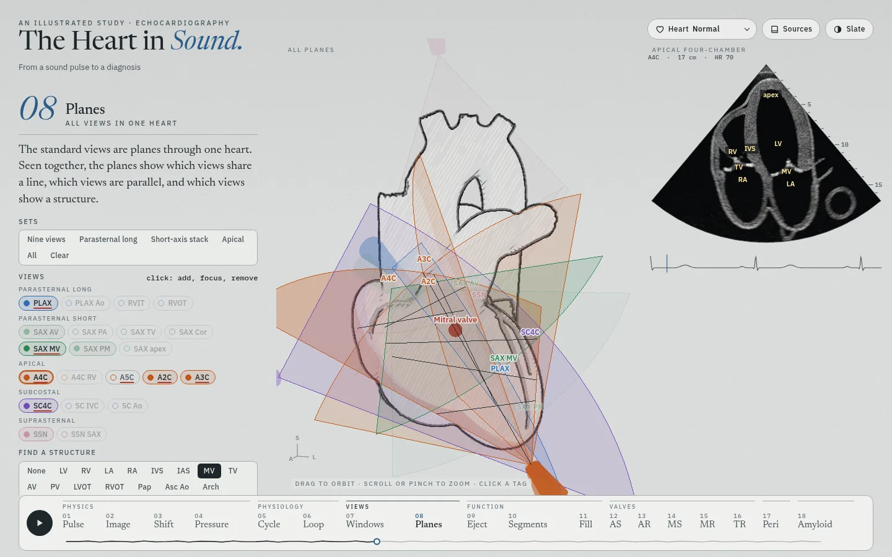

## Chapters

| Part | Chapter | The figure |
| --- | --- | --- |
| Physics | 01 Pulse | One scan line: pulse, echoes, A-mode, wavelength and axial resolution, attenuation by tissue |
| | 02 Image | A sector image built line by line, with a sweep whose speed follows the frame rate; four artifacts |
| | 03 Shift | Doppler equation, beam angle, Nyquist limit, pulsed, continuous and color Doppler |
| | 04 Pressure | Stroke volume from LVOT area × VTI; RV systolic pressure from the TR jet and the IVC. The text gives the principle behind the continuity equation and PISA (flow rate = area × velocity) and links to the chapters that use them |
| Physiology | 05 Cycle | Wiggers diagram with ECG, heart sounds, mitral and LVOT Doppler, and the four-chamber frame at the cursor |
| | 06 Loop | Pressure–volume loop: ESPVR, EDPVR, arterial elastance, EF = Ees ÷ (Ees + Ea); presets for a hypocontractile, a stiff, a pressure-loaded and a volume-loaded ventricle (chronic severe mitral regurgitation, the Barlow heart's loop) |
| Views | 07 Views | 35 standard views in three panes: the planes of the nine standard views in one heart, each in the color of its window, with the current plane lit and the lines where it crosses the others (a click on a plane opens its view), or with **Probe and body** the whole heart with the probe and a body figure; the heart cut on the imaging plane and labeled; and the echo view that plane cuts from the same mesh. The plane moves from view to view as a probe does |
| Function | 08 Eject | Biplane method of disks: apical four- and two-chamber echo views with the traced border and disks, each above the disk model of the same LV; foreshortening; TAPSE, S′ and fractional area change |
| | 09 Segments | Buttons on the figure occlude the LAD, RCA or circumflex: its territory turns hypokinetic, akinetic or dyskinetic on the 17-segment bull's-eye, which draws the artery with its block, and in the apical four-, two- and three-chamber views, echo cine sectors cut from the heart mesh in which each segment moves by its score. The text names the walls to watch in each view. Any segment can also be scored by tapping it; the wall motion score index follows |
| | 10 Fill | Diastolic dysfunction, normal to restrictive: four-chamber view with the LA to scale, mitral inflow, tissue Doppler, pulmonary veins, LA strain, TR jet, and the lit path through the 2025 ASE algorithm. In the text, the algorithm's four steps as a diagram, with ▲▼ buttons on its nine measurements: each change flashes where it acts, and the slider moves to the band of the new grade |
| Valves | 11 Aortic stenosis | Normal valve to severe stenosis, then LV dysfunction and low flow: PLAX with wall thickening, short-axis orifice to scale, CW and LVOT Doppler, mitral inflow |
| | 12 Aortic regurgitation | Mild to severe with LV dysfunction: jet width in the LVOT, pressure half-time, descending aorta reversal, LVOT VTI, LV dilation |
| | 13 Mitral stenosis | Normal valve to severe rheumatic stenosis: apical four-chamber view with doming leaflets, the LA to scale and the color inflow jet with its flow convergence at 40 cm/s; pressure half-time, the gradient at any heart rate, PA pressure, planimetry |
| | 14 Mitral regurgitation | Mild to severe with LV dysfunction: color jet and flow convergence at 30 cm/s with the PISA radius; CW jet, pulmonary vein flow reversal, E wave, LV and LA dilation. Under the Barlow heart the leak starts in mid-systole until it is severe |
| | 15 Tricuspid regurgitation | Mild to torrential: color jet and flow convergence at 28 cm/s with the PISA radius; RV, annulus and RA dilation, hepatic vein reversal, IVC, septal flattening, a jet that slows at the torrential end |
| Pericardium | 16 Pericardium | No effusion through mild, moderate and severe (large) effusion to tamponade: four-chamber view with the fluid round the heart, RA and RV collapse and the septal shift with each breath; mitral, tricuspid and hepatic vein Doppler over a breath; PLAX with the fluid in front of the descending aorta; IVC M-mode |
| Cardiomyopathy | 17 Cardiac amyloidosis | Normal heart to advanced amyloid cardiomyopathy: the parasternal long axis at end-diastole with calipers and the apical four-chamber view, both cut from the heart mesh at the chosen amyloid burden; mitral inflow and septal tissue Doppler; the 17-segment strain bull's-eye; the ESC 2021 echo criteria and the multiparametric score, run live |

The report chapter (four simulated cases in the ASE 2025 structure) is hidden: `SHOW_REPORT` in `src/chapters.js`. Its module and markup stay, and it comes back as chapter 18 when that is true (`src/main.js` shows the article of each chapter in the list). The **Normal values** table opens from the report, under its table of values; the header button is hidden with it (`#btn-norms`, kept).

Chapter 08 Planes is archived and hidden the same way: `SHOW_PLANES` in `src/chapters.js`. Its module (`src/ch/planes.js`), its markup and its quiz stay: the plane sets, the structure finder, the viewpoints, the free plane and the table of angles between planes. Its nine standard planes show in the left pane of 07. The addresses `#planes` and `#views` open 07. PR #19 made 07 and 08 one chapter, with three panes and all the controls of 08; PR #20 went back to the two panes of 07, with the planes in Probe and body. Now 07 has three panes again, with the controls of 07 only: the planes, the cross-section and the echo. **Probe and body** puts the probe and the body figure in place of the planes.

| | | |
| --- | --- | --- |
| 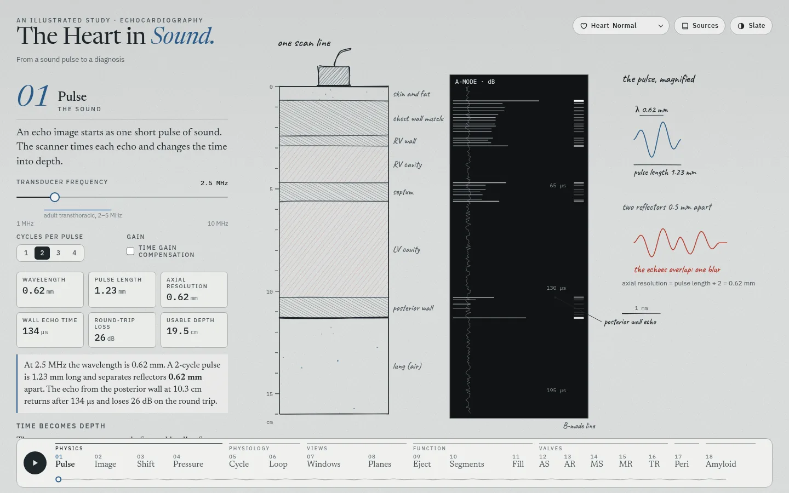 | 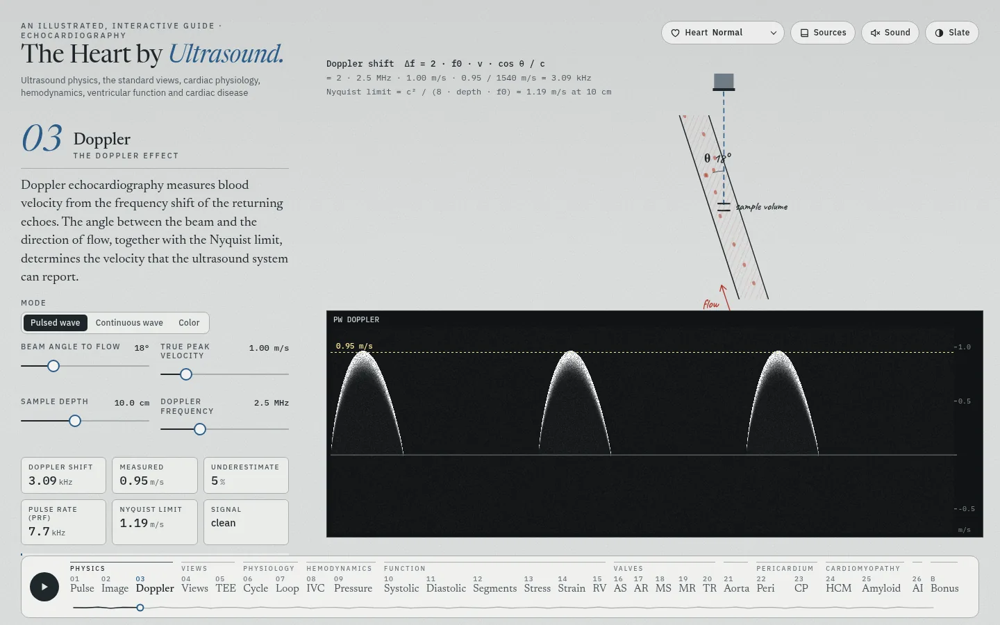 | 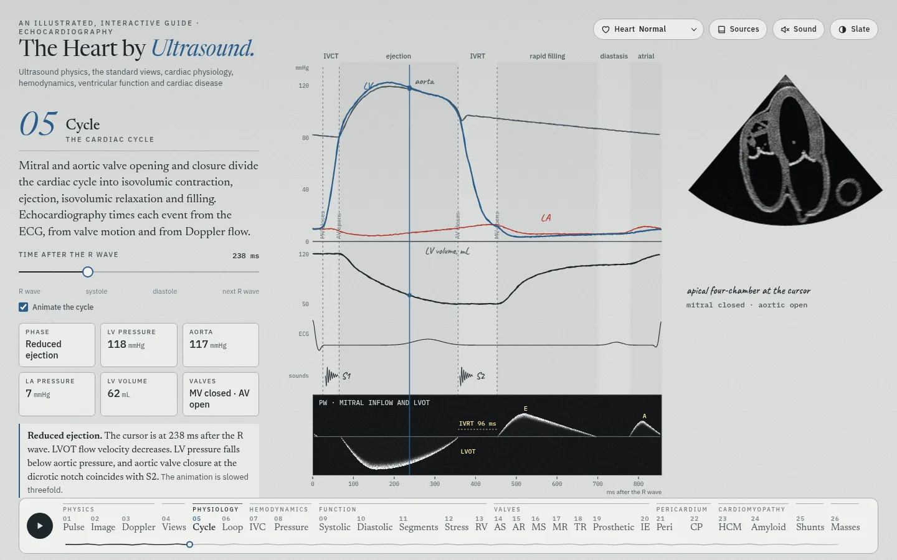 |
| 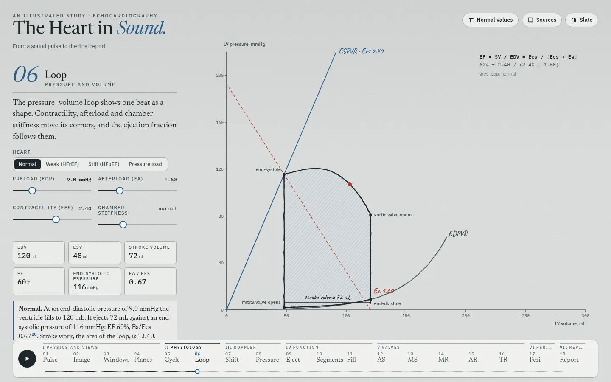 | 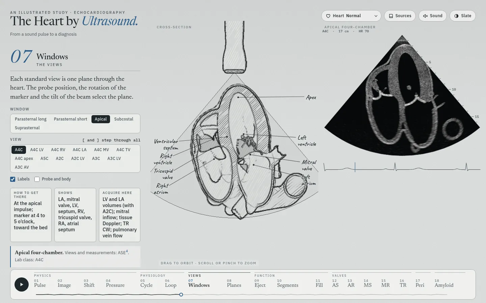 | 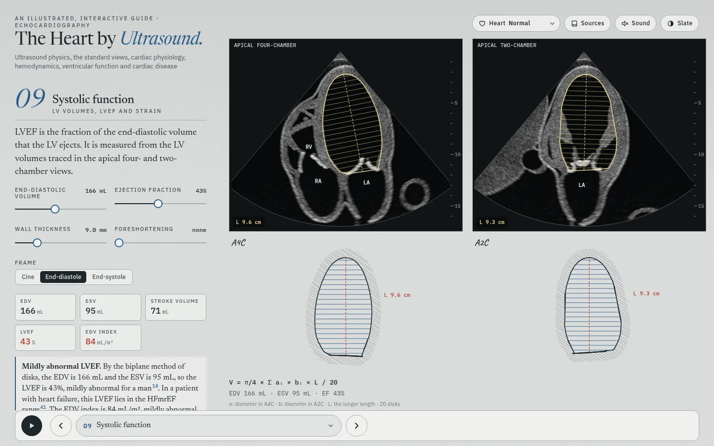 |
| 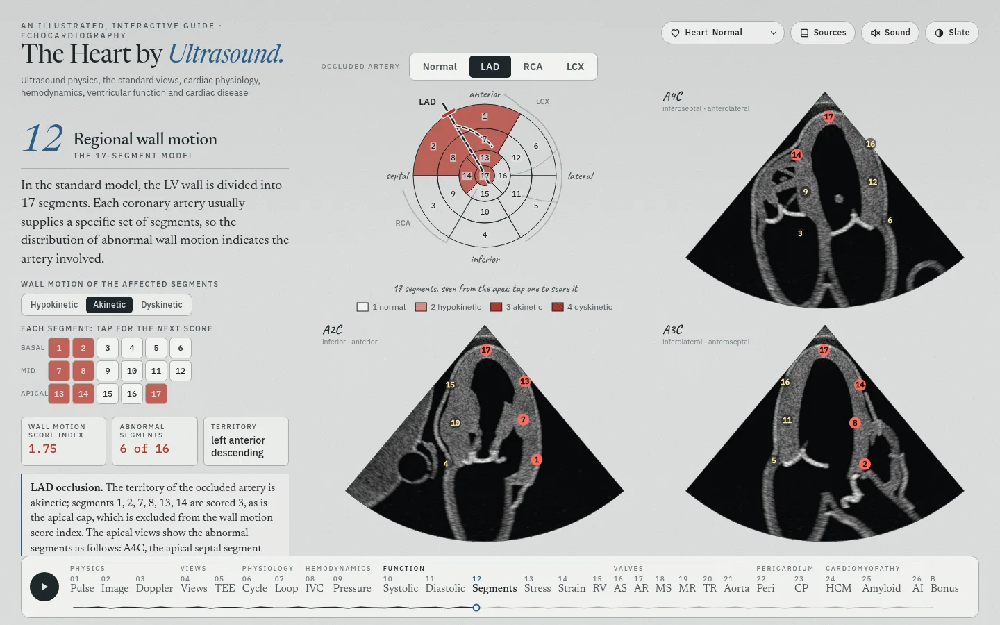 | 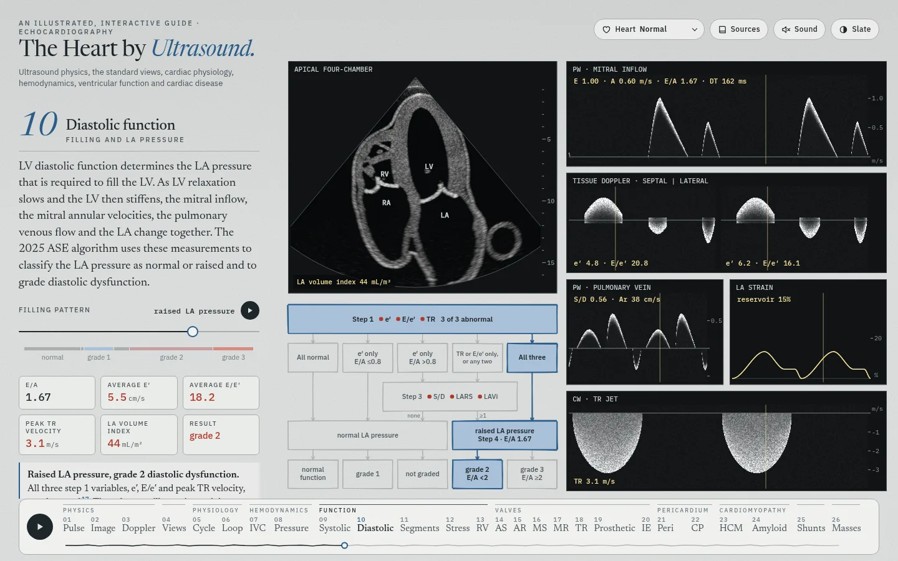 | 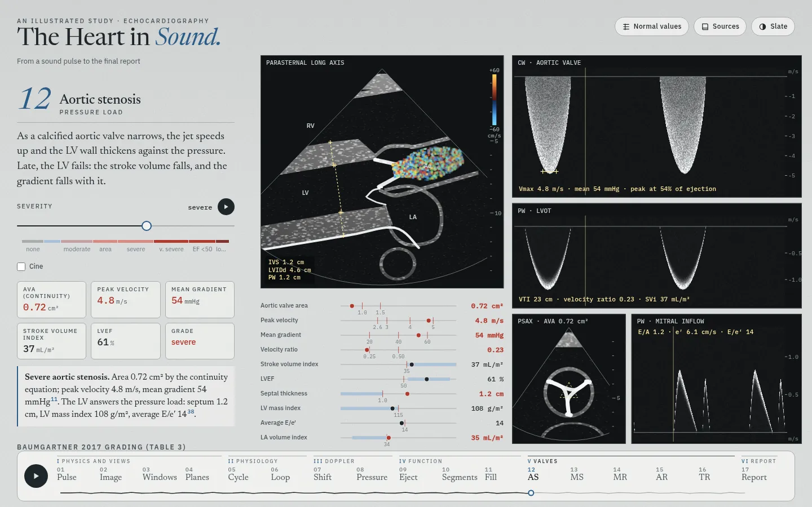 |
| 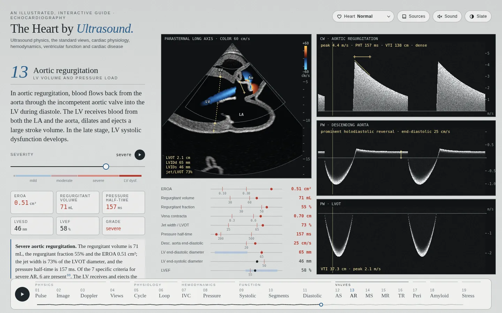 | 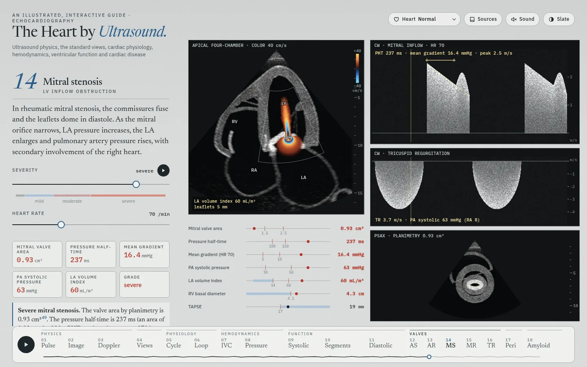 | 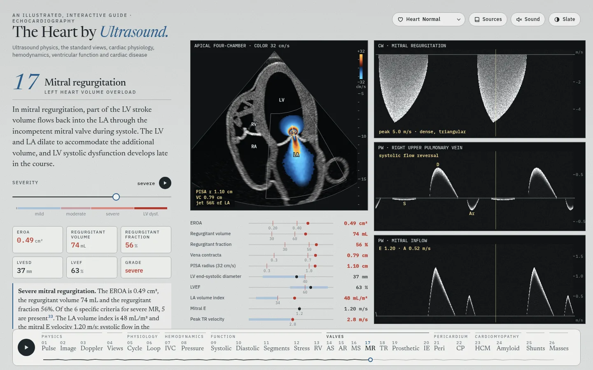 |
| 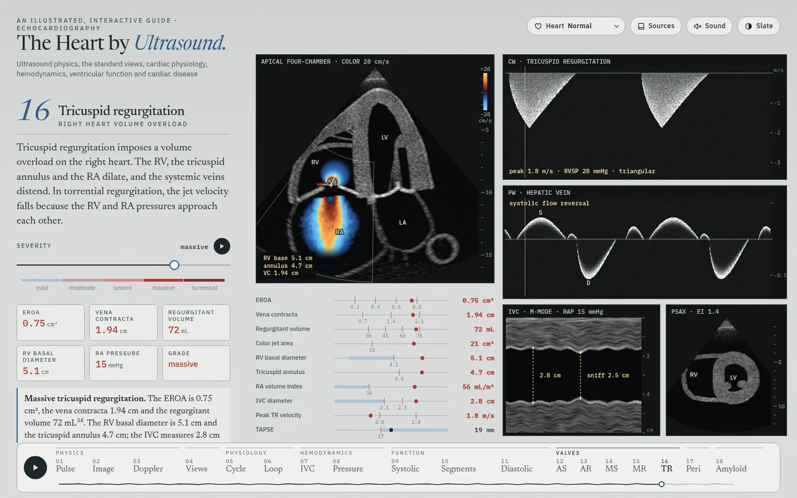 | 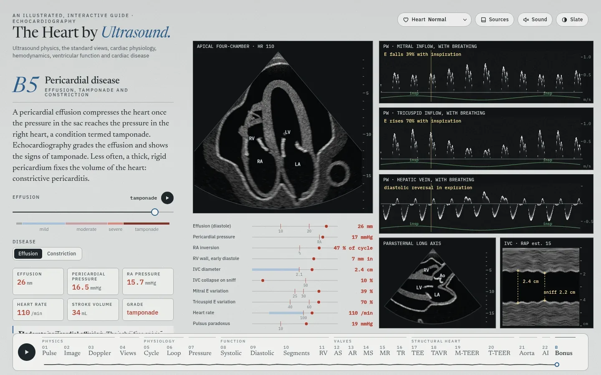 | 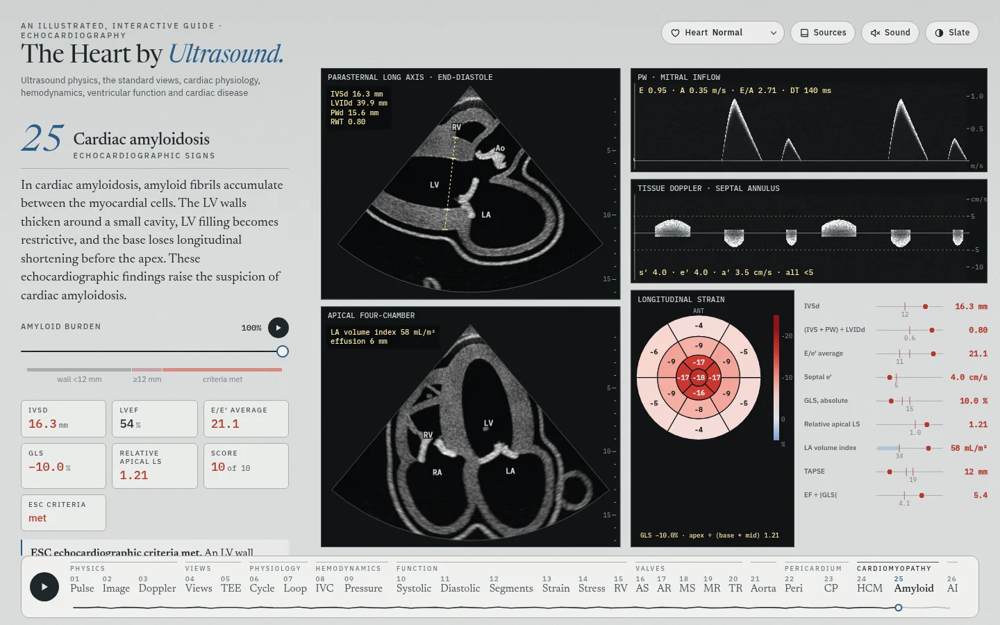 |

On a phone the figure sits above the text and stays in view while the text scrolls:

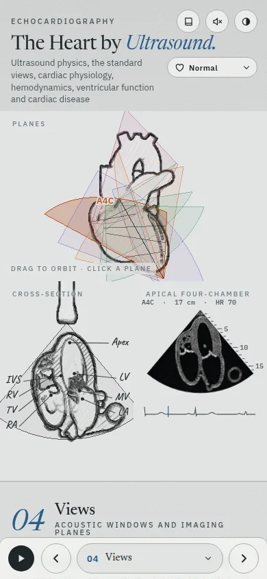 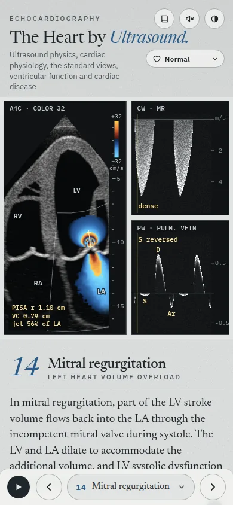

On a phone the bar at the bottom holds the Play button for the tour, back and next buttons, and the current chapter's number and title. A tap on the title opens the list of all chapters, by part. Each of these targets is at least 44 px. A title that needs more than two lines takes its short name, as on the desktop bar (TR at 320 px). Wider screens keep the row of chapter numbers.

## The heart shown

The **Heart** menu in the header sets the heart for the whole page, and the page keeps the choice between visits. A note under the title says what the heart shows.

- **The mesh changes shape.** The 3D heart, and every echo view cut from it (chapters 02, 05, 07 and 09), take the chosen heart. Chapter 17 cuts its views from the model's own normal-to-amyloid shape at the page's burden, whatever heart the menu shows (`setBurden` in `src/echo.js`). Amyloidosis is the model's own amyloid state. The other three are built from the normal mesh the first time they are chosen (`src/gl/phenomesh.js`, a few seconds; the note says so while it runs): each moves the walls, valves and chambers and scales the systolic motion by segment.
  - **Ischemic cardiomyopathy**: a large LAD infarct. The LV dilates to 222 mL with an EF of 25%, the LAD territory is thin and akinetic, the apex bulges a little in systole, the rest is hypokinetic, and the mitral leaflets are pulled toward the apex.
  - **Barlow mitral valve**: thick, redundant leaflets that billow into the LA, a wide annulus, a large LA, and an LV of 183 mL with an EF of 67%.
  - **Bicuspid aortic valve**: the right and left cusps fused along a raphe; the valve domes and opens as a slit. The LV walls thicken to 12.5 mm and the ascending aorta widens to 3.9 cm.
- **The 2D views draw the heart's valves** (`setHeart` in `src/echo2d.js`). Under the bicuspid heart the short axis shows two cusps, a raphe and a slit, and the long axis closes off-centre. Under the Barlow heart the mitral leaflets are 3 mm thick and 30% longer, and in systole they billow up to 1 cm past the annulus. Walls and chamber sizes stay each page's own.
- **Chapters open at the heart's values** (`src/pheno.js`). Loop opens at the heart's loop (a stiff ventricle under amyloidosis, a hypocontractile one under ischemic cardiomyopathy, a pressure load under the bicuspid valve, a volume load under Barlow), also when the heart is chosen on another chapter. Eject opens at the heart's volumes and EF, Segments at the LAD occlusion, Fill at the heart's diastolic grade, and the heart's own valve page at its severity (aortic valve area 0.76 cm²; mitral EROA 0.46 cm²). The pericardium page opens at a 7 mm effusion and the amyloid page at full burden under amyloidosis. The other valve pages open with no lesion, the amyloid page opens normal under the other disease hearts, and no page plays on its own.
- **The Barlow heart's loop** (chapter 06, *Volume load (MR)*, `src/ch/loop.js`): chronic severe primary MR. The EDPVR is flat, so the LV fills to 183 mL at an EDP of 11.5 mmHg; EF 67%, as on the mesh; regurgitant fraction 53%, as on the MR page. The LA is a second outlet: blood goes back whenever LV pressure is above LA pressure, at a flow that goes with the square root of the difference, so the volume falls 4 mL before the aortic valve opens and 10 mL after it closes. LA pressure rises through systole to a v wave of 20 mmHg (LA compliance 8 mL/mmHg, a model value), and the mitral valve opens at it. Stroke volume 123 mL: 58 forward, 65 back into the LA. Ees is 1.70: with V0 fixed at 0, a larger end-systolic volume at a normal pressure gives a lower slope. The leak after aortic closure adds to the EF, so Ees ÷ (Ees + Ea) no longer gives it; the figure's card shows EF = SV ÷ EDV and the forward and regurgitant parts. Sources: Neema and Panidapu 2025 and Klabunde's *Cardiovascular Physiology Concepts*.
- **The report** (hidden) has a case for each heart, with its button next to the four standard cases.
- **Sizes.** The LV volumes come from 50 short-axis slices of each shape. The slices read 6% over the model's own normal volumes (118 and 42 mL against 112 and 39), so each heart's values are scaled by 0.945.
- **Limits.** The severity pages keep their own LV models, so a page can show values that differ from the heart's (the MR page gives an EF of 64% under the Barlow heart, the mesh 67%).

| | | |
| --- | --- | --- |
| 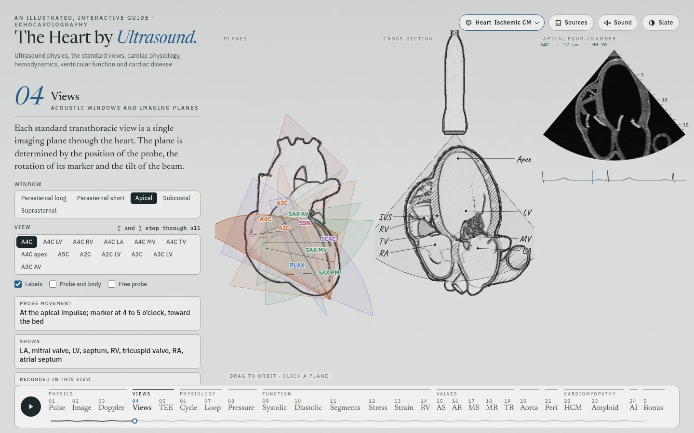 | 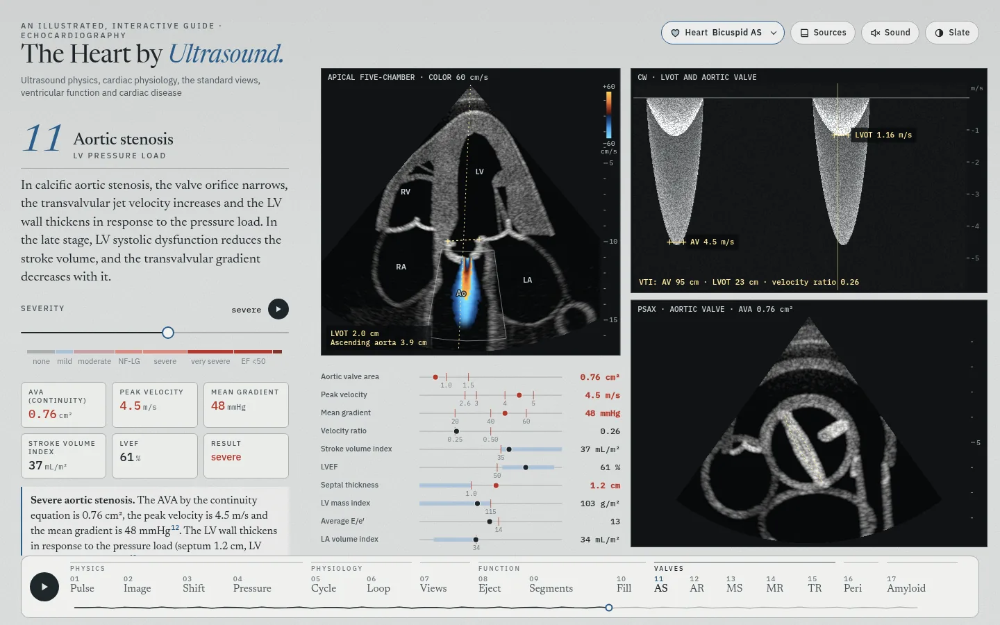 | 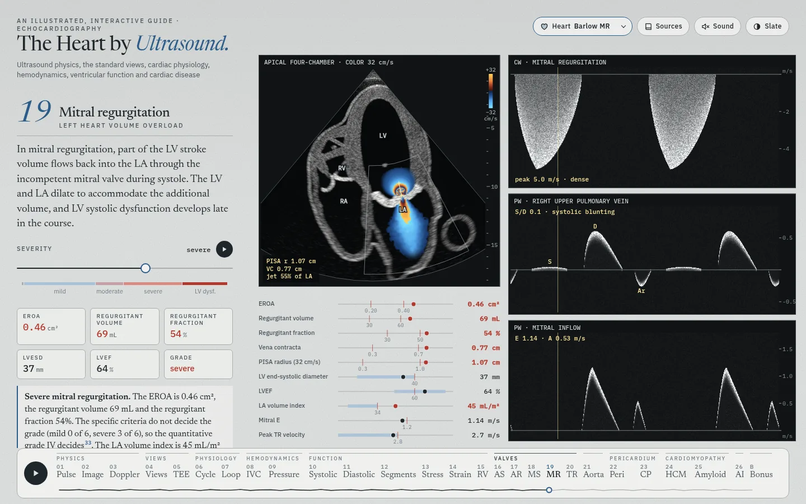 |

## Sound

**Sound** in the header plays music in time with the heart, and cues for what changes on screen (`src/music.js`). Both follow the InVision sound brand: its chords, instruments, echo and room, and its cue notes. All of it is synthesized in the browser (Web Audio), so there is nothing to download. It is off when the page opens; a click turns it on, and another turns it off.

- **One beat per heartbeat.** The tempo is the heart rate the page shows: 70 a minute, and up to 118 at tamponade on the pericardium page. Where the heart on the page beats in real time (chapters 07 and 10 to 17), the kick falls on its first heart sound, mitral closure 25 ms after the R wave. Chapters that slow the beat for study (05 Cycle, 06 Loop, 08 Eject, 09 Segments) and chapters with no heart keep the rate without the lock. So does a page that draws too few frames to keep its heart in real time.
- **The music.** C major, I–V–vi–IV (C, G, Am, F), one chord to a bar of four beats, in the brand's voicings: a pad of five detuned saws, a sine sub on the root in eighths, a soft kick on every beat, off-beat hats, and the brand's plucked arpeggio with a dotted-eighth echo. The pad, the sub and the arpeggio dip on each kick. The brand's films lean on the kick and the sub, which laptop and phone speakers barely play; here the pad and the plucks carry the music over a softer kick and sub.
- **The cues.** A new chapter sounds the brand's rising fourth, G5 then C6. A smaller change sounds one soft bell on a note of the chord that plays: a new view or plane set in chapter 07, any switch or tick box, a new heart from the header menu, and each new grade while a severity page plays. A bell never follows a chapter cue within 0.6 s, nor another bell within 0.25 s.
- **Levels.** About −17.5 LUFS with the cues, the level of the first music. The brand's master stage (a tanh curve) holds every peak under −1.4 dBFS.
- **Sound starts only after a click**, as browsers require: until the button is pressed the page makes no audio context. The sound stops while the tab is hidden.
- **iPhone and iPad.** There, Web Audio plays as ambient sound, which the ring/silent switch mutes; videos play as media, which it does not. So the page asks for media playback: the Audio Session API where Safari has it, and a silent one-second track (`assets/silence.mp3`) that plays on a loop while the sound is on. A call or another app's audio can pause the sound; the next tap on the page brings it back.

## Views and the lab's annotation classes

Chapter 07 covers the ASE comprehensive transthoracic views (Mitchell 2019, Tables 2.1–2.27). Each view carries the class name from the lab's annotation list (`lab` in `src/views.js`), for example `PLAX_IVS_LVPW_LVIDD`, `PSAX_(level_great_vessels)_focus_on_PV_and_PA`, `Subcostal_IVC`, `SSN_aortic_arch`. Six views have no class in that list: the coronary artery origins, the zoomed tricuspid valve, LV apex and aortic valve (apical), the zoomed atrial septum (subcostal) and the suprasternal short axis.

- **The plane moves between views.** A change of view turns the plane along the shortest rotation while the point it images slides across, so neighbouring views are small moves: the tricuspid valve view lies 9° from the aortic valve level and steers onto the valve, and the abdominal aorta is 7° from the IVC plane.
- **The great-vessel short axis (ASE 2019, Table 2, rows 2.7–2.10).** The probe lies in front of the aortic root, a little to its left; the beam runs back, a little to the right and down. At the aortic valve the plane passes 4.5 mm above the valve's centre, through the shut cusps where they meet, and leans 30° from square to the root, toward the patient's right and 20° back. Square to the root, it would pass above this model's left atrium; in the ASE images the left atrium lies directly behind the valve at this level. Leaning, it cuts the atrium 2 mm behind the root (5 mm with the earlier lean of 28°, 10° back) and shows what ASE lists: the RVOT across the front from the tricuspid to the pulmonic valve, the valve in the middle, the right atrium on the left, the left atrium below and the atrial septum between. The sector turns 10° in the plane toward the patient's left and is 86° wide (80° before), so the main PA runs round the aorta down the right of the sector, as in the ASE image, and the tricuspid valve stays at the left edge. The probe sits 1.1 cm lower and to the patient's right, and the beam runs 12° down (19° before). The zoomed valve view is square to the root, so the shut cusps meet in a Y, with the right coronary cusp at the top, the left on the right and the non-coronary cusp at the lower left. One level up (row 2.7), the plane passes 2 cm up the root from the valve's centre and leans 20° from square to it, toward the front and a little to the patient's left. It shows the aorta above its valve in cross-section, the RVOT, the pulmonic valve, the trunk down the right of the sector, the bifurcation, the RPA behind the aorta and the LPA.
- **The LV short axis (ASE 2019, Table 2, rows 2.11–2.13).** The probe lies at the left sternal border, 138° round the LV's axis from its lateral wall toward the front, level with a point a fifth of the way from the LV's equator to the mitral valve. From there the beam tilts 9° up to the mitral valve and 9° down to the papillary muscles, as the probe fans between the levels; the long axis turned 90° clockwise lies 2° from the mitral level. At both levels the RV's cavity lies at about 11 o'clock from the LV's centre, as in the ASE images (before this change, 12 o'clock at the mitral valve and 10:30 at the papillary muscles). The mitral level keeps the LV ring and both leaflets through the beat; before, the plane lay square to the axis at the valve, and in systole the base's descent took it into the left atrium. For the apex the probe slides 5.2 cm toward the apex, to a level 0.4 cm below the end of the RV, so the LV shows alone.
- **The five-chamber view (ASE 2019, Table 2, row 2.17).** It is the four-chamber plane tilted 10° toward the front. The beam aims 85% of the way from the four-chamber target to the aortic valve, so the LVOT, the valve and the aortic root lie in the plane between the right and left atria: the valve 3 mm off the plane, the LVOT 1 mm. Before this change the beam aimed 55% of the way, the plane passed 1 cm from the valve, and the view showed four chambers.
- **The aortic valve model is turned 60°.** As supplied, the valve model faced its commissures, not its sinuses, toward the coronary origins. Turned 60° about its own axis (the model has three-fold symmetry), the right coronary cusp faces the RVOT and each coronary artery leaves its own sinus. The targets that carry the root's own motion (systole, amyloid) are split: an affine fit, which is the root's motion, stays where it is, and only the valve's own change turns.
- **Cross-section, labels, probe and body.** The middle pane shows the 3D heart cut on the view plane and seen square to it, turned as the echo is (probe at the top). **Labels** names the structures in the margin of the model, as in *The Amyloid Heart*; the echo sector carries no labels. A pane under 340 px wide takes the views' short names (RVOT, IVS). The tags are laid out at end-diastole and hold still through the beat; each leader follows its structure. **Probe and body** puts in the left pane, in place of the planes, the whole heart from the front, head up, with the plane and the probe, and a body key in the corner (`src/gl/bodykey.js`): the patient turned as the camera is, drawn in pencil like the heart, the body as an outline. The body has adult male proportions (chest 33 cm across and 26 cm deep). The heart inside is the model's own mesh, in red pencil, and beats with it. It lies about three-quarters left of the midline, with the apex 8.5 cm from the midline. The probe sits on the skin at the view's window, with its sector toward the heart and its cable hanging. The transducer (`src/gl/probe3d.js`) is a phased-array probe drawn to scale: a 2.6 × 1.7 cm head with a lens and an index marker on the screen-right side, 13 cm from the lens to the cable. The probe and the body key go through the same pencil passes as the heart (`tools` and `renderInset` in `src/gl/pencil.js`): graphite outlines and hatching, darker where a part is darker (the lens, the cable).
- **The planes, in the left pane.** The left pane draws the planes of the nine standard views of 08 Planes (archived): the long axis; the short axis at the aortic valve, the mitral valve and the papillary muscles; the apical four-, two- and three-chamber views; the subcostal four-chamber view; and the suprasternal view (`src/gl/fans.js`). The heart is whole and seen from the front, without the pericardium, so the planes show inside it; the subcostal views add the whole liver. Each plane is in the color of its window, and the current view's plane is lit. Ink lines mark where the current plane crosses the others. A view off the nine shows its own plane in ink, with its code. In a pane under 260 px tall (a phone, or a tablet held upright) nine tags would cover the heart, so only the current plane's tag shows. Where a plane runs behind the heart's front surface it is fainter, so it reads as going into the heart. A click or tap on a plane or its tag (not a drag) takes the probe to that view; on hover the plane lights up. The planes carry no probes; the cross-section shows the probe. The left pane is the shared stage's second pane (`Pane3D` in `src/gl/stage3d.js`, from PR #19): it draws the same scene from a camera of its own, and in each frame the chapter sets the scene for it and back again (`prepare` and `restore` in `src/ch/windows.js`).
- **Three panes.** Where the figure's width is more than 0.95 of its height, the planes, the cross-section and the echo sit side by side. In a taller figure the planes go across the top, with the cross-section and the echo side by side under them, and on a phone the figure takes up to 64% of the screen height (560 px at most). The pane names have a halo of paper, because the probe in a narrow cross-section can run under them.
- **The pulmonic valve.** The RV outflow view (row 2.5) runs along the valve's own axis (the principal axis of the valve mesh), turned about it to hold the bifurcation and 3 mm to one side, so it crosses two cusps and the line where they meet: shut, they meet in the middle; open, they lie along the walls of the trunk, which runs in the plane to the bifurcation. Turned this way, the probe moves 3.0 cm toward the long-axis probe: it sits 4.1 cm from it (5.5 cm before). The model's left main runs through a gap in the mesh beside the valve, so the RV outflow view leaves the coronary arteries out, and any coronary section that lies inside a blood pool, clear of the walls, is dropped in every view.
- **The pulmonary artery, re-shaped as the model loads** (`src/gl/pabend.js`). The model's trunk rose 48° from its valve to the bifurcation, 30° out of the plane square to the aortic root, so the short axis at the aortic valve cut it as a stub. In a heart the trunk runs back round the left side of the aorta near that plane; the RPA runs behind the aorta and the LPA back and to the left over the left bronchus. The trunk now bends along its own axis between 0.5 and 2.8 cm above the valve, to 15° above the horizontal and 19° to the patient's left of straight back; past the bend it moves as one piece with the bifurcation. The LPA rises 19° over its first 2 cm, then turns down 25° over the bronchus. The RPA climbs 30° from the lowered bifurcation, then levels off under the arch: in the suprasternal view it lies 0.7 cm lower than before, 8 mm under the arch (4 mm before). The RV muscle round the trunk's root, and the pericardium and coronary arteries near the PA, follow the nearest PA point, each by the share of the gap it lies across, so what lies between the PA and a fixed wall is squeezed, not crossed. Each morph target's displacement and each normal turns with its point. Before the bend, two holes in the PA's wall close: a 2 cm opening at the tip of a short cone in the roof of the bifurcation, and a 6 mm gap in the inner surface beside it. A plane through the lip of either hole joined the wall's two outlines into one, and the echo then drew a coronary artery as a ring inside the PA. Inside the aortic valve level's sector the PA wall now draws 22.9 cm of outline (5.6 cm before); one level up, 46.9 cm (30.6 cm).
- **The left pulmonary veins and the papillary muscles, re-seated as the model loads** (`seatLeftVeins` and `holdPapillary` in `src/gl/rvdetail.js`). Two parts of the model ran out of the heart in the four-chamber view. The left pulmonary veins leave the left atrium's lateral wall beside the mitral annulus, and the lower one lay in the four-chamber plane, so the view showed a tube leaving the LV's base. Each left vein now turns over its first centimetre, the upper one up, left and back, the lower one back, left and a little down, in front of the descending aorta and out of both the four-chamber and the long-axis planes. Where their shared mouth still crosses the four-chamber plane, it is pressed into the line of the atrial wall. The veins' displacements in systole and in the amyloid heart do not turn with them, so each vein point moves as the atrium it leaves moves. An RV papillary muscle ran out through the RV free wall. Every papillary point now stays at least 1.2 mm inside the heart's outer surface: the 15 points that lay outside it move in, by up to 4.2 mm, and 20 that lay less than 1.2 mm inside it move by up to 1.0 mm. The outer surface is the myocardium within 6 mm of the pericardium whose normal runs with the pericardium's (dot product above 0.3).
- **RV trabeculations, added as the model loads** (`trabeculate` in `src/gl/rvdetail.js`). The model's RV was smooth inside. It now has the moderator band, from the septum to the free wall at the anterior papillary muscle's base, 36% of the way from the RV apex to the tricuspid valve: 2.9 cm long, 5.4 mm across at the septum, 4.0 mm in the middle and 4.8 mm at the free wall, bowed 1.5 mm toward the apex. Seven thin trabeculae, 1.8 to 2.2 mm across and 1.0 to 2.4 cm long, cross the apical third, some in the four-chamber plane and some up to 9 mm to either side of it. The free wall's endocardium carries coarse ridges up to 2 mm high over the apical quarter, fading out by the RV's middle. They run in two crossing families 1.25 and 1.55 cm apart, and their height and course vary along the wall, so a plane that grazes the wall cuts an uneven row of ridges, not a comb. Each band runs between the points where a ray from the middle of the cavity meets the two walls, its ends 1.2 mm into the muscle. It moves with the walls it joins: its systolic and amyloid displacements blend from those of the wall at each end. The four-chamber, RV-focused and subcostal views show the band and the trabeculae.
- **Below the diaphragm.** The heart model ends at the diaphragm. For the subcostal views, `src/abdomen.js` adds simple shapes to the echo: a liver moulded to the underside of the heart, the IVC down through it, two hepatic veins, the abdominal aorta with the celiac trunk and the superior mesenteric artery, and the spine. The subcostal four-chamber plane in this model passes above the liver, so that view keeps a liver layer in the near field. The parasternal views leave out the liver and its hepatic veins: this model's liver reaches into their far field, where ASE's parasternal images show none. The aorta and the IVC stay.
- **The liver in 3D, in the subcostal views only** (`src/gl/liver3d.js`). In the IVC and aorta views the cross-section shows the liver the echo cuts, cut on the same plane, with a *Liver* tag. Its cut face is hatched more sparsely than the heart's, and the other way. In the four-chamber view it shows the echo's near-field layer: a lobe in the plane from 1.5 cm under the skin to the diaphragm at 5 cm. The lobe is flat across the sector, thicker toward the right lobe and thin at the apex side. With *Probe and body* the whole liver shows under the heart in every subcostal view. The liver fades in as the plane moves into the subcostal window and out as it leaves, over the time the plane takes to move (0.4 to 1.3 s); from the four-chamber view to the IVC view the layer fades out as the liver fades in. The pencil renderer draws it as a second layer: its own normal, depth and data passes, laid over the heart where it is nearer, at the alpha it fades by. Four-chamber planes from below the xiphoid were tried and left out: the ones that cross the model's liver lie 15° to 30° from the four-chamber plane. Their cut no longer reads as four chambers, and the liver fills only one side of the near field. The model's IVC, hepatic veins and abdominal aorta stay in the echo only.


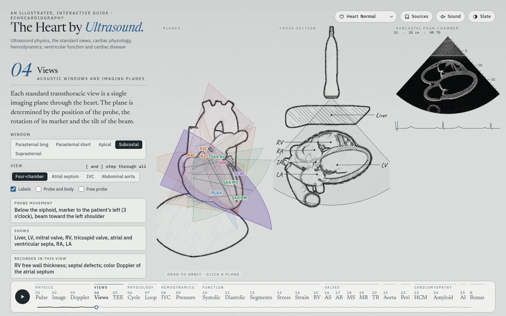


**The planes together.** The apical views share the LV long axis; the model places the two-chamber plane about 60° from the four- and three-chamber planes, as the ASE rotation describes. The mitral and papillary muscle levels fan from one probe spot, 9° up and 9° down; the aortic valve level lies above them.

## The severity pages (chapters 10 to 17)

- **One slider per disease.** It runs from normal to the end stage. The bands under it show where the grade changes; the page computes them from its own model, so a band starts where the values cross the guideline cut-off.
- **Play** moves the slider through the whole course and starts again. It starts when the page opens; any control stops it. The beat runs all the time; there is no cine switch.
- **Several views change together.** A 2D view drawn to scale (a caliper on the screen reads the value in the text), three or four Doppler strips with a cursor at the same moment of the beat, a strip of measurements against their cut-offs, and the guideline table with the current column marked.
- **Grades and stages.** Regurgitation follows ASE 2017 (Zoghbi), with EACVI 2022 for massive and torrential TR; aortic stenosis follows Baumgartner 2017; mitral stenosis follows ASE 2023 (Pandian); diastolic function follows ASE 2025 (Nagueh). The LV and atrial consequences follow the ACC/AHA 2020 stages (Otto), for example stage C2 in MR at LVEF ≤60% or end-systolic diameter ≥40 mm. Effusion size follows ESC 2015 and 2025 (<10, 10–20, >20 mm at end-diastole); the echo signs of tamponade follow ASE 2013 (Klein) and ESC 2025 (Schulz-Menger). The amyloid bands follow the ESC 2021 echo criteria (Garcia-Pavia): an unexplained wall of 12 mm or more, plus two of three findings (grade 2 or worse diastolic dysfunction; septal s′, e′ and a′ all below 5 cm/s; GLS below 15% in absolute value) or a multiparametric score of 8 or more (Boldrini 2020).
- **What the model is.** The orifice or valve area drives the numbers (PISA, continuity equation, pressure half-time = 220 ÷ area); the chamber sizes, vein flows and pressures follow illustrative tracks set inside the guideline bands. In the pericardium page the effusion drives the pressure in the sac; tamponade starts where that pressure reaches the RA pressure, and the right heart then folds in during its relaxation. In the amyloid page the burden blends the heart mesh from its normal to its amyloid corner: the walls, cavity, atria, valves, atrial septum, RV wall and pericardial space come from the mesh (the calipers measure IVSd 9.0 to 16.8 mm, LVIDd 46.8 to 39.8 mm and PWd 8.9 to 15.0 mm), and the Doppler, strain and filling values follow a track from normal to grade 3 filling set inside the cited ranges. They are teaching values, not patient data.

## The echo images

Every echo image is simulated. The anatomy comes from sections of the heart mesh (chapters 02, 05, 07, 09 and 17) or from parametric views drawn to scale (chapters 08 and 10 to 16). One renderer, `src/bmode.js`, turns either into a scanner frame:

- **Echogenicity.** Each structure has a level in dB against myocardium: blood about −60, leaflets +15 (to +21 when thickened), chordae +4, pericardium +16, calcium +22 with an acoustic shadow behind it; the coronary arteries sit in bright epicardial fat.
- **Specular surfaces.** A surface is brightest where the beam meets it head-on (cos⁴ of the angle). Walls that run along the beam, such as the atrial septum in the four-chamber view, stay faint.
- **Speckle.** Random scatterers ride with each structure from end-diastole, and the beam blur comes after, each frame. The speckle moves with the wall, and the grain keeps its size while the wall shortens and thickens.
- **Beam blur.** 0.6 mm along the beam (two cycles at 3.4 MHz). Across it, 0.8 mm near the probe, then 1.3 mm at 10 cm: a 2.5 cm aperture in harmonic imaging, the 1.7 MHz transmit beam squared times the 3.4 MHz receive beam.
- **Structures into the image.** A small rasterizer fills each structure into the beam grid with its exact coverage, so a leaflet or a chord thinner than a sample keeps part of its strength instead of dropping out.
- **Near field and noise.** Chest-wall layers, reverberation clutter over the first 2 cm below them, and electronic noise that rises with depth and changes each frame while the cine runs.
- **Display.** Light speckle reduction (a fifth of each sample is the local mean; two fifths in a zoomed view), time-gain with a small loss left at depth, darker sector edges, log compression over 56 dB, then scan conversion at the screen's own pixel density. The views draw about 30 frames a second.
- **Valves in the parametric views.** Each leaflet keeps its length and swings about its hinge; closed, the leaflets meet in a zone of contact up to 8 mm long and stay on the ventricular side of the annulus, which narrows about 15% in systole. Rheumatic stenosis holds the tips, so the anterior leaflet domes and the short posterior leaflet cannot move. Regurgitation leaves a gap at closure; the aortic cusps open along the sinus walls, or dome when stiff. Chordae run from the papillary muscles to the leaflets and fade when slack in diastole.
- **Anatomy in the parametric views.** Papillary muscles and chordae; in the RV, the moderator band, three thin trabeculae across the apex beyond it, coarse trabeculae up to 2.4 mm deep on the free wall's apical half and up to 1.2 mm on the septum's apical third (four-chamber view), and up to 1.5 mm on the free wall in the short axis at the papillary muscles; pulmonary vein openings, the pericardium, the coronary sinus and the descending aorta. The walls stay at the model's values on the measuring line, so the calipers read what the page reports.
- **Pericardium.** In the four-chamber view the sac follows the convex envelope of the ventricles' outer walls, 1.3 mm out: it wraps the apex and bridges the interventricular groove, which epicardial fat fills; an RV wall that collapses in tamponade pulls away from it. In the long axis it runs behind the posterior wall, round the coronary sinus in the atrioventricular groove and behind the LA, in front of the descending aorta, at least 1.3 mm from each. In the views cut from the mesh, any point of the pericardium that falls inside a wall moves out to the wall's surface, and any point that falls in a blood pool more than 1.2 mm from every wall is dropped, as a coronary ring is.
- **Effusion.** Fluid widens the pericardial space most over the free walls and the apex and least at the atrioventricular grooves; grey lung and mediastinum lie outside the sac, so the fluid shows as a dark band. In the parasternal long axis the fluid thins out at the atrioventricular groove in front of the descending aorta. A swinging heart rocks about the middle of the atrioventricular plane inside a sac that stays put: the apex travels farthest, and the grooves, where the fluid is thinnest, hardly move sideways.
- **Regional wall motion.** In chapter 09 each vertex of the LV wall belongs to one of the 17 segments, placed from the LV long axis and the apical planes. Its systolic motion scales by the segment's score: normal 100%, hypokinetic 45%, akinetic 0 and dyskinetic −35% (outward). The pericardium over a segment moves with it.
- **Biplane tracing (chapter 08).** The four- and two-chamber views trace the border of the compacted myocardium, close it with a straight line across the mitral annulus and take L from the middle of that line to the farthest point of the border (Lang 2015). The disk drawing under each view is the same LV, with one width profile (`lvWidth` in `src/echo2d.js`). Its cross-section is an ellipse, 0.94 as wide in the two-chamber view as in the four-chamber view, with the area of the circle in the model's volume. At 120 mL and an EF of 60%, the model LV shortens 15% along its axis and 33% across it, the annulus narrows 12%, and the wall thickens so that the muscle keeps its volume.
- **Color Doppler jets.** Each jet comes from a model of its flow (`jet()` in `src/echo2d.js`). Upstream of the orifice the flow converges on a hemisphere, its velocity falling as flow ÷ 2πr². Downstream the jet widens to a flame, fastest in its core.
- **Color scale.** The MR, TR and MS views show the convergence and the jet at one scale, the aliasing velocity for PISA: 30, 28 and 40 cm/s. AR and AS show at 60 cm/s. The image shows the jets only; the rest stays grey.
- **One look for every jet.** Each jet is drawn as the torrential TR jet looks: laminar, with no variance mosaic, its core aliasing once. For that the velocity drawn is at most 3.2 times the aliasing velocity, and a jet across the beam is drawn as if at 40° to it. The CW panels carry the true velocities.
- **The scanner format, kept.** `JETS` in `src/jets.js` switches the valve pages to the image a scanner makes from all the flow (`src/cflow.js`). That format has the pulse-pair estimate on beam lines 0.8° apart, a wall filter and normal flow through the beat. Its jets show at 60 cm/s, and the MR and TR pages get a Jet/PISA switch.

*The Amyloid Heart* got its realistic views from the sculpted mesh; it drew them with flat textures and white outlines. This site keeps the mesh and adds the image formation above.

## Sources and data

- Guideline values come from ASE, EACVI, BSE, ACC/AHA, ESC and ESC/ERS documents; the main ones are Lang 2015 (chamber quantification), Mitchell 2019 (comprehensive TTE), Zoghbi 2017 (regurgitation), Baumgartner 2017 (aortic stenosis), Otto 2020 (valve disease), Pandian 2023 (rheumatic mitral stenosis), Nagueh 2025 (diastolic function), Mukherjee 2025 (right heart), Thomas 2025 (strain), Klein 2013, Adler 2015 and Schulz-Menger 2025 (pericardium), Garcia-Pavia 2021 and Moody 2023 (cardiac amyloidosis) and Taub 2025 (reporting). The full list, with DOI and PubMed links, opens from **Sources** on the page (`src/refs.js`).
- Each reference was checked against PubMed and Crossref before use. Where sources disagree, the page follows the current guideline.
- The figures run simple models set to agree with these sources. The diastolic values and the Doppler and strain values of the amyloid page are illustrative, not patient data. All images are simulated; there are no patient images.
- Normal values for the **Normal values** dialog (it opens from the report chapter) and the grading helpers live in one place: `src/norms.js`.

## The text

The text reads as a clinical echocardiography text or a guideline: statements of fact in the third person, with the side, chamber, valve, phase, view, method and unit named. It has no taglines, no figurative verbs and no second person, and it addresses no group of readers. A recommendation uses "should", as a guideline does. Each live caption begins with a bold lead that names the state shown (for example, *Severe aortic stenosis with LV dysfunction*); the chapter videos and the intro take their step names from these leads. The rewrite to this register kept every number, unit, grade term and citation of the text before it, and a script compared them chapter by chapter. Five values were then corrected against their sources; the checks below list them.

## How it is built

A static site with no build step: ES modules, a canvas sketch layer (`src/sketch.js`, rough.js) and a WebGL pencil renderer for the 3D heart (three.js). Echo views are live cross-sections of the heart mesh (`src/echo.js`) or parametric views (`src/echo2d.js`), imaged by `src/bmode.js`. The heart mesh, pencil renderer and 3D stage are adapted from *The Amyloid Heart*. Vendored libraries and their licenses are in `vendor/`.

```
index.html          page, chapter text, dialogs
src/main.js         chapter engine: controls, readouts, citations, tour, keyboard
src/ch/*.js         one module per chapter
src/sev.js          severity pages: keyframe tracks, grade bands, Play, measurement strip
src/bmode.js        B-mode and M-mode image formation for every echo view
src/abdomen.js      liver, IVC, hepatic veins, abdominal aorta and spine for the subcostal echo views
src/gl/liver3d.js   the liver in the 3D views of the subcostal window, a pencil layer that fades
src/echo2d.js       parametric echo views drawn to scale (A4C, A2C, PLAX, three short-axis levels, IVC M-mode), the biplane tracing, the color jets and the flow in each color view
src/jets.js         the color Doppler format: jets from their model (plume), or the scanner format below
src/cflow.js        the scanner format (kept, off): flow elements, pulse-pair estimate, wall filter, tissue priority
src/views.js        view catalog: planes, lab classes, structures, probe moves
src/gl/stage3d.js   the 3D stage: camera presets, trackball, labels, a second pane (Pane3D)
src/gl/fans.js      the imaging-plane fans (the planes of chapter 07, and the views video)
src/echo.js         plane geometry, plane changes, cross-sections and the echo views cut from the heart mesh
src/cyclemodel.js   one heartbeat (pressures, volume, valve events)
src/music.js        the sound: music in time with the heart on the page, and cues (Web Audio)
src/gl/pabend.js    the pulmonary artery, re-shaped as the model loads
src/gl/rvdetail.js  the left pulmonary veins, the papillary muscles and the RV's trabeculations, as the model loads
src/norms.js        normal values and cut-offs
src/refs.js         references
assets/             heart mesh (JSON), anatomy landmarks, poster image, favicon (SVG; PNGs for Safari and the iPhone home screen)
video/              the views video, the chapter videos and the intro: pages, cuts, chapter steps, intro clips, timing, fonts
tools/              video tools: render, storyboard
tools/score/        the video soundtracks: Bright pulse (pulse.py) on the InVision sound engine (synth.py); the first brand scores (score.py), kept (Python)
```

## Run it

Serve the folder with any static server, for example:

```
python3 -m http.server 8000
```

Then open <http://localhost:8000/>. A chapter can be opened directly: `#windows`, `#fill`, `#amyloid`.

Keys: ← → change chapter, space plays the tour, [ and ] step the views in chapter 07. They run through every view of every window: after a window's last view comes the next window's first. A chapter opens directly by its key, for example `#as`, `#mr`, `#tr`, `#peri`, `#amyloid`.

## The views video

`video/index.html` plays the standard views of chapter 07 as a video, drawn by the site's own code. Three panes show the probe on the body and on the heart, the cross-section, and the echo image. The plane moves smoothly from view to view in all three. A caption names each view, the probe position and the structures it shows. The zoomed and depth-focused views are left out.

Cut B also draws the planes of the nine standard views in its Probe and body pane, as chapter 07 did in PR #20 (the site now draws them in a pane of their own; the video was not rendered again): each in its window color, the current plane in ink with the lines where it crosses the others, and the view at either end of a move lit as the plane leaves the one and reaches the other. The camera frames each view as before, and the pencil probe and the body key stay. Cut P, the three-pane video of PR #19, is archived: its definition stays in `video/cuts.js`, and it is not part of the set.

- The heart beats at 70 per minute. The soundtrack is *Bright pulse* (`tools/score/pulse.py`), the style chosen from a review of fourteen. A soft synth pluck plays a sixteenth-note arpeggio with a dotted-eighth echo over a pad, one chord to a bar (C, Am, F, G); a sub bass joins from the second window, and the pluck and the pad brighten window by window. There are no drums, no heartbeat and no cues during the tour, and the beat is not locked to the heart. The tempo is near 109 BPM, set per cut so that the end card falls on a bar line after whole phrases of four bars: A 110.6, B 104.5, C 109.3 and D 107.4 BPM. The end card has a rolled C chord, the pad on Cmaj9 and the brand's logo shimmer (G5, B5, E6), soft. The score uses the brand's engine (`tools/score/synth.py`) with its room and echo, and sets each part by its K-weighted level while it plays. −15 LUFS with linear gain, true peak under −2.5 dBTP. Each cut has a fixed seed, so its mix rebuilds bit for bit. The brand score with a kick locked to the heart and a cue on each view (`tools/score/score.py`), and the first soundtrack (`tools/make-audio.mjs`), are kept but not used.
- Between windows the probe travels round the heart, over the front of the chest, with its beam on the heart. Inside a window the plane moves as the site moves it.
- The cross-section's tags are laid out at end-diastole and hold still while a view holds; each leader follows its structure through the beat.
- On the heart and the body key the probe is drawn in the page's accent blue (`Pencil.setToolInk`), so its place stands apart from the graphite heart. In the cross-section it is graphite, drawn as the heart is. The site keeps it in graphite.
- In the subcostal views both drawing panes show the liver as the site does, faded in and out across each move by the plane's progress (`liverAt` in `video/app.js`).
- The two drawing panes are graphite on paper in every cut, as the site draws them in its light theme; on a dark frame the echo stays on black (`?diagrams=theme` draws them in the cut's own palette). The cross-section carries no sector, since the echo pane shows it. In cut B the Probe and body pane draws the current plane among the nine planes; in cuts A, C and D it has no sector. The body key keeps its small sector to show the beam's direction.

| Cut | Format | Frame | Views | Length |
|---|---|---|---|---|
| A, Full tour | 1920 × 1080 | dark | 20 | 2:24 |
| B, Core views, with the nine planes | 1920 × 1080 | light | 12 | 1:09 |
| C, Quick cut | 1920 × 1080 | dark | 10 | 0:38 |
| D, Vertical | 1080 × 1920 | dark | 12 | 1:06 |
| P, Views and planes (archived) | 1920 × 1080 | dark | 12 | 1:20 |

Cuts A, C and D are as rendered on October 1, 2026. Cut B is rendered again with the nine planes; it is the video of chapter 07 in the series.

To render a cut (Node 22, Playwright with Chromium, ffmpeg), serve the repository root on port 8790, then:

```
python3 tools/score/pulse.py A video/out/echo-views-A.wav   # Python 3 with numpy and scipy
node tools/render-video.mjs --cut=A --jobs=3 --audio=video/out/echo-views-A.wav
node tools/storyboard.mjs --cut=A --moves          # one frame of each view on one sheet
```

The videos go to `video/out/`, which git ignores. Each frame depends on its time alone, so parallel jobs join without a seam. Each job logs its progress every 30 frames. The cuts, their timing and the captions are in `video/cuts.js` and `video/timeline.js`.

## The chapter videos

`video/chapter.html?ch=as` plays one chapter as a video, in the frame of the views video's dark cuts. Every chapter has one except 07, whose video is cut B of the views video above. The chapter's figure is the site's own (`src/ch/*.js`), on paper and drawn 1.3 times larger than its layout. It steps through the chapter's states on the heartbeat (`video/chapters.js`): the steps follow the chapter's tour (the Play button), slowed, with a hold on each step. Numbers ease from one step to the next; the severity pages move their slider from the middle of one grade band to the middle of the next.

- The caption names each step. By default its name and line are the chapter's live sentence at that step, with its numbers; a step can name its own sentences or quote a readout. The progress line names the steps. Where the figure has no measurement strip of its own, a pane beside it lists the chapter's readouts as they change.
- The page runs on a clock of its own (`video/chapter.html`): `performance.now()` reads the time of the frame being drawn, and the chapter's motion (its `anim()`) runs in steps of 1/30 s from the start. A frame therefore depends on the frames before it: a chapter video renders in order in one job, and `--jobs` renders that many chapters at once.
- The soundtrack is *Bright pulse* (`tools/score/pulse.py`), as on the views video: the chapter's steps are its windows, so the bass joins at the second step and the pluck and the pad brighten step by step. Seed 93 and the chapter's number from the time 08 Planes was in the list, so the scores rebuild as they were. The last hold takes up to six more beats (two at most in these videos), so that the end card falls on a bar line after whole four-bar phrases near 109 BPM.
- Title card: the chapter's number, part and title, and the first sentence of its summary. End card as on the views video.

| Chapter | Steps | Length |
|---|---|---|
| 01 Pulse | Transmit frequency 2, 3.5, 5 and 7 MHz; time gain compensation | 0:48 |
| 02 Image | Imaging depth 16 and 24 cm; reverberation, acoustic shadow, mirror image, side-lobe artifact | 0:49 |
| 03 Shift | Beam at 0° and 60° to the flow; aliasing above the Nyquist limit; continuous-wave Doppler; color Doppler, then aliasing on color Doppler | 0:49 |
| 04 Pressure | Stroke volume; an LVOT diameter error of 2 mm; RV systolic pressure at a peak TR velocity of 2.4, 3.0 and 3.5 m/s | 0:48 |
| 05 Cycle | The seven phases of the cardiac cycle, the cursor running through each | 0:50 |
| 06 Loop | Normal, HFrEF, HFpEF, pressure load, volume load | 0:48 |
| 07 Views | Cut B of the views video: the 12 core views, with the nine planes in Probe and body | 1:09 |
| 08 Eject | Normal LV systolic function; dilated LV with an LVEF of 30%; foreshortened apical views; normal RV systolic function; RV systolic dysfunction | 0:48 |
| 09 Segments | Normal wall motion; LAD, RCA and circumflex occlusion | 0:48 |
| 10 Fill | Normal diastolic function; grades 1, 2 and 3 | 0:48 |
| 11 Aortic stenosis | The eight grade bands, none to severe with low flow | 0:57 |
| 12 Aortic regurgitation | None to severe with LV dysfunction | 0:48 |
| 13 Mitral stenosis | None to severe; severe at a heart rate of 110/min | 0:48 |
| 14 Mitral regurgitation | None to severe with LV dysfunction | 0:48 |
| 15 Tricuspid regurgitation | None to torrential | 0:48 |
| 16 Pericardium | No pericardial effusion to tamponade | 0:48 |
| 17 Cardiac amyloidosis | A normal wall to relative apical sparing | 0:48 |

```
python3 tools/score/pulse.py as video/out/chapter-as.wav
node tools/render-video.mjs --ch=as --audio=video/out/chapter-as.wav
node tools/render-video.mjs --ch=all --jobs=3 --audio=auto     # every chapter video, three at a time
node tools/storyboard.mjs --ch=as                              # one frame of each step on one sheet
```

## The intro

`video/out/intro.mp4` introduces the series in 71 seconds: a title card, one clip from each of eight chapters, and the end card. A review of the chapter videos and the views video picked the clips. Each clip is the most striking and most useful moment of its part of the site. No two clips teach the same lesson or show the same layout. Chapter 08 Planes is archived since the review: the clip of 07 takes the time of both clips, with the nine planes of 08 in its Probe and body pane.

| Start (s) | Chapter | Clip |
|---|---|---|
| 0.0 | | Title card: the site's name and the start of its description |
| 4.6 | 02 Image | The sweep acquires a frame scan line by scan line |
| 9.1 | 05 Cycle | The cursor runs through one cardiac cycle, and the four-chamber view follows it |
| 16.0 | 07 Views | The probe turns 90° at the left sternal border, from the long axis to the short axis, tilts to the mitral valve level, then crosses the chest to the apex; the nine planes show in Probe and body |
| 29.7 | 09 Segments | Normal wall motion, then an LAD occlusion |
| 36.6 | 11 Aortic stenosis | No stenosis, then severe |
| 43.4 | 14 Mitral regurgitation | No regurgitation, then severe with LV dysfunction |
| 50.3 | 16 Pericardium | No pericardial effusion, then tamponade |
| 57.1 | 17 Cardiac amyloidosis | A normal wall, then relative apical sparing |
| 64.0 | | End card |

Left out, with the reason:
- 01, 03, 04: diagrams. The valve clips show Doppler in use.
- 06: the cycle clip and the valve clips show its loads.
- 08, 10: dense panels. LV function shows in the segments and amyloid clips.
- 12, 13, 15: the layout of 11 and 14.

How it is built:
- `video/reel.js` holds the clips. A chapter clip is a chapter video script with its holds and moves in bars. The clip of 07 is a cut of the views video with the nine planes in Probe and body, as in cut B.
- Each clip renders on its own page: `video/chapter.html?reel=k`, or `video/index.html?reel=k` for 07. The page draws the progress line of the intro, which names the eight chapters and runs on the time of the whole.
- The score is *Bright pulse* at 105 BPM (`tools/score/pulse.py intro`, seed 9300). A bar is 8/3 heartbeats, so a clip of 3 bars is 8 heartbeats. Each cut falls on a bar line.
- The clips are the windows of the score. The bass starts at the second clip, and the pluck and the pad brighten clip by clip.
- At each cut the panes and the caption dip to the frame for 0.4 s. The progress line stays.
- The captions are the chapters' own text: the live sentence at the step's state, a readout, or a sentence from the chapter's page.

```
python3 tools/score/pulse.py intro video/out/intro.wav
node tools/render-video.mjs --reel --jobs=3 --audio=auto       # the eight clips, three at a time, joined in order
node tools/render-video.mjs --reel --stills=7,42.5             # PNG stills at those times of the intro
```

## Checks run before this commit

- PISA: chapter 04 gains the section *Flow through an orifice* (flow rate = area × velocity; the continuity equation; the PISA method) with links to chapters 03, 11, 14 and 15. Chapter 14 gains the four steps that its figure follows and a worked example: an EROA of 0.40 cm² at 5.0 m/s is 200 mL/s, a radius of 1.03 cm at 30 cm/s and 60 mL (arithmetic checked). Text checked against Zoghbi 2017. In a browser at 1440 × 900 and 390 × 844, each link opens its chapter; no page errors, no sideways scroll. Layout audit of chapters 04 and 14 at 320, 390, 768 and 1440 px: no findings.
- Chapter 10 Fill: the 2025 ASE algorithm as a diagram in the text, with ▲▼ buttons on its nine measurements, and its path in the figure. A browser test passes 115 checks at 1440 × 900 and 111 each at 390 × 844 and 320 × 640. Each button moves its value one step and stops at its limits. The diagram, the readouts, the live sentence and the figure follow each edit, and the clicked button stays under the pointer. After an edit the slider lies in a band of the new result, and the values stay as edited. A move or drag of the slider, Play, the tour, Reset and a heart chosen on another chapter clear the edits. From the start, the buttons reach all five outcomes. An IVRT change leaves the result, and the change line says why. The flash goes after 1.4 s, and reduced motion shows none. Layout audit at the 14 sizes, nine states each (the start, the middle of each of the six bands, two edited states), and in the dark theme at 390 × 844 and 1440 × 900: no findings. The chapter video page for 10 steps through its four holds with no page error.
- Chapter 07 in three panes. Against PR #20 (`8b449ca`): `src/gl/stage3d.js` is again the file of PR #19 (`5a06820`); `src/ch/windows.js` draws the planes, or Probe and body, in the left pane and the cross-section in the middle; `src/echo.js` takes the short names of PR #19; the video code changes only in comments. No video was rendered again.
- Chapter 07 at the 14 test sizes (320 × 640 to 1920 × 1080), nine states each: the start, A4C, SSN, Probe and body at A4C, PLAX, the short axis at the mitral valve, the subcostal IVC view and RV inflow, and the subcostal IVC view with labels. No overlapping or clipped text, no sideways scroll, no page errors.
- The layout: three across at 1440 × 900 (a figure of 994 × 801, panes 331 px wide) and at 1920 × 1080; the planes across the top at 1024 × 768 (a figure of 635 × 672) and on a phone at 390 × 844 (a figure 540 px tall: the planes 390 × 248, the cross-section and the echo 195 × 291 each).
- Chapter 07 in a browser at 1440 × 900: clicks at 6 fixed points of the planes pane opened 3 other views (SSN, SAX PM, A2C); the other 3 points fell on the current plane or on none. A drag does not change the view. With Probe and body the tag canvas is empty, the pane takes that name and a click does nothing; the subcostal IVC, suprasternal and apical four-chamber views put the probe at their windows. RV inflow, a view off the nine, shows its plane in ink with its code (RVIT). The dark theme, leaving 07 and coming back, and chapters 02, 05 and 09 after 07 give no page errors.
- All 17 chapters at 1440 × 900 and 390 × 844: no page errors, no sideways scroll, the chapters numbered 01 to 17; `#planes` and `#views` open 07.
- Chapter 07 back in two panes, with the nine planes in Probe and body; 08 Planes archived. Against main before PR #19 (`207f592`): `src/ch/planes.js` and `src/quiz.js` are unchanged, and `src/gl/stage3d.js` changes only in its first comment. `src/ch/windows.js` adds the planes and the title Views. `src/styles.css` adds the readout rule of PR #19, and `src/echo.js` keeps the depth-label fix of PR #19 and the new chapter numbers in comments.
- Chapter 07 at the 14 test sizes (320 × 640 to 1920 × 1080), nine states each: the start, A4C, SSN, Probe and body at A4C, PLAX, the short axis at the mitral valve, the subcostal IVC view and RV inflow, and the subcostal IVC view cut. No overlapping or clipped text, no sideways scroll, no page errors. The audit found no overlap on phones, but there the nine tags covered the small heart; a pane under 260 px tall now shows only the current plane's tag, and 320 to 480 px were checked again on the final code (no findings).
- Chapter 07 in a browser at 1440 × 900: the tag canvas is empty with the cut and holds the tags with Probe and body. A click at the far end of four planes took the probe to that plane three times, and once to the plane drawn in front of it; a drag does not change the view. RV inflow, a view off the nine, shows its plane in ink with its code (RVIT). The dark theme, the amyloid heart, leaving and coming back, and `#planes`, which opens 07, give no page errors.
- All 17 chapters at 1440 × 900 and 390 × 844 on the final code: the chapter bar and the headings number them 01 to 17; no page errors; no sideways scroll; no "undefined", NaN or unfilled template in the live text. `#planes` and `#views` open 07.
- Views video, cut B with the nine planes: 2,057 frames, the number the layout gives (68.57 s, 49.1 MiB), rendered in 32.5 min with three jobs (2.7 to 2.8 s a frame each). No flicker, and no still frame in the tour. Where the jobs join, the frame-to-frame change lies within that of the beat around it. The biggest changes are the moves between windows. Audio −14.9 LUFS, loudness range 1.8 LU, true peak −4.4 dBFS. Stills of each window were read against the captions.
- Intro, with the clip of 07 rendered again (412 frames in 21.5 min): 2,126 frames, the number the layout gives (70.87 s, 25.5 MiB). No clip shows flicker (A, B, A) or a still stretch longer than 2 frames. At each cut the last frame of the clip is at the level of the frame background (29.0 to 33.7 of 255, gray, at 320 × 180) and the first frame of the next clip at 29.0 to 64.0. Audio −15.0 LUFS, loudness range 2.4 LU, true peak −4.1 dBFS.
- README screenshots: the seven of chapter 07 retaken; the free-plane shot of 08 removed.
- Chapter videos 08 to 17, rendered again for the new numbers (34.2 min, three at a time): each holds the frames of its layout (1,440; 1,697 for 11), with no flicker (A, B, A). The title cards read 08 to 17. Audio in the MP4s −14.8 to −14.9 LUFS, true peak −3.3 to −4.1 dBFS; 7.8 to 14.6 MiB. The only still stretch longer than a second is the RV steps of 08 (172 frames), which the site draws still.
- Text rewrite, chapter by chapter, against the text before it: the numbers, the citation markers, the markup outside the prose, the JavaScript outside its strings, the strings the code compares and the right answer of each quiz question are unchanged, except for the corrections in the next item.
- Corrections against the sources. The severe band of the TR regurgitant volume beyond severe is 45–59 mL (the table had 40–59, the band of the EROA row; massive 60–74 mL, torrential ≥75 mL). In aortic regurgitation, ACC/AHA stage C1 has an LV end-systolic diameter ≤50 mm (the text had <50). In severe MR the mitral E velocity is >1.2 m/s (a key point had ≥1.2). The LVEF bands are named mildly, moderately and severely abnormal, as in Lang 2015 Table 4; the code said "reduced", the term of the heart failure category at 41–49%. The AS caption says that the LV wall thickens: at the severe step the LV mass index (103 g/m²) is normal for a man, so "hypertrophy" was wrong. The tamponade caption names RV collapse and pulsus paradoxus only past the thresholds of its own sign table. Two values were checked against the ASE 2017 PDF and kept: a PISA radius ≥1.0 cm at a Nyquist limit of 30–40 cm/s is a specific criterion of severe MR, and >0.9 cm is the TR criterion.
- MR and TR captions name the vein flow from the value that their panel draws (rounded to 0.02 m/s). At the MR video's severe step the caption said that systolic flow reverses while the panel said no systolic flow (S = −0.025 m/s); both now say that it stops. The TR video steps keep their text; 14 of 1,001 TR slider states change.
- Every caption state of the slider chapters, computed by the modules: aortic stenosis, aortic regurgitation, mitral stenosis, mitral regurgitation, tricuspid regurgitation, pericardium and amyloid at 201 slider positions, Fill at 61, Cycle at 86. They give 73 distinct leads, and none contains "undefined", NaN or an unfilled template.
- All 18 chapters at 1440 × 900 and 390 × 844: no console errors, no sideways scroll, a caption on each. Every module parsed in ES module mode.
- Video captions measured in the frame at the middle of each hold, in the 17 chapter videos and the 8 intro clips that use a chapter page: every step name on one line, its text on three lines at most and inside the caption box (lowest line at 1048 of 1080 px); the title-card subtitles on one or two lines.
- Chapter videos: all 17 rendered with the new captions in 53.4 min, three at a time; 15 rendered again after the vein-flow fix. Each holds every frame of its layout (1440 to 1697), and no frame undoes the one before it (A, B, A). A frame at the middle of each hold was read against the chapter's text. Audio in the MP4s −14.8 to −14.9 LUFS, true peak −2.8 to −4.1 dBFS; 4.6 to 21.9 MiB each. The views video (07) keeps its text and was not rendered again.
- Intro: the eight chapter clips rendered again (6.5 min, two at a time); the clip of 07 is unchanged. 2,126 frames decoded, the number the layout gives (70.87 s, 22.6 MiB); no flicker. At each cut the last frame of the clip is at the level of the frame background (29 to 34 of 255, gray, at 320 × 180) and the first frame of the next clip at 29 to 64; eight frames later the next clip is fully in. Audio in the MP4 −15.0 LUFS, true peak −4.1 dBTP.
- Intro: 2,126 frames decoded, the number the layout gives (70.87 s, 22.4 MiB). No clip shows flicker (A, B, A) or a still stretch longer than 2 frames. The biggest changes inside a clip are the moves of the site: the probe in 07, the camera in 08, the LAD territory in 10.
- Intro cuts: the last frame of each clip and the first frame of the next are near the level of the frame background (29 to 64 of 255, gray, at 320 × 180). Eight frames later the next clip is fully in.
- Intro audio in the MP4: −15.0 LUFS, true peak −4.1 dBTP. The score alone: 28 bars at 105.0 BPM to the end card, −15.0 LUFS.
- Intro stills before the render, from all nine clips and both cards: the captions, the panes and the progress line are correct, with no console errors. A still of 08 alone does not show the camera at the apex, because the 3D stage moves only on the frames that the page draws. In the render the camera is at the apex by 4.0 s into the clip.
- Intro render: 8.4 min, three clips at once. The 2D clips take 0.32 to 0.46 s a frame. The 3D clips take 2.31 s (07) and 1.63 s (08).
- Chapter 12 at 20 s and views cut C at 12 s, rendered from this commit, against frames of the shipped videos: mean difference 2.5 and 2.7 of 255, with 4 and 1 pixels more than 40 apart. That is encoding noise, so the chapter and views pages draw as before.
- Chapter videos: all 17 rendered with their soundtracks, ten on this machine and seven in a second cloud session from the same commit (`7523ae9`). Each holds every frame of its layout (1440 to 1697), except that 02, 03 and 08 lost the last four frames of the still end card to ffmpeg's `-shortest`; the mux now pads the soundtrack to the last frame instead. No frame undoes the one before it (A, B, A). Still stretches longer than a second come only from the figures themselves: the pause between pulses in 01, the sniff cycle of the IVC in 04, and the RV steps of 09, which the site draws still. In 03 the blood and the Doppler cursor move through every hold, too small to show at a check's low resolution: 465 to 967 pixels change in each half second. Audio in the MP4s −14.8 to −14.9 LUFS, true peak −2.8 to −4.1 dBFS; the soundtracks alone −15.0 LUFS at 105.7 to 110.2 BPM. 4.4 to 21.9 MiB each.
- Before the renders, storyboards of all 17 (the title card, each step, the end card): no console errors or warnings; each caption read against the chapter's live text at the step's state. Chapter 12 checked frame by frame across the title dissolve, a move and the end card; chapter 08 across its camera moves; the seven from the second session against frames of this machine's renders (faces, layout, drawing).
- Render time: 0.12 to 0.15 s a frame alone, 0.23 to 0.29 s each with three at once on four cores (load average 10 to 12); chapter 08, with the 3D heart, 1.05 s a frame (25.6 min).
- Favicon: the scanner screen, an image sector over an ECG trace, chosen from six options. The SVG serves browsers that take SVG icons; a 32 px PNG serves the rest, and a 180 px PNG the iPhone home screen. The site and the video page link all three; each loads (HTTP 200) with no console errors.
- Four-chamber views against main (`b75c8e5`), at end-diastole and end-systole in all five hearts: the A4C, A4C RV, A4C LA and subcostal four-chamber sections no longer show a left pulmonary vein outside the heart, and no papillary muscle crosses the RV free wall. In the amyloid heart's zoomed LA view the pressed mouth leaves a small step in the lateral wall. The other views show no change besides the RV trabeculations.
- Left veins in all 19 mesh views: the triangles of each vein more than 4 mm past its mouth that the view's plane cuts inside its sector, at end-diastole, mid-systole and end-systole. On main the lower vein lies in the four-chamber planes (139 to 148 triangles in A4C, up to 2.7 cm out). The first version turned it down, left and back: it left those planes (cuts within 1.2 cm of the mouth, pressed into the wall line), but in systole it swung through the long-axis plane behind the mitral annulus (115 to 119 triangles, up to 2.7 cm out; none on main). Of 71 directions tried, back, left and a little down (0.42, −0.38, −0.82) keeps the four-chamber cuts within 1.3 cm of the mouth and clears the long-axis plane (3 triangles at end-systole, within 5 mm of the mouth). The short axis at the mitral valve now cuts the vein at end-systole only (on main, from mid-systole). No single direction also kept clear of the descending aorta: the lower vein's far part runs against the aorta's front wall (54 of its 796 points within 2 mm). A second turn past the first centimetre did not clear the long-axis plane, which the vein meets 1.3 cm out.
- Papillary hold, point by point against main: 35 of the 964 papillary points move, three of them in the LV. A ray test in 26 directions finds 15 of them outside the myocardium (13 to 17 rays escape); these move in by up to 4.2 mm. The other 20 move by at most 1.0 mm. A first version of the outer-surface test took the endocardium of thin walls for the outer surface and moved 110 LV papillary points by up to 6.2 mm, none of them outside the heart. Against the same ray test over the 1,259 wall points within 1.6 cm of the papillary muscles, the rule now used (within 6 mm of the pericardium, normals' dot product above 0.3) takes all 475 outer points and no other. The ridges keep the looser rule (within 1.5 cm, dot product 0 or more): over the RV's 2,352 wall points it misses 1 of the 1,096 outer points, where the strict rule misses 10, and an outer point taken for endocardium would bulge the epicardium.
- RV trabeculations: the band and all seven trabeculae are placed, none dropped; the band runs from the septum to the free wall. Echo views beside main at end-diastole and end-systole: four-chamber, RV-focused, RV inflow, subcostal four-chamber, and the short axis at the papillary muscles and the apex. In the subcostal view the first ridges, regular waves, cut a row of even bars like a comb; their course and height now vary along the wall. Video stills of cut C (long axis, short axis, four-chamber, subcostal) in all three panes: no console errors.
- Load time. The new steps first added 0.9 s to loading the model (1.15 s against 0.27 s; headless, software rendering). A numeric cell key for the neighbour grid (`grid` and `nearest` in `src/gl/phenomesh.js`: the string key took most of the time), outer-surface tests limited to the walls that need them and ray tests over triangles read once bring it to about 0.39 s against 0.27 s on main (median of three); the papillary points come out bit-identical to the slow version. The grid key also speeds up the disease hearts: the ischemic heart builds in 1.5 s (2.1 s on main), the Barlow and bicuspid hearts about 0.08 s faster.
- All 18 chapters and the hidden report at 1440 × 900 and 390 × 844, each in both themes: no page errors, no sideways scroll. The only console notes are SwiftShader's "GPU stall due to ReadPixels" in chapter 07, which main gives as well.
- README screenshots: the 18 that show the heart mesh or a parametric four-chamber or short-axis view retaken; the other seven differ from the committed ones only in speckle.
- Views video: all four cuts rendered with these changes and their Bright pulse soundtracks (A 48.8 min, B 22.2, C 13.7, D 20.5 with three jobs). Where the render jobs join, the frame-to-frame change lies within that of the beat around it. The soundtracks rebuild bit for bit from `pulse.py`; in the MP4s they read −14.8 to −14.9 LUFS (ffmpeg's ebur128), loudness range 1.7 to 2.3 LU, true peaks −3.3 to −4.4 dBTP. A first render of cut C, made with an earlier vein direction, was set aside.
- Sound on iPhone: the music did not come through on the page while videos played with sound, because the ring/silent switch mutes Web Audio but not video. Tested in Chromium as a desktop and as an iPhone (user agent and touch). With the sound on, the audio context runs, and as an iPhone the silent track plays on a loop. With the sound off, the context suspends and the track pauses. After a forced suspension, one tap brings the context back. As a desktop, no media element is made. Inside a cross-origin, sandboxed frame with no autoplay permission, as the artifact viewer shows pages, the click still starts the sound. Safari's engine is not available here to test.
- Sound on the site, recorded from the page on the audio thread (an AudioWorklet tap; a ScriptProcessor tap dropped and repeated buffers under software rendering, and a test chime through the new tap decays at the scheduled −20.7 dB/s). Music alone −17.8 LUFS (the first music −17.7); peak −2.9 dBTP with the cues, and the tanh master caps any peak at −1.4 dBFS. In 300–3000 Hz the chapter cue stands 10.7 dB over the music, against 11.0 dB for the brand's value cue over its own groove; the bells stand 4.6 to 6.3 dB over it. Each cue sounds 28 to 40 ms after its change of state (it is scheduled 20 ms ahead). Notes: G5 then C6 for a chapter; the bells on notes of the chord that plays (G5, A4 and C5 in the test). All 18 chapters with the sound on: one chapter cue each, no page errors; the pages' own Play rings bells at their grades (aortic stenosis four in 8 s, Fill three, pericardium two). Header at the 14 screen sizes: no overlap, clipped label or sideways scroll; the button reads *Sound* from 834 px and shows its icon alone below that. The beat scheduler and the lock to the heart are unchanged.
- Video soundtracks: 66 cues at their events (28 in cut A, 20 in B, 18 in C), each 5 to 45 dB over the moment before in the band of its note. −15.0 LUFS, −2.7 dBTP, loudness range 1.9 to 2.2 LU, side/mid 0.073 to 0.080. The normalization stays linear: a look-ahead limiter first takes 8 to 10 hits (the window accents, the end-card hit, the last heartbeat) down by at most 2.6 dB, and the gain elsewhere is one constant, title card included. ffmpeg's default AAC rate loop took the opening heartbeat to +1.7 dBFS in cut A at 160, 192 and 224 kb/s; with its fast loop at 256 kb/s every band decodes within 0.5 dB of the WAV, with peaks of −2.2 dBFS at most. The re-muxed masters keep their video streams bit for bit.
- Title *The Heart by Ultrasound*: the header title is 10.72 em wide in its face, against 8.5 em before, so in the two-column layouts its size now comes from the panel width ÷ 10.9 (8.2 before). It stays on one line and inside its box at all 14 screen sizes from 320 × 640 to 1920 × 1080: 380 of 386 px at 1440, 279 of 283 px at 834, 281 of 288 px at 320. Layout audit at the 14 sizes, five states each over chapters 01 and 07: no findings, no sideways scroll, no page errors. The 25 README screenshots were retaken with the new header. Video end cards of cuts A, B and C: the title on one line, the last word in the accent italic.
- Five-chamber view: the aortic valve lies 0.3 cm off the plane and the LVOT 0.1 cm (1.0 and 0.5 cm before), 9.9° from the four-chamber plane. The sections show the LVOT into the aortic root between the atria. All six tags land on their structures, and chapter 08 still settles every view on itself.
- Liver in 3D, chapter 07 at 1280 × 800: the liver shows in the three subcostal views and in no other. Alphas sampled through moves: from the four-chamber view to the IVC view the layer and the liver read 0.77 and 0.23 at 0.4 s, and 0.01 and 0.99 at 1.25 s. From the aorta view to the four-chamber apical view the liver reads 0.87 at 0.36 s and 0 at 1.6 s. At half alpha both themes draw the heart through the liver. *Probe and body* swaps the layer for the whole liver and back. The layer leaves the shared stage when chapter 07 closes, so chapter 08 shows none. Video stills of cut C through the move into the four-chamber view, its hold, the move to the IVC view, its hold and the move out: the liver fades with the plane in both drawing panes, with no console errors.
- Plane click, chapter 08 at 1440 × 900 and 390 × 844 (touch): three clicks on sectors under 5 to 8 overlapping planes each took a view whose sector holds the point. The camera ended square to it (view direction · plane normal = 1.000, up along the probe). A drag and a click on paper leave the focus as it was, and hover shows a pointer.
- All 18 chapters at 1440 × 900: no page errors. The only console notes are SwiftShader "GPU stall due to ReadPixels" during screenshots, which the site before this change gives as well.
- Music: the page opens with the button off and no audio context; a click starts the music, a second click stops it (the context suspends), and a hidden tab suspends it. Kicks against the first heart sound on the page, 8 s per chapter (headless): the aortic stenosis page 6.6 ms after it at the median and 9.4 ms at worst, with beats of 847 to 862 ms; the pericardium page at tamponade (508 ms beats) 4.0 and 7.4 ms, and at a mild effusion (836 ms) 4.7 and 8.6 ms. Cycle and Pulse keep 857 ms beats. At 4 frames a second (chapter 07 under software rendering) the beat stays at 857 ms without the lock; at 9, the beats stay within 12% of 857 ms while the lock settles. Recorded output: −17.7 LUFS integrated, sample peak −1.9 dBFS. All 18 chapters with the music on, and at 1440 × 900 and 390 × 844 with it off: no page errors, no sideways scroll.
- Header with the music button: layout audit at the 14 screen sizes, 11 states each over chapters 01, 07, 12 and 17: no findings, no sideways scroll, no page errors. README screenshots: all 24 retaken with the new header.
- Pulmonary artery re-shape. In the browser the bent heart wall and pulmonary valve match the Python reference used to tune them within 5 × 10⁻⁷ cm, and the pericardium and coronary arteries within 0.2 mm. Crossings on 240 planes through the great vessels at end-diastole and end-systole, in the normal and amyloid hearts: no new crossing of the PA with the aorta, the LA or the RV, or of the RV inflow with the outflow. 28 crossings of the PA's inner surface with its outer surface remain, all within 0.8 mm of the closed opening in the bifurcation's roof. The PA crosses the pericardium at more points (252 against 163 at end-diastole) and, in the amyloid heart, the coronary arteries at up to 7 more. The loaded bounding boxes enclose the bent meshes with every morph target on.
- Section topology in every view at end-diastole and end-systole: the loops are unchanged except where the plane or the PA moved (great-vessel short axis, RV outflow, suprasternal short axis) and in the zoomed apical two- and three-chamber views, whose new loops lie beyond their 14 cm depth. Against ASE 2019 (Table 2): at the aortic valve level (row 2.8) the main PA runs round the aorta down the right of the sector; one level up (row 2.7) the trunk divides behind the aorta, the RPA under it and the LPA to the right; in the RV outflow view (row 2.5) the trunk runs in the plane from the valve to the bifurcation. The four disease hearts show these views as the normal heart does, at end-diastole and end-systole.
- Pericardium in blood: before this change its line ran through a blood pool in 16 of 35 views (4.4 cm of line in the RV inflow view); now in 9, at most 1.0 cm, all of it within 1.2 mm of a wall.
- Tags and planes: at the aortic valve level all seven ASE tags stay inside the 86° sector (the tricuspid valve at 41° left of the beam); every PA tag lies within 0.7 cm of its plane. Every plane view still settles on itself in chapter 08, and the RV outflow plane no longer lies near the tricuspid valve view.
- All 18 chapters at 1440 × 900 and 390 × 844, under the normal heart at both sizes, the amyloid heart at 1440 and the Barlow heart at 390: no page errors, no sideways scroll. Layout audit with the extra states (other settings, all 35 chapter 07 views, the disease hearts), 76 states at 390 × 844 and at 1440 × 900: no findings, no sideways scroll, no page errors. Loading the model takes about 100 ms longer (median 275 ms against 170 ms; headless, software rendering). README screenshots: the five that show the PA retaken (the aortic valve level, probe and body, both planes views and the phone planes view); the others differ only in the moment of the beat.
- Loop model: the five presets give the values in the text (MR: EDV 183 mL, ESV 60 mL, EF 67%, stroke volume 123 mL, forward 58, regurgitant 65, RF 53%, end-systolic pressure 119 mmHg); the four earlier presets are unchanged. A sweep of 4,116 slider states, with and without the leak, gives finite values, volumes in order (smallest volume ≤ end-systolic corner ≤ volume at aortic opening ≤ EDV) and no negative leak.
- Loop page in a browser at 320, 360, 390, 430, 820 and 1440 px, each preset: no text on text on the figure, no sideways scroll, no page errors. Choosing a disease heart on chapter 01 and then opening chapter 06, by reload or in the page, opens it at that heart's loop (before this change it kept the old values under the new heart's button). A slider moved off the MR preset keeps the leak, and the text drops the preset's claims.
- README screenshots: all 24 retaken with the current header and navigation. Each was compared with the one it replaces: the same chapter and state; the loop now shows the Barlow heart's MR loop.
- Layout audit (every chapter, the key states, both dialogs, a disease heart's note) at 390 × 844, 834 × 1194 and 1440 × 900: 44 states at each size, and the four loop presets at each size: no findings, no sideways scroll, no page errors.
- Normal values: the header shows Heart, Sources and the theme at every width; the button in the report opens the table (100 rows), with the report hidden and with `SHOW_REPORT` on. On a phone the dialogs' Close buttons are no longer squeezed to 34 px.
- Every module parsed as an ES module (`node --experimental-default-type=module --check`). Plain `node --check` treats these files as CommonJS and passes them without parsing them fully; it missed a duplicate declaration during this change, which the module-mode check caught.
- All 18 chapters at 1440 × 900 and 390 × 844: no console errors, no horizontal scroll, every citation numbered. Each severity page is playing when it opens.
- Layout audit in a headless browser with the page's own fonts, at 14 screen sizes from 320 × 640 to 1920 × 1080: 44 states at each size (every chapter; each severity page, and the amyloid page, at none, the middle and the end stage; both dialogs; a disease heart's note), and 75 more at 390, 820 and 1440 px (other settings, all 35 chapter 07 views, the four disease hearts on six chapters). It reads every line of text on the page and every string drawn on a canvas, and checks for text on text, text cut by its box or the canvas edge, text covered by another element (three points on each line, and at the end of the scroll under the bottom bar) and sideways scroll. The last run found none of these, and no page errors.
- Every chapter's tour steps run, and the Play button advances chapters. On the severity pages any control stops Play.
- Amyloid page: at every 2% step of the burden the calipers on the mesh read within 0.047 mm of the page's IVSd, LVIDd and PWd. Over the burden the wall reaches 12 mm at 40%, the ESC criteria are met from 55% (grade 2 filling and GLS below 15%), the 5-5-5 sign appears from 80% and the score reaches 10 at 100%. Under the amyloid heart the page opens at 100% and holds; under the other disease hearts at 0%. Layout audit of the page and of the MS page at all 14 sizes: no findings.
- Mitral stenosis in four chambers: frames over a beat at four grades. The color box covers the LA within 3.5 cm of the annulus and the inflow, not the right heart.
- Color jets: frames of the five valve pages at severe grades, and of MR under the Barlow heart, beside the version before the scanner format (814a140). TR matches it in form: the convergence dome, its radius, and the flame with an orange core and a blue rim. The MR, AR and AS jets lost their variance mosaic and show the same flame; the AS and MS jets, toward the probe, show it in the mirror colors. With the Jet/PISA switch hidden, the MR and TR pages open at their one scale.
- The probe and the body key in pencil: all 18 chapters at 1440 × 900 and 390 × 844 with no page errors, and chapter 07 in both themes, with Probe and body in the parasternal, apical and subcostal windows; the probe leaves the shared stage when chapter 07 closes, so chapter 08 shows none.
- Views video: frames through every window change of cut A, 11 a move, in all three panes: the plane and the body camera move without a jump, and the probe stays in frame and outside the heart. Stills of cuts B (light) and D (vertical). In a test render with its soundtrack, every kick landed within 2 ms of its beat. Full renders of the four cuts: every kick within 4.2 ms of its beat (167 in cut A), and at each seam where the render jobs join the frame-to-frame change matches the frames round it. The site's chapter 07 and 08 frames are byte-identical with and without the pencil change (reduced motion, 1440 × 900).
- Chapter order and labels: the valve chapters run aortic stenosis, aortic regurgitation, mitral stenosis, mitral regurgitation, tricuspid regurgitation (12 to 16), and every chapter header's number matches its place in the navigation. The part labels carry no numerals; a part of one chapter shows only its rule, so no label is cut off at 1024 or 1440 px. The page text names no chapter outside the chapter headers (the report's links to chapters are off, `SHOW_LINKS` in `src/ch/report.js`).
- Segments: the page opens normal. The LAD, RCA and LCX buttons on the figure set their territories (segments 1, 2, 7, 8, 13, 14, 17; 3, 4, 9, 10, 15; 5, 6, 11, 12, 16), and the text names the walls per view (for the RCA: A4C, the basal and mid inferoseptal segments; A2C, the whole inferior wall; A3C, normal). A tap on the bull's-eye scores a segment at desktop and phone width. 47 fps on the desktop layout and 60 on the phone layout (headless, software rendering). Dark theme checked.
- Pericardium against myocardium, measured point by point. In the parametric four-chamber view, before this change the line ran 0.4 cm inside the apical wall; now no point of it lies inside a wall at any contraction, effusion (none to 2.2 cm), RV collapse or septal shift, and it stays at least 1.0 mm from the epicardium. With the swing the pericardium page pairs with each effusion (up to 0.7 cm at 2.3 cm of fluid), the walls stay at least 3.5 mm inside the sac. In the long axis, no point lies inside the posterior wall, the coronary sinus, the LA wall or the descending aorta, with at least 1.3 mm of clearance. In the mesh views (A4C, A2C, A3C, PLAX, PSAX, subcostal four-chamber) at eight moments of the beat, the overlap fell from up to 0.27 cm (normal) and 0.40 cm (dyskinetic segments in chapter 10) to at most 0.06 cm, below the beam's lateral resolution.
- Pericardium model swept at 2,001 points: the grades come in order, the pressure in the sac stays at or above the RA pressure through tamponade, and no sign of tamponade turns on before the tamponade grade.
- Free-plane moves: the inverse of the rotate–tilt–rock order is exact to 4 × 10⁻¹⁴ over 200 random poses. From (rotate −50°, tilt 12°, rock −15°, slide 1.5 cm, sweep −1.0 cm), *Back to the focused view* brought slide and sweep to zero at 1.8 s, tilt and rock at 2.9 s and rotation at 3.6 s (planned: 1.6, 2.7 and 3.5 s). The headless browser drew 4.2 frames a second, so each step came at most one frame late. *Go to a view* re-counted a pose 20° off the four-chamber view as 42°, 8.5°, −10.1° from the two-chamber view, then eased to it; a move to the long axis crossed windows. The picker fits at 390 px.
- Eject: the biplane volume traced on the two echo views equals the model volume within 0.1% at 360 states (EDV 50 to 320 mL, EF 10 to 75%, walls 6 to 20 mm, foreshortening 0 and 15%; end-diastole, mid-systole and end-systole). Before the apical LV length was made exact, the four-chamber view ran up to 0.2 cm long when the septum was thick. Each echo panel now keeps its own last frame, and the page draws 53 frames a second on the desktop layout and 56 on the phone layout (headless; 38 before). The pericardium check above, run again after the basal wall taper: no point inside a wall, at least 1.0 mm clear.
- Image: the sweep takes 125 frame times, so 1.2 s a frame at 100 fps and 3.7 s at 33 fps, and the label says so.
- Great-vessel short axis against ASE 2019 (Table 2, rows 2.7–2.9), view by view: at the aortic valve level the RVOT lies across the front, the tricuspid valve at the upper left, the pulmonic valve at the right, the right atrium on the left, the left atrium below the valve with the atrial septum between; the zoomed valve shows the right coronary cusp at the top, the left on the right and the non-coronary cusp at the lower left; one level up the aorta is round and the trunk runs down its right side to both branches. Before this change the beam reached the root from the patient's left side (6.7 cm left of the valve, 2.7 cm in front), and the plane cut the cusps below where they meet.
- Short axis against ASE 2019 (Table 2, rows 2.8 and 2.11–2.13), beside the version before this change. At the aortic valve level the left atrium lies 2 mm behind the root in the plane (5 mm before); the tricuspid, pulmonic and aortic valves stay in the sector, and the shut cusps meet in a Y. At the mitral level the LV ring and both leaflets stay in the plane through the beat (before, the systolic frames cut the left atrium). The RV lies at about 11 o'clock at both LV levels. At the apex the LV shows alone (before, the RV tip and the liver). No parasternal view shows the liver; the long axis keeps the descending aorta behind the left atrium. The long axis turned 90° clockwise still settles on the mitral level, and the four-chamber view turned 60° and 120° counterclockwise on the two- and three-chamber views.
- Chapter 07 tags, 40 frames in each of five views (long axis, the three short-axis levels, four-chamber) at 1440 × 900: before this change they moved up to 45 px, one changed column, and six showed in only 5 to 30 frames; now none moves and every tag shows in every frame. All 18 chapters at 1440 × 900 and 390 × 844 under the normal, Barlow and amyloid hearts: no page errors, no sideways scroll. Layout audit of chapters 07 and 08, 45 states at 390 and 1440 px: no findings.
- Aortic valve turn: after the turn the cusp bellies lie at −75°, 45° and 165° round the root, the left main origin within 5° of the left coronary cusp's centre and the right coronary origin 11° from the right coronary cusp's centre (before: both at commissures), and the valve's outer radius is unchanged (1.15 cm). Parasternal long axis, five-chamber and three-chamber frames compared before and after.
- Citation audit: every cited id resolves to a reference, and every id used in live text also appears in the static text.
- Earlier checks, still valid: plane changes rendered frame by frame; the free plane settles onto the two-chamber view at −60°, the three-chamber view at −120° and, from the long axis, the short axis at +90°, and a plane from another window never settles; echo images at 1× and 2× device scale; model checks of the diastolic algorithm, aortic stenosis, the mitral gradient across heart rates and the pressure–volume presets.
