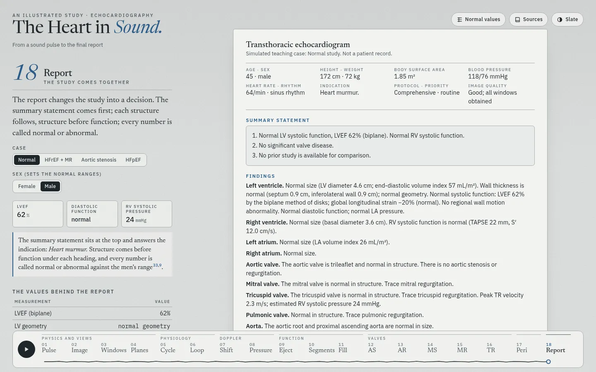

# The Heart in Sound

An illustrated, interactive study of echocardiography for trainees: ultrasound physics, the standard views, cardiac physiology, Doppler, ventricular function, valve disease and the final report. Seventeen chapters in six parts. Chapters 11 to 16 each follow one disease from normal to its end stage: one slider, a Play button, and several views that change together. Every guideline value carries its source.


## Chapters

| Part | Chapter | The figure |
| --- | --- | --- |
| I Physics and views | 01 Pulse | One scan line: pulse, echoes, A-mode, wavelength and axial resolution, attenuation by tissue |
| | 02 Image | A sector image built line by line; frame rate; four artifacts |
| | 03 Windows | 35 standard views: the heart with the imaging plane or its labeled cross-section, and the echo view that plane cuts from the same mesh; the plane moves from view to view as a probe does |
| | 04 Planes | All standard view planes in one heart: crossings, parallel stacks, which views show a structure, and a free plane that settles onto the nearest standard view |
| II Physiology | 05 Cycle | Wiggers diagram with ECG, heart sounds, mitral and LVOT Doppler, and the four-chamber frame at the cursor |
| | 06 Loop | Pressure–volume loop: ESPVR, EDPVR, arterial elastance, EF = Ees ÷ (Ees + Ea) |
| III Doppler | 07 Shift | Doppler equation, beam angle, Nyquist limit, pulsed, continuous and color Doppler |
| | 08 Pressure | Stroke volume from LVOT area × VTI; RV systolic pressure from the TR jet and the IVC |
| IV Function | 09 Eject | Biplane method of disks and foreshortening; TAPSE, S′ and fractional area change |
| | 10 Segments | 17-segment bull's-eye, the three apical views, coronary territories, wall motion score index |
| | 11 Fill | Diastolic dysfunction, normal to restrictive: four-chamber view with the LA to scale, mitral inflow, tissue Doppler, pulmonary veins, LA strain, TR jet, and the 2025 ASE algorithm run live |
| V Valves | 12 Aortic stenosis | Normal valve to severe stenosis, then LV failure and low flow: PLAX with hypertrophy, short-axis orifice to scale, CW and LVOT Doppler, mitral inflow |
| | 13 Mitral stenosis | Normal valve to severe rheumatic stenosis: doming leaflets, LA size, pressure half-time, the gradient at any heart rate, PA pressure, planimetry |
| | 14 Mitral regurgitation | Mild to severe with LV dysfunction: color jet and PISA shell, CW jet, pulmonary vein flow reversal, E wave, LV and LA dilation |
| | 15 Aortic regurgitation | Mild to severe with LV dysfunction: jet width in the LVOT, pressure half-time, descending aorta reversal, LVOT VTI, LV dilation |
| | 16 Tricuspid regurgitation | Mild to torrential: RV, annulus and RA dilation, hepatic vein reversal, IVC, septal flattening, a jet that slows at the torrential end |
| VI Report | 17 Report | Four simulated cases written up in the ASE 2025 report structure, with sex-specific ranges |

| | | |
| --- | --- | --- |
|  |  |  |
|  |  |  |
|  |  |  |

On a phone the figure sits above the text and stays in view while the text scrolls:

 

## Views and the lab's annotation classes

Chapter 03 covers the ASE comprehensive transthoracic views (Mitchell 2019, Tables 2.1–2.27). Each view carries the class name from the lab's annotation list (`lab` in `src/views.js`), for example `PLAX_IVS_LVPW_LVIDD`, `PSAX_(level_great_vessels)_focus_on_PV_and_PA`, `Subcostal_IVC`, `SSN_aortic_arch`. Six views have no class in that list: the coronary artery origins, the zoomed tricuspid valve, LV apex and aortic valve (apical), the zoomed atrial septum (subcostal) and the suprasternal short axis.

- **The plane moves between views.** A change of view turns the plane along the shortest rotation while the point it images slides across, so neighbouring views are small moves: the pulmonic valve, tricuspid valve and zoomed aortic valve views are small tilts, steers or zooms of the great-vessel short axis, and the abdominal aorta is 7° from the IVC plane.
- **Cross-section.** With it on, the 3D heart is cut on the view plane and seen square to it, turned as the echo is (probe at the top), with the structures named in the margin, as in *The Amyloid Heart*.
- **Below the diaphragm.** The heart model ends at the diaphragm. For the subcostal views, `src/abdomen.js` adds simple shapes to the echo only: a liver moulded to the underside of the heart, the IVC down through it, two hepatic veins, the abdominal aorta with the celiac trunk and the superior mesenteric artery, and the spine. The subcostal four-chamber plane in this model passes above the liver, so that view keeps a liver layer in the near field.

Chapter 04 shows the planes together. The apical views share the LV long axis; the model places the two-chamber plane about 60° from the four- and three-chamber planes, as the ASE rotation describes. The short-axis levels form a parallel stack. The structure table lists what ASE names for each view.

**Free plane.** Five controls move a plane away from the focused view as a probe moves: rotate about the beam, tilt across the plane, rock within it, slide along it and sweep across it. The echo pane shows what the plane cuts, and *Square to the plane* turns the heart to face it. The probe stays in the focused view's window, so only the standard views of that window count; the apical four-chamber plane lies 4° from the subcostal one in this model, but the two are different views. The nearest view is judged by the angle between the planes, with the marker on the same side, and how far that view's centre lies off the free plane: within 20° and 3 cm it is marked, and within 10° and 1.5 cm the plane settles onto it when the control is let go. The same plane turned 180° is flagged as mirrored, not taken as the view. The textbook turns work: the four-chamber plane rotated 60° counterclockwise settles on the two-chamber view and 120° on the three-chamber view, and the long axis rotated 90° clockwise on the short axis at the mitral valve.


## The severity pages (chapters 11 to 16)

- **One slider per disease.** It runs from normal to the end stage. The bands under it show where the grade changes; the page computes them from its own model, so a band starts where the values cross the guideline cut-off.
- **Play** moves the slider through the whole course and starts again; any control stops it. **Cine** runs the beat; with it off, the views stop at the moment that shows the jet.
- **Several views change together.** A 2D view drawn to scale (a caliper on the screen reads the value in the text), three or four Doppler strips with a cursor at the same moment of the beat, a strip of measurements against their cut-offs, and the guideline table with the current column marked.
- **Grades and stages.** Regurgitation follows ASE 2017 (Zoghbi), with EACVI 2022 for massive and torrential TR; aortic stenosis follows Baumgartner 2017; mitral stenosis follows ASE 2023 (Pandian); diastolic function follows ASE 2025 (Nagueh). The LV and atrial consequences follow the ACC/AHA 2020 stages (Otto), for example stage C2 in MR at LVEF ≤60% or end-systolic diameter ≥40 mm.
- **What the model is.** The orifice or valve area drives the numbers (PISA, continuity equation, pressure half-time = 220 ÷ area); the chamber sizes, vein flows and pressures follow illustrative tracks set inside the guideline bands. They are teaching values, not patient data.

## The echo images

Every echo image is simulated. The anatomy comes from sections of the heart mesh (chapters 02 to 05) or from parametric views drawn to scale (chapters 11 to 16). One renderer, `src/bmode.js`, turns either into a scanner frame:

- **Echogenicity.** Each structure has a level in dB against myocardium: blood about −60, leaflets +15 (to +21 when thickened), chordae +4, pericardium +16, calcium +22 with an acoustic shadow behind it; the coronary arteries sit in bright epicardial fat.
- **Specular surfaces.** A surface is brightest where the beam meets it head-on (cos⁴ of the angle). Walls that run along the beam, such as the atrial septum in the four-chamber view, stay faint.
- **Speckle.** Random scatterers ride with each structure from end-diastole, and the beam blur comes after, each frame. The speckle moves with the wall, and the grain keeps its size while the wall shortens and thickens.
- **Beam blur.** 0.6 mm along the beam (two cycles at 3.4 MHz). Across it, 0.8 mm near the probe, then 1.3 mm at 10 cm: a 2.5 cm aperture in harmonic imaging, the 1.7 MHz transmit beam squared times the 3.4 MHz receive beam.
- **Structures into the image.** A small rasterizer fills each structure into the beam grid with its exact coverage, so a leaflet or a chord thinner than a sample keeps part of its strength instead of dropping out.
- **Near field and noise.** Chest-wall layers, reverberation clutter over the first 2 cm below them, and electronic noise that rises with depth and changes each frame while the cine runs.
- **Display.** Light speckle reduction (a fifth of each sample is the local mean; two fifths in a zoomed view), time-gain with a small loss left at depth, darker sector edges, log compression over 56 dB, then scan conversion at the screen's own pixel density. The views draw about 30 frames a second.
- **Valves in the parametric views.** Each leaflet keeps its length and swings about its hinge; closed, the leaflets billow a little toward the atrium and share a zone of contact. Rheumatic stenosis holds the tips, so the anterior leaflet domes and the short posterior leaflet cannot move. Regurgitation leaves a gap at closure; the aortic cusps open along the sinus walls, or dome when stiff. Chordae run from the papillary muscles to the leaflets and fade when slack in diastole.
- **Anatomy in the parametric views.** Papillary muscles and chordae, apical trabeculae, the moderator band, pulmonary vein openings, the pericardium, the coronary sinus and the descending aorta. The walls stay at the model's values on the measuring line, so the calipers read what the page reports.
- **Color Doppler.** Velocity along the beam inside a color box: red toward the probe, aliasing at the set velocity, a green variance tag in turbulent jets, and a flow-convergence shell sized from the flow rate.

*The Amyloid Heart* got its realistic views from the sculpted mesh; it drew them with flat textures and white outlines. This site keeps the mesh and adds the image formation above.

## Sources and data

- Guideline values come from ASE, EACVI, ACC/AHA, ESC/ERS and IAC documents; the main ones are Lang 2015 (chamber quantification), Mitchell 2019 (comprehensive TTE), Zoghbi 2017 (regurgitation), Baumgartner 2017 (aortic stenosis), Otto 2020 (valve disease), Pandian 2023 (rheumatic mitral stenosis), Nagueh 2025 (diastolic function), Mukherjee 2025 (right heart), Thomas 2025 (strain) and Taub 2025 (reporting). The full list, with DOI and PubMed links, opens from **Sources** on the page (`src/refs.js`).
- Each reference was checked against PubMed and Crossref before use. Where sources disagree, the page follows the current guideline.
- The figures run simple models set to agree with these sources. The diastolic values and the four report cases are illustrative, not patient data. All images are simulated; there are no patient images.
- Normal values for the **Normal values** dialog and the grading helpers live in one place: `src/norms.js`.

## How it is built

A static site with no build step: ES modules, a canvas sketch layer (`src/sketch.js`, rough.js) and a WebGL pencil renderer for the 3D heart (three.js). Echo views are live cross-sections of the heart mesh (`src/echo.js`) or parametric views (`src/echo2d.js`), imaged by `src/bmode.js`. The heart mesh, pencil renderer and 3D stage are adapted from *The Amyloid Heart*. Vendored libraries and their licenses are in `vendor/`.

```
index.html          page, chapter text, dialogs
src/main.js         chapter engine: controls, readouts, citations, tour, keyboard
src/ch/*.js         one module per chapter
src/sev.js          severity pages: keyframe tracks, grade bands, Play, measurement strip
src/bmode.js        B-mode and M-mode image formation for every echo view
src/abdomen.js      liver, IVC, hepatic veins, abdominal aorta and spine for the subcostal echo views
src/echo2d.js       parametric echo views drawn to scale (A4C, PLAX, three short-axis levels, IVC M-mode) and color Doppler jets
src/views.js        view catalog: planes, lab classes, structures, probe moves
src/echo.js         plane geometry, plane changes, cross-sections and the echo views cut from the heart mesh
src/cyclemodel.js   one heartbeat (pressures, volume, valve events)
src/norms.js        normal values and cut-offs
src/refs.js         references
assets/             heart mesh (JSON), anatomy landmarks, poster image
```

## Run it

Serve the folder with any static server, for example:

```
python3 -m http.server 8000
```

Then open <http://localhost:8000/>. A chapter can be opened directly: `#planes`, `#fill`, `#report`.

Keys: ← → change chapter, space plays the tour, 1–5 and [ ] step the views in chapters 03 and 04. A chapter opens directly by its key, for example `#as`, `#mr`, `#tr`.

## Checks run before this commit

- `node --check` on every module.
- Screenshots of all 17 chapters at 1440 × 900 and 390 × 844, and of the main chapters in the dark theme; no console errors.
- Echo images at 1× and 2× device scale in every chapter that has one, including the zoomed and subcostal views, and the new views of chapter 03. Frame rate of the severity pages on the test machine (headless Chromium, software rendering, 1×): 56–61 fps with the cine running and 35–53 fps with Play, against 56–61 and 38–55 before this change. The 3D chapters run at 4–5 fps there before and after (software WebGL).
- Plane changes rendered frame by frame (four- to two-chamber, long to short axis); the free plane rotated from the four-chamber view settles onto the two-chamber view at −60° and the three-chamber view at −120°, and from the long axis onto the short axis at +90°; the same planes at +60° and −90° read as mirrored, and a plane from another window never settles (the apical and subcostal four-chamber planes lie 4° apart); cross-sections of the parasternal, apical and subcostal views at desktop and phone width and in the dark theme.
- Every chapter's tour steps run, and the Play button advances chapters. On the severity pages, Play moves the slider and any control stops it.
- Each severity model swept across its slider: the grade bands come out in order; in MR, AR and TR the EROA, volume, fraction and vena contracta cross their severe cut-offs at the same point.
- Citation audit: every cited id resolves to a reference, and every id used in live text also appears in the static text, so it gets a number.
- Model checks: the diastolic algorithm across the whole filling slider; aortic stenosis velocity, gradient and area across valve areas; mitral gradient across heart rates; pressure–volume presets.
