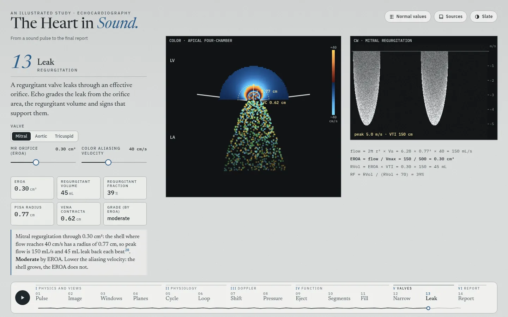
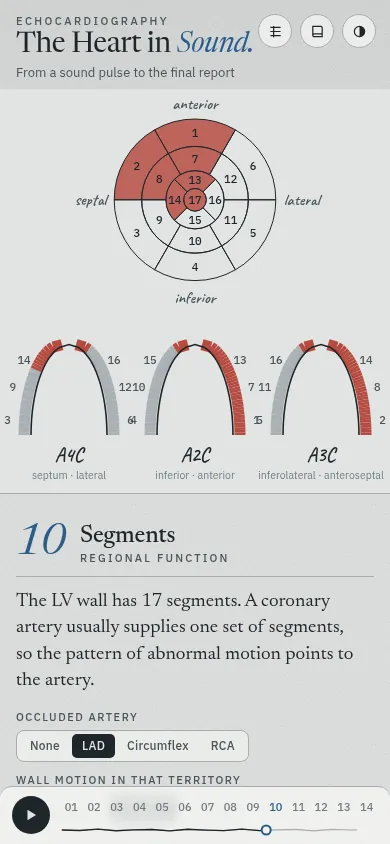

# The Heart in Sound

An illustrated, interactive study of echocardiography for trainees: ultrasound physics, the standard views, cardiac physiology, Doppler, ventricular function, valve disease and the final report. Fourteen chapters in six parts. Every guideline value carries its source.


## Chapters

| Part | Chapter | The figure |
| --- | --- | --- |
| I Physics and views | 01 Pulse | One scan line: pulse, echoes, A-mode, wavelength and axial resolution, attenuation by tissue |
| | 02 Image | A sector image built line by line; frame rate; four artifacts |
| | 03 Windows | 29 canonical views: the heart with the imaging plane, and the echo view that plane cuts from the same mesh |
| | 04 Planes | All standard view planes in one heart: crossings, parallel stacks, and which views show a structure |
| II Physiology | 05 Cycle | Wiggers diagram with ECG, heart sounds, mitral and LVOT Doppler, and the four-chamber frame at the cursor |
| | 06 Loop | Pressure–volume loop: ESPVR, EDPVR, arterial elastance, EF = Ees ÷ (Ees + Ea) |
| III Doppler | 07 Shift | Doppler equation, beam angle, Nyquist limit, pulsed, continuous and color Doppler |
| | 08 Pressure | Stroke volume from LVOT area × VTI; RV systolic pressure from the TR jet and the IVC |
| IV Function | 09 Eject | Biplane method of disks and foreshortening; TAPSE, S′ and fractional area change |
| | 10 Segments | 17-segment bull's-eye, the three apical views, coronary territories, wall motion score index |
| | 11 Fill | Mitral inflow, tissue Doppler and TR jet, with the 2025 ASE diastolic algorithm run live |
| V Valves | 12 Narrow | Aortic stenosis (continuity equation, low-flow states) and mitral stenosis (pressure half-time, heart rate) |
| | 13 Leak | Regurgitation: PISA shell, vena contracta, CW signal, ASE 2017 grading table |
| VI Report | 14 Report | Four simulated cases written up in the ASE 2025 report structure, with sex-specific ranges |

| | | |
| --- | --- | --- |
|  |  |  |
|  |  |  |

On a phone the figure sits above the text and stays in view while the text scrolls:

 

## Views and the lab's annotation classes

Chapter 03 covers the ASE comprehensive transthoracic views (Mitchell 2019, Tables 2.1–2.27). Each view carries the class name from the lab's annotation list (`lab` in `src/views.js`), for example `PLAX_IVS_LVPW_LVIDD`, `PSAX_(level_great_vessels)_focus_on_PV_and_PA`, `Subcostal_IVC`, `SSN_aortic_arch`. The subcostal abdominal aorta has no slice: it lies below the diaphragm, outside the heart model.

Chapter 04 shows the planes together. The apical views share the LV long axis; the model places the two-chamber plane about 60° from the four- and three-chamber planes, as the ASE rotation describes. The short-axis levels form a parallel stack. The structure table lists what ASE names for each view.

## Sources and data

- Guideline values come from ASE, EACVI, ACC/AHA, ESC/ERS and IAC documents; the main ones are Lang 2015 (chamber quantification), Mitchell 2019 (comprehensive TTE), Zoghbi 2017 (regurgitation), Baumgartner 2017 (aortic stenosis), Otto 2020 (valve disease), Pandian 2023 (rheumatic mitral stenosis), Nagueh 2025 (diastolic function), Mukherjee 2025 (right heart), Thomas 2025 (strain) and Taub 2025 (reporting). The full list, with DOI and PubMed links, opens from **Sources** on the page (`src/refs.js`).
- Each reference was checked against PubMed and Crossref before use. Where sources disagree, the page follows the current guideline.
- The figures run simple models set to agree with these sources. The diastolic values and the four report cases are illustrative, not patient data. All images are simulated; there are no patient images.
- Normal values for the **Normal values** dialog and the grading helpers live in one place: `src/norms.js`.

## How it is built

A static site with no build step: ES modules, a canvas sketch layer (`src/sketch.js`, rough.js) and a WebGL pencil renderer for the 3D heart (three.js). Echo views are live cross-sections of the heart mesh (`src/echo.js`). The heart mesh, pencil renderer and 3D stage are adapted from *The Amyloid Heart*. Vendored libraries and their licenses are in `vendor/`.

```
index.html          page, chapter text, dialogs
src/main.js         chapter engine: controls, readouts, citations, tour, keyboard
src/ch/*.js         one module per chapter
src/views.js        view catalog: planes, lab classes, structures, probe moves
src/echo.js         plane geometry and the echo-view renderer
src/cyclemodel.js   one heartbeat (pressures, volume, valve events)
src/norms.js        normal values and cut-offs
src/refs.js         references
assets/             heart mesh (JSON), anatomy landmarks, poster image
```

## Run it

Serve the folder with any static server, for example:

```
python3 -m http.server 8000
```

Then open <http://localhost:8000/>. A chapter can be opened directly: `#planes`, `#fill`, `#report`.

Keys: ← → change chapter, space plays the tour, 1–5 and [ ] step the views in chapters 03 and 04.

## Checks run before this commit

- `node --check` on every module.
- Screenshots of all 14 chapters at 1440 × 900 and 390 × 844, and of the main chapters in the dark theme; no console errors.
- Every chapter's tour steps run, and the Play button advances chapters.
- Citation audit: every cited id resolves to a reference, and every id used in live text also appears in the static text, so it gets a number.
- Model checks: the diastolic algorithm across the whole filling slider; aortic stenosis velocity, gradient and area across valve areas; mitral gradient across heart rates; pressure–volume presets.
