# The Heart by Ultrasound

An illustrated, interactive guide to echocardiography: ultrasound physics and Doppler, the standard views, transesophageal echocardiography, cardiac physiology, Doppler hemodynamics with the RA pressure from the inferior vena cava, LV function, stress echocardiography, myocardial strain and cardio-oncology, the right ventricle and acute pulmonary embolism, valvular disease, diseases of the aorta, pericardial disease, hypertrophic cardiomyopathy, cardiac amyloidosis, and two AI models that measure a study and read it. Twenty-four chapters in ten parts, in an order taken from the ASE guidelines, with TEE after the transthoracic views and the AI models last. Six bonus chapters follow in a part of their own, B: left ventricular assist devices, prosthetic valves, infective endocarditis, intracardiac shunts, cardiac masses and the complications of myocardial infarction. Chapters 10 and 13 to 23, and bonus chapters B2 to B6, each follow one disease, or one kind of load, from normal to its end stage. Bonus chapter B1 follows an LVAD through its pump speeds. Each of these chapters has one slider that plays when the page opens, and several views that change together. A menu in the header changes the heart that every chapter shows: normal, cardiac amyloidosis, ischemic cardiomyopathy, a Barlow mitral valve with severe regurgitation, or a bicuspid aortic valve with severe stenosis. Every guideline value carries its source.


## Chapters

| Part | Chapter | The figure |
| --- | --- | --- |
| Physics | 01 Pulse | One scan line: pulse, echoes, A-mode, wavelength and axial resolution, attenuation by tissue |
|  | 02 Image | A sector image built line by line, with a sweep whose speed follows the frame rate; four artifacts |
|  | 03 Doppler | Doppler equation, beam angle, Nyquist limit, pulsed, continuous and color Doppler |
| Views | 04 Views | 35 standard views in three panes: the planes of the nine standard views in one heart, each in the color of its window, with the current plane lit and the lines where it crosses the others (a click on a plane opens its view), or with **Probe and body** the whole heart with the probe and a body figure; the heart cut on the imaging plane and labeled; and the echo view that plane cuts from the same mesh. The plane moves from view to view as a probe does. **Free probe** moves the probe from the current view with five sliders in the ASE terms: rotate, tilt, rock, and a slide along the marker and across the plane. The three panes follow it, and the panel names the nearest standard view, how far the probe lies from it, and the moves from the starting view |
|  | 05 Transesophageal echocardiography | 17 of the 28 views of Hahn 2013, in two panes. They include all 11 views of the basic perioperative examination (Reeves 2013). The left pane shows the heart from the patient's left, with the esophagus behind the LA. The probe sits at its level, and its imaging plane turns with the multiplane angle. The right pane shows the echo that the plane cuts from the same mesh, in the guideline's display orientation. It carries labels, the view's name and an angle icon after the Philips display: a half circle with 0 at its left end and 180 at its right, the angle above it, and a needle that turns from left (0°) through down (90°) to right (180°). Two switches set the level (upper esophageal, mid-esophageal or transgastric) and the turn of the probe (left, neutral or right). The slider sets the angle from 0° to 180°. Bands under the slider mark each view's angle range in the guideline. A drag that stops near a view's angle snaps to that view. Between two views of one level and turn, the probe moves from one view's position to the other's. Play steps through the views in the guideline's order. A Free probe switch releases the probe from the views' positions. Four sliders then advance or withdraw it along the esophagus, turn it, ante- or retroflex it and flex it to the side, from the position that the switches and the angle gave. With the probe free, the angle turns the plane about the beam alone. A panel names the standard view nearest the plane, and a button returns the probe to its starting position. The readouts give the view, its level and angle, the probe movement, the structures and the probe's place in the model. For a moved free probe they give its moves and the nearest view. The text covers the probe movements, the display convention and the views. It also lists what TEE adds to TTE: the LA appendage before cardioversion, endocarditis, prosthetic valves, dissection and the saline study |
| Physiology | 06 Cycle | Wiggers diagram with ECG, heart sounds, mitral and LVOT Doppler, and the four-chamber frame at the cursor |
|  | 07 Loop | Pressure–volume loop: ESPVR, EDPVR, arterial elastance, EF = Ees ÷ (Ees + Ea); presets for a hypocontractile, a stiff, a pressure-loaded and a volume-loaded ventricle (chronic severe mitral regurgitation, the Barlow heart's loop) |
| Hemodynamics | 08 Doppler hemodynamics | A switch with two settings: Flow and pressure, and IVC. Flow and pressure: blood moves from the LVOT through the aortic valve into the aorta, and the same flow passes every level, so the velocity rises where the area falls (continuity). Strips along the tube show the flow, the velocity and the pressure at peak flow: the pressure falls by 4(V₂² − V₁²) to the vena contracta and rises again in the aorta (pressure recovery, 4V² × 2 EOA/AoA × (1 − EOA/AoA)). PW Doppler before the valve and CW through it on one scale, with stroke volume = area × VTI at both levels. Sliders: stroke volume, LVOT diameter, valve area, aorta diameter and peak TR velocity. Beside it, the RV systolic pressure from the TR jet and the RA pressure, as one bar on a mmHg scale. IVC: the subcostal long axis takes the place of the flow, with the IVC through the liver into the RA, the tricuspid valve and the RV above the RA, a hepatic vein, the diaphragm and a caliper 1 to 2 cm from the RA, and the IVC on M-mode through quiet breathing and a sniff, with its collapse. The RV systolic pressure stays beside them (below them on a phone). One RA pressure serves both settings: its buttons (3, 8 or 15 mmHg) set an IVC that gives that value, and an IVC that gives one of these values lights its button. In the IVC setting, the text shows the 2025 ASE estimate as a diagram, with ▲▼ buttons on the IVC diameter and its collapse and a switch for the breathing: quiet, with a sniff or under positive-pressure ventilation. Under ventilation with secondary signs, the IVC gives no single RA pressure, and the RV systolic pressure reads a dash. The text adds the stroke volume from the LVOT and its squared diameter error, PISA, the vena contracta, the regurgitant fraction and the limits of the RV systolic pressure. Its second half gives the RA pressure from the IVC and its pitfalls |
| Function | 09 Systolic function | Biplane method of disks: apical four- and two-chamber echo views cut from the heart mesh, with the border traced on them and its disks, each above the disk model of the same trace; foreshortening, by a probe off the plane. In the text, the measurements as a diagram: ▲▼ buttons on the traced EDV and ESV and a switch for the sex give the stroke volume, the LVEF and the volume indexes in the bands of Lang 2015 for that sex, with the heart failure category. As in 08, the buttons move the chapter's own sliders. TAPSE, S′ and FAC moved to 14; the RV side stays in the code, hidden (`SHOW_RV` in `src/ch/eject.js`) |
|  | 10 Diastolic function | Diastolic dysfunction, normal to restrictive: four-chamber view cut from the heart mesh (the LA at the LA volume index that the page prints, on the heart that the header shows), mitral inflow, tissue Doppler, pulmonary veins, LA strain, TR jet, and the lit path through the 2025 ASE algorithm. In the text, the algorithm's four steps as a diagram, with ▲▼ buttons on its nine measurements: each change flashes where it acts, and the slider moves to the band of the new grade |
|  | 11 Regional wall motion | Buttons on the figure occlude the LAD, RCA or circumflex: its territory turns hypokinetic, akinetic or dyskinetic on the 17-segment bull's-eye, which draws the artery with its block, and in the apical four-, two- and three-chamber views, echo cine sectors cut from the heart mesh in which each segment moves by its score. The text names the walls to watch in each view. Any segment can also be scored by tapping it; the wall motion score index follows |
|  | 12 Stress echocardiography | Dobutamine stress as the quad screen: one apical view (four-, two- or three-chamber) cut from the heart mesh at rest, at low dose, at peak and in recovery, each beating at the heart rate of its stage, with each segment's score on its wall; the response of each segment on the 17-segment bull's-eye (ischemic, scar, hypokinetic with no change, viable, viable and ischemic at peak); the protocol, with the dobutamine stages of 5 to 40 µg/kg/min, atropine, the heart rate against 85% of the age-predicted maximum, the end of the infusion and the first wall motion abnormality. Seven cases: a normal response, ischemia in the LAD, RCA or circumflex territory, ischemia in two territories, a scar, and viable myocardium with a biphasic response. The readouts give the wall motion score index and the LVEF by stage; the LVEF is measured on the figure's four- and two-chamber views by the biplane method, as in 09, and kept in a table for each heart (`src/stresscal.js`). The text gives the protocol, the reading of the responses and the high-risk findings, and the other uses in one paragraph |
|  | 13 Strain | Global longitudinal strain by speckle tracking, from normal function (GLS −21.6%) to severe dysfunction (GLS −7.9%). A switch sets the pattern: global (the long-axis shortening first), regional (the LAD territory first) or apical sparing. In apical sparing the basal and mid segments lose their shortening while the apical segments keep theirs, the pattern of cardiac amyloidosis. The apical four-, two- and three-chamber views are cut from the heart mesh. Each shows the region of interest: the myocardial midline from base to base, in six segments colored by their end-systolic strain. Beside them are the strain curves of the chosen view through one beat, with aortic valve closure and the peak, and the 18-segment bull's-eye with GLS. A panel gives the arithmetic: (L − L0) ÷ L0 for each view's midline, and GLS as their mean. In apical sparing it adds the relative apical LS, apical ÷ (basal + mid), from the bull's-eye's segments, against the cut-off of 1.0 (Phelan 2012). Cardio-oncology is a subtopic, on the second tab. It sets a follow-up study during cancer therapy beside its baseline, each with its four-chamber view, LVEF, bull's-eye and GLS. It gives the relative decline in GLS, the fall in the LVEF, a switch for a new rise in cardiac biomarkers, and the grade of asymptomatic CTRCD by ESC 2022 Table 3. A map plots the LVEF against the decline in GLS, with the grades' zones. Every strain and the LVEF are measured on the mesh |
|  | 14 Right ventricle | A normal RV to severe pressure overload (pulmonary hypertension), to severe volume overload or to acute pulmonary embolism, with a switch for the load: the RV-focused four-chamber view and the RV-focused short axis at the papillary muscles (its sector turned 16° toward the RV and opened to 90°) cut from the heart mesh, the RV at the printed basal diameter and free-wall thickness, the RA at the printed area, the free wall's own motion scaled with the FAC, and the septum at the printed eccentricity index at end-diastole and at end-systole, with D1 and D2 drawn; CW through the TR jet with the RV systolic pressure, PW in the RVOT with its acceleration time and mid-systolic notch, TAPSE on M-mode and the tissue Doppler S′. Under acute pulmonary embolism the RV dilates and its wall stays thin. The box gives the RV/LV ratio. Rings at the base, the middle and the apex of the free wall show its inward motion. The mid wall stops while the apex keeps its own motion (McConnell's sign). The CW trace gives the TR gradient, and the two Doppler traces mark the 60/60 sign. A frame switch holds end-diastole or end-systole. The calculator in the text and the probability of PH are hidden (below) |
| Valves | 15 Aortic stenosis | Normal valve to severe stenosis, then LV dysfunction and low flow: apical three-chamber view cut from the heart mesh, with the LA, the LV and its wall at the page's values, the cusps thickened and calcified with the grade, and the jet up the aorta; under the bicuspid heart the cusps dome and open off-centre, and the ascending aorta is 3.6 cm. The CW trace shows the LVOT envelope inside the jet, with both peaks marked. The short axis at the aortic valve is cut from the mesh at the cusp tips, with the orifice at the printed area and a dashed trace round it in systole. In the text, the continuity equation and the gradients as a diagram, with ▲▼ buttons on six measurements: each change flashes where it acts, and the slider moves to the band of the new result |
|  | 16 Aortic regurgitation | Mild to severe with LV dysfunction: jet width in the LVOT, pressure half-time, descending aorta reversal, LVOT VTI, LV dilation. The long axis is cut from the heart mesh, its LV at the printed diameters. In the text, the ASE 2017 algorithm (Figure 25) as a diagram, with ▲▼ buttons on eleven measurements and switches for the flow convergence and a flail valve: the volumetric method with grades I to IV, the specific criteria for mild and for severe AR, and the result with the ACC/AHA stage |
|  | 17 Mitral stenosis | Normal valve to severe rheumatic stenosis: apical four-chamber view with doming leaflets, the LA to scale and the color inflow jet with its flow convergence at 40 cm/s; pressure half-time, the gradient at any heart rate, PA pressure, planimetry. The four-chamber view and the short axis at the leaflet tips are cut from the heart mesh, the LA, the RV and the mitral orifice at the printed sizes. In the text, the ASE grades of Pandian 2023 (Table 1) as a diagram, with ▲▼ buttons on four measurements and a switch for the RA pressure: the area by planimetry gives the grade, and the diagram shows whether the pressure half-time, the mean gradient at a heart rate of 60–80/min and the PA systolic pressure lie in its band |
|  | 18 Mitral regurgitation | Mild to severe with LV dysfunction: color jet and flow convergence at 32 cm/s with the PISA radius; CW jet, pulmonary vein flow reversal, E wave, LV and LA dilation. The four-chamber view is cut from the heart mesh, its LA and LV at the printed sizes. Under the Barlow heart the leak starts in mid-systole until it is severe. In the text, the ASE 2017 algorithm (Figure 18) as a diagram, with ▲▼ buttons on thirteen measurements and a switch for a flail leaflet: the PISA formulas with grades I to IV, the specific criteria for mild and for severe MR, and the result with the ACC/AHA stage |
|  | 19 Tricuspid regurgitation | Mild to torrential: color jet and flow convergence at 28 cm/s with the PISA radius; RV, annulus and RA dilation, hepatic vein reversal, IVC, septal flattening, a jet that slows at the torrential end. The RV-focused four-chamber view and the RV-focused short axis at the papillary muscles are cut from the heart mesh, the RV, the RA and the septum at the printed sizes. In the text, the ASE 2017 algorithm (Figure 31) as a diagram, with ▲▼ buttons on fifteen measurements and switches for the leaflets and the CW contour: the RV systolic pressure, the PISA method with the ASE grades and the EACVI grades beyond severe, the specific criteria for mild and for severe TR, and the result |
| Aorta | 20 Diseases of the aorta | A switch for the disease and one slider for its severity. Dilation, from normal to 6.0 cm at the sinuses and the ascending aorta: the long axis zoomed on the root, cut from the heart mesh and widened by targets on the aortic wall. At end-diastole, L-L calipers measure the sinuses, the STJ and the ascending aorta; at midsystole, an I-I caliper measures the annulus. The four diameters lie against the normal ranges of Lang 2015, with the sinus Z score, the aorta's profile and the 2022 ACC/AHA thresholds. Under the bicuspid heart the thresholds are those for a bicuspid valve. Dissection: a reverberation of the pericardium at twice its depth, then a mobile flap, then AR, then a pericardial effusion. The long axis with color shows the true lumen expanding in systole with brisk forward flow, and slow, late, reversed flow in the false lumen. No color crosses the flap. As the flap reaches nearer the valve, the AR jet follows it: central as the root dilates, eccentric from a prolapsed right coronary cusp, and beside the flap when it prolapses through the valve. An M-mode and a zoomed root follow the flap. Coarctation, from a mild narrowing to a severe one: the suprasternal view with the narrowing just past the left subclavian artery, its caliper and color jet. The subcostal view gives the abdominal aorta. CW Doppler shows the diastolic tail, and PW Doppler of the abdominal aorta its diastolic forward flow. Two tables set the ACC/AHA 2022 and ESC 2020 criteria side by side |
| Pericardium | 21 Pericardial disease | One slider and a switch with two settings: Effusion and Constriction. Effusion: no effusion through mild, moderate and severe (large) effusion to tamponade. The four-chamber view is cut from the heart mesh, with the fluid round the heart, RA and RV collapse and the septal shift with each breath; mitral, tricuspid and hepatic vein Doppler over a breath; PLAX from the mesh, with the fluid behind the LV and, in a large effusion, in front of the RV; IVC M-mode. Constriction: a normal pericardium to all three Mayo Clinic criteria. The four-chamber view from the mesh shows the pericardium at the printed thickness, the septum's shift with each breath and the atria at the printed LA volume index. Mitral and tricuspid inflow and hepatic vein flow run over two breaths, with a respiratory trace, beside tissue Doppler of both annular sites, an M-mode of the septum, the IVC on M-mode and the measurements against their cut-offs. The Mayo Clinic criteria grade constriction. Restrictive cardiomyopathy is one paragraph of the text. The text puts the effusion and tamponade first; constriction holds 30% of its words on the two conditions |
| Cardiomyopathy | 22 Hypertrophic cardiomyopathy | A normal heart to severe obstructive HCM, with a switch for rest or the Valsalva strain and one for the frame (cine, end-diastole, SAM): the parasternal long axis and the apical three-chamber view cut from the heart mesh, with the anterior septum at the printed thickness, the anterior mitral leaflet at the printed SAM-septal gap or touching the septum for the printed share of systole, the LA at the printed volume index and, on the normal heart, the LV at the printed LVEF; calipers at end-diastole and on the SAM; the outflow jet and the posteriorly directed MR jet in one color box; CW through the LVOT (late-peaking, dagger-shaped) and through the MR on one scale; M-mode through the mitral valve with the SAM. The gradient follows the contact as Pollick 1984 found it. The tables mark the obstruction (none, latent, at rest) and the SAM grade |
|  | 23 Cardiac amyloidosis | Normal heart to advanced amyloid cardiomyopathy: the parasternal long axis at end-diastole with calipers and the apical four-chamber view, both cut from the heart mesh at the chosen amyloid burden; mitral inflow and septal tissue Doppler; the 17-segment strain bull's-eye; the ESC 2021 echo criteria and the multiparametric score, run live. In the text, the criteria as a diagram: ▲▼ buttons on TAPSE, the Doppler velocities and the longitudinal strain of each level give the diastolic grade, the three findings, the score and the result. The walls, which the image shows, have no buttons and follow the slider |
| Artificial intelligence | 24 AI interpretation and measurement | EchoPrime and EchoNet-Measurements on one study of the heart shown, in seven steps in three rows. 1 Sort: the 14 videos of the study, cut from the heart mesh, each tagged with its view. Each is one beat in 16 frames of 224 × 224 pixels, EchoPrime's input. Three show color Doppler. 2 Encode: one video encoder (an outlined box, mViT), and for each video its view's tag and a stripe that stands for its 512 numbers. 3 Weigh: the chosen section's mix of the 14 videos, from the anatomical attention weights of the public code. One bar holds each view group's share of the sum of the videos' weights: its videos' weights over the sum for all 14, so that the three parasternal short-axis videos count three times (`shareOf` in `src/aifig.js`). The five largest parts carry their tag, their videos (×3) and their share in whole percent that add to 100; the rest is one pale part. A part's shade grows with its share. For the left ventricle the three PSAX videos carry 25% and the two subcostal videos 15%; for the IVC the subcostal videos carry 73%. The shares are the site's arithmetic on the public weights, not an output of EchoPrime. A strip of the 15 sections at the top chooses one. The earlier form, a line from each video's row to the section, stays behind `SHOW_LINES`. 4 Answer: the chosen section's task heads, of about 150. Each number head shows its value and, where it checks a measurement, a ring; the words of the word heads follow in the serif. 5 Measure: the nine B-mode measurements of EchoNet-Measurements, each on its view cut from the mesh. Each view shows the frame that its clip reports, with the heat maps and the caliper. The nine Doppler and M-mode measurements sit on eight recordings of the chapters that own them (08, 10, 14, 15 and 18). 6 Anchor: the values of the chosen section beside one band, the heads' range of ± 10% with a dashed head line, and a dot for each caliper. 7 Report: the site's report for the heart, with EchoPrime's words in a serif face and the measured numbers in blue. Each caliper of the heart shown lies in its head's range, and the anchor keeps it. The two-peaked map, a second peak on the septum's heat map that the anchor corrects, is off, and its switch is hidden (`SHOW_TWO` in `src/aifig.js`). The heads and the anchor are a simulation (*Sources and data*). A click on the strip of sections, a tile or a sentence chooses a section. The Play button beside the Section slider plays the chapter's sequence: steps 1 to 7 on the left ventricle (the aortic valve at step 3), then step 7 stays lit and the report's 15 sections follow in its order, 3 s each (the left ventricle 4.5 s), 76.5 s in all. Each section lights its cell of the strip, its mix, its heads, its tiles, its anchor and its sentence. After a section chosen by hand, Play starts the sections at that one. Arrows link each step to the next, and two labeled links join the models: the view picks the clip each model reads (from 1 to the B-mode band), and the number heads anchor every value (from 4 down to the anchor; under 800 px, to both bands). The figure has no tabs at any size. A figure 840 px wide or more shows every step at once, in three rows at least 540 px tall. The sort takes two fifths of the top row, and steps 2 to 4 take a fifth each. Under the links, row 2 holds the bands and, at their right under step 4, the anchor, at 30% of the width (280 to 400 px). The bands sit side by side, or in one card where that gives larger images. Row 3 holds the report across the figure, as tall as its words at 12.5 px, up to 42% of the height under the links. Where the tiles need more room, the report gives up lines, down to 4. These cards take compact headers where that gives the tiles more room, and in the shortest boxes a tile shows its name in its image's tag. A tile carries no anchor check of its own (step 6 holds it), and its image takes the height that the grid leaves in the card, up to a shape of 1.4. A figure under 540 px tall scrolls the rest into view. A figure narrower than 840 px shows the steps in more rows, each as tall as its cards need, and scrolls. From 800 px these are the three rows: the sort at two fifths beside the other three steps of EchoPrime, then the bands with the anchor at their right, then the report. Under 800 px the sort sits over the other three, which share a row from 486 px and take two rows below that. The bands take two cards from 600 px, else one, and the anchor and the report follow, each across the figure. Where rows lie between the sort and the bands, the sort's link runs down a lane at the left. When a step lights, the figure scrolls its card into view. The videos play only while the sort's card shows |

**Bonus chapters.** Six chapters follow the main chapters as bonus chapters, B1 to B6 (`BONUS` in `src/order.js`). The chapter bar has one entry for them after 24: B, Bonus, in a part of its own. B opens the bonus page, `#bonus` (`src/ch/bonus.js`). The page lists B1 to B6, each with its number, its title and the line under the title, as a link. It has no figure, so the stage hides and the list takes the width of the page. On a phone the list takes one column.

The bar, its list and the tour leave B1 to B6 out. Next on 24 opens B, and next on B opens B1. Back and next step through B1 to B6, back on B1 returns to B, and back on B returns to 24. Each bonus chapter opens by its address, for example `#endocarditis`. While one is open, B is the current entry of the bar, of the strip and of the list, and the dot stands at B. The phone's bar gives the bonus chapter's number and title, for example B3 Infective endocarditis.

A link in the text to a bonus chapter reads "bonus chapter B3" or "B3 Infective endocarditis". Each bonus chapter keeps its module, figure, text, quiz and sources. 24 AI interpretation and measurement ends with its own key points.

| Chapter | The figure |
| --- | --- |
| B1 Left ventricular assist devices | A HeartMate 3 (HM3) from 4,600 to 6,200 rpm in steps of 100 rpm. A switch sets the case: a working pump, RV failure, de novo AR or an obstruction of the outflow graft. The chapter cuts the parasternal long axis and the apical four-chamber view from the heart mesh. They show the LV at the printed LVIDd, the septum at the printed position and the RV at the printed basal diameter. The inflow cannula is a bright tube in the LV apex, pointed at the mitral valve, with reverberation and a shadow behind it. Color shows laminar flow into it, and the MR, TR and AR jets. PW at the inflow cannula and CW in the outflow graft show the HM3's artificial pulse every 2 s. PW in the RVOT gives the VTI and the total cardiac output. An M-mode through the aortic cusps shows them open in every beat, in one or two of three beats, or shut. A ramp plot draws the LVIDd against the speed, with the working pump's slope of −0.15 cm per 100 rpm and an obstruction's flat line |
| B2 Prosthetic valves | A 23-mm surgical aortic prosthesis from normal function to significant stenosis, or a normal valve that is small for the patient (mismatch). Switches pick the valve and the cause. The zoomed long axis and the short axis square to the root are cut from the heart mesh, with the prosthesis in the heart's own annulus. The bioprosthesis shows its sewing ring, stent and leaflets; the bileaflet mechanical valve shows its housing, two discs, shadow and reverberation. CW through the valve marks the peak velocity, the acceleration time and the ejection time; PW in the LVOT gives the DVI. In the text, ASE 2024 Tables 5 and 7 mark the current column |
| B3 Infective endocarditis | No vegetation to a 22-mm vegetation on the anterior mitral leaflet, then a perforation of that leaflet. The MR goes from mild to severe. The zoomed parasternal long axis and the apical three-chamber view are cut from the heart mesh, in one plane. The vegetation lies on the atrial side of the leaflet, at the gray scale of myocardium, with a caliper on its maximal length. It oscillates; from 8 mm it prolapses into the LA in systole and into the LV in diastole. The color jet of the perforation crosses the body of the leaflet, graded by its vena contracta. CW through the mitral valve, and PW in a pulmonary vein with systolic reversal in severe MR. A switch holds systole or diastole. The text gives the echo lesions of the Duke-ISCVID and ESC criteria, and TTE and TOE. It also gives the ESC recommendations on surgery at 10 mm and the differential diagnosis |
| B4 Shunts: ASD, VSD and PFO | No shunt to a large one, for a secundum ASD, a perimembranous VSD or a PFO. ASD: the subcostal view of the atrial septum with the defect, its caliper and the color jet. The RV-focused four-chamber view shows the printed RV basal diameter and RA area. PW in the RVOT and the LVOT gives each stroke volume for Qp/Qs, and the TR jet gives the RV systolic pressure. VSD: the short axis at the aortic valve shows the defect at about 11 o'clock and its jet into the RV. The long axis shows the printed LVEDD. CW through the defect gives the RV systolic pressure as 125 mmHg − 4V². PFO: the agitated saline study in the four-chamber view, beat by beat, at rest and after Valsalva release. LA pressure: a restrictive 5-mm atrial communication, the LA and RA pressures over the beat, and CW across the septum. The peak velocity and the traced mean gradient, each added to the RA pressure, give the peak and the mean LA pressure. All views are cut from the heart mesh, with the defect cut into the septum |
| B5 Cardiac masses and thrombus | One slider runs from no mass to a large one, and a switch sets the kind of mass. A left atrial myxoma hangs on a stalk from the fossa ovalis. As it grows it prolapses through the mitral valve in diastole, and CW through the valve gives the mean gradient. An LV thrombus lies on an akinetic apex: mural, then protruding, then with a mobile part, beside the 17-segment bull's-eye. A papillary fibroelastoma sits on the aortic side of the right coronary cusp: sessile, then on a stalk. Each kind has two views cut from the heart mesh. The myxoma shows in the four-chamber view and the long axis. The thrombus shows in the four-chamber view and the short axis at the apex. The fibroelastoma shows in the long axis and the apical long axis, zoomed on the aortic valve. Calipers on each mass read the printed size. A second switch adds an ultrasound enhancing agent: the cavities fill, a myxoma enhances in part, and a thrombus and a fibroelastoma stay dark |
| B6 Complications of myocardial infarction | One slider runs from no complication to the end stage, and a switch sets the complication. A septal rupture grows in the thinned, akinetic apical septum of the four-chamber view, with its color jet and caliper. CW across it gives the RV systolic pressure, and PW in the two outflow tracts gives Qp/Qs. A torn posteromedial papillary muscle flails the medial anterior leaflet into the LA in the apical three-chamber view. Its MR jet is eccentric and hugs the LA wall; the CW jet peaks early, and the pulmonary vein flow reverses. A contained rupture of the inferolateral wall forms a pseudoaneurysm in the long axis, with calipers on its neck and its sac. It then bleeds into the pericardium, to tamponade. The akinetic apex turns dyskinetic, then into a true aneurysm with calipers on its mouth and width, then holds a mural thrombus |

**The order** follows the ASE guidelines. The comprehensive examination (Mitchell 2019) puts the instrumentation first, then the views, then the measurements. TEE follows the transthoracic views, in the part Views: a second set of views, from its own probe. The RA pressure from the IVC comes before the pressures that add it, as in the right-heart guideline (Mukherjee 2025). Function comes before the valves. It starts with the LV's systolic and diastolic function and its regional wall motion. Stress echocardiography tests that motion, so it follows it. Myocardial strain comes next, then the right ventricle. The valves go by valve, as in the ASE report (Taub 2025). For each valve, stenosis comes before regurgitation, as in the ASE textbook. The diseases of the aorta follow the valves. Artificial intelligence comes last, as a model that reads a whole study draws on every chapter before it. The chapter titles use the ASE terms where one exists. Each chapter keeps its key (`#fill`, `#eject`), so an old address still opens the same chapter.

The report chapter (four simulated cases in the ASE 2025 structure) is hidden: `SHOW_REPORT` in `src/order.js`. Its module and markup stay, and it comes back as the last main chapter, in a part of its own, when that is true (`src/main.js` shows the article of each chapter in the list). The **Normal values** table opens from the report, under its table of values; the header button is hidden with it (`#btn-norms`, kept).

Planes is archived and hidden the same way: `SHOW_PLANES` in `src/order.js`; it comes back after Views. Its module (`src/ch/planes.js`), its markup and its quiz stay: the plane sets, the structure finder, the viewpoints, the free plane and the table of angles between planes. Its nine standard planes show in the left pane of 04 Views. The addresses `#planes` and `#views` open 04. PR #19 made Views and Planes one chapter, with three panes and all the controls of Planes; PR #20 went back to the two panes of Views, with the planes in Probe and body. Now Views has three panes again, with the controls of Views only: the planes, the cross-section and the echo. **Probe and body** puts the probe and the body figure in place of the planes.

Automated measurements (EchoNet-Measurements) is hidden the same way: `SHOW_MEASURE` in `src/order.js`. Its module (`src/ch/measure.js`), its markup (`#ch-measure`, `#fig-measure`), its quiz and its screenshot stay, and it comes back before the AI chapter when that is true. Named exports of `src/ch/measure.js` give the AI chapter the 18 measurements of the heart shown. The exports change nothing that Automated measurements draws. The address `#measure` opens the AI chapter (`ALIAS` in `src/main.js`). The AI chapter's Study and Retrieval views are hidden in the same way (`SHOW_STUDY` and `SHOW_RETRIEVAL` in `src/ch/ai.js`), with their controls. Their code stays.

Shock is hidden: `SHOW_SHOCK` in `src/order.js`. The page does not load its module (`src/ch/shock.js`, with `src/shockcal.js`), and no text, list or video names it. Its figure, its article and the lines that only it used are in `archive/shock.html`, which the site does not load. To restore it, set `SHOW_SHOCK` to true, import the module in `src/chapters.js` and put back the archived lines, as the comment at `SHOW_SHOCK` lists.

Constrictive pericarditis is hidden as a chapter of its own: `SHOW_CONSTRICT` in `src/order.js`. 21 Pericardial disease shows constriction as a setting of its switch, and restrictive cardiomyopathy as one paragraph of its text. The figure, the model and the text of constriction are in `src/constriction.js`. The hidden chapter's module (`src/ch/constrict.js`) uses them too, with restrictive cardiomyopathy as its second setting. The page does not load that module. Its figure, its article, its stage height and its video entry are in `archive/constrict.html`, which the site does not load. The address `#constrict` opens 21 on Constriction (`ALIAS` and `ALIAS_STATE` in `src/main.js`). To restore the chapter, follow the steps at `SHOW_CONSTRICT`.

The inferior vena cava is hidden as a chapter of its own in the same way: `SHOW_IVC` in `src/order.js`. 08 Doppler hemodynamics shows the RA pressure from the IVC as the second setting of its switch, with the subcostal long axis and the M-mode. `src/ivcfig.js` holds the estimate, the clock of the panels, the ▲▼ diagram, the live text and the readouts. Both modules use it, each with its own state keys: `cava*` in 08 and `ivc*` in the hidden chapter.

The hidden chapter's module (`src/ch/ivc.js`) keeps the whole figure, with hepatic vein PW Doppler and the IVC beside the abdominal aorta. The page does not load that module. Its figure, its article, its stage rules and its video entry are in `archive/ivc.html`, which the site does not load. The address `#ivc` and the links to the IVC open 08 on IVC (`ALIAS` and `ALIAS_STATE` in `src/main.js`), and the links read "chapter 08" (`SHOWN_IN` in `src/order.js`). To restore the chapter, follow the steps at `SHOW_IVC`.

In 14 Right ventricle, the calculator in the text and the ESC/ERS 2022 echocardiographic probability of PH are hidden. `SHOW_CALC` and `SHOW_PROB` in `src/ch/rv.js` bring them back, with the `hidden` attributes on their markup in `index.html`. The code of both stays. The calculator has ▲▼ buttons on fifteen measurements and a switch for the notch. The probability has a readout, a live sentence, a section of the text, a key point and a quiz question (`hidden` in `src/quiz.js`).

| | | |
| --- | --- | --- |
|  |  |  |
| 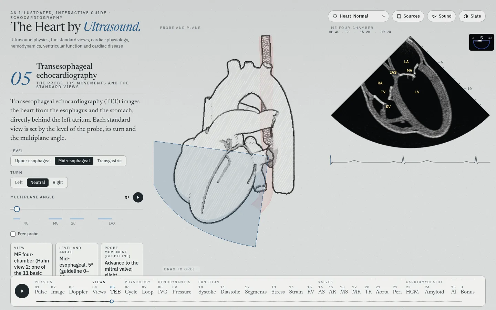 |  |  |
| 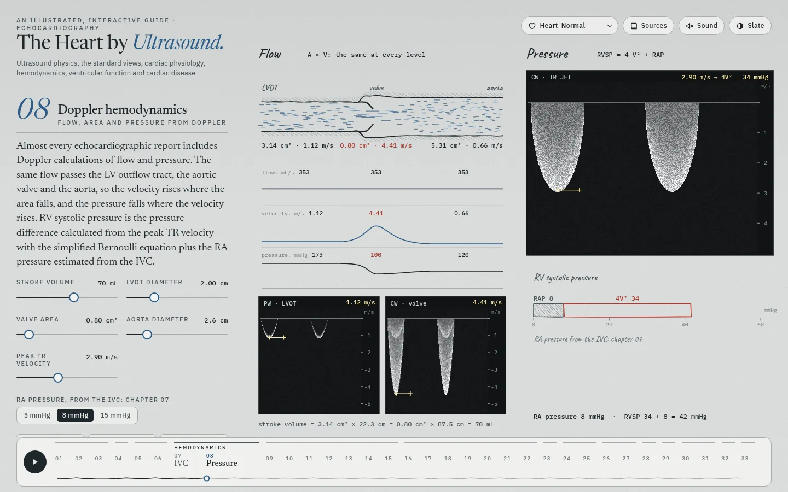 |  |  |
|  | 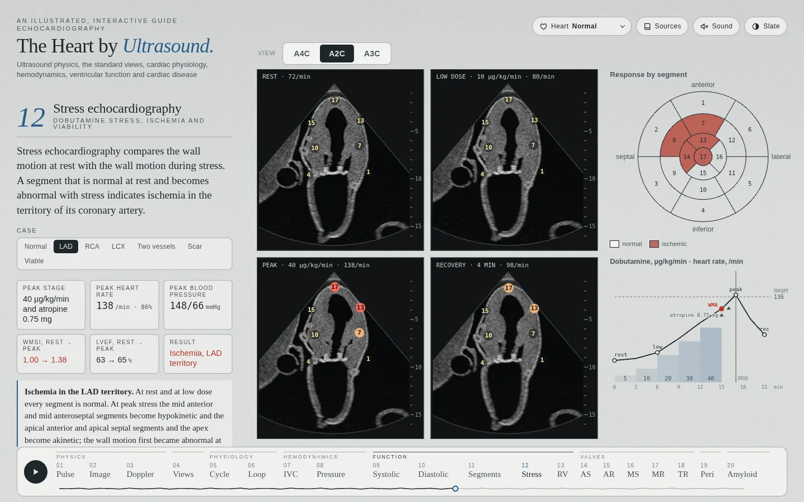 | 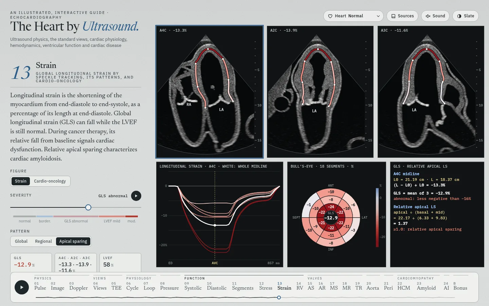 |
| 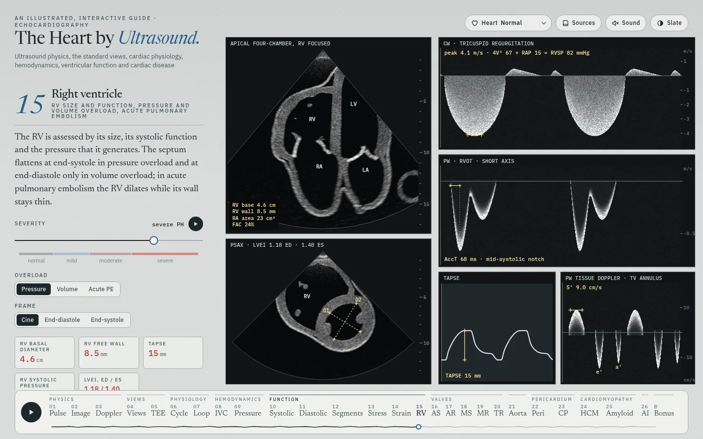 |  |  |
|  |  |  |
| 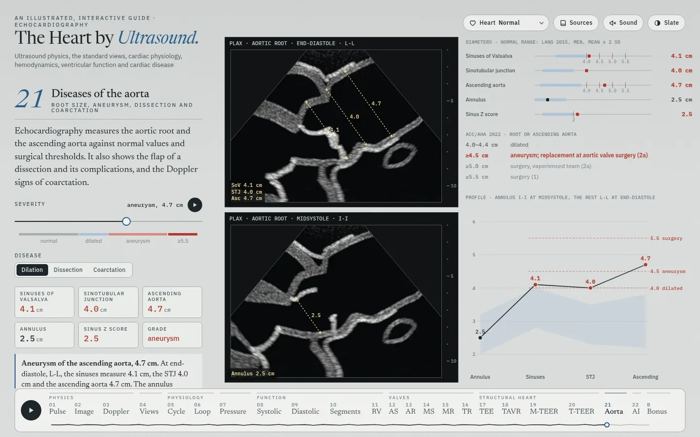 |  | 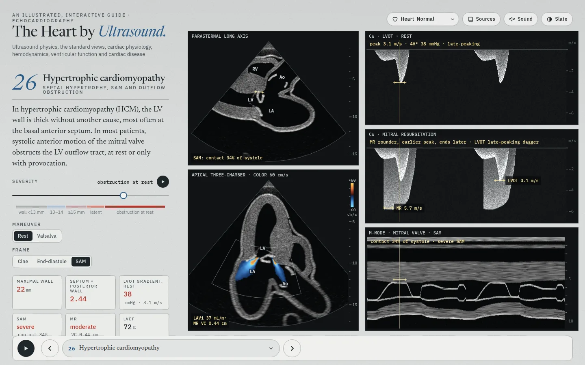 |
|  | 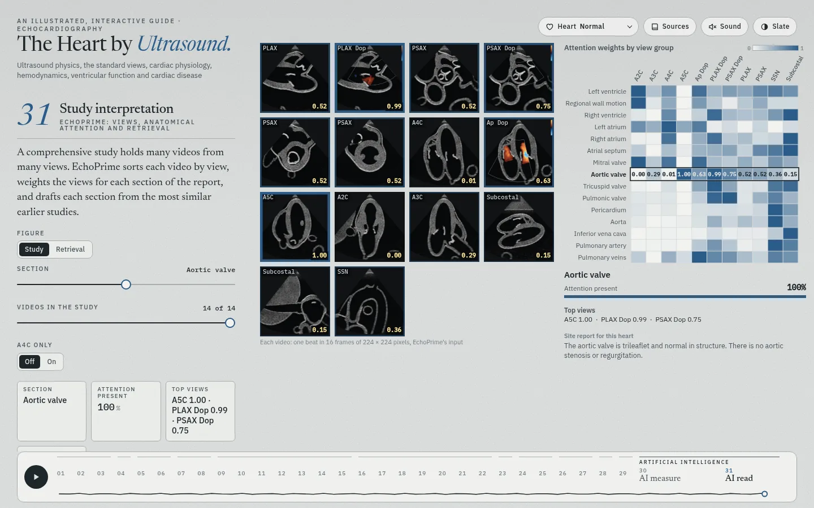 | |

The bonus chapters:

| | | |
| --- | --- | --- |
| 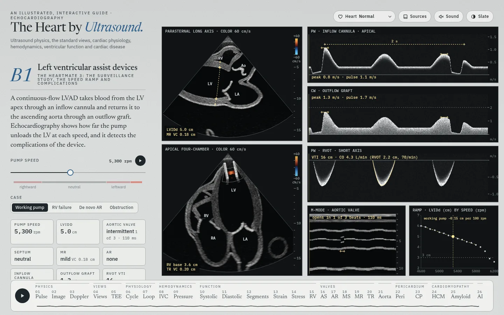 | 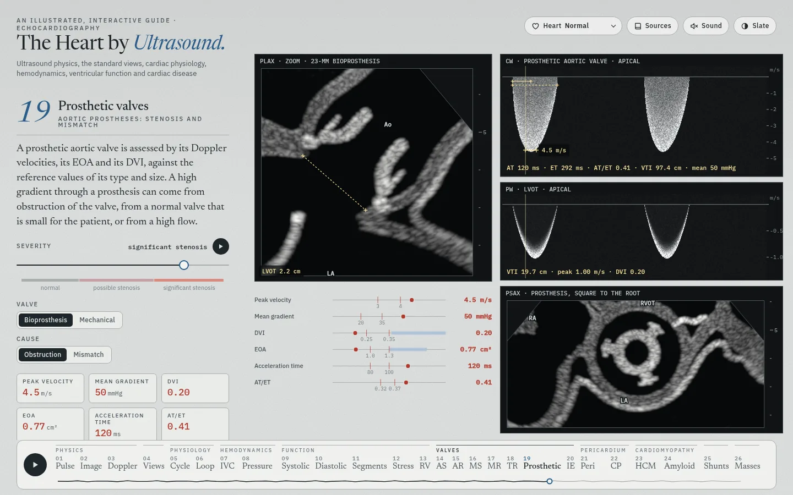 | 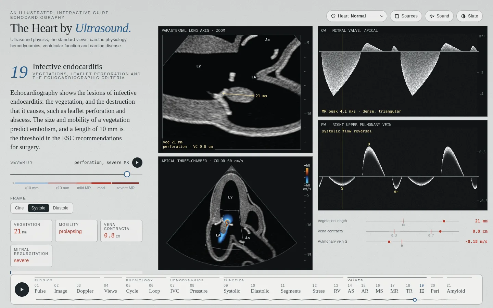 |
| 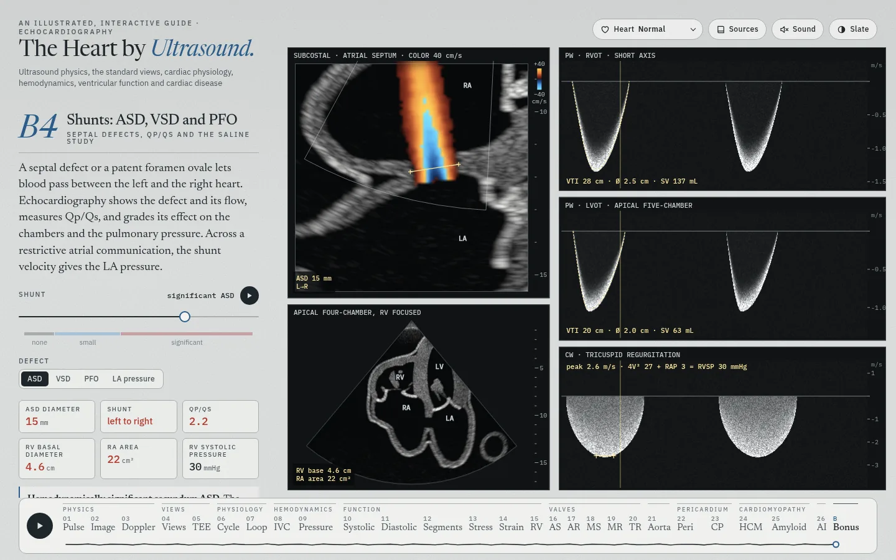 | 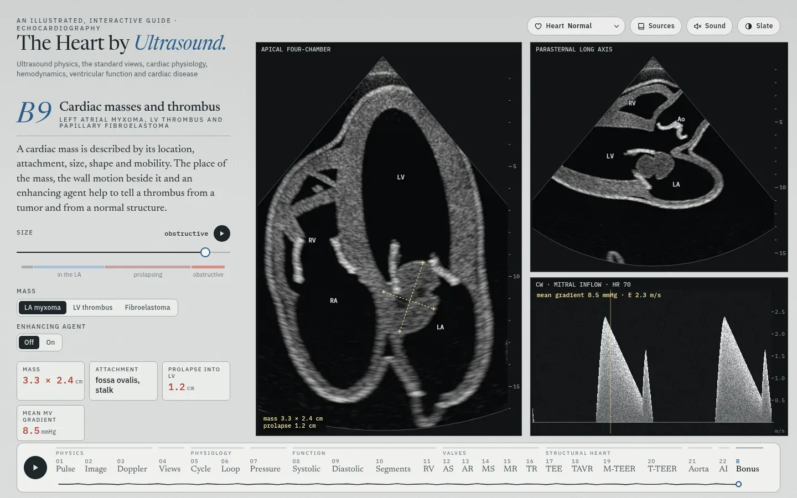 | 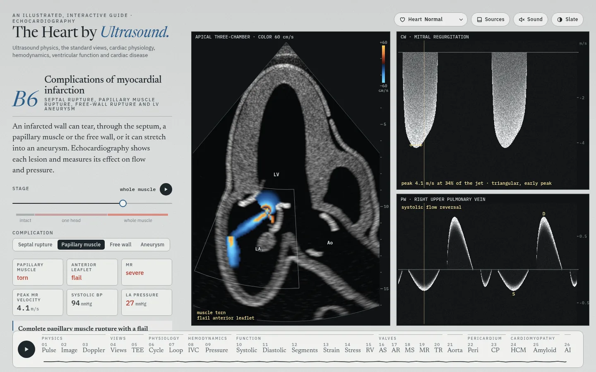 |

On a phone the figure sits above the text and stays in view while the text scrolls:

 

On a phone the bar at the bottom holds the Play button for the tour, back and next buttons, and the current chapter's number and title. A tap on the title opens the list of the 24 main chapters and B, by part. Each of these targets is at least 44 px. A title that needs more than two lines takes its short name, as on the desktop bar (TR, AR and Amyloid at 320 px). Wider screens show the row of chapters with their names under their parts when all the names fit. With 24 chapters, B and the web fonts, the row fits from 1325 px (1373 px with 25 chapters). When the names do not all fit, the row becomes a strip between back and next. The reader slides the strip with a trackpad, touch or the mouse wheel. The open chapter sits in the middle of the strip, with the names of its neighbours on each side. The edges fade where the strip goes on, and each part's name stays at the left edge while its chapters show. The button at the right end opens the same list as the phone's title.

## The heart shown

The **Heart** menu in the header sets the heart for the whole page, and the page keeps the choice between visits. The menu names the heart. The note under the title that described the heart is off (`SHOW_HEART_NOTE` in `src/main.js`). Its code and markup stay.

- **The mesh changes shape.** The 3D heart, and every echo view cut from it (chapters 02, 04, 06, 09 to 22 and B1 to B6), take the chosen heart. Chapter 23 cuts its views from the model's own normal-to-amyloid shape at the page's burden, whatever heart the menu shows (`setBurden` in `src/echo.js`). Amyloidosis is the model's own amyloid state. The other three are built from the normal mesh the first time they are chosen (`src/gl/phenomesh.js`, a few seconds; while it runs, the Heart menu is busy: `aria-busy`, a pulsing heart icon and a progress cursor): each moves the walls, valves and chambers and scales the systolic motion by segment. The descending aorta keeps its place in these three hearts, and their larger atria meet it: no point of the atrium or a pulmonary vein comes nearer the aorta's axis than 1.55 cm, 1 mm outside its wall (`descGuard`), so the aorta marks the back of the Barlow atrium. Before, the scaled atrium pulled the aorta's front wall into its lumen, by up to 6.9 mm in the Barlow heart, 2.9 mm in the ischemic heart and 1.7 mm in the bicuspid heart. It also pushed a pulmonary vein past the aorta's outer wall, by up to 11 mm, 4 mm and 1 mm.
  - **Ischemic cardiomyopathy**: a large LAD infarct. The LV dilates to 222 mL with an EF of 25%, the LAD territory is thin and akinetic, the apex bulges a little in systole, the rest is hypokinetic, and the mitral leaflets are pulled toward the apex.
  - **Barlow mitral valve**: thick, redundant leaflets that billow into the LA, a wide annulus, a large LA, and an LV of 183 mL with an EF of 67%.
  - **Bicuspid aortic valve**: the right and left cusps fused along a raphe; the valve domes and opens as a slit. The LV walls thicken to 12.5 mm and the ascending aorta widens to 3.6 cm (its lumen, square to its axis; 2.7–2.9 cm in the normal heart).
- **The 2D views draw the heart's valves** (`setHeart` in `src/echo2d.js`). Under the bicuspid heart the short axis shows two cusps, a raphe and a slit, and the long axis closes off-centre. Under the Barlow heart the mitral leaflets are 3 mm thick and 30% longer, and in systole they billow up to 1 cm past the annulus. Walls and chamber sizes stay each page's own.
- **Chapters open at the heart's values** (`src/pheno.js`). Loop opens at the heart's loop (a stiff ventricle under amyloidosis, a hypocontractile one under ischemic cardiomyopathy, a pressure load under the bicuspid valve, a volume load under Barlow), also when the heart is chosen on another chapter. Eject opens at the heart's volumes and EF, Segments at the LAD occlusion, Stress echocardiography at the viable case under ischemic cardiomyopathy, Fill at the heart's diastolic grade, and the heart's own valve page at its severity (aortic valve area 0.76 cm²; mitral EROA 0.46 cm²). The RV page opens under a pressure load, at the peak TR velocity of the heart's Doppler hemodynamics (3.0 m/s under amyloidosis and the Barlow heart, 3.1 m/s under ischemic cardiomyopathy, 2.6 m/s under the bicuspid heart). Its TAPSE, S′ and FAC are the heart's own RV on the mesh: at a normal pressure, TAPSE 12 mm and FAC 29% under amyloidosis, and 15 mm and 31% under ischemic cardiomyopathy. The pericardium page opens at a 7 mm effusion and the amyloid page at full burden under amyloidosis. The other valve pages open with no lesion, and the amyloid page opens normal under the other disease hearts. Under a disease heart, the severity pages do not play on their own. The other chapters play their own sequence under any heart (see *Run it*). The sequence starts from the first values of the tour. In Pressure, Loop, Eject and Segments, these values replace the heart's values. The tour, which plays when the page opens, also sets each chapter's values as it passes, under any heart.
- **Stress echocardiography under each heart** (chapter 12, `src/ch/stress.js`). As in Regional wall motion, the scores set the motion: the heart's own systolic change is off, and the normal heart's, scaled segment by segment, takes its place on the heart's shape. A factor on the motion of the normal and hypokinetic segments (`BASE`), measured on the mesh by the chapter's own biplane method, gives each heart its own LVEF at rest in the normal response: 54% under amyloidosis (1.10), 67% under the Barlow valve (1.59) and 63% under the bicuspid valve (0.91); the normal heart keeps 62.6%. The viable case is an ischemic cardiomyopathy at rest, the LAD territory akinetic and the other segments hypokinetic: that is the ischemic heart's own wall motion, and its LVEF is 25.1% with no factor. The motion of a segment is held to 1.75 times the normal heart's: beyond about 1.8 the walls of the Barlow LV fold at end-systole, and its measured LVEF falls. So the Barlow heart's normal response rises from 67% only to 71% at peak. Under ischemic cardiomyopathy the other cases move the remote segments as normal ones, on the dilated LV: the normal response and the four ischemic cases read an LVEF of 52% at rest, and the scar 42%, not the heart's 25%.
- **The Barlow heart's loop** (chapter 07, *Volume load (MR)*, `src/ch/loop.js`): chronic severe primary MR. The EDPVR is flat, so the LV fills to 183 mL at an EDP of 11.5 mmHg; EF 67%, as on the mesh; regurgitant fraction 53%, as on the MR page. The LA is a second outlet: blood goes back whenever LV pressure is above LA pressure, at a flow that goes with the square root of the difference, so the volume falls 4 mL before the aortic valve opens and 10 mL after it closes. LA pressure rises through systole to a v wave of 20 mmHg (LA compliance 8 mL/mmHg, a model value), and the mitral valve opens at it. Stroke volume 123 mL: 58 forward, 65 back into the LA. Ees is 1.70: with V0 fixed at 0, a larger end-systolic volume at a normal pressure gives a lower slope. The leak after aortic closure adds to the EF, so Ees ÷ (Ees + Ea) no longer gives it; the figure's card shows EF = SV ÷ EDV and the forward and regurgitant parts. Sources: Neema and Panidapu 2025 and Klabunde's *Cardiovascular Physiology Concepts*.
- **The report** (hidden) has a case for each heart, with its button next to the four standard cases.
- **Sizes.** The LV volumes come from 50 short-axis slices of each shape. The slices read 6% over the model's own normal volumes (118 and 42 mL against 112 and 39), so each heart's values are scaled by 0.945.
- **Limits.** The severity pages keep their own LV models, so a page can show values that differ from the heart's (the MR page gives an EF of 64% under the Barlow heart, the mesh 67%).
- **What the chapters share.** One heart mesh, one set of view planes (`viewGeometry` in `src/echo.js`), one echo renderer and one cycle model (`src/cyclemodel.js`) serve every chapter, so a change there reaches all of them. The Heart menu is the one patient: every chapter shows its heart and opens at its values. Each chapter's sliders, buttons and Play change only that chapter's own keys in the store (`src/state.js`), and the chapter keeps them while the page is open; no other chapter reads them. `SHARED` in `src/state.js` names the keys that several chapters use (the open chapter, the two Play states and the heart), and `node tools/check-state.mjs` fails when a chapter reads or writes another chapter's key that `SHARED` does not name.
- **Why the chapters do not share their settings.** Each disease page is a one-slider model. Along the slider, every number that the page prints stays in its guideline grade, and the guidelines grade one lesion at a time. No model in the site computes two lesions together. For example, severe MR lowers the forward stroke volume and with it the aortic gradient: an aortic stenosis page that took the MR of another chapter would print a gradient that no model computed. A shared setting would also make each page depend on the reader's path through the other chapters, while the text, the quizzes, the videos and the checks describe each chapter from its own start. The five hearts are the shared patients: each one is a set of values for every chapter, made and measured together.

| | | |
| --- | --- | --- |
|  |  |  |

## Sound

**Sound** in the header plays music in time with the heart, and cues for what changes on screen (`src/music.js`). Both follow the InVision sound brand: its chords, instruments, echo and room, and its cue notes. All of it is synthesized in the browser (Web Audio), so there is nothing to download. It is off when the page opens; a click turns it on, and another turns it off.

- **One beat per heartbeat.** The tempo is the heart rate the page shows: 70 a minute, and up to 118 at tamponade on the pericardium page. Where the heart on the page beats in real time (chapters 04, 08, 10, 12 to 23 and B1 to B6), the kick falls on its first heart sound, mitral closure 25 ms after the R wave. Chapters that slow the beat for study (06 Cycle, 07 Loop, 09 Systolic function, 11 Regional wall motion) and chapters with no heart keep the rate without the lock. So does a page that draws too few frames to keep its heart in real time.
- **The music.** C major, I–V–vi–IV (C, G, Am, F), one chord to a bar of four beats, in the brand's voicings: a pad of five detuned saws, a sine sub on the root in eighths, a soft kick on every beat, off-beat hats, and the brand's plucked arpeggio with a dotted-eighth echo. The pad, the sub and the arpeggio dip on each kick. The brand's films lean on the kick and the sub, which laptop and phone speakers barely play; here the pad and the plucks carry the music over a softer kick and sub.
- **The cues.** A new chapter sounds the brand's rising fourth, G5 then C6. A smaller change sounds one soft bell on a note of the chord that plays: a new view or plane set in chapter 04, any switch or tick box, a new heart from the header menu, and each new grade while a severity page plays. A bell never follows a chapter cue within 0.6 s, nor another bell within 0.25 s.
- **Levels.** About −17.5 LUFS with the cues, the level of the first music. The brand's master stage (a tanh curve) holds every peak under −1.4 dBFS.
- **Sound starts only after a click**, as browsers require: until the button is pressed the page makes no audio context. The sound stops while the tab is hidden.
- **iPhone and iPad.** There, Web Audio plays as ambient sound, which the ring/silent switch mutes; videos play as media, which it does not. So the page asks for media playback: the Audio Session API where Safari has it, and a silent one-second track (`assets/silence.mp3`) that plays on a loop while the sound is on. A call or another app's audio can pause the sound; the next tap on the page brings it back.

## Views and the lab's annotation classes

Chapter 04 covers the ASE comprehensive transthoracic views (Mitchell 2019, Tables 2.1–2.27). Each view carries the class name from the lab's annotation list (`lab` in `src/views.js`), for example `PLAX_IVS_LVPW_LVIDD`, `PSAX_(level_great_vessels)_focus_on_PV_and_PA`, `Subcostal_IVC`, `SSN_aortic_arch`. Six views have no class in that list: the coronary artery origins, the zoomed tricuspid valve, LV apex and aortic valve (apical), the zoomed atrial septum (subcostal) and the suprasternal short axis.

- **The plane moves between views.** A change of view turns the plane along the shortest rotation while the point it images slides across, so neighbouring views are small moves: the tricuspid valve view lies 9° from the aortic valve level and steers onto the valve. The abdominal aorta lies 27° from the IVC plane, which turns toward the four-chamber view (below).
- **The free probe** (`src/freeprobe.js`, `src/ch/windows.js`). The **Free probe** check box frees the probe from the standard views. Five sliders then move it from the current view, in the terms of the ASE guideline (Mitchell 2019, Section II.B, page 5):
  - **Rotate** turns the probe about its beam, up to 180° clockwise or counterclockwise as the examiner sees it.
  - **Tilt** turns the beam across the imaging plane, up to 45° each way, and the probe stays where it is.
  - **Rock** turns the beam within the plane, up to 60° toward or away from the marker.
  - **Slide along** and **Slide across** move the probe over the skin, up to 10 cm each way. The first moves it along the marker, and the second at a right angle to the plane.

  The pose applies the moves in that order. It is the free plane of Planes (archived), and both chapters now share the pose and its inverse. The inverse moves the probe onto the target view's beam line, so one set of slider values reaches each view exactly. The panel names the standard view nearest the plane, among the starting view and the views of the probe's window. It gives three numbers, as the free probe of the TEE chapter does. They are the angle between the beams, the angle between the markers, and the distance from the probe to that view's beam line. Within 5° and 0.5 cm the panel names the plane as that view. A drag that stops there settles the probe on the view, and the sliders go back to zero. The arrow keys move the probe without a settle. The nearest view has the least sum of the angle between the planes, half the larger of the other two angles, and 5° for each cm. The TEE chapter's score, the larger angle and 10° for each cm, named the RV outflow for the long axis rotated 90°. In this model the short-axis probes lie 3 to 4 cm from the long-axis probe. The panel calls a view near when the planes lie within 15° and the middle of the view's image within 2.5 cm of the plane. A view turned 180° about its beam is near, and the sentence names it mirrored. Tilt and Slide across take the words of the window. In the short axis they move toward the base or the apex. At the apex they move anteriorly, posteriorly, medially or laterally, by the heart's axes. In the other windows they take the nearest axis of the body. Angling has no slider, because the guideline defines it as several small movements together. The echo keeps the depth and the sector of the starting view, without its zoom. With the option off, the figure is the figure of main.
- **The parasternal long axis.** The plane runs through the apex and the centres of the mitral and aortic valves, the plane of the apical long-axis view, so the aortic root opens into the ascending aorta past the valve: the aortic centreline stays within 0.3 cm of the plane for its first 4 cm. The probe stays at the left sternal border, with the parasternal beam turned into that plane; the LV keeps the tilt it had on screen (12°), so the aorta rises 50° and leaves the sector 2.5 cm past the valve, at about the sinotubular junction (where the model's root narrows to 1.36 cm in radius, from 1.59 cm in the sinuses). The beam keeps its angle of 83° to the LV's long axis, so in Probe and body it now points 50° toward the feet, seen from the side (36° before). Before this change the plane held the LV's axis and the parasternal beam, 19° round the LV's axis from this one: it passed 0.9 cm from the aortic valve's centre, and the root closed just past the valve. In this heart model the new plane passes 3.5 to 5 cm beside the descending aorta behind the left atrium, so the descending aorta has left the sector; among the planes through the aortic valve's centre, none holds the LV, the open root and the descending aorta behind the atrium together. The long axis's tags name the septum and the inferolateral wall where the calipers cross them, the cavity 1.2 cm toward the apex from there, and the RVOT in front of the LVOT. The calipers measure square to the LV's long axis (ASE 2015) through the point 30% of the way from the LV's middle to the mitral valve; before, they ran along the beam. The LV diameter tables (`LVD` in `src/meshcal.js`, chapters 15, 16, 18 and B4) and chapter 23's wall thicknesses were measured again this way.
- **The great-vessel short axis (ASE 2019, Table 2, rows 2.7–2.10).** The probe lies in front of the aortic root, a little to its left; the beam runs back, a little to the right and down. At the aortic valve the plane passes 4.5 mm above the valve's centre, through the shut cusps where they meet, and leans 30° from square to the root, toward the patient's right and 20° back. Square to the root, it would pass above this model's left atrium; in the ASE images the left atrium lies directly behind the valve at this level. Leaning, it cuts the atrium 2 mm behind the root (5 mm with the earlier lean of 28°, 10° back) and shows what ASE lists: the RVOT across the front from the tricuspid to the pulmonic valve, the valve in the middle, the right atrium on the left, the left atrium below and the atrial septum between. The sector turns 10° in the plane toward the patient's left and is 86° wide (80° before), so the main PA runs round the aorta down the right of the sector, as in the ASE image, and the tricuspid valve stays at the left edge. The probe sits 1.1 cm lower and to the patient's right, and the beam runs 12° down (19° before). The zoomed valve view is square to the root, so the shut cusps meet in a Y, with the right coronary cusp at the top, the left on the right and the non-coronary cusp at the lower left. One level up (row 2.7), the plane passes 2 cm up the root from the valve's centre and leans 20° from square to it, toward the front and a little to the patient's left. It shows the aorta above its valve in cross-section, the RVOT, the pulmonic valve, the trunk down the right of the sector, the bifurcation, the RPA behind the aorta and the LPA.
- **The LV short axis (ASE 2019, Table 2, rows 2.11–2.13).** The probe lies at the left sternal border, 138° round the LV's axis from its lateral wall toward the front, level with a point a fifth of the way from the LV's equator to the mitral valve. From there the beam tilts 9° up to the mitral valve and 9° down to the papillary muscles, as the probe fans between the levels; the long axis turned 90° clockwise lies 2° from the mitral level. At both levels the RV's cavity lies at about 11 o'clock from the LV's centre, as in the ASE images (before this change, 12 o'clock at the mitral valve and 10:30 at the papillary muscles). The mitral level keeps the LV ring and both leaflets through the beat; before, the plane lay square to the axis at the valve, and in systole the base's descent took it into the left atrium. For the apex the probe slides 5.2 cm toward the apex, to a level 0.4 cm below the end of the RV, so the LV shows alone.
- **The five-chamber view (ASE 2019, Table 2, row 2.17).** It is the four-chamber plane tilted 10° toward the front. The beam aims 85% of the way from the four-chamber target to the aortic valve, so the LVOT, the valve and the aortic root lie in the plane between the right and left atria: the valve 3 mm off the plane, the LVOT 1 mm. Before this change the beam aimed 55% of the way, the plane passed 1 cm from the valve, and the view showed four chambers.
- **The subcostal IVC view (ASE 2019, Table 2, row 2.25), with more of the heart.** ASE shows the IVC in its length through the liver into the RA. The plane holds the IVC's axis from its RA end to 5 cm down it, so the vessel lies in its length and its diameter measures square to it. It is the plane through that axis and the subcostal probe point, turned 20° about the axis toward the subcostal four-chamber view. That turn brings it closest to the four-chamber plane: 49° from it (60° before). The tricuspid valve and the RV then show above the RA, and the RV lies under the liver, as in the four-chamber view. The middle hepatic vein lies in the plane for 3.9 of its 4.8 cm (0.7 cm before). It opens into the IVC 1.1 to 1.8 cm from the RA. The probe sits below the xiphoid, 3.8 cm to the patient's left of the IVC. The beam aims 24° toward the patient's right, toward the liver. The sector is 84° wide, as in the four-chamber view (76° before), so it holds the RA and the RV. Before this change the plane held the body's long axis and the beam. It lay 8° off the IVC's axis, and the heart in it was the RA with an arc of the tricuspid valve. No plane through the IVC's axis shows four chambers with the probe below the xiphoid. The LV's centre lies about 4 to 5 cm from each of them. Turned 30° the other way, the plane shows the atrial septum and the LA in place of the RV, with the probe 4 cm to the right of the IVC. On the mesh the IVC measures 2.06 cm across, 2 cm from the RA, on every heart. Before, the plane cut it off its centre: 1.99 to 2.02 cm, 1.8 cm from the RA. Chapter 08 draws the RV and the tricuspid valve above the RA too.
- **The aortic valve model is turned 60°.** As supplied, the valve model faced its commissures, not its sinuses, toward the coronary origins. Turned 60° about its own axis (the model has three-fold symmetry), the right coronary cusp faces the RVOT and each coronary artery leaves its own sinus. The targets that carry the root's own motion (systole, amyloid) are split: an affine fit, which is the root's motion, stays where it is, and only the valve's own change turns.
- **Cross-section, labels, probe and body.** The middle pane shows the 3D heart cut on the view plane and seen square to it, turned as the echo is (probe at the top). **Labels** names the structures in the margin of the model, as in *The Amyloid Heart*; the echo sector carries no labels. A pane under 340 px wide takes the views' short names (RVOT, IVS). The tags are laid out at end-diastole and hold still through the beat; each leader follows its structure. **Probe and body** puts in the left pane, in place of the planes, the whole heart from the front, head up, with the plane and the probe, and a body key in the corner (`src/gl/bodykey.js`): the patient turned as the camera is, drawn in pencil like the heart, the body as an outline. The body has adult male proportions (chest 33 cm across and 26 cm deep). The heart inside is the model's own mesh, in red pencil, and beats with it. It lies about three-quarters left of the midline, with the apex 8.5 cm from the midline. The probe sits on the skin at the view's window, with its sector toward the heart and its cable hanging. The transducer (`src/gl/probe3d.js`) is a phased-array probe drawn to scale: a 2.6 × 1.7 cm head with a lens and an index marker on the screen-right side, 13 cm from the lens to the cable. The probe and the body key go through the same pencil passes as the heart (`tools` and `renderInset` in `src/gl/pencil.js`): graphite outlines and hatching, darker where a part is darker (the lens, the cable).
- **The planes, in the left pane.** The left pane draws the planes of the nine standard views of Planes (archived): the long axis; the short axis at the aortic valve, the mitral valve and the papillary muscles; the apical four-, two- and three-chamber views; the subcostal four-chamber view; and the suprasternal view (`src/gl/fans.js`). The heart is whole and seen from the front, without the pericardium, so the planes show inside it; the subcostal views add the whole liver. Each plane is in the color of its window, and the current view's plane is lit. Ink lines mark where the current plane crosses the others. A view off the nine shows its own plane in ink, with its code. In a pane under 260 px tall (a phone, or a tablet held upright) nine tags would cover the heart, so only the current plane's tag shows. Where a plane runs behind the heart's front surface it is fainter, so it reads as going into the heart. A click or tap on a plane or its tag (not a drag) takes the probe to that view; on hover the plane lights up. The planes carry no probes; the cross-section shows the probe. The left pane is the shared stage's second pane (`Pane3D` in `src/gl/stage3d.js`, from PR #19): it draws the same scene from a camera of its own, and in each frame the chapter sets the scene for it and back again (`prepare` and `restore` in `src/ch/windows.js`).
- **Three panes.** Where the figure's width is more than 0.95 of its height, the planes, the cross-section and the echo sit side by side. In a taller figure the planes go across the top, with the cross-section and the echo side by side under them, and on a phone the figure takes up to 64% of the screen height (560 px at most). The pane names have a halo of paper, because the probe in a narrow cross-section can run under them.
- **The pulmonic valve.** The RV outflow view (row 2.5) runs along the valve's own axis (the principal axis of the valve mesh), turned about it to hold the bifurcation and 3 mm to one side, so it crosses two cusps and the line where they meet: shut, they meet in the middle; open, they lie along the walls of the trunk, which runs in the plane to the bifurcation. Turned this way, the probe moves 3.0 cm toward the long-axis probe: it sits 4.1 cm from it (5.5 cm before). The model's left main runs through a gap in the mesh beside the valve, so the RV outflow view leaves the coronary arteries out, and any coronary section that lies inside a blood pool, clear of the walls, is dropped in every view.
- **Walls between cavities, in the heart mesh** (heartmodel's `blender/anatomy.py`, built into `assets/heart.json` and `assets/valves.json`). The great-vessel short-axis views showed the aortic root without an anterior wall: the RV outflow tract's lumen ran into the right and left coronary sinuses, so the aortic lumen ran into the RVOT, and in systole into the pulmonary trunk, in all five hearts and at every point of the beat. The model's shape fields now keep every other lumen 1 mm outside the aorta's outer surface, so a wall of 2.6 to 3.8 mm parts the aortic lumen from the RVOT and the pulmonary trunk in the aortic valve, zoomed valve, coronary, pulmonary artery and tricuspid valve views; the superior vena cava no longer opens into the ascending aorta either. The right coronary artery, which ran through the opening, now shows as a ring in the root's anterior wall. The descending aorta moves up to 9.5 mm back as the amyloid atrium grows toward it (the atrium ran 6 mm into it), so the atrium keeps its volume (115 mL at end-systole) and its four-chamber RA/LA area ratio (0.91); the left atrium and the left pulmonary veins keep 3 mm from it. The lower left pulmonary vein enters the back of the atrium, low, and runs left and down, in front of the descending aorta; the upper one keeps its course from the lateral wall, left, back and up. Before, the lower vein left the lateral wall beside the mitral annulus, and the four-chamber views cut it there: in systole a wedge of vein showed at the lateral annulus. The coronary arteries are seated on the heart without the pulmonary veins, so the circumflex keeps to its groove (the lower vein had pulled up to 8.1 mm of it out), and the pericardium keeps 1 mm from each pulmonary vein's wall. The open pulmonic cusps move up to 3 mm inward with the narrower trunk lumen beside the aorta, and the open aortic cusps up to 0.5 mm.
- **The pulmonary artery, re-shaped as the model loads** (`src/gl/pabend.js`). The model's trunk rose 48° from its valve to the bifurcation, 30° out of the plane square to the aortic root, so the short axis at the aortic valve cut it as a stub. In a heart the trunk runs back round the left side of the aorta near that plane; the RPA runs behind the aorta and the LPA back and to the left over the left bronchus. The trunk now bends along its own axis between 0.5 and 2.8 cm above the valve, to 15° above the horizontal and 19° to the patient's left of straight back; past the bend it moves as one piece with the bifurcation. The LPA rises 19° over its first 2 cm, then turns down 25° over the bronchus. The RPA climbs 30° from the lowered bifurcation, then levels off under the arch: in the suprasternal view it lies 0.7 cm lower than before, 8 mm under the arch (4 mm before). The RV muscle round the trunk's root, and the pericardium and coronary arteries near the PA, follow the nearest PA point, each by the share of the gap it lies across, so what lies between the PA and a fixed wall is squeezed, not crossed. Each morph target's displacement and each normal turns with its point. Before the bend, two holes in the PA's wall close: a 2 cm opening at the tip of a short cone in the roof of the bifurcation, and a 6 mm gap in the inner surface beside it. A plane through the lip of either hole joined the wall's two outlines into one, and the echo then drew a coronary artery as a ring inside the PA. Inside the aortic valve level's sector the PA wall now draws 22.9 cm of outline (5.6 cm before); one level up, 46.9 cm (30.6 cm).
- **The papillary muscles, re-seated as the model loads** (`holdPapillary` in `src/gl/rvdetail.js`). An RV papillary muscle ran out through the RV free wall. Every papillary point now stays at least 1.2 mm inside the heart's outer surface: the 15 points that lay outside it move in, by up to 4.2 mm, and 20 that lay less than 1.2 mm inside it move by up to 1.0 mm. The outer surface is the myocardium within 6 mm of the pericardium whose normal runs with the pericardium's (dot product above 0.3). The load step for the left pulmonary veins (`seatLeftVeins`) is kept and no longer called. It turned the older meshes' veins out of the four-chamber plane and pressed their shared mouth into the line of the atrial wall; that press also pulled the amyloid atrium's lateral wall in by up to 15 mm, so the four-chamber view showed a step in it. The mesh now brings the lower left vein into the back of the atrium (see *Walls between cavities* above).
- **RV trabeculations, added as the model loads** (`trabeculate` in `src/gl/rvdetail.js`). The model's RV was smooth inside. It now has the moderator band, from the septum to the free wall at the anterior papillary muscle's base, 36% of the way from the RV apex to the tricuspid valve: 2.9 cm long, 5.4 mm across at the septum, 4.0 mm in the middle and 4.8 mm at the free wall, bowed 1.5 mm toward the apex. Seven thin trabeculae, 1.8 to 2.2 mm across and 1.0 to 2.4 cm long, cross the apical third, some in the four-chamber plane and some up to 9 mm to either side of it. The free wall's endocardium carries coarse ridges up to 2 mm high over the apical quarter, fading out by the RV's middle. They run in two crossing families 1.25 and 1.55 cm apart, and their height and course vary along the wall, so a plane that grazes the wall cuts an uneven row of ridges, not a comb. Each band runs between the points where a ray from the middle of the cavity meets the two walls, its ends 1.2 mm into the muscle. It moves with the walls it joins: its systolic and amyloid displacements blend from those of the wall at each end. The four-chamber, RV-focused and subcostal views show the band and the trabeculae.
- **The posterior mitral leaflet opens, re-shaped as the model loads** (`src/gl/mvopen.js`). In the valve model's open shape the posterior leaflet hardly opened. Across P2 it left the annulus 60–65° below the annulus plane and bent back to 45–50°, 1.0 cm long; shut, it lies 25–35° below, 1.17 cm long. In the long axis its hinge sits behind a ridge of the posterior wall, so in diastole only its tip showed, as a stub that pointed into the orifice. Its middle shape lay close to the shut one too. The open shape is now the shut one turned 20° toward the apex about the leaflet's own part of the annulus, and 10% longer. The middle shape is the shut one turned 10°. The change fades in from 85° to 115° round the annulus from the aortic valve, so the anterior leaflet and the commissures do not move. The chordae next to the posterior leaflet go with it, less with distance, and not at all past 1.2 cm. The shut target takes the change back, so the shut shape does not change. The open shape moves by up to 0.48 cm and the middle one by up to 0.42 cm (2,274 leaflet and 2,217 chordal vertices).
- **The coronary arteries, in one view only.** The echo views cut the coronary arteries only where a view sets `cor: true`: the coronary artery origins (`psax_cor` in `src/views.js`). Elsewhere their cuts came and went through the plane with each beat, in the aortic sinuses or the atrioventricular groove. They read as a small vessel that moved through the aortic root (chapters 22, B2, B3 and B4). The 3D heart keeps them.
- **A ring of leaflet, not a disc** (`wound` in `src/echo.js`). The B-mode fill uses the nonzero rule, and the section walk gives each loop either winding. A valve loop that lies wholly inside another loop of the same valve now runs the other way, so it cuts a hole. The mitral funnel cut across in the short axis at diastasis shows as a ring, as do the billowed Barlow leaflets in systole. Loops that only overlap, as two leaflets in contact do, keep one winding and fill as one.
- **Below the diaphragm.** The heart model ends at the diaphragm. For the subcostal views, `src/abdomen.js` adds simple shapes to the echo: a liver moulded to the underside of the heart, the IVC down through it, two hepatic veins, the abdominal aorta with the celiac trunk and the superior mesenteric artery, and the spine. The subcostal four-chamber plane in this model passes above the liver, so that view keeps a liver layer in the near field. The parasternal views leave out the liver and its hepatic veins: this model's liver reaches into their far field, where ASE's parasternal images show none. The aorta and the IVC stay.
- **The liver in 3D, in the subcostal views only** (`src/gl/liver3d.js`). In the IVC and aorta views the cross-section shows the liver the echo cuts, cut on the same plane, with a *Liver* tag. Its cut face is hatched more sparsely than the heart's, and the other way. In the four-chamber view it shows the echo's near-field layer: a lobe in the plane from 1.5 cm under the skin to the diaphragm at 5 cm. The lobe is flat across the sector, thicker toward the right lobe and thin at the apex side. With *Probe and body* the whole liver shows under the heart in every subcostal view. The liver fades in as the plane moves into the subcostal window and out as it leaves, over the time the plane takes to move (0.4 to 1.3 s); from the four-chamber view to the IVC view the layer fades out as the liver fades in. The pencil renderer draws it as a second layer: its own normal, depth and data passes, laid over the heart where it is nearer, at the alpha it fades by. Four-chamber planes from below the xiphoid were tried and left out: the ones that cross the model's liver lie 15° to 30° from the four-chamber plane. Their cut no longer reads as four chambers, and the liver fills only one side of the near field. The model's IVC, hepatic veins and abdominal aorta stay in the echo only.


**The planes together.** The apical views share the LV long axis; the model places the two-chamber plane about 60° from the four- and three-chamber planes, as the ASE rotation describes. The mitral and papillary muscle levels fan from one probe spot, 9° up and 9° down; the aortic valve level lies above them.

**Transesophageal views (chapter 05).** The views, their angles, levels, probe movements and structures follow Table 10 of the 2013 ASE/SCA guideline (Hahn). The 11 views of the basic examination follow Reeves 2013. The display follows Hahn's Figure 2. The transducer is at the top. At 0° the patient's right is on the left of the display, and at 90° the left of the display is inferior. At 180° the image is the mirror image of 0°. Each view's echo on the normal heart was set beside the guideline's schematic and image of that view. The structures lie in the same places on the display, with these differences:

- **ME four-chamber, 5°.** Both atria, the atrial septum and both atrioventricular valves lie as in the schematic. The RV is on the left and the LV on the right. The LV takes more of the sector than in the guideline's image. The schematic has the ventricular septum on the sector's centre line, from the crux to the apex. Here the septum leans about 40° from it: on the normal heart the crux lies at −17° and the apex at +17°. The plane through the probe, the crux and the apex was tried at 11 heights along the esophagus, from y = −3 to 2 cm in steps of 0.5 cm. The four-chamber probe lies at y = 0.1 cm. At each height the septum leaned 34–53°. So no probe position or angle in this mesh gives the guideline's upright septum.
- **ME mitral commissural, 60°, and two-chamber, 85°.** The LA lies above the LV, with the apex at the bottom. The mesh has no coronary sinus. The appendage's mouth lies 1.8 cm from the two-chamber plane on the normal heart (1.8–2.8 cm on the five hearts). So this view does not show the appendage that the guideline lists. In the commissural view the leaflets do not show the P3, A2 and P1 pattern of the schematic.
- **ME long axis, 140°.** The plane is the two-chamber frame's plane at 140°, with the beam turned in it to the mitral valve. On the normal heart the mitral valve lies on the centre line, the aortic valve at +28° and the apex at −15°. On the five hearts the aortic valve lies at +19° to +28°. The LVOT, the aortic valve and the proximal aorta lie on the right of the display, as in the schematic. The valve's centre lies 0.44 cm off this plane on the normal heart.
- **ME aortic valve long axis, 120°; ascending aorta long axis, 95°, and short axis, 5°.** These lie as in the schematics. The root and the aorta run to the right of the display. In the long axis of the ascending aorta, the right pulmonary artery lies in the near field. In its short axis, the SVC lies on the left of the aorta and the main PA on its right.
- **ME aortic valve short axis, 30°; RV inflow-outflow, 55°; bicaval, 95°.** These lie as in the schematics. For the valve's short axis the probe lies 0.5 cm below the valve's centre, behind the upper LA, anteflexed to the valve. The guideline gives this move as "Advance" and "Anteflex". So a part of the superior LA lies in the near field, as the guideline lists. The plane lies 15° from square to the aortic root. The short axis shows the three cusps, with the LA above, the RA on the left and the RVOT below. The RV inflow-outflow view, 0.6 cm lower, shows the LA above and the tricuspid valve, the RV and the pulmonic valve round the aortic valve. The bicaval view shows the IVC on the left and the SVC on the right of the RA. The atrial septum lies on the centre line of the bicaval view, 4.7 cm deep. Where the LA and RA walls of the mesh lie within 0.7 cm of each other, they span 2.5 cm. So the septum is shorter than in the guideline's image.
- **ME left atrial appendage, 105°.** The LA lies in the near field, and the appendage hangs from it toward the far field, as in the schematic. The model's appendage is 2.8 cm long from its mouth to its closed tip on the normal heart, and its lumen narrows toward the tip. The model's left upper pulmonary vein enters the LA below the appendage. So it lies on the left of the display, where the schematic has it on the right.
- **TG midpapillary short axis, 10°, and two-chamber, 90°.** The short axis shows the LV ring with both papillary muscles, and the RV on the left. The two-chamber view shows the apex on the left and the mitral valve and LA on the right. The short axis sits at 10°, inside the guideline's 0–20°. The two-chamber plane at 90° then holds the apex, the mitral valve and the LA. It passes 1.5 cm from the aortic valve. In the two-chamber view the appendage shows beyond the mitral valve, as the guideline lists. The RVOT and the pulmonary artery show in the far field.
- **Descending aorta, 0° and 90°; aortic arch, 0° and 70°.** These lie as in the schematics. The mesh's descending aorta ends a little above the hiatus. So the probe for its views lies 4.5 cm above that end, behind the LA, where the tube crosses the whole sector in long axis. Just above the diaphragm, the closed end of the tube showed on the left of the long axis. The guideline withdraws the probe along the aorta to image all of it. The mesh has no azygos or hemiazygos vein, no intercostal artery and no innominate vein. The arch's short axis sits at 70°, the low end of 70–90°, where the main PA lies nearest the plane. The beam turns in that plane from the arch toward the PA, with 17° of retroflexion on the normal heart. So the arch lies near the transducer on the right. The main PA and the pulmonic valve lie in long axis in the far field on the left.

Eleven of the 28 views are not shown. They are the ME five-chamber (1), right pulmonary vein (9), modified bicaval tricuspid (12) and UE pulmonary vein views (14). The TG basal and apical short axis (16, 18) and the three TG RV views (19, 20, 23) are left out too. So are the deep TG five-chamber view (21) and the TG long axis (24). Each position of the two switches holds the views that the angle alone reaches from one probe position. The other views need another depth or flexion at the same level and turn. In the TG frame the plane through the aortic valve lies at 109–111°. That is below the 120–140° of the TG long axis.

## The severity pages (chapters 10, 13 to 23 and B1 to B6)

- **One slider per disease.** It runs from normal to the end stage. The bands under it show where the grade changes; the page computes them from its own model, so a band starts where the values cross the guideline cut-off.
- **Play** runs the page's own sequence, the sequence of the tour. The slider moves from normal through the course, holds, and starts again. In mitral stenosis, the heart rate then rises. The page moves when it opens, in the tour or in its own sequence. Any input in the page stops it (see *Run it*). The beat runs all the time; there is no cine switch.
- **Several views change together.** A 2D view drawn to scale (a caliper on the screen reads the value in the text), Doppler strips with a cursor at the same moment of the beat, and a strip of measurements against their cut-offs. Most pages also have the guideline table with the current column marked. In 10 Diastolic function, 15 Aortic stenosis, 16 Aortic regurgitation, 17 Mitral stenosis, 18 Mitral regurgitation, 19 Tricuspid regurgitation and 23 Cardiac amyloidosis a diagram in the text takes the place of the table: the guideline algorithm or the calculations, with ▲▼ buttons on the measurements. An edit moves the slider to a band of the new result; a move of the slider, Play, the tour or Reset returns the values to the model. 15 Aortic stenosis shows the apical three-chamber view, one CW trace with the LVOT envelope inside the aortic jet, and the short-axis valve to scale.
- **Grades and stages.** Regurgitation follows ASE 2017 (Zoghbi), with EACVI 2022 for massive and torrential TR; aortic stenosis follows Baumgartner 2017; mitral stenosis follows ASE 2023 (Pandian); diastolic function follows ASE 2025 (Nagueh). The RV's size, wall and function and the RV systolic pressure follow the ASE 2025 right heart guideline (Mukherjee), Table 1 as corrected in May 2025; the echocardiographic probability of PH (hidden) follows ESC/ERS 2022 (Humbert). Acute pulmonary embolism follows the 2019 ESC guideline (Konstantinides). Its grades are RV dilation, RV dysfunction and the specific signs. RV dilation is an RV basal diameter above 4.0 cm (Mukherjee 2025). The page calls RV dysfunction an RV/LV ratio of 1.0 or more with a TAPSE below 16 mm. ESC 2019 links these two findings most often to an unfavorable prognosis. McConnell's sign follows McConnell 1996, its accuracy Kurzyna 2002 and Falster 2022, and its mimic in RV infarction Casazza 2005. The 60/60 sign follows ESC 2019 and Kurzyna 2002, and the prevalence of both signs Kurnicka 2016. Mediratta 2016 gives McConnell's sign without PE, and Rudski 2010 the acutely loaded RV that dilates before it thickens. The LV and atrial consequences follow the ACC/AHA 2020 stages (Otto), for example stage C2 in MR at LVEF ≤60% or end-systolic diameter ≥40 mm. Effusion size follows ESC 2015 and 2025 (<10, 10–20, >20 mm at end-diastole); the echo signs of tamponade follow ASE 2013 (Klein) and ESC 2025 (Schulz-Menger). The amyloid bands follow the ESC 2021 echo criteria (Garcia-Pavia): an unexplained wall of 12 mm or more, plus two of three findings (grade 2 or worse diastolic dysfunction; septal s′, e′ and a′ all below 5 cm/s; GLS below 15% in absolute value) or a multiparametric score of 8 or more (Boldrini 2020). Constriction follows the Mayo Clinic criteria (Welch 2014; ESC 2025, Schulz-Menger), with the respiratory variation of mitral and tricuspid E of ASE 2013 (Klein). The LA volume index takes the bands of Lang 2015. HCM follows the 2024 AHA/ACC guideline (Ommen) and ASE 2022 (Nagueh), with ESC 2023 (Arbelo) where it differs: a maximal wall of 15 mm or more (13–14 mm in a family member or with a positive genetic test), obstruction at a peak LVOT gradient of 30 mmHg or more, latent obstruction below 30 mmHg at rest and 30 mmHg or more with provocation, and the M-mode SAM grades of ASE 2022 (mild >10 mm; moderate ≤10 mm or contact <30% of systole; severe contact ≥30%). The gradient follows the SAM-septal contact by the regression of Pollick 1984: 25 × (contact time ÷ time from SAM onset to contact) + 25 mmHg. Prosthetic aortic valves follow the 2024 ASE guideline (Zoghbi): Table 5 for stenosis, Table 7 for mismatch and Appendix Table A4 for each valve's reference EOA. Pibarot 2006 gives the mismatch threshold of 0.85 cm²/m². The shunts follow ESC 2020 (Baumgartner) and AHA/ACC 2018 (Stout). A shunt is significant at a Qp/Qs of 1.5 or more, or with RV (ASD) or LV (VSD) dilation (Mukherjee 2025, Lang 2015). The VSD's last band is an RV systolic pressure of half the systemic pressure or more (Stout). The saline study follows ASE 2015 (Silvestry) and Mitchell 2019, and the RV pressure across a VSD Silbert 1986. The LA pressure tab adds 4V² across a restrictive atrial communication to the RA pressure (Gavazzoni 2022, Sakul 2026). It calls a mean LA pressure above 15 mmHg raised, the cut-off of Lababidi 2025. Infective endocarditis follows the ESC 2023 guidelines (Delgado). The size of a vegetation is its maximal length. The recommendations on surgery to prevent embolism use a length of 10 mm. The echo lesions follow the 2023 Duke-ISCVID criteria (Fowler), ESC 2015 (Habib), ASE 2016 (Saric) and the AHA 2015 statement (Baddour). The perforation jet takes the vena contracta cut-offs of Zoghbi 2017. Cardiac masses follow the ASE 2016 guideline on the cardiac source of embolism (Saric). It gives the three types of LV thrombus, and the sites of a myxoma and a fibroelastoma. The page calls a myxoma obstructive from a mean mitral gradient of 5 mmHg, where the moderate band of ASE 2023 (Pandian) starts. The uptake of an enhancing agent by a mass follows ASE 2018 (Porter). GLS in chapter 13 follows the 2025 ASE/EACVI consensus (Thomas): normal more negative than −18%, borderline −16% to −18%, abnormal less negative than −16%. The definition of strain and the speckle tracking follow the EACVI/ASE task force (Voigt 2015) and Lang 2015, and the normal values Lang 2015 and Yingchoncharoen 2013. The LVEF there takes the bands of Lang 2015 for women. Cancer therapy-related cardiac dysfunction follows ESC 2022 Table 3 (Lyon), from the IC-OS consensus (Herrmann 2022), with Plana 2014, Farsalinos 2015, Thavendiranathan 2021 (SUCCOUR) and Negishi 2023. LVADs follow ASE 2015 (Stainback) and its 2024 update for the HM3 (Estep). A suction event is an LVIDd below 3 cm, and a vena contracta of 0.3 cm or more is at least moderate AR. An outflow graft velocity of 2 m/s or more near a narrowing points to an obstruction. The HM3 inflow peaks below 1.0 m/s, and up to 1.2 m/s with the artificial pulse. The HM3 ramp follows Uriel 2017 and Najjar 2020, and the RV basal diameter the bands of Mukherjee 2025. The diseases of the aorta follow Lang 2015 and Goldstein 2015 for the measurements and the normal values. The terms and the thresholds for surgery follow the 2022 ACC/AHA guideline (Isselbacher), with its recommendations for a bicuspid valve. The dissection follows Goldstein 2015, and its AR the vena contracta cut-offs of Zoghbi 2017. Coarctation shows the criteria of ACC/AHA 2022 (Table 37) and ESC 2020 (Baumgartner) side by side. The complications of myocardial infarction follow the 2021 AHA statement (Damluji). A septal rupture's shunt is significant at a Qp/Qs of 1.5 or more (Stout). Its RV systolic pressure is the systolic blood pressure minus 4V² across the rupture (Konstantinides 1997). The rupture's last band is an RV systolic pressure of 50 mmHg or more, the moderate band of Mukherjee 2025. A flail leaflet or a ruptured papillary muscle makes the MR severe (Zoghbi 2017). The LA pressure is the systolic blood pressure minus the peak MR gradient (Gorcsan 1991), raised above 15 mmHg (Lababidi 2025). A pseudoaneurysm's neck is at most 0.5 of its sac, and a true aneurysm's mouth 0.9 to 1.0 of its width (Gatewood 1980). The effusion and the tamponade take the bands of chapter 21 (Klein 2013). An aneurysm is a focal dilatation with an akinetic or dyskinetic wall (Lang 2015). The page calls one an aneurysm where the width below the mouth exceeds the mouth. The mural thrombus follows Saric 2016. Shock (hidden) follows Vincent 2013 for the four mechanisms, their echo patterns and the bedside algorithm, and ASE 2013 (Spencer) and ASE/ACEP 2010 (Labovitz) for FoCUS. Its stages take the LV diameter and the LVEF grades of men from Lang 2015. An LVEF above 70% is hyperdynamic, the ACC's definition (Paonessa 2015). The effusion sizes and the RA and RV collapse of tamponade follow Klein 2013. An RV/LV ratio above 1 follows Labovitz 2010, and McConnell's sign McConnell 1996. The output is low below a minute distance (VTI × heart rate) of 9.7 m/min and high above 20.5 m/min (Goldman 2001). The RA pressure follows the IVC rule of Mukherjee 2025.
- **What the model is.** The orifice or valve area drives the numbers (PISA, continuity equation, pressure half-time = 220 ÷ area); the chamber sizes, vein flows and pressures follow illustrative tracks set inside the guideline bands. Each page rounds its values to the decimals that it prints, calculates each derived value from the rounded ones, and grades, flags and words from them (`shown` in `src/sev.js`), so no grade or sentence contradicts a number on screen. In MR the regurgitant volume and fraction, the vena contracta and the jet size follow the printed EROA, and each crosses its cut-off where the EROA crosses its own. In TR the vena contracta and the jet follow it in the same way, to torrential TR. The TR regurgitant volume is the EROA × the VTI of the drawn CW envelope: it reaches 45 mL with an EROA of 0.40 cm², and lags the EROA beyond severe TR, where the jet slows from 3.2 m/s to below 2 m/s. In AR they follow the model's severity and cross their cut-offs together; the EROA is the regurgitant volume ÷ the VTI of the drawn CW envelope (4.4 m/s at aortic closure, over the 565 ms of diastole), so it reaches its own cut-offs a little earlier; in MS the peak TR velocity, and from it the PA systolic pressure, follows the printed area. The PISA radius follows the flow rate (EROA × velocity), so it can lie in another band, and the text says so. In 18 Mitral regurgitation the PISA radius is the measurement and the EROA follows from it, as on a scanner; the CW envelope is fitted to the peak velocity and the VTI over the time the jet lasts, so those two values limit each other. Where Figure 18 gives no number, the diagram names the site's rule: a small jet below 20% of the LA, the upper limits of normal LV and LA size for men, an LVEF above 60% for normal LV function, and a soft CW jet where the panel draws it faint (regurgitant volume below 30 mL). When the EROA, the volume and the fraction fall in different grades, it uses the middle grade. In 16 Aortic regurgitation the regurgitant volume is the LVOT minus the mitral stroke volume, as in the guideline's volumetric method, and the AR VTI and the pressure half-time set the peak velocity of the CW envelope, which the buttons keep within 3–6 m/s. Where Figure 25 gives no number, the diagram names the site's rule: the flow convergence is the observer's call (a switch), a soft CW jet is the panel's faint jet (regurgitant volume below 30 mL), a normal LV has an LVEDD ≤58 mm, normal LV function is an LVEF above 55%, and prominent holodiastolic reversal has an end-diastolic velocity ≥20 cm/s (EACVI). In 19 Tricuspid regurgitation the PISA radius at a baseline shift to 28 cm/s is the measurement, the EROA follows from it and the peak velocity, and the RV systolic pressure is 4 × the peak velocity² + the RA pressure of the IVC rule (chapter 08). "Most" specific criteria of Figure 31 is a majority, four of the seven. Where Figure 31 gives no number, the diagram names the site's rule: a small jet below 20% of the RA, a normal RV and RA and a preserved RV function by Mukherjee 2025, a dilated annulus above 4.0 cm (ACC/AHA), and a faint CW jet below a regurgitant volume of 30 mL. Figure 31 gives the PISA radius at 30–40 cm/s; the diagram uses the radii of Table 14 at 28 cm/s. Massive and torrential TR are the EACVI grades of Table 16, by the middle grade of the vena contracta, the EROA and the regurgitant volume. In 17 Mitral stenosis the valve area by planimetry gives the grade, as Pandian 2023 prefers that method, and from 4.0 cm² the diagram calls the valve normal (a normal area is 4.0–5.0 cm², Baumgartner 2009). The pressure half-time is 220 ÷ the area. The stroke volume is 4.9 L/min ÷ the heart rate, so the mean gradient rises with the heart rate; its bands apply at 60–80/min. The half-time and the mean gradient can lie one band below the area (part 5 under Checks), and the diagram names each measure that does. In 14 Right ventricle the model has one track for each load, set inside the bands of the 2025 ASE guideline (the corrected Table 1); the page grades a pressure load by the RV systolic pressure (ASE 2025 Figure 5) and a volume load by the RV basal diameter. Under acute pulmonary embolism it grades by the findings of ESC 2019, and the specific signs come last. The RA pressure follows the IVC rule, so the RV systolic pressure steps where the estimate goes from 3 to 8 and to 15 mmHg. The septum's eccentricity index at the two times follows Ryan 1985 (pressure: 1.44 at end-systole and 1.26 at end-diastole; volume: 1.26 at end-diastole). In the pericardium page the effusion drives the pressure in the sac; tamponade starts where that pressure reaches the RA pressure, and the right heart then folds in during its relaxation. In the amyloid page the burden blends the heart mesh from its normal to its amyloid corner: the walls, cavity, atria, valves, atrial septum, RV wall and pericardial space come from the mesh (the calipers measure IVSd 9.0 to 16.8 mm, LVIDd 46.8 to 39.8 mm and PWd 8.9 to 15.0 mm), and the Doppler, strain and filling values follow a track from normal to grade 3 filling set inside the cited ranges. They are teaching values, not patient data.

## The echo images

Every echo image is simulated. The anatomy comes from sections of the heart mesh (chapters 02, 04, 06, 09 to 23 and B1 to B6) or from parametric views drawn to scale (chapter 08). Chapter 08 keeps its parametric views, for the reasons under *One heart in every chapter*, below. One renderer, `src/bmode.js`, turns either into a scanner frame:

- **Echogenicity.** Each structure has a level in dB against myocardium: blood about −60, leaflets +15 (to +21 when thickened), chordae +4, pericardium +16, calcium +22 with an acoustic shadow behind it; the coronary arteries sit in bright epicardial fat.
- **Specular surfaces.** A surface is brightest where the beam meets it head-on (cos⁴ of the angle). Walls that run along the beam, such as the atrial septum in the four-chamber view, stay faint.
- **Speckle.** Random scatterers ride with each structure from end-diastole, and the beam blur comes after, each frame. The speckle moves with the wall, and the grain keeps its size while the wall shortens and thickens.
- **Beam blur.** 0.6 mm along the beam (two cycles at 3.4 MHz). Across it, 0.8 mm near the probe, then 1.3 mm at 10 cm: a 2.5 cm aperture in harmonic imaging, the 1.7 MHz transmit beam squared times the 3.4 MHz receive beam.
- **Structures into the image.** A small rasterizer fills each structure into the beam grid with its exact coverage, so a leaflet or a chord thinner than a sample keeps part of its strength instead of dropping out.
- **Near field and noise.** Chest-wall layers, reverberation clutter over the first 2 cm below them, and electronic noise that rises with depth and changes each frame while the cine runs.
- **Display.** Light speckle reduction (a fifth of each sample is the local mean; two fifths in a zoomed view), time-gain with a small loss left at depth, darker sector edges, log compression over 56 dB, then scan conversion at the screen's own pixel density. The views draw about 30 frames a second.
- **Valves in the parametric views.** Each leaflet keeps its length and swings about its hinge; closed, the leaflets meet in a zone of contact up to 8 mm long and stay on the ventricular side of the annulus, which narrows about 15% in systole. Rheumatic stenosis holds the tips, so the anterior leaflet domes and the short posterior leaflet cannot move. Regurgitation leaves a gap at closure; the aortic cusps open along the sinus walls, or dome when stiff. Chordae run from the papillary muscles to the leaflets and fade when slack in diastole. In the short axis at the aortic valve, the shut tricuspid leaflets and pulmonic cusps meet 1 mm past their hinge line, and the RA opens into the RV between the tricuspid hinges.
- **Wall motion in the parametric views.** In systole the base moves toward the apex, the walls thicken by about 50% at a normal LVEF, and the cavity narrows. The septum takes 40% of the narrowing and the lateral wall 60%, so the septum's RV face moves 2–3 mm, as in the 3D model. Under the aortic valve the septum keeps its place, so the LVOT keeps its diameter through systole. Each wall is an offset of its inner border, to one side for the whole wall.
- **Anatomy in the parametric views.** Papillary muscles and chordae; in the RV, the moderator band, three thin trabeculae across the apex beyond it, coarse trabeculae up to 2.4 mm deep on the free wall's apical half and up to 1.2 mm on the septum's apical third (four-chamber view), and up to 1.5 mm on the free wall in the short axis at the papillary muscles; pulmonary vein openings, the pericardium, the coronary sinus and the descending aorta. The walls stay at the model's values on the measuring line, so the calipers read what the page reports.
- **The parametric views against chapter 04.** The long axis (chapters 16 and 21) and the short axes at the mitral valve (17) and the papillary muscles (19) take their sector (80°), chest wall (1.2 cm), depth and the heart's place from the views that chapter 04 cuts from the heart mesh. In the long axis, on the line of the LV minor axis at the mitral tips, the RV free wall lies at 2.2–2.6 cm, the RV outflow tract is 1.75 cm deep, the septum begins at 4.35 cm and the LV cavity spans 5.24–9.92 cm, as in the mesh, and the LV long axis rises 5° toward the apex. In front of the aortic root the RV free wall comes down and leaves a channel of 0.6 cm; the descending aorta lies near 14 cm. In the short axes the LV centre lies 7.6 cm (mitral valve) and 7.7 cm (papillary muscles) deep, and the RV crescent wraps the front and the left side of the LV: at the mitral valve from 163° to 318° on screen, about 3 cm deep from 180° to 260°; at the papillary muscles from 172° to 300°, deepest at 236° (2.9 cm at an RV basal diameter of 3.4 cm). The four- and two-chamber views, the great-vessel short axis and the subcostal IVC view agree with chapter 04 in the layout and size of the chambers.
- **Pericardium.** In the four-chamber view the sac follows the convex envelope of the ventricles' outer walls, 1.3 mm out: it wraps the apex and bridges the interventricular groove, which epicardial fat fills; an RV wall that collapses in tamponade pulls away from it. In the long axis it runs behind the posterior wall, round the coronary sinus in the atrioventricular groove and behind the LA, in front of the descending aorta, at least 1.3 mm from each. In the views cut from the mesh, any point of the pericardium that falls inside a wall moves out to the wall's surface, and any point that falls in a blood pool more than 1.2 mm from every wall is dropped, as a coronary ring is.
- **Effusion (chapter 21, cut from the mesh).** The sac moves out from the heart, 1 cm for each cm of fluid over the free walls and round the apex, 0.2 cm at the atrioventricular grooves and none over the atria (`eff` in `src/gl/phenomesh.js`). A small effusion collects behind and beside the heart; fluid in front of it comes from 6 mm on, at 0.75 of the rest (`effAnt`). With no fluid the mesh's sac lies 1.7 mm out, so the chapter subtracts that: the largest space at end-diastole (the 99th percentile of the sac's distance from the heart) measures 10.2, 15.0, 20.0, 22.9, 25.0 and 27.1 mm where the page prints 10, 15, 20, 23, 25 and 27. Grey lung and fat lie in a band 1.6 cm wide outside the sac, so the fluid shows as a dark band; the cavities and the lumens stay dark. In the parasternal long axis the fluid thins out at the atrioventricular groove. With fluid in it, the sac keeps still while the heart inside it contracts. The probe sits on the chest wall: in the four-chamber view the fluid round the apex sets the heart back, in the long axis the fluid in front of the RV, and the depth grows by as much.
- **Tamponade (chapter 21).** Within each beat the RA free wall folds in (up to 1.2 cm at its middle) and the RV free wall moves in by the millimetres that the page prints; the septum moves toward the LV in inspiration and back in expiration (up to 4.5 mm); the chambers underfill (the LV walls 2.8 mm in, the RV free wall 6 mm, the RA 3 mm); and the heart swings about the middle of the atrioventricular plane inside a sac that stays put, the apex up to 7 mm across the four-chamber plane. These targets move the walls, not the sac, so the walls pull away from it. The parametric four-chamber view keeps its own drawing of these signs (`dyn` in `drawA4C`, `src/echo2d.js`); no chapter uses it now.
- **Regional wall motion.** In chapter 11 each vertex of the LV wall belongs to one of the 17 segments, placed from the LV long axis and the apical planes. Its systolic motion scales by the segment's score: normal 100%, hypokinetic 45%, akinetic 0 and dyskinetic −35% (outward). The pericardium over a segment moves with it.
- **Biplane tracing (chapter 09, cut from the mesh).** `src/meshtrace.js` traces the LV on a mesh view as Lang 2015 does: the border of the compacted myocardium, closed by a straight line between the mitral valve's hinge points, with L from the middle of that line to the farthest point of the border and 20 disks square to it. The hinge points are where the valve model's annulus ring crosses the plane (two loops about 0.5 cm round). The papillary muscles and the trabeculae count as cavity, so the border is the convex hull of the walls that rays from the cavity's deepest point meet first; it also runs straight across a septal bulge. On the normal mesh the trace gives an EDV of 107 mL and an ESV of 40 mL (EF 63%); the model's own volumes are 112 and 39 mL. The disk drawing under each view is that view's trace, turned apex up, with the wall that the slider sets (at end-systole, the wall that keeps the muscle's volume).
- **Color Doppler jets.** Each jet comes from a model of its flow (`jet()` in `src/echo2d.js`). Upstream of the orifice the flow converges on a hemisphere, its velocity falling as flow ÷ 2πr². Downstream the jet widens to a flame, fastest in its core.
- **Color scale.** The MR, TR and MS views show the convergence and the jet at one scale, the aliasing velocity for PISA: 30, 28 and 40 cm/s. AR and AS show at 60 cm/s. The image shows the jets only; the rest stays grey.
- **One look for every jet.** Each jet is drawn as the torrential TR jet looks: laminar, with no variance mosaic, its core aliasing once. For that the velocity drawn is at most 3.2 times the aliasing velocity, and a jet across the beam is drawn as if at 40° to it. Its convergence zone follows the same rule: when the jet runs more than 40° off the beam, the zone shows the flow's part along the jet's axis. So the zone is one hemisphere in the jet's color with its aliasing shell, and not a red and a blue lobe either side of the beam. The CW panels carry the true velocities.
- **The scanner format, kept.** `JETS` in `src/jets.js` switches the valve pages to the image a scanner makes from all the flow (`src/cflow.js`). That format has the pulse-pair estimate on beam lines 0.8° apart, a wall filter and normal flow through the beat. Its jets show at 60 cm/s, and the MR and TR pages get a Jet/PISA switch.

*The Amyloid Heart* got its realistic views from the sculpted mesh; it drew them with flat textures and white outlines. This site keeps the mesh and adds the image formation above.

### One heart in every chapter

Every chapter but 08 shows its echo views cut from the one heart mesh. A chapter's disease becomes a shape target on the mesh, and the chapter sets the target's weight from the value that it prints. The image then shows the size that the text prints, on the heart that the header shows.

- **Why.** Two drawings of one view can disagree: the long axis of chapter 21 showed an RV too large and over the aorta until #42 set it to chapter 04. A parametric view also draws the page's own heart under every heart of the menu: under the ischemic heart, the parametric chapters draw a normal LV beside the dilated LV of chapters 04 and 11. One heart removes both faults.
- **How.** `DISEASE` in `src/gl/phenomesh.js` gives each target as the fields that build the disease hearts. `buildDisease` builds it on the normal mesh the first time a chapter needs it. The target adds to the heart shown, linear in its weight, and the landmarks move with it (`setDisease` in `src/echo.js`). `src/meshpanel.js` draws a view in a panel of a chapter's figure and returns a frame in the shape of `src/echo2d.js`, so the measurement boxes, calipers and jets of the parametric views draw on it unchanged. As in the parametric views, the sector fills the panel's height, its sides may be cut, and a chamber name stays inside the image.
- **Chapter 10, the first.** The four-chamber view is cut from the mesh. The LA scales about the mitral valve, by 1 + w at weight w; the scale fades out at the valve's plane and along the veins. `src/meshcal.js` holds the LA volume against the weight for each heart at end-systole, and its inverse gives the weight for the printed LAVi. The volume comes from the spread of the LA's vertices (the square root of the determinant of their covariance). This measure gives the amyloid LA 2.312 times the normal LA; the model's own volumes give 2.313 (115.16 against 49.78 mL). Each heart's own LAVi, at a BSA of 1.97 m²: normal 25.3, amyloid 58.4, ischemic 37.4, Barlow 67.9 and bicuspid 31.4 mL/m².
- **Limits in chapter 10.** The LA moves as the mesh's LA moves; the parametric LA emptied by the page's LA strain. The walls keep the heart's thickness; the parametric walls thickened with the grade (0.9 to 1.1 cm), which the text does not describe. The LA target folds the mesh below a weight of −0.3, so the smallest LA is 0.49 (normal heart) to 0.60 (Barlow) of the heart's own LA volume. Under the amyloid and Barlow hearts, whose atria are large from their disease, a printed LAVi under 33 and 41 mL/m² shows larger; the chapter's grades do not model that disease.
- **Cost.** A mesh frame takes 13–25 ms against 9–16 ms for a parametric frame (headless, software rendering). The model loads once (0.67 s, 3.5 MB of assets). The disease hearts and targets build in steps of at most 12 ms, so the page answers while they build: the longest task while a heart builds falls from 1,631 ms to 337 ms. Chapters 09, 10, 12 to 22, B1 and B4 build their targets ahead of need (`warm`), one chapter at a time and nearest first, once the open chapter is ready (see Load time), so that a chapter opens on its image: 2.0 s of work in these steps for the targets of 09, 10 and 21, and 2.3 s for those of 15 to 19, 2.2 s of it the right heart's (headless, software rendering). Chapters 23, B2, B3 and B5 have no targets to build; they start their views in the same way.
- **Chapter 21, pericardial effusion.** The four-chamber view and the long axis are cut from the mesh, with the effusion and the signs of tamponade as targets on it (*Effusion* and *Tamponade*, above). Under a disease heart the fluid surrounds that heart. Two mesh views draw in each frame: with the cine running, the figure draws 2.8 frames a second against 3.3 to 3.6 on main (headless, software rendering).
- **Chapter 09.** Three controls set the LV on the heart shown: `lvSize` (`src/gl/phenomesh.js`: at weight 1 the wall 1 cm out at its middle and the apex 0.8 cm farther from the base), `lvWall` (the amyloid heart's own thickening, on the LV wall alone) and the LV's own contraction (`setLvSys` in `src/echo.js`: every systolic target of the LV wall and the papillary muscles scaled by k, through each vertex's share of LV wall). The contraction stops at the heart's own (k = 1): beyond it the systolic targets fold the walls. A smaller ESV makes the LV smaller at end-systole instead: the size weight falls through systole to the weight whose traced ESV at k = 1 is the one asked. For each heart, `src/meshcal.js` holds the traced EDV by size and wall weight, the wall's thickness by wall weight, and the traced ESV by size, wall and k, all measured on the mesh by the biplane method; `lvWeights` interpolates and inverts them. Asked against traced, on the normal heart: 120 and 48 mL show 119.5 and 47.4; 200 and 140 show 199.9 and 139.7; 50 and 20 show 49.7 and 19.9; 320 and 224 show 320.3 and 223.5; and at 120 mL the EF from 10% to 80% shows within 0.3 percentage points. Each heart's own state needs weights near 0 and k near 1 (amyloid 72 mL, EF 54%, wall 16 mm: traced 72.1 mL, EF 53.8%). Foreshortening moves the probe off the plane, square to it, and aims it at the same point 10.5 cm deep; `foreOffset` gives the offset (by LV size) at which the traced LV is shorter at end-diastole by the slider's fraction: 9.8% for 10% and 19.7% for 20%.
- **Limits in chapter 09.** The page keeps its model of foreshortening: both traced volumes fall by the slider's fraction, and the EF stays. On the mesh the plane that misses the apex loses more of the LV at end-systole: at 20% foreshortening of the 120-mL LV the end-systolic trace is 46% shorter, and the mesh's own disks give 82 and 18 mL (EF 78%) where the page prints 96 and 38 mL (EF 60%). Under the amyloid heart the wall stays 13 mm or thicker. An EF above the heart's own moves the whole LV wall inward at end-systole; under the ischemic heart that includes the akinetic LAD territory. The smallest size of the table limits the EF of a small LV: 76% in a 50-mL LV, and 37% in a 120-mL LV under the ischemic heart, whose own LV is 222 mL. The mitral annulus keeps the heart's own descent in systole at every EF, so the traced length shortens even in an LV that does not contract: in the four-chamber view of the 120-mL LV, from 9.1 cm to 7.8 cm at an EF of 10%, and to 7.5 cm at an EF of 60%. The chamber names come from the heart's landmarks, which do not follow the LV's contraction scale.
- **Chapters 16 and 18.** Chapter 18's four-chamber view and chapter 16's long axis are cut from the mesh. In 18 the LA takes the printed LA volume index (`laWeight`, as in chapter 10), and the LV the printed LVEDD and LVEF: `lvSizeOf` gives the size weight for the LVEDD, and `lvByEf` the contraction for the EF from chapter 09's volume tables. In 16 the LV takes the printed LVEDD and LVESD (`lvDiamWeights`). For this, `src/meshcal.js` holds the LV's diameters in the long axis for each heart, measured as chapter 23's calipers measure them: square to the LV's long axis through the point 30% of the way from the LV's middle to the mitral valve, from the septum to the posterior wall. The calipers on the view read the printed diameters to 0.1 mm (48 to 71 mm at end-diastole and 22 to 54 mm at end-systole on the normal heart, and on the ischemic and Barlow hearts). `src/meshjet.js` finds on the section where each jet starts and the chamber that clips it. The MR jet starts where the mitral leaflets meet and fills the share of the LA that the page prints: 15, 30, 45 and 56% paint 14, 32, 47 and 57% of the LA on the plane, and 60% paints 65%. The AR jet starts where the shut cusps meet and runs down the LVOT. It is widest 0.7 cm below the valve, where the jet/LVOT caliper reads it, and its flow convergence stays in the aortic root. Its color fills the blood that the LVOT just below the valve and the LV see (`aorticJet` in `src/meshjet.js`). The mitral annulus closes that blood between its hinges, and a cut closes the aortomitral curtain, which the section does not draw (`curtainOf`). Bonus chapter B1 draws its AR jet the same way. The scanner format (`JETS` in `src/jets.js`) keeps the parametric views.
- **Limits in chapters 16 and 18.** In 18 the LV follows the printed LVEDD and LVEF; the four-chamber view does not show the printed LVESD. The LA floors of chapter 10 hold here too. In 16 the page prints no LA size, so the LA is the heart's own; the parametric long axis enlarged it with the leak. The LVOT is the heart's own (about 2 cm) whatever LVOT diameter the page prints, and the jet's width is the printed share of the printed diameter. An LVEDD above the table shows at the table's end (72 mm on the normal heart). In a large LV the long axis bends where the septum meets the aortic root, as the LV wall moves out and the root stays.
- **Chapter 19.** The RV-focused four-chamber view and the short axis at the papillary muscles are cut from the mesh. In the standard four-chamber view, the free wall of a dilated RV leaves the sector from an RV basal diameter of about 4.5 cm; the RV-focused view, in which the RV basal diameter is measured (Lang 2015), keeps it in the sector to 6 cm. Three targets set the right heart. `rvGrow` moves the RV free wall out from the LV's long axis, 1 cm at weight 1 across the middle of its span, from near the apex to the base, and the tricuspid annulus widens with it; the RA wall next to the annulus moves with the RV, so the RV base does not overhang the RA. `raGrow` scales the RA about the tricuspid valve and keeps the atrial septum in its place. `sep` (chapter 21's septal shift) flattens the septum. For each heart, `src/meshcal.js` holds the RV basal diameter and the annulus against the `rvGrow` weight (the widest RV in its basal third, parallel to the annulus), the RA volume against the `raGrow` weight (from the spread of the RA's vertices, as for the LA in chapter 10; the normal heart's RA is 27.6 mL/m² by the area-length method on the four-chamber view) and the eccentricity index against the `sep` weight (the short axis at end-diastole). Asked against drawn: RV basal diameters of 4.0, 5.1 and 5.5 cm draw 4.01, 5.11 and 5.51 cm on the normal heart and 4.01, 5.13 and 5.55 cm on the bicuspid heart; an EI of 1.4 draws 1.40. The TR jet starts where the tricuspid leaflets meet. Leaflets that tent into the RV cut the RA along them, so that the RV's blood beside them, open to the gap between their tips, is not counted as RA; the flow convergence stays in the RV's blood within 65° of the RV's axis. The jet fills the share of the RA that the page prints: 15, 36, 50, 64 and 74% paint 14.5, 31.6, 50.1, 62.8 and 68.8% of the RA on the plane.
- **Limits in chapter 19.** The annulus follows the RV base and draws 0.25–0.3 cm under the printed annulus (3.4, 4.45 and 4.84 cm for 3.7, 4.7 and 5.1 cm on the normal heart). The EI table ends at 1.43 (Barlow) to 1.52 (normal), so a larger printed EI draws at the table's end. Under the amyloid heart, whose own RA is 2.35 times the normal RA, the RA target folds the mesh below a weight of −0.3, so a printed RA volume index under 40 mL/m² draws at 40. The leaflets are the mesh's own: the leaflet switch (coaptation, gap, flail) changes the leaflets in the scanner format alone, and on the mesh view it names the state in the measurement box. At 74% and above the plume of the jet is as wide as the RA and does not fill the printed share. The short axis at the papillary muscles is the RV-focused one of chapter 14, so the RV's crescent shows beside the LV. At the largest RVs its far corner, within about 2 cm of the probe, still meets the sector's edge.
- **Chapter 14.** The RV-focused four-chamber view and the short axis at the papillary muscles are cut from the mesh, with the targets of chapter 19 and one more. `rvGrow` takes the printed RV basal diameter less what the septum's shift adds to it (`rvSepAdd`: at `rvGrow` 0.5 to 1.5 the sum is within 0.03 cm of the measured diameter). `raGrow` takes the printed RA area, traced at end-systole as for the area-length volume (`raAreaWeight`; the normal heart's own RA is 19.7 cm²). `rvThick` moves the outer face of the RV free wall out, square to the LV's long axis. It finds that face by its distance from the pericardium, so the cavity keeps its size. The wall thickens by 8.8–9.1 mm per unit of weight on every heart, from the heart's own 3.2–3.6 mm (7.5 mm under amyloidosis), and the RV basal diameter grows by less than 0.1 cm at weight 1. `sep` takes the printed eccentricity index at end-diastole (`sepOf`) and at end-systole (`sepEsOf`, a table at aortic valve closure), and moves between them with the systolic weight. The LV basal diameter of the RV/LV ratio is measured on the mesh at that septum (`lvBasalAt`). The short axis is `psax_pm_rv`: the plane of chapter 04's short axis at the papillary muscles, its sector turned 16° in the plane toward the RV and opened from 80° to 90° (`turn` and `angle` in `src/views.js`). The probe and the plane do not move, so the septum's shape and the eccentricity index are those of the standard view.
- **Chapter 14, RV function.** The tricuspid valve and its chordae travel toward the apex by a share kT of the heart's own travel (`setRvSys` in `src/echo.js`): 19.9 mm on the normal heart, 12.1 mm under amyloidosis, 14.9 mm under ischemic cardiomyopathy and 19.9–20.0 mm on the Barlow and the bicuspid heart (`RV_TAPSE` in `src/meshcal.js`). The printed TAPSE is that travel. kT falls to 0.6 under a pressure load; under a volume load it rises to 1.15 and falls back. Under a pressure load, a heart keeps the smaller of its own travel and the normal heart's at that pressure. S′ follows TAPSE. The free wall's own motion falls to 0.2 of the heart's own under a pressure load and stays at the heart's own under a volume load. The printed FAC is the image's: `rvFacAt` holds it for each heart along both tracks, traced on the mesh as the union of the RV traces from four starts past the tricuspid hinges. After an edit in the calculator (hidden), the free wall's motion moves by the printed FAC's distance from the table's value, through the table's slopes. Asked against drawn on the five hearts, at 11 positions of each load: the printed TAPSE is within 0.4 mm of the valve's travel, and the printed FAC within 1.4 points of the image's. On the normal heart the FAC falls from 48% to 17% under a pressure load. Under a volume load it rises to 62%, as the septum, flat at end-diastole, moves back toward the RV in systole.
- **Limits in chapter 14.** The RV's area on the image is smaller than the printed area: on the normal heart 16.1 cm² at end-diastole for a printed 18 cm², 26.0 cm² for 35 cm² in severe PH and 28.4 cm² for 42 cm² under a severe volume load. `rvGrow` widens the RV more than it lengthens it. The FAC is a ratio of the image's own areas, so the difference does not change it. The tricuspid valve moves as one piece: in the normal heart it travels 2.0 cm in systole, and the RV wall next to the annulus 0.5–1.0 cm. kT stays between 0.3 and 1.15, the range of the calibration. The free wall's motion stays between none and 1.25 times the heart's own, so after an edit that asks for a TAPSE and a FAC far apart, the image's FAC differs from the printed FAC. The table of the eccentricity index at end-systole ends at 1.44 (amyloid) to 1.72 (ischemic), so a printed 1.46 draws at 1.44 under the amyloid heart. As in chapter 19, the short axis shows the septum's shape and not the RV's size.
- **Chapter 14, acute pulmonary embolism.** The third load, `pe`, sets the motion of each third of the RV free wall. `src/gl/rvpemesh.js` gives each myocardium vertex a level along the RV. The level is 0 at the tricuspid valve's landmark and 1 at the lowest vertex of the RV free wall. On the normal mesh these lie 8.6 and 2.5 cm above the epicardial apex. The track sets the free wall's motion share at the middles of the basal, mid and apical thirds, with a smooth change across each border. `setRvSys` in `src/echo.js` takes these shares as a new argument, `reg`, in place of the one share of the other loads. Along the track the base falls with TAPSE to 0.6 of the heart's own motion, the middle falls to 0, and the apex keeps 1. `freeWall` and `wallLevels` measure the motion on the view as the centerline method does. They follow the same wall from end-diastole to end-systole, through the section's rest shape, and take its move along the wall's inward normal. On the normal heart at a normal load, the free wall moves inward 5.4, 3.8 and 1.2 mm at the base, middle and apex. At the end of the track it moves 3.3, 0.0 and 1.2 mm. `rvPeAt` in `src/meshcal.js` holds the FAC and the three motions for each heart at 21 slider positions. The valve travels the model's TAPSE before rounding, as the table was measured, so the printed TAPSE is that travel to the millimeter. Asked against drawn on the five hearts, at 13 slider positions each, the RV basal diameter is within 0.06 cm. The RV/LV ratio is within 0.03, and the FAC within 1.1 points. TAPSE is within 0.6 mm and the three motions within 0.2 mm. The page calls McConnell's sign when the mid wall moves under 1 mm and under a quarter of its motion at a normal load. The apex must keep at least 80% of its own motion. McConnell 1996 measured −0.2 ± 0.8 mm at the mid free wall in acute PE. On the four-chamber view a ring marks each level's place at end-diastole, and a dot follows the same wall through the beat.
- **Limits of acute pulmonary embolism in chapter 14.** The mesh's RV apex moves little: 1.2 mm inward at a normal load on the normal heart. McConnell 1996 measured 5.7 mm at the apex in acute PE, not different from normal subjects. So the image shows the sign mainly as a mid wall that stops while the heart around it moves. The tricuspid valve travels more than the wall next to it (above), so in systole the valve passes the basal ring. The amyloid heart's own mid wall moves 0.8 mm and its apex 0.5 mm at a normal load. So the quarter rule alone sets its sign, from s 0.73. Its RV wall is 7.5 mm and its TAPSE 12 mm at a normal load. So its text names a thick wall and a low TAPSE at every position. Its LV is narrow at the base (3.6 cm), so its RV/LV ratio reaches 1.0 at s 0.065. The ischemic heart's LV is 5.0 to 6.0 cm wide at the base, so its RV/LV ratio stays below 1.0. Its band of RV dysfunction does not appear. The Barlow heart's RV/LV ratio reaches 1.0 at s 0.935. The TR velocity, the IVC, the RVOT flow and S′ follow the track, as for the other loads. The grades are echocardiographic findings; the page gives no risk class, which needs the clinical state and the troponin.
- **Bonus chapter B1, left ventricular assist devices.** Three targets act on the parasternal long axis and the apical four-chamber view: `lvSize`, `sep` and `rvGrow`. `src/lvadcal.js` holds each heart's LVIDd, read by the calipers of `plaxCalipers`, against 21 `lvSize` weights at `sep` 0 and 1. It holds the septum's shift at the middle of the LV, in the four-chamber view at end-diastole, against 10 `lvSize` and 7 `sep` weights. `vadWeights` finds both weights from the printed LVIDd and septal position. It solves for each in turn six times, as each moves the other. A rightward septum lies 4.5 mm toward the RV from its place at that LV size, and a leftward septum 5 mm toward the LV. `rvGrowAt` takes the printed RV basal diameter less what `lvSize` and `sep` add to it, from tables at `rvGrow` 0.5 and 2.5. The aortic valve opens on the printed beats. Its drive starts early enough that the cusps stand more than 0.6 mm apart for the printed time (`AV_GAP`). The inflow cannula is not a target. `src/gl/lvadmesh.js` builds it in each frame, from the epicardial apex toward the middle of the mitral valve. Both views cut it with the code of chapter Prosthetic valves (`cutMesh`): a metal wall at +26 dB, with a shadow and reverberation behind it. Measured on the mesh against printed, at 9 speeds of the 4 cases on the 5 hearts, LVIDd is within 0.008 cm. The septal shift is within 0.19 mm and the RV basal diameter within 0.028 cm. The aortic valve opens on the printed beats, within 5 ms of the printed time.
- **Limits in bonus chapter B1.** The cannula's size is a drawing: 1.6 cm across, 1.3 cm into the cavity. No source gives it, and the page prints none. The long-axis plane runs along the cannula's axis, but 35° to 62° off the beam's centre line, against a sector of ±40°. So the long axis shows only the cannula's tip, at the sector's edge, in the smallest LVs. In a small LV the walls lie against the tube. At an LVIDd of 2.4 to 2.6 cm they overlap it by 1.5 to 5.4 mm at end-diastole. The image draws the tube over them. No tissue enters the cannula: the obstructed beat of a suction event shows on the PW strip and in the color. The outflow graft is not drawn. Its CW strip, the inflow and RVOT strips and the ramp plot are drawn from the printed values. The figure loops three beats (2.57 s) with two pulses. So in the moving image a pulse comes 2.0 s after the one before, then 0.57 s after it. The LV contracts as `lvByEf` gives for an LVEF of 15%, at its `lvSize` held to −0.8 to 1.5. The page prints no LVEF. In RV failure the RV free wall contracts at 0.3 of the heart's own, and the tricuspid valve travels 0.45 as far. The page prints no TAPSE. Every heart takes the same tracks. So the ischemic heart (its own LVIDd 6.3 cm) and the amyloid heart (4.0 cm) both start at 6.0 cm. The bicuspid heart's fused cusps open as a slit of at most 5 mm. They part by 2 mm at a drive of 0.55, against 0.13 to 0.28 on the other hearts. No source gives a distance for a rightward or leftward septum, so the 4.5 and 5 mm are the page's own.
- **Chapter 17.** The four-chamber view and the short axis at the mitral valve are cut from the mesh: the LA at the printed LA volume index (`laWeight`), the RV at the printed RV basal diameter (`rvGrowOf`), and the mitral valve at the printed area and leaflet thickness. Two targets act on the valve and its chordae. `msValve`: open, each leaflet point loses a share of its swing that grows toward the tips, across the valve's axis 95% at the tips at weight 1 and along it 45%, so the tips hold a small orifice that hangs in the LV as a funnel and the bodies bow into the LV by up to 0.45 cm; shut, the valve is the heart's own. `mvThick`: the leaflets 1 mm thicker at the tips and 0.5 mm at the base per unit of weight. A valve target has a shape for the open, the middle and the shut leaflets, and `src/echo.js` weighs the last two as it weighs the leaflets' own shapes. Through diastole the narrowed valve stays open, without the closure of diastasis (`MeshPanel` takes a valve drive of its own). For each heart, `src/meshcal.js` holds the orifice seen along the valve's axis (the open area inside the leaflets, which planimetry at the tips estimates) against 11 `msValve` and 6 `mvThick` weights, at mid-diastole, and `msWeights` inverts it for the printed area; the thickness weight is the printed thickness less the heart's own leaflets near the tips (normal and bicuspid 1.24 mm, ischemic 1.6, amyloid 3.08, Barlow 5.36). The short axis moves along its normal, 0.2 to 0.9 cm, to the tips (`setShift` in `src/echo.js`), and a dashed trace follows the orifice (`enFaceOrifice` in `src/meshjet.js`). Asked against drawn, on the normal heart: 1.5, 1.25, 1.0 and 0.75 cm² give 1.50, 1.27, 1.00 and 0.74 cm² along the axis, and the trace on the plane encloses the same areas: it is scaled about its middle to the area along the axis, as the plane at the tips is tilted to the valve's axis (unscaled, it enclosed 1.47, 1.24, 0.96 and 0.70 cm²). The inflow jet starts where the leaflet tips come nearest each other on the plane and runs to the apex; its flow convergence keeps to the LA and the funnel.
- **Limits in chapter 17.** Each heart's own valve opens to 2.59 cm² (normal and bicuspid), 1.69 (amyloid), 4.26 (ischemic) and 3.47 cm² (Barlow), less with thicker leaflets; a printed area above that draws the heart's own opening, so the normal 4.5-cm² valve and mild stenosis at 2.5 cm² draw about 2.4 to 2.6 cm² on the normal heart. At full weight with 5 mm of thickening the orifice is 0.34 cm² on the normal, bicuspid and amyloid hearts, 1.09 cm² on the ischemic heart and 1.01 cm² on the Barlow heart: at the chapter's severe end, 0.75 cm² with 5-mm leaflets, the ischemic heart draws 1.28 and the Barlow heart 1.22 cm². The Barlow heart's own leaflets, 5.4 mm, are thicker than any printed thickness, and the box prints the leaflets as drawn. The commissures do not fuse: the tips bound the orifice, and the cut at the tips shows gaps at the commissures. The LV is the heart's own; the parametric LV narrowed by 0.4 cm with the grade.
- **Chapter 15.** The apical three-chamber view and the short axis at the aortic valve are cut from the mesh. The LA takes the printed LA volume index (`laWeight`), the LV the model's LVIDd and the printed LVEF (`lvSizeOf`, `lvByEf`), the LV wall the printed septal thickness (`lvWallOf`, 9 to 13 mm), and the aortic valve the printed area and the model's cusp thickness (1 to 2.8 mm). Two targets act on the cusps. `avSten`: each point of a cusp loses the same share of its swing, so a stiff cusp opens less far; at weight 1 the valve stays shut. `avThick`: the cusps 1 mm thicker at the base and 0.5 mm at the free edges per unit of weight, as calcium gathers at the base. The calcium also shows on the image: the cusps are up to 7 dB brighter, with an acoustic shadow of up to 6 dB (`setCalc` in `src/echo.js`). For each heart, `src/meshcal.js` holds the orifice seen along the root's axis in mid-systole against 11 `avSten` and 5 `avThick` weights, and `asWeights` inverts it for the printed area; the thickness weight is the model's cusp thickness less the heart's own (normal and Barlow 0.77 mm, ischemic 0.78, bicuspid 1.89, amyloid 2.05). The short axis moves along its normal to the cusp tips, and in systole a dashed trace follows the orifice (`enFaceOrifice`, with the root's axis as its frame), scaled about its middle to the area along the axis, as in chapter 17. Asked against drawn, along the axis: on the normal heart 2.0, 1.6, 1.2, 0.9, 0.7 and 0.6 cm² give 2.01, 1.62, 1.19, 0.90, 0.67 and 0.58 cm²; on the amyloid, ischemic and Barlow hearts each is within 0.05 cm², except 0.99 for 0.9 (ischemic) and 0.55 for 0.6 (Barlow). The jet starts where the cusp tips come nearest each other on the plane and runs up the aorta toward the middle of its lumen, which clips it; its flow convergence keeps to the LVOT. Under the bicuspid heart the box prints the ascending aorta as the plane shows it: the lumen's widest width square to the jet, 2 to 4.5 cm above the valve. Through the beat it is 3.55 to 3.63 cm; the box keeps the largest width that it has seen, so the number does not change from frame to frame.
- **Limits in chapter 15.** The apical view is the three-chamber view, not the five-chamber view of the parametric page: the mesh's five-chamber plane, as in chapter 04, cuts the aortic root obliquely, and the aorta's section runs out of the heart. In the three-chamber view the root runs 42.5–43.9° off the beam from the probe through the valve, on all five hearts. So the view draws no CW line: a beam that far off the jet would contradict the CW trace beside it, which shows the full velocity. Each heart's own valve opens to 2.64 cm² (normal), 2.26 (amyloid), 2.80 (ischemic), 2.77 (Barlow) and 0.81 cm² (bicuspid). A printed area above that draws the heart's own opening: the normal 2.7-cm² valve draws 2.64 cm², and under the bicuspid heart every printed area above 0.81 cm², the first half of the slider, draws 0.79–0.81 cm². At full weight the orifice is 0.26–0.31 cm² on the normal heart, 0.27–0.32 on the amyloid heart, 0.32–0.38 on the ischemic heart and 0.42–0.51 on the Barlow heart, where it wavers with the weight; the chapter's smallest area, 0.58 cm², lies above these floors. The LVOT is the heart's own (about 2.0 cm), whatever LVOT diameter the page prints. The LV tables were measured with the heart's own wall, and the wall target thickens the wall about half inward: at a septum of 13 mm the normal heart's LV draws 3.7 mm narrower than the model's LVIDd (42.3 against 46 mm). The chapter prints no LV diameter.
- **Bonus chapter B2, prosthetic valves.** The zoomed long axis and the short axis square to the root are cut from the heart mesh. The heart's own aortic valve stays out of the cut (`hideValves` in `src/echo.js`). A prosthesis takes its place, built each frame on the hinge ring of that valve (`src/gl/prostheticmesh.js`). Its section on the plane joins the frame as B-mode items (`extraItems`, through the `hide` and `extra` options of `src/meshpanel.js`). The sewing ring reaches out to the heart's own annulus. Fabric, stent and leaflets lie 15 to 21 dB above myocardium, and the metal 28 dB, with a shadow of 24 to 28 dB. Behind the metal faces that meet the beam, four reverberation copies follow, 2 mm apart and 5 dB fainter each. The short axis moves along the root to 1.36 cm above the sewing ring for the bioprosthesis and 0.25 cm for the mechanical valve, at mid-systole. Asked against drawn, on all five hearts at mid-systole: the orifice inside the leaflets measures 1.599, 1.419, 1.119, 0.819 and 0.599 cm² for a printed EOA of 1.60, 1.42, 1.12, 0.82 and 0.60 cm². Each disc's angle to the annular plane on the long axis equals the printed angle: 85/85°, 74/85°, 51/85°, 25/80° and 25/70° at five slider positions. The LVOT 0.4 cm below the sewing ring measures 2.245 cm on the normal heart, 2.222 cm on the amyloid heart and 2.247 cm on the bicuspid heart, which print as 2.2 cm. The drawn Doppler envelopes give the printed VTI within 0.01 cm, the acceleration time within 0.04 ms and the mean gradient within 0.5 mmHg.
- **Limits in bonus chapter B2.** The prosthesis is drawn on the plane and is not part of the mesh, so the 3D heart and the other chapters do not show it. Every heart gets the same 23-mm valve and the same patient, so the printed values do not change with the heart. The Barlow heart's annulus is 2.78 cm across: the sewing ring fills the gap, and the 2.2 cm caliper ends short of the posterior wall. Under the ischemic heart the caliper line 0.4 cm below the ring runs along the septum, so the caliper centres on the root's axis. The orifice is drawn with the EOA as its area; a real valve's geometric orifice is larger than its EOA. Through ejection the ring moves 0.37 cm along the root on the normal heart, so the short axis cuts the leaflets 1.10 to 1.47 cm above it; the leaflets stand straight there, and the orifice keeps its area. The page derives each disc's opening angle from the EOA, a model choice. The thickness of the leaflets is drawn and not printed.
- **Bonus chapter B3, infective endocarditis.** The zoomed parasternal long axis and the apical three-chamber view are cut from the mesh. Both views lie in one plane, through the apex and the centres of the mitral and aortic valves. They show one vegetation and one hole. The lesions are not shape targets. A hook adds them on the plane, under the leaflets: `extraUnder` in `src/echo.js`, the `under` option of `src/meshpanel.js`, and `src/gl/endocarditismesh.js`. At each frame the hook finds the section of the anterior leaflet: its hinge, its free edge and its two faces. The atrial face is the face away from the septum's side of the leaflet's chord. The vegetation is a lobulated solid of revolution in world space. Its base is on the atrial face, at 30% of the leaflet's length from the free edge. A sessile vegetation oscillates. A pedunculated one swings into the LA while the valve is shut, and into the LV while it is open. It also flutters. Its echo is that of myocardium plus 2 dB. The perforation removes the leaflet's section inside a sphere at 62% of the leaflet's length. The gap on the plane is the printed vena contracta. The color jet leaves the hole square to the leaflet, into the LA. Its flow convergence stays on the LV side, and the leaflets and the vegetation show over the color. Calibration: the vegetation's scale is set on its own section. The farthest two points of the section, where the caliper lies, are then the printed length apart. On the five hearts at 11 slider positions, in systole and in diastole, the long axis shows the printed length to 0.01 mm. The three-chamber view shows it to within 0.06 mm. The gap in the leaflet equals the printed vena contracta in both views.
- **Limits in bonus chapter B3.** The vegetation and the hole exist only on the plane of the two views. The four-chamber view lies 57.6° from that plane and would not show them, so the apical view is the three-chamber view. Through the beat the base slides along the leaflet by up to 0.8 mm. The length of the section changes from 2.26 to 1.99 cm. The hole is a cut of the section, not of the mesh. The jet follows the leaflet at the hole, so its direction differs between the hearts. The MR is graded by the vena contracta with the cut-offs of chronic MR. The peak MR velocity (5.0 to 4.0 m/s) and the pulmonary vein velocities are values of the model, not measured on the image. Under the ischemic heart the leaflets shut below the annulus. In systole a vegetation of 10 mm or less stays below the annulus line, on the atrial side of the leaflets. The Barlow heart's own MR is not drawn; the only jet is that of the perforation. Only the anterior mitral leaflet carries a vegetation; the figure does not draw the other lesions of the text.
- **Chapter 20, diseases of the aorta.** Three targets of `src/gl/aortamesh.js` act on region 5 of the myocardium, the wall of the aorta. A centre line fitted through that wall, from the aortic valve round the arch, places them. `aoRoot` moves the wall at the sinuses 1 cm out from the line at weight 1, and `aoAsc` the tubular ascending aorta. The walls next to the aorta follow in full within 0.8 cm of it and not at all beyond 2.4 cm. `aoCoa` narrows the isthmus 1 cm toward the line at weight 1, just past the stub of the left subclavian artery. `src/aortacal.js` measures the image: L-L square to the root's axis at end-diastole, and the annulus I-I from the right coronary cusp's hinge at midsystole. Its tables hold the sinuses, the STJ and the ascending aorta on a 13 × 13 grid of the two weights, in steps of 0.125, for each heart. Another table holds the narrowest lumen at the isthmus against the coarctation weight. The chapter inverts the tables and sets the image to the printed values, to the millimetre. On the five hearts at 21 slider positions, every printed diameter equals its caliper rounded to 0.1 cm. The largest difference is 0.048 cm. The isthmus agrees in the same way at 13 positions. The dissection's flap, reverberation and color are drawn on the plane each frame. In diastole the aortic cusps of the cut move on the plane as the AR's mechanism sets them: apart in the centre, the right coronary cusp prolapsed, or apart behind the prolapsed flap. Each point's color is the flow of its own lumen. The AR jet and its convergence zone leave out the flap, its far side, the cusps and the space behind the anterior mitral leaflet. The jet's tip fades out where its axis meets them (`fade` of `jet()` in `src/echo2d.js`). With the AR the root dilates by `aoRoot` and `aoAsc`, set by the same tables to 4.3 cm at the sinuses and 4.2 cm at the ascending aorta. A heart's own larger size stays. The effusion takes the targets of the effusion in chapter 21.
- **Limits in chapter 20.** The slider takes the sinuses to 6.0 cm. On the Barlow heart the image reaches 5.8 cm at most, so that heart prints 5.8 cm at the end. The STJ is not set: it follows the two targets, from 3.0 to 4.8 cm on the normal heart and to 5.8 cm on the Barlow heart. The annulus is each heart's own: 2.5 cm normal, 2.3 cm amyloid, 2.4 cm ischemic, 3.1 cm Barlow and 2.3 cm bicuspid. Under the bicuspid heart the ascending aorta starts at that heart's own 3.8 cm, L-L 1.5 cm above the STJ. Chapter 15 prints 3.6 cm for it: the lumen's width, inner edge to inner edge, on the apical three-chamber plane. The flap, the lumens' color, the cusps' changes and the reverberation exist only on the plane of each view, not in the 3D heart. The false lumen's entry tear lies beyond the views. The M-mode is drawn from the normal heart's depths along one beam, under every heart. With the dilated root its layers move by slopes measured on the normal heart's mesh. The coarctation and the abdominal aorta are the same on every heart. The image draws the PW gate in the abdominal aorta but not its beam, and the strip shows the flow pattern. The velocities, pressures and gradients are teaching values: every criterion of both guidelines turns at slider position 0.45, so the two always agree.
- **Chapter 21, constriction (`src/constriction.js`).** The four-chamber view is cut from the mesh with four targets. `periThick` (`src/gl/phenomesh.js`) moves the whole pericardium out from the heart, 1 cm at weight 1, along the radius from the LV axis. The chapter draws the pericardium's bright line at the printed thickness and up to 10 dB brighter (`periW` and `periE` in `src/echo.js`). `src/meshpanel.js` passes them as `o.peri`; the Effusion setting and the other chapters keep the line at 1.5 mm and 8 dB. The line moves out by half its extra width, so its inner edge stays 0.7 to 1.1 mm from the epicardium. `sep` moves the septum toward the LV in inspiration and back in expiration, with an early diastolic bounce. On each heart its weight per cm was measured at the septum's middle: 0.91 to 0.97 cm per unit. `la` sets the LA at the printed LA volume index (`laWeight`), and `raGrow` grows the RA in proportion. In a restrictive filling pattern the walls fill fast in early diastole and then stop; the valves keep real time. On the normal heart, shifts of 1, 3, 5, 6, 7 and 8 mm draw 0.99, 2.97, 4.95, 5.94, 6.93 and 7.92 mm. On the five hearts each drawn shift is within 0.12 mm of the printed one. LA volume indexes of 25 to 60 mL/m² draw within 0.2 mL/m², above the floors below. The Doppler strips, the tissue Doppler and the M-modes are drawn from the printed values. At 24 slider positions the drawn variations, e′ velocities and reversal ratios equal the printed values.
- **Limits of constriction in chapter 21.** Transthoracic echocardiography is unreliable for measuring pericardial thickness (Klein 2013); the image draws the thickness that the page prints. Under the amyloid heart the pericardium keeps that heart's own small effusion, so its line lies 5.9 to 6.1 mm from the epicardium. The LA target keeps the floors of chapter 10. Under the amyloid and Barlow hearts, a printed LA volume index below 33 and 40 mL/m² draws at 33.4 and 40.5. The RA is not printed; it grows with the LA, and at large weights the two targets thicken the atrial septum. The guidelines give the septal shift no size, so the page's 3 mm cut-off is a rule of this model. Breathing runs at 14 breaths a minute, five beats to a breath, so every breath shows the same five beats. The heart rate stays at 70/min, and the LV size and function stay the heart's own.
- **Chapter 22, hypertrophic cardiomyopathy.** The parasternal long axis and the apical three-chamber view are cut from the mesh. Two targets of `src/gl/hcmmesh.js` act, with the LA (`laWeight`) and, on the normal heart, `lvSize`. `hcmSep` thickens the anterior septum at the base and in the middle of the LV. At weight 1 its LV face moves 0.6 cm toward the LV's axis, and its RV face 0.25 cm out where the RV cavity lies beyond it. It tapers toward the aortic valve, so the outflow tract stays open in diastole; the posterior wall does not move. `hcmSam` folds the distal anterior leaflet toward the septum: from 35% of the way down from its hinge, it turns 125° at weight 1 about the normal of the long-axis plane. The folded part grows 70% longer, as an elongated leaflet does. The chordae follow it, and the posterior leaflet stays, so the leaflets part. It is a move within the beat (`setMotion`), 0 in diastole. For each heart, `src/hcmcal.js` holds the calipers at end-diastole (IVSd, LVIDd, PWd) against 11 `hcmSep` weights. It holds the biplane LVEF against the same weights, and on the normal heart against 4 end-systolic `lvSize` moves. It holds the SAM-septal gap on the long axis against the `hcmSep` weight, 7 times in systole and 11 `hcmSam` weights. The chapter inverts these tables for the printed IVSd, LVEF and gap; contact draws a gap of 0.4 mm. Asked against drawn, at 10 slider positions with both switch positions, on all five hearts: the calipers read the printed IVSd, LVIDd and PWd within 0.5 mm, and the biplane LVEF is within 0.5 points. A printed SAM gap draws within 0.8 mm (0.1 mm on the disease hearts). A printed contact draws a gap of at most 1.4 mm through the contact (1.9 mm once on the bicuspid heart). The long axis and the three-chamber view lie 0.2 mm apart in this model, so both show the same gap. The outflow jet starts at the narrowest point between the leaflet and the septum, with no convergence zone in the LV. The MR jet starts where the leaflets part and runs posteriorly into the LA. It also fills the blood between the gap and the annulus (`clipOr`), so it leaves the gap itself. Both jets draw at most 1.8 times the aliasing velocity (`vmax`) and keep their exit velocity for their first centimetre (`keep`: 1.0 cm for the MR jet, 0.8 cm for the outflow jet). So each core aliases once, and no second wrap shows. Both jets share one color box (`jet` with `box: false`, `src/echo2d.js`). The MR strip draws the MR envelope and, inside it, the brighter LVOT envelope, as a beam between the two jets records them, each with its peak caliper and tag. The LVOT strip draws the LVOT alone.
- **Limits in chapter 22.** The printed septum is the larger of the track's value and the heart's own (amyloid 16 mm, bicuspid 12 mm); the posterior wall is the heart's own. The fold reaches the septum only at a thicker septum on two hearts. The first contact comes at a septum of 22 mm on the amyloid heart and 21 mm on the ischemic heart, against 17 mm (with Valsalva) on the normal and the bicuspid heart. Below that, the page prints the least gap that the image draws, with its low gradient. So the amyloid and the ischemic heart have no latent band, and their obstruction starts at 79% and 66% of the slider. On the Barlow heart the fold is not drawn, as its leaflets billow into the LA. The page prints no SAM, a normal LVOT velocity and no SAM-related MR there. The Barlow heart's own severe MR is graded in chapter 18 and is not drawn here. The LV's end-systolic size follows the printed LVEF on the normal heart only. The other hearts keep their own contraction and print its biplane LVEF: amyloid 48–50%, ischemic 27–28%, Barlow 62–64% and bicuspid 58–60%. The CW strips draw the LVOT model, so under the bicuspid heart the jet of its aortic stenosis is not drawn. The M-mode strip is drawn from the printed values, not cut from the mesh. With SAM, the LV pressure is a rounded curve that peaks in mid-systole, and the aortic pressure is the LV pressure less 4v². The page does not print the aortic pressure. It rises up to 22.5 mmHg above the cycle model's, then falls up to 20 mmHg below it as the gradient peaks. With contact, the MR jet peaks 67 to 136 ms before the LVOT jet at gradients up to 44 mmHg. The lead is 16 to 27 ms at 46 to 71 mmHg, and 10 to 15 ms at 74 to 108 mmHg. A wider lead in severe obstruction would need a larger swing of the aortic pressure. Without contact, the MR jet peaks 30 ms before the LVOT flow. Where SAM first appears, the LVOT flow can still be normal (1.0 m/s); it then peaks 32 ms before the MR jet. The MR strip names an earlier peak from a lead of 30 ms.
- **Bonus chapter B4, shunts.** The views are cut from the mesh with the targets of chapters 14 and 18. In the ASD, `rvGrow` takes the printed RV basal diameter (`rvGrowOf`). `raGrow` takes the printed RA area less what the RV's growth adds to the RA. That share is 2.28 cm² per unit of `rvGrow` on the normal heart and 0.98–2.59 cm² on the others (`RA_BY_RV` in `src/ch/shunts.js`). In the VSD, `lvSize` takes the printed LVEDD (`lvSizeOf`) and `la` the printed LA volume index (`laWeight`). A defect is a disc in the septum, drawn as blood over the walls through a new hook, `setShapes` in `src/echo.js`. `src/gl/shuntsmesh.js` finds the septa on the normal mesh by the myocardium's regions. The atrial septum is the LA and RA walls within 1.2 cm of each other. The membranous septum is the LV wall under the aortic valve within 1.6 cm of the RV wall. It lies 35° round the root from the tricuspid valve toward the pulmonary valve. In each frame the defect's centre follows those vertices on the drawn mesh and moves into the plane that measures it. For the ASD that plane is the subcostal view 1 cm back from the aortic root. For the VSD it is the short axis at the aortic valve, 0.7 cm toward the apex. There the cut is the printed diameter wide, and it ends 1.5 mm into the blood on each side of the wall. The caliper on the view reads the printed diameter: ASD 6, 10, 15 and 20 mm, VSD 4, 6, 7 and 10 mm. On all five hearts the RV basal diameter reads within 0.06 cm of the printed value, and the RA area within 0.4 cm². LVIDd reads the printed LVEDD, and the saline view draws the LA bubbles that it prints. The LA pressure tab (`shType: 'lap'`) draws a 5-mm ASD with the same disc, and its caliper reads 5 mm on all five hearts. Its LA and RA waveforms keep their means over the beat, so the traced mean of 4V² is their difference.
- **Limits in bonus chapter B4.** On the subcostal plane the mesh's atrial septum runs about 2 cm, from a fold of the two atrial walls to the atrioventricular valves. The ASD lies 1.4 cm along it from the fold, and a 20-mm ASD takes all of it. The four-chamber view cuts the disc off its middle (0.5 to 18.6 mm), so it draws no caliper. At the annulus the mesh's RA wraps the aortic root to about 11 o'clock. A VSD at 10 o'clock would open into the RA, so the defect lies at about 11 o'clock. The long axis misses the defect. A defect has no rims, no aneurysm and no tricuspid tissue. The PFO has no flap on the image, and the septum does not shift at the release. The outflow diameters and VTIs, Qp/Qs and the RV pressure are model values that the strips draw. The disease hearts set floors: the ischemic LV is never below 49 mm, and the amyloid and Barlow LA never below 33 and 41 mL/m². The amyloid RA is never below 20 cm². The page prints the floor. The ASD grades read the RV and the VSD grades the LV, each with Qp/Qs, so no floor changes a grade.
- **Bonus chapter B5, cardiac masses and thrombus.** The masses are meshes of their own, not targets on the heart (`src/gl/massesmesh.js`). Each frame builds them from points of the heart shown, so they move with it. The views cut them as they cut the heart and draw them under the walls (`underWalls` in `src/echo.js`, `o.underWalls` in `src/meshpanel.js`). The myxoma hangs from a septal vertex at 55% of the septum's height, and its axis lies in the four-chamber plane. With the valve open the axis runs through the channel between the leaflets. On that plane the tumor's length and width are the printed values. In mid-diastole (560 ms, the still frame) its deepest point lies the printed prolapse below the annulus line. `MYX_GEO` in `src/ch/masses.js` holds, for each heart, where the line from the stalk reaches the annulus at that time. The tumor keeps that length through the beat and swings on its 4-mm stalk. The thrombus is the apical endocardium moved into the cavity. A layer (mural) moves along the wall's normal, and a mound (protruding) along the LV's long axis. The patch is cut at the radius whose chord on the four-chamber plane is the printed base length. The short axis at the apex moves along its normal to cross the thrombus (`PSAX_AP` and `APEX_Z`). The apical segments do not move (`regional`), except on the ischemic heart, whose own apex is dyskinetic. The fibroelastoma is a round body with frond-like edges, and its longest chord on the long-axis plane is the printed size. Measured on the mesh against printed, on the five hearts, the myxoma's length, width and prolapse are within 0.01 cm. A tumor that the page keeps in the LA stays 0.3 mm or more above the annulus line. The thrombus's thickness is within 0.1 mm, except on the ischemic heart (up to 0.35 mm less). Its base is within 0.1 mm, and its mobile part within 0.4 mm. The fibroelastoma's size is within 0.04 mm in both of its views.
- **Limits in bonus chapter B5.** A mass does not move the heart. The leaflets keep their own motion, and the myxoma narrows to the channel between the leaflets as they lie at rest. In systole a tumor too long for the LA slides back on its stalk, to 1.5 mm at the largest size on the normal heart. In systole the largest myxoma lies up to 0.8 mm below the annulus line (normal heart), or 1.5 mm (ischemic heart). A large LA keeps the tumor in it longer: on the Barlow heart the largest tumor prolapses 0.4 cm and does not obstruct. The mean gradient comes from a model of the inflow, not from the image. The model takes the share of the orifice that the tumor fills, from its width and its prolapse. The CW trace draws the envelope of that model. The protruding grade is the page's own rule: a thickness more than 0.35 of the base's half-length. On the deep apices (normal, amyloid and bicuspid hearts) the short axis shows the thrombus filling most of the apical cavity. Enhancement is a fixed level for each kind of mass, not a model of perfusion: there is no flash and no replenishment. The fibroelastoma in the apical long axis has no caliper.
- **Bonus chapter B6, complications of myocardial infarction.** Two targets of `src/gl/mimesh.js` act on the mesh, through `DISEASE` in `src/gl/phenomesh.js`. `miAneu` moves the apical LV wall below a hinge, 36% of the LV's length above the apex, onto a sphere. At weight 1 the sphere's diameter is the cavity's width at the hinge ÷ 0.87. The septal side moves 85% as far, and the wall keeps 40% of its thickness. `aneurysmCalipers` measures the mouth at the hinge and the largest width parallel to it below, on the four-chamber view at end-diastole. `src/mical.js` holds both for each heart at weights 0 to 1, in steps of 0.1, and the page sets the weight in those steps. The calipers stay where they were placed on the end-diastolic frame while the cine runs. The mural thrombus is bonus chapter B5's, on the aneurysm's apex. `anchorsOf` in `src/gl/massesmesh.js` now keys its anchors by the view's disease too; with no disease the key is unchanged. `miFlail` turns the medial anterior mitral leaflet past a fold 22% down from its hinge, by 105° at weight 1, into the LA. The chordae next to it follow, and the move follows the valve's closure in each beat. The torn head is an oval drawn on the plane past the leaflet's tip. The septal rupture and the pseudoaneurysm are drawn on the plane in each frame. The pseudoaneurysm's neck is a disc through the inferolateral wall at 58% to 78%, as Shunts draws its defects. Its sac is a circle outside the wall, cut by the heart's outer surface, so it runs on behind the intact wall. The rupture comes from the section of the four-chamber view in each frame (`vsrShapes`). Lines square to the apical septum, 0.4 mm apart, give its LV face and its RV face. The RV's cavity meets the septum only below the RV's apex. The rupture's apical edge meets the RV face 3 mm below that apex, and a larger rupture reaches farther toward the base. From the RV's apex to 1.6 cm below it, the septum thins from its LV face. It keeps half its thickness, and no more than 5.5 mm. The thinning fades out over 1.2 cm toward the base and 1.6 cm toward the apex. Each edge of the rupture is the rounded end of the thinned septum, ragged by up to 1.4 mm. The caliper joins the two edges' tips, which lie the printed diameter apart. Measured on the mesh against printed, on the five hearts: the rupture within 0.001 mm and the neck within 0.1 mm. The sac agrees within 0.2 mm, the mouth and the width exactly, the thrombus's thickness within 0.01 mm and its base within 0.31 mm.
- **Limits in bonus chapter B6.** The septal rupture and the pseudoaneurysm exist only on the plane of their views; the 3D heart does not show them. The thinned septum round the rupture exists only on that plane too. A trabecula that met the septum inside the rupture now ends at the rupture's RV side. The sac keeps its size through the beat. The torn head of the papillary muscle is a drawing, and the papillary muscle mesh keeps its own heads. The aneurysm bulges toward the probe, so it lies in the narrow near field of the apical views. On the amyloid heart the mouth-to-width ratio is 0.89, under the 0.9 to 1.0 of Gatewood 1980; the sentence then leaves out that range. The RV grows with the shunt (`rvGrowOf`), but the page prints no RV size. The effusion and the signs of tamponade take the targets and the calibration of chapter 21. On the ischemic heart the wall motion is the heart's own, so its apex is dyskinetic from the start. Once the muscle tears, the three-chamber view scales the LV's own contraction by 1.25: a hyperdynamic LV. The MR jet, the CW strips and the pulmonary vein flow come from a model of the LV and LA pressures, not from the image. On a phone the free-wall views stack, so the inferolateral wall stays in view, and the readouts replace the measurement strip.
- **Shock (hidden).** The five views are cut from the mesh with the targets of chapters 09, 14 and 21 and one more. `lvSize` and the LV's own contraction (`lvByEf`) set the LV's size and its LVEF. `rvGrow`, `raGrow` and `sep` set the right heart and the septum, and `src/gl/rvpemesh.js` sets the RV free wall by level for McConnell's sign. `eff`, `effAnt`, `under`, `raIn`, `rvIn`, `swing` and `bob` set the effusion and the signs of tamponade. The new target is `setIvc` in `src/echo.js`. It scales the IVC tube of `src/abdomen.js` about its centre line, in full from 0.6 cm below its RA end. Each case has a track of these weights over the slider (`TRACKS` in `src/ch/shock.js`). `src/shockcal.js` measures the image as the calipers do. It measures LVIDd on the long axis at end-diastole (`plaxCalipers`) and the biplane LVEF (`src/meshtrace.js`). It measures the RV and LV basal diameters on the four-chamber view and the effusion on the short axis. It measures the IVC 2.0 cm from its RA end, at end-expiration and at the sniff. It measures the LVOT in midsystole, 0.5 cm below the annulus. Its tables hold these at 21 slider positions of each case on each of the five hearts, and the page prints them rounded. On the normal heart a check took 7 positions of each case, 5 of them between the table's nodes. Every printed LVIDd, basal diameter, effusion, IVC and LVOT diameter equals its caliper rounded. The largest differences are 0.50 mm, 0.048 cm, 0.41 mm, 0.001 cm and 0.046 cm. The traced envelope gives the printed VTI within 0.021 cm. The heart rate and the VTI are values of the model. Systole shortens with the heart rate as QS2 does at rest (Boudoulas 1981).
- **Limits in Shock (hidden).** `lvSize` moves the LV's base with its cavity, so the LVOT changes with the LV's size. On the normal heart it measures 2.3 cm at the start, 2.1 cm in severe hypovolemia and 2.5 cm in severe cardiogenic shock. A patient's LVOT does not change. The printed stroke volume is the Doppler one. The image's own, the biplane EDV − ESV, falls less. The mesh's LV fills to no less than 49 mL and empties to no less than 12 mL. On the normal heart it is 67 mL at the start, against 75 mL printed. At the severe end it is 37 against 23 mL in hypovolemia and 48 against 32 mL in cardiogenic shock. It is 55 against 25 mL in tamponade, 42 against 27 mL in pulmonary embolism and 73 against 80 mL in distributive shock. The IVC view's plane holds the vessel's axis, so the image shows each track's collapse factor. The factors are the collapse that the image showed on the normal heart before the plane changed: it rises from 58% to 72% in hypovolemia. The IVC measures its full diameter, about 3% more than before, so a printed IVC can read 0.1 cm more. Every breath carries a sniff, at 15 breaths a minute. The QS2 relation was measured at rest, and the model takes it to 130/min. The PW strip is the model's flow; the figure has no five-chamber view. The ischemic heart starts at its own LVEF of 25%, and its tracks take the same share of it. The amyloid heart's own effusion prints as a small effusion. The RV apex moves 0.5 mm on the amyloid heart and 0.9 mm on the ischemic heart. The page asks 1 mm of an apex that keeps its motion, so McConnell's sign does not show on these hearts. The Barlow LV stays above 42 mm, so its hypovolemic case shows a hyperdynamic LV and no small one. On the Barlow heart the plane shows no anterior leaflet 0.5 cm below the annulus. So the LVOT line moves up toward the annulus until it meets a wall on both sides. Between the table's nodes the printed LVOT then differs from the caliper by up to 0.09 cm.
- **Chapter 13, strain.** The LV's systolic motion is the chapter's model, seven targets of `src/gl/strainmesh.js` in the `DISEASE` table (`strA`, `strB`, `strD`, `strR`, `strZ`, `strP`, `strQ`). `strA` takes away the heart's own systolic motion where the chapter sets it. `strB` gives back the LV wall's own motion across the long axis. `strD` moves every point toward the apex by the shortening of the LV below it: one field of space, which fades over 3.5 cm above the mitral valve, so the valves and the atria follow the base. `strR` takes away the LAD territory's share of both: the anterior and anteroseptal walls and the apical inferoseptal segment of the 18-segment model. Its angles are taken round the line from the apex to the mitral valve's centre, so the hinges of each apical view sit within 2° of the angles of its walls (90°, 150°, 210°, 270°, 330° and 30°); round the frame's own axis, 0.9 cm off that centre, the two-chamber view's anterior hinge sat at 47°. `strZ` takes away the amyloid heart's own systolic change. `strP` and `strQ` make the apical-sparing pattern. `strP` takes away the basal and mid levels' share of the shortening along the axis, and `strQ` their share of the wall's motion across it. The share is none below 0.2 of the LV's length from the apex and all of it from 0.4 up. On the normal heart the apical segments of the three views end at 0.22 to 0.26 of that length. The chapter weights the targets within the beat (`setMotion`) by the slider's track in `src/straincal.js`. In the global track the long-axis shortening kL falls first, then the wall's motion kT. In the regional track the LAD share q falls first, then the other segments k. In the apical-sparing track the share p of the shortening rises first, then the share u of the motion across the axis. The fourth track is the follow-up of cardio-oncology. The apical-sparing track keeps `strB` and `strD` at weight 1, so the apical segments keep their strain. `src/straintrack.js` finds the region of interest on each apical view at end-diastole: the LV's endocardial border from hinge to hinge over the apex, the epicardium along its normals, and the midline halfway, smoothed. Each point of the midline is a blend of mesh vertices, so it follows its tissue through the beat, and each wall is cut into three equal segments at end-diastole. `TABLE` in `src/straincal.js` holds, for each heart and track at 21 slider positions, the 18 segments' strain at aortic valve closure, the midline's length in each view at end-diastole and at aortic valve closure, and the biplane volumes of chapter 09's traces; the page interpolates it. On the normal heart at normal function the views read −21.8, −22.6 and −20.4% (GLS −21.6%) and the LVEF 64% (107 and 38 mL). Along the apical-sparing track on the normal heart, the mean basal strain goes from −20.3% to −5.3% and the mean mid strain from −21.7% to −7.0%. The mean apical strain stays between −21.7% and −22.7%. GLS goes from −21.6% to −11.3% and the LVEF from 64% to 35%. The relative apical LS, from the segments as the bull's-eye prints them, rises from 0.54 to 1.76 and reaches 1.0 at the slider's 0.385. The curves and the region of interest are found on the mesh as they are drawn.
- **Limits in chapter 13.** The disease hearts' LV walls move by the chapter's model, not by their own disease. At normal function GLS and the LVEF read −21.2% and 73% on the amyloid heart (its own LVEF 54%), −19.3% and 55% on the ischemic heart (25%), −19.4% and 56% on the Barlow heart (67%) and −21.8% and 69% on the bicuspid heart (63%). So the amyloid heart opens at the apical-sparing pattern, the pattern of its own disease. It opens at the slider's 0.755 (GLS −12.0%, LVEF 54%, relative apical LS 2.32). The ischemic heart opens at the regional pattern at 0.97 (GLS −6.8%, LVEF 25%), the LAD territory akinetic. At normal function the apical segments average −13.7% on the ischemic heart and −16.7% on the Barlow heart, against −22.7% on the normal heart. So along the apical-sparing track the relative apical LS stays below 1.0 on the ischemic heart (0.31 to 0.82). On the Barlow heart it reaches 1.0 only at the slider's 0.835. On the amyloid heart it reaches 1.0 at 0.19 and rises to 2.81. On the amyloid and bicuspid hearts a basal segment lengthens by up to 1% from the slider's 0.6 and 0.495. The page takes the relative apical LS from the bull's-eye's numbers and prints the level means to 0.01%. At 36 of the 1,005 slider positions of the five hearts, the arithmetic of those printed means gives a ratio 0.01 away. On the amyloid heart's small cavity the biplane LVEF wavers along the regional track: in places it rises by up to 3 points as the slider moves on. At normal function the segments read −16% to −25%: the basal anteroseptal segment is the weakest, as the model moves it. In the regional pattern the basal anterior segment of the two-chamber view lengthens by up to 6%: the base round it still moves inward. The curves through the beat follow the cycle model's systolic weight, the same for every segment: the model has no post-systolic shortening and no dispersion of the peaks. The page prints values interpolated between the table's nodes; the measured differences are in the checks below.
- **Chapter 05, transesophageal echocardiography.** The views are planes through the heart shown, cut from the mesh as in chapter 04 (`src/teeviews.js`, `src/ch/tee.js`). No shape target changes the heart. The esophagus is a curve through ten design points in the model's frame (`ESO`). It runs from above the aortic arch to the cardia below the heart. It passes behind the LA and to the right of the descending aorta, then forward and to the left to the hiatus. For each heart, the points from y = −2.4 to 2.4 cm come forward until the tube meets the LA. The tube is 0.8 cm in radius. Their mean shift back carries the points next to them, fading over 6 cm. A point that would still meet the heart moves back and to the right. It never moves behind the middle of the descending aorta. The transducer lies 0.45 cm in front of the centre line. The descending aorta, the arch, the ascending aorta and the venae cavae are vertex sets of the myocardium's regions 5 and 7. They are picked on the base mesh, so they follow each heart. The LA appendage is a vertex set too. It holds the LA vertices more than 2 cm from the LA's centroid along the direction of its farthest vertices. In the stomach the tip lies 2 cm below the point where it would meet the heart under the LV. It lies on the LV's anterior axis at the papillary muscles, and the beam looks up through the LV. Each view has a probe frame that shows its plane at its angle. Landmarks set each plane. The four-chamber plane holds the apex and the tricuspid valve. The valve short axis passes 0.6 cm above the valve, from a probe 0.5 cm below the valve's centre, as near square to the aortic root as that beam allows. The RV inflow-outflow plane holds the tricuspid and pulmonic valves, and the bicaval plane the SVC and the IVC. The valve long axis holds the root's axis, and the TG short axis is square to the LV's long axis. For the appendage view the probe lies 0.75 cm below the appendage's centre, its beam on the appendage. The commissural and two-chamber views share one frame, with the beam on the apex. The long axis takes that frame's plane at 140°, with the beam turned to the mitral valve. The two views of each pair share a frame too: the ascending aorta, the TG and the descending aorta views. The descending aorta's probe lies 4.5 cm above the end of the mesh's descending aorta. The arch's short axis takes the plane of the long axis's probe at 70°, with the beam turned toward the main PA. Between two views of a level and turn, the frame eases from one to the other with the angle. A position of the switches with no view takes the level's neutral frame, turned 30°. The free probe moves the frame that the switches and the angle gave (`freeFrame`). An advance carries the probe's centre along the esophagus, and the frame turns with the path's bends. The turn is about the shaft 3 cm behind the tip, and ante- or retroflexion is about the line across the beam and that shaft. A flex to the side turns the plane about the beam. The transducer stays 0.45 cm in front of the probe's centre. The nearest view is the one with the least sum of the larger angle (between the beams or between the screens' right directions) and 10° per cm between the transducers. The probe is on a view within 2° and 0.2 cm, and near one within 15° and 1.5 cm.
- **Limits in chapter 05.** To look into the appendage, the model's probe is withdrawn 0.7–1.4 cm from the four-chamber position. It is turned 10–14° to the left and anteflexed 19–23° (five hearts). The guideline turns the probe to the left from the two-chamber view and may advance or anteflex it. On the normal heart the four-chamber plane lies 28° from the transverse plane of an unflexed probe. To show it at 5°, the model's probe is retroflexed 9° and flexed 33° to the right. The right flexion is 31–34° on the five hearts. The four-chamber beam is turned 17° from the apex toward the crux of the heart, so that both atria lie in the sector. The model's probe therefore turns 16° to the left between the four-chamber and the commissural view (15–17° on the five hearts). A large LA pushes the esophagus back: 2.3 cm under the amyloid heart and 1.4 cm under the Barlow heart. The probe then anteflexes 28° (amyloid) and 19° (Barlow) for the aortic valve short axis. On the other hearts it takes −2° to 10°. Under the amyloid and Barlow hearts the lower esophagus lies to the right of the descending aorta rather than in front of it. For the descending aorta views the probe then faces 84° and 106° round from the front toward the patient's left. On the other hearts it faces 129–139°. The echo leaves out the liver and the hepatic veins of `src/abdomen.js`. The probe's path from the four-chamber position to the TG short axis is 12.4 cm on the normal heart. It is 12.4–13.6 cm on the five hearts. The guideline gives a probe depth of about 30 to 35 cm for the four-chamber view. It gives no depth for the TG views.
- **Chapter 08 stays parametric.** Its views show the liver, the IVC, the hepatic veins, the diaphragm, the RA, and the tricuspid valve and the RV above the RA. The mesh views build the liver and the vessels too, as simple tubes and a liver from `src/abdomen.js`, and the heart mesh adds the RA, the tricuspid valve and the RV. The parametric subcostal view is drawn to the measuring rule: the IVC square to the beam, the site 1.8 cm from the RA and just below the hepatic vein, and the M-mode line square to the IVC. On the mesh the IVC keeps one size (radius 1.05 to 0.95 cm), so the chapter would need an IVC target that follows the breath, a target for the hepatic vein, a plane through both and new overlays, to gain the RA of the heart shown. The cost of the choice: under a disease heart, chapter 08 draws the normal RA and RV. The M-mode, the hepatic vein Doppler and the IVC and aorta panels do not depend on the heart.
- **The parametric code stays** for the overlays, for chapter 08, and for the scanner format (`JETS` in `src/jets.js`).

## Sources and data

- Guideline values come from ASE, EACVI, BSE, ACC/AHA, ESC and ESC/ERS documents; the main ones are Lang 2015 (chamber quantification), Mitchell 2019 (comprehensive TTE), Zoghbi 2017 (regurgitation), Baumgartner 2017 (aortic stenosis), Otto 2020 (valve disease), Pandian 2023 (rheumatic mitral stenosis), Nagueh 2025 (diastolic function), Mukherjee 2025 (right heart), Thomas 2025 (strain), Klein 2013, Adler 2015 and Schulz-Menger 2025 (pericardium), Garcia-Pavia 2021 and Moody 2023 (cardiac amyloidosis), Pellikka 2020 and Lancellotti 2017 (stress echocardiography) and Taub 2025 (reporting). The full list, with DOI and PubMed links, opens from **Sources** on the page (`src/refs.js`).
- Each reference was checked against PubMed and Crossref before use. Where sources disagree, the page follows the current guideline.
- The figures run simple models set to agree with these sources. The diastolic values and the Doppler and strain values of the amyloid page are illustrative, not patient data. All images are simulated; there are no patient images.
- The AI chapter follows the papers and the public code of its two models. For EchoNet-Measurements it follows Sahashi 2025 and github.com/echonet/measurements: one segmentation model for each of 18 measurements and a heat map for each point. It also follows their weighted center, the DICOM region tags and the end-diastole rule. For EchoPrime it follows Vukadinovic 2026 and github.com/echonet/EchoPrime: the 11 view groups and the retrieval of k = 50 studies. The 165 attention weights come from `assets/MIL_weights.csv`, to 3 decimals in `src/echoprime.js`. Neither model ran on the site's images. The heat maps sit on the site's own caliper points, and the 2,000 earlier studies of the hidden Retrieval view are simulated (seed 20260212). The task heads and the anchor are in development and not published, so the figure simulates them (`src/aifig.js`). Each head's value is the site's own value for the heart shown: the `SITE` table of `src/ch/measure.js` for the B-mode measurements, and its Doppler values. Each head's range is that value ± 10%, a band chosen for the figure, not an error of the model. The figure prints no accuracy for the heads. The report's words come from the site's report for the heart (`src/ch/report.js`), without that report's numbers. Each number is a measurement of the figure, or the LVEF.
- Normal values for the **Normal values** dialog (it opens from the report chapter) and the grading helpers live in one place: `src/norms.js`.

## The text

The text reads as a clinical echocardiography text or a guideline: statements of fact in the third person, with the side, chamber, valve, phase, view, method and unit named. It has no taglines, no figurative verbs and no second person, and it addresses no group of readers. A recommendation uses "should", as a guideline does. Each live caption begins with a bold lead that names the state shown (for example, *Severe aortic stenosis with LV dysfunction*); the chapter videos and the intro take their step names from these leads. The rewrite to this register kept every number, unit, grade term and citation of the text before it, and a script compared them chapter by chapter. Five values were then corrected against their sources; the checks below list them.

Each concept has one home chapter, and the other chapters link to it instead of explaining it again: the Doppler principles in 03, the views in 04, the RA pressure, flow, pressure gradients and the RV systolic pressure with its limits in 08, and PISA in 18. M-mode (02), tissue Doppler (03), the vena contracta and the regurgitant fraction (08) and the pressure half-time (16) each have a definition before a later chapter uses them. A link reads "chapter NN" or "NN Title", and a link to a bonus chapter "bonus chapter B3" or "B3 Title", so the page sets its number from the order.

A chapter holds 1,100 words or fewer: its dek, body and key points, the visible text only. 08 Doppler hemodynamics and 21 Pericardial disease each join two chapters and hold 1,700 words or fewer. A dek holds 50 words or fewer, and its first sentence is the title card of the chapter video. Key points are 3 or 4 items of 100 words or fewer. 08 Doppler hemodynamics has 5: its fifth is the IVC's. A longer chapter keeps the criteria, cut-offs and values that its figure uses, and leaves to the figure what its tables and readouts show.

## How it is built

A static site with no build step: ES modules, a canvas sketch layer (`src/sketch.js`, rough.js) and a WebGL pencil renderer for the 3D heart (three.js). Echo views are live cross-sections of the heart mesh (`src/echo.js`) or parametric views (`src/echo2d.js`), imaged by `src/bmode.js`. The heart mesh, pencil renderer and 3D stage are adapted from *The Amyloid Heart*. Vendored libraries and their licenses are in `vendor/`. The pencil draws graphite on paper in the light theme and chalk on slate in the dark theme (`src/gl/pencil.js`). In both, the lit surface stays bare: graphite hatches the shadows, and chalk gives only the highlights a faint sheen.

```
index.html          page, chapter text, dialogs, and the preload block (tools/preload.mjs)
src/main.js         chapter engine: controls, readouts, citations, the tour and each chapter's own sequence, keyboard, the chapter bar and the bonus page's list
src/state.js        the one store: each chapter's own keys, and the keys that several chapters share (SHARED)
src/ch/*.js         one module per chapter
src/order.js        the chapter order, the bonus page (BONUS_PAGE), the bonus chapters (BONUS), the six hidden chapters, and each chapter's number (numOf: 01 to 24, B, B1 to B6; a hidden chapter that another chapter shows takes its number, SHOWN_IN)
src/sev.js          severity pages: keyframe tracks, grade bands (lazyBands: built on first use), Play, measurement strip
src/bmode.js        B-mode and M-mode image formation for every echo view
src/abdomen.js      liver, IVC, hepatic veins, abdominal aorta and spine for the subcostal echo views
src/gl/liver3d.js   the liver in the 3D views of the subcostal window, a pencil layer that fades
src/echo2d.js       parametric echo views drawn to scale (A4C, A5C, A2C, PLAX, three short-axis levels, IVC M-mode), the biplane tracing, the color jets and the flow in each color view, and the measurement boxes of every echo view
src/ivc2d.js        the subcostal IVC and its M-mode (08, IVC setting); hepatic vein PW Doppler, and the IVC and the aorta side by side (the hidden IVC chapter)
src/ivcfig.js       the RA pressure from the IVC (ASE 2025) for 08 and the hidden IVC chapter: the model, the clock of the panels, the ▲▼ diagram, the live text and the readouts, on each module's own state keys
src/jets.js         the color Doppler format: jets from their model (plume), or the scanner format below
src/cflow.js        the scanner format (kept, off): flow elements, pulse-pair estimate, wall filter, tissue priority
src/views.js        view catalog: planes, lab classes, structures, probe moves
src/gl/stage3d.js   the 3D stage: camera presets, trackball, labels, a second pane (Pane3D)
src/gl/fans.js      the imaging-plane fans (the planes of chapter 04, and the views video)
src/echo.js         plane geometry, plane changes, cross-sections and the echo views cut from the heart mesh, with a chapter's disease (setDisease), calcified valves (setCalc), and the LV's and the RV's own contraction (setLvSys, setRvSys)
src/meshpanel.js    an echo view cut from the heart mesh in a panel of a chapter's figure; its frame is the frame of echo2d.js, so the overlays draw on it; regional wall motion by segment (12, B5); meshPanelsReady, for the video pages
src/meshcal.js      the weights of the disease targets against the values that the chapters print: the LA volume (10, 15, 17, 18, 21, 22, B4), the LV's volumes and wall (09, 15, 18, B1), its diameters in the long axis (15, 16, 18, B4), foreshortening (09), the RV basal diameter, the RA volume and the septum's eccentricity index (17, 19, 21, B4), the RV free wall, the septum at end-systole, the RV and LV basal diameters with the septum's shift and the RA area (14), the mitral orifice and leaflet thickness (17), and the aortic orifice and cusp thickness (15), in each heart
src/meshtrace.js    the LV traced on a mesh view for the biplane method of disks (Lang 2015)
src/stresscal.js    chapter 12: the LV volumes of its cases on each heart, measured on the mesh (tools/stress-volumes.mjs)
src/meshjet.js      a valve's hinge and closure points, a chamber's cavity and the long-axis LV calipers, found on a mesh section for the overlays (14 to 22, B1, B3, B4, B6), and a valve's orifice seen along its axis (15, 17)
src/hcmcal.js       chapter 22: the calipers, the biplane LVEF and the SAM-septal gap against the weights of its targets, on each heart
src/gl/hcmmesh.js   chapter 22: the septal hypertrophy and the SAM fold (hcmSep, hcmSam)
src/gl/prostheticmesh.js  bonus chapter B2: the prosthesis on the annulus of the heart shown, built in each frame, with its shadow and reverberation
src/gl/endocarditismesh.js  bonus chapter B3: the vegetation and the leaflet perforation on the plane of the two views
src/gl/shuntsmesh.js  bonus chapter B4: the ASD and the VSD placed in each frame, and the bubbles of the saline study
src/gl/massesmesh.js  bonus chapter B5: the myxoma, the LV thrombus and the fibroelastoma, built in each frame from points of the heart shown
src/gl/strainmesh.js  chapter 13: the LV's systolic motion along its long axis, set by the chapter's model of strain
src/straintrack.js  chapter 13: speckle tracking on an apical view cut from the mesh (Voigt 2015): the region of interest, its midline and six segments
src/straincal.js    chapter 13: the tracks of its model, and what speckle tracking measures on the mesh along them
src/gl/rvpemesh.js  chapter 14: acute pulmonary embolism, the RV free wall's systolic motion by level, for McConnell's sign
src/gl/lvadmesh.js  bonus chapter B1: the inflow cannula in the LV apex of the heart shown, built in each frame
src/lvadcal.js      bonus chapter B1: sizes of the mesh against the weights of the chapter's targets, on each heart
src/gl/aortamesh.js  chapter 20: the targets that widen the root and the ascending aorta and narrow the isthmus
src/aortacal.js     chapter 20: the calipers on the mesh views, and their tables against the targets' weights, on each heart
src/gl/mimesh.js    bonus chapter B6: the apical aneurysm and the flail leaflet (miAneu, miFlail), the septal rupture and the pseudoaneurysm on the plane, and the aneurysm's calipers
src/mical.js        bonus chapter B6: the aneurysm's mouth and width on the four-chamber view against its weight, on each heart
src/constriction.js constriction and restrictive cardiomyopathy: the model, the figure (constrictionFigure) and the text. Chapter 21 shows constriction; the hidden chapter src/ch/constrict.js shows both
src/shockcal.js     Shock (hidden, not loaded): the calipers of its five views on the mesh, and what they measure along each case's track, on each heart
src/aifig.js        chapter 24: the figure in seven steps: the study's videos, the encoder, the section's mix of the weights (shareOf), the task heads, the measurements, the anchor and the report; its layout (three rows, or more rows that scroll) and the arrows between the steps
src/teeviews.js     chapter 05: the esophagus, the probe frame and the views of Hahn 2013, cut from the heart mesh
src/gl/teeprobe3d.js  chapter 05: the esophagus as a tube behind the heart, the probe in it and its imaging fan, in the 3D pane
src/gl/phenomesh.js the disease hearts built from the normal mesh, and the chapters' disease targets (DISEASE, buildDisease): shapes by the hearts' fields, moves such as the sac and the walls of tamponade, the right heart's growth (RV and RA), the RV free wall's thickness (`rvThick`), and the stenotic mitral and aortic valves
src/cyclemodel.js   one heartbeat (pressures, volume, valve events)
src/music.js        the sound: music in time with the heart on the page, and cues (Web Audio)
src/gl/pabend.js    the pulmonary artery, re-shaped as the model loads
src/gl/rvdetail.js  the papillary muscles and the RV's trabeculations, as the model loads; the left veins' old load step, kept and not called
src/norms.js        normal values and cut-offs (with the LVEF range by sex and the RV bands); the integrated grades of aortic stenosis, aortic regurgitation, mitral stenosis, mitral regurgitation and tricuspid regurgitation
src/edits.js        the ▲▼ buttons of the diagrams: one step of a value, the slider's place for a result, the flash, and a clicked button that stays under the pointer
src/refs.js         references
assets/             heart mesh (JSON), anatomy landmarks, poster image, favicon (SVG; PNGs for Safari and the iPhone home screen)
video/              the views video, the chapter videos and the intro: pages, cuts, chapter steps, intro clips, timing, fonts
tools/              video tools: render, storyboard; check-state.mjs, the check that each chapter keeps to its own state keys; loadtime.mjs, the load time of each chapter; stress-volumes.mjs and preload.mjs, which write and check the stress volume table and the preload block of index.html
archive/shock.html  the hidden Shock chapter's markup and lines, which the site does not load
archive/constrict.html  the hidden Constrictive pericarditis chapter's figure, article, stage height and video entry, which the site does not load
archive/ivc.html    the hidden Inferior vena cava chapter's figure, article, stage rules and video entry, which the site does not load
tools/score/        the video soundtracks: Bright pulse (pulse.py) on the InVision sound engine (synth.py); the first brand scores (score.py), kept (Python)
```

## Run it

Serve the folder with any static server, for example:

```
python3 -m http.server 8000
```

Then open <http://localhost:8000/>. A chapter can be opened directly: `#windows`, `#fill`, `#amyloid`.

Keys: ← → change chapter, space plays or pauses the tour, [ and ] step the views in chapter 04. They run through every view of every window: after a window's last view comes the next window's first. A chapter opens directly by its key, for example `#as`, `#mr`, `#tr`, `#peri`, `#amyloid`, `#ivc`.

**The tour and each chapter's own sequence.** *Play all chapters*, the button at the left of the chapter bar, runs the tour. Each chapter has a sequence for the tour: `tourEnter`, then `tourTick` for the chapter's dwell (11 to 76.5 s; the longest is 24's, where the report's 15 sections follow the seven steps). At the end of the dwell, the tour opens the next chapter.

- The tour plays when the page opens, from the chapter in the address (01 when the address names none). With reduced motion, it does not.
- A click on *Play all chapters* (or the space bar) pauses the tour. Any input in the chapter also pauses it: a pointer or the wheel on the figure or the text, a click there, a control, or a key of the chapter.
- The next click continues in the open chapter from the step that it shows. It never starts at 01 and never runs `tourEnter`, which resets the chapter. After a control or a new heart, or in a chapter that did not play, the tour starts at the time that matches the chapter's state (`tourAt`): the frequency in 01, the view in 04 (one of the 14 views of the tour), the preset in 07, the setting and the values in 08, the occluded artery in 11, the case in 12, the slider in 10, 13 to 23 and B1 to B5, and the step and section in 24. In 24 a step and section off the sequence, as a reader leaves them, start the report's sections at that section. A chapter without `tourAt` starts from its first step.
- The tour runs through the 24 main chapters. After the end of 24, the tour stops, and 24 plays its own sequence. The next click starts the tour again at 01. The tour does not open B. B has no steps of its own, so the tour would only stop there.
- B and a bonus chapter stop the tour. A bonus chapter then plays its own sequence. On B or a bonus chapter, *Play all chapters* starts the tour at 01.
- The dot on the chapter bar shows the time of the tour in the chapter. It starts under the chapter's number and holds while the tour is paused. On 24 it stays under 24, where the tour ends. On B and on a bonus chapter it stands at B.

With the tour paused by a click, the open chapter plays its own sequence:

- It plays the sequence of the tour to the end of the dwell, holds 1.5 s, and starts again. It does not open the next chapter, and the dot does not move.
- The chapter continues from the step where the tour paused. *Play all chapters* then continues from the step that the chapter shows.
- Any input in the chapter stops the sequence until the chapter opens again.
- On a severity page, and beside the Section slider of 24 ("Play the report's sections"), **Play** shows whether the page moves. It stops the sequence and the tour, or starts the sequence again. The button is a circle of 30 px in a square of 44 px that takes the tap. Its label names what it plays (`data-anim`).
- With reduced motion, no chapter plays on its own. **Play** then changes the values every 2.5 s, without a sweep.
- Under a disease heart, the severity pages keep the heart's grade and do not play on their own.
- Chapter 06 has no `tourTick`, so it has no own sequence. Its cursor runs as before.

While a chapter moves, in its own sequence or in the tour, its readouts and live sentence render at most 5 times a second. The figure, the slider and its value follow every step. A pause or a control renders the text at once.

## Load time

Every chapter loads the same files, about 115 of them: 7.9 MB, or 4.1 MB with gzip. The heart model (`assets/heart.json`, `assets/valves.json`) is 2.3 MB of the gzip total. On a desktop CPU, most of the wait was work on the page, not the download: a chapter with mesh views took 3 to 5 s even with every file in the browser cache. Four changes cut it:

- **Grade bands on first use.** A severity slider's grade bands come from up to 501 model evaluations (`bands()` in `src/sev.js`). The chapters build them with `lazyBands()`: when the chapter first shows, when Play runs, or when a ▲▼ button needs them. `paintBands` paints the slider of a hidden chapter when the chapter shows. Before, every chapter built its bands when the page started: 0.75 s of blocked main thread on every page.
- **One chapter warms at a time.** The other chapters load their models, disease targets and figures ahead of need (`warm()`). `warmQueue()` in `src/main.js` warms them one at a time, nearest first, once the open chapter is ready. Before, every chapter started at the first idle moment and took the CPU from the open chapter: its first image came 1.0 to 1.6 s later.
- **Stress volumes from a table.** Chapter 12 reads the LV volumes of its cases from `src/stresscal.js`, for every heart, case and stage. The table holds the values that the chapter measured on the page before: 112 mesh cuts and traces, about 3.3 s of blocked main thread after the four views showed. `node tools/stress-volumes.mjs` writes the table, and `--check` measures again and fails when a value differs. Run it after a change to the mesh, the hearts, the cases or the tracing. A heart that the table lacks is still measured on the page.
- **Preload.** The head of `index.html` lists the page's 92 modules as `modulepreload` links, so that the browser asks for all of them at once, not one import level at a time. On a chapter whose figure needs the heart model (`model: true` in its module: 21 mesh chapters, Views and TEE), a script in the head starts the model's three files and its six modules at once. `src/model3d.js` starts the model's download beside the modules that read it, and `src/scanner.js` loads the renderer beside the model. `node tools/preload.mjs` writes the block, and `--check` fails when the block is stale. A stale block costs time only.

Before and after, in Chromium on a 4-core 2.1 GHz Xeon VM:

| | Before | After |
|---|---|---|
| 01 Pulse, local | 1.21 s | 0.43 s |
| 09 Systolic function, local | 2.99 s | 2.03 s |
| 12 Stress, four views, local | 4.19 s | 2.18 s |
| 12 Stress, all volumes, local | 7.59 s | 2.84 s |
| Median of the 33 pages, first image, local | 2.92 s | 1.98 s |
| Slowest of the 33 pages, first image, local | 4.97 s | 2.67 s |
| 12 Stress, 4G, first visit | 7.66 s | 5.13 s |
| 12 Stress, 4G, next visit | 4.83 s | 2.05 s |
| 09 Systolic function, 4G, first visit | 8.01 s | 5.12 s |
| 01 Pulse, 4G, next visit | 1.90 s | 0.71 s |

Local: `python3 -m http.server`, no network delay, web fonts blocked (`node tools/loadtime.mjs`). 4G: Chromium's throttling at 9 Mb/s and a 150 ms round trip, from an HTTP/2 server with gzip that makes the browser check every file again on each visit (`no-cache`), with the web fonts from a local copy. A phone runs the page's JavaScript more slowly than this VM, so its times are longer. `node tools/loadtime.mjs [--net=slow] [--warm] [keys...]` measures any chapter: the first image, `ready()`, the main thread blocked before then, and the bytes.

## The views video

`video/index.html` plays the standard views of chapter 04 as a video, drawn by the site's own code. Three panes show the probe on the body and on the heart, the cross-section, and the echo image. The plane moves smoothly from view to view in all three. A caption names each view, the probe position and the structures it shows. The zoomed and depth-focused views are left out.

Cut B also draws the planes of the nine standard views in its Probe and body pane, as chapter 04 (then 07) did in PR #20 (the site now draws them in a pane of their own): each in its window color, the current plane in ink with the lines where it crosses the others, and the view at either end of a move lit as the plane leaves the one and reaches the other. The camera frames each view as before, and the pencil probe and the body key stay. Cut P, the three-pane video of PR #19, is archived: its definition stays in `video/cuts.js`, and it is not part of the set.

- The heart beats at 70 per minute. The soundtrack is *Bright pulse* (`tools/score/pulse.py`), the style chosen from a review of fourteen. A soft synth pluck plays a sixteenth-note arpeggio with a dotted-eighth echo over a pad, one chord to a bar (C, Am, F, G); a sub bass joins from the second window, and the pluck and the pad brighten window by window. There are no drums, no heartbeat and no cues during the tour, and the beat is not locked to the heart. The tempo is near 109 BPM, set per cut so that the end card falls on a bar line after whole phrases of four bars: A 110.6, B 104.5, C 109.3 and D 107.4 BPM. The end card has a rolled C chord, the pad on Cmaj9 and the brand's logo shimmer (G5, B5, E6), soft. The score uses the brand's engine (`tools/score/synth.py`) with its room and echo, and sets each part by its K-weighted level while it plays. −15 LUFS with linear gain, true peak under −2.5 dBTP. Each cut has a fixed seed, so its mix rebuilds bit for bit. The brand score with a kick locked to the heart and a cue on each view (`tools/score/score.py`), and the first soundtrack (`tools/make-audio.mjs`), are kept but not used.
- Between windows the probe travels round the heart, over the front of the chest, with its beam on the heart. Inside a window the plane moves as the site moves it.
- The cross-section's tags are laid out at end-diastole and hold still while a view holds; each leader follows its structure through the beat.
- On the heart and the body key the probe is drawn in the page's accent blue (`Pencil.setToolInk`), so its place stands apart from the graphite heart. In the cross-section it is graphite, drawn as the heart is. The site keeps it in graphite.
- In the subcostal views both drawing panes show the liver as the site does, faded in and out across each move by the plane's progress (`liverAt` in `video/app.js`).
- The two drawing panes are graphite on paper in every cut, as the site draws them in its light theme; on a dark frame the echo stays on black (`?diagrams=theme` draws them in the cut's own palette). The cross-section carries no sector, since the echo pane shows it. In cut B the Probe and body pane draws the current plane among the nine planes; in cuts A, C and D it has no sector. The body key keeps its small sector to show the beam's direction.

| Cut | Format | Frame | Views | Length |
|---|---|---|---|---|
| A, Full tour | 1920 × 1080 | dark | 20 | 2:24 |
| B, Core views, with the nine planes | 1920 × 1080 | light | 12 | 1:09 |
| C, Quick cut | 1920 × 1080 | dark | 10 | 0:38 |
| D, Vertical | 1080 × 1920 | dark | 12 | 1:06 |
| P, Views and planes (archived) | 1920 × 1080 | dark | 12 | 1:20 |

All five cuts, the archived cut P too, were rendered again on October 4, 2026, with the new parasternal long axis (the plane through the aortic root); cut B is the video of chapter 04 in the series. Before, cuts A, C and D dated from October 1 and differed from the site in the heart (the mitral valve in the cross-section and in the echo, and the heart sketch in Probe and body). In Probe and body, the beam of the long axis now points 50° toward the feet, seen from the side (36° before). The beam keeps its angle of 83° to the LV's long axis, so that the LV keeps its tilt on screen; in the new plane, that beam points further toward the feet. In one of two runs of an earlier check, a still drew the current plane in Probe and body in its window colour instead of ink; the other run and the video draw it in ink, so compare stills of that pane with care. The cuts before this change are kept in `video/out/old/2026-10-04-pre-plax/`.

All five cuts were rendered again on October 5–6, 2026, after the review fixes of #67: the coronary arteries show only in the coronary-origins view, and the posterior mitral leaflet opens as one straight leaflet. The lengths did not change; each cut measures −14.8 to −14.9 LUFS.

All five cuts were rendered again on October 7, 2026, from main `c95b724`, with the subcostal IVC view of #99. Its plane turns 20° about the IVC's axis toward the four-chamber view, so the tricuspid valve and the RV show above the RA, and the captions of A, B, D and P name them. In 12 stills of each cut, set against the cut before, only the IVC view changed. The lengths did not change; each cut measures −14.8 to −14.9 LUFS. The cuts before are kept in `video/out/old/2026-10-06-pre-final/`.

To render a cut (Node 22, Playwright with Chromium, ffmpeg), serve the repository root on port 8790, then:

```
python3 tools/score/pulse.py A video/out/echo-views-A.wav   # Python 3 with numpy and scipy
node tools/render-video.mjs --cut=A --jobs=3 --audio=video/out/echo-views-A.wav
node tools/storyboard.mjs --cut=A --moves          # one frame of each view on one sheet
```

The videos go to `video/out/`, which git ignores. Each frame depends on its time alone, so parallel jobs join without a seam. Each job logs its progress every 30 frames. The cuts, their timing and the captions are in `video/cuts.js` and `video/timeline.js`.

## The chapter videos

`video/chapter.html?ch=as` plays one chapter as a video, in the frame of the views video's dark cuts. Every chapter has one except 04 Views, whose video is cut B of the views video above. A bonus chapter's title card gives its number, B1 to B6, and the part Bonus. Shock's video is out of the list while Shock is hidden (`SHOW_SHOCK` in `src/order.js`). The video of Constrictive pericarditis is in `archive/constrict.html` while that chapter is hidden. 21 Pericardial disease shows constriction in its own video. The video of the inferior vena cava is in `archive/ivc.html` in the same way. 08 Doppler hemodynamics shows the subcostal long axis and the M-mode in its own video. The chapter's figure is the site's own (`src/ch/*.js`), on paper and drawn 1.3 times larger than its layout. 24 AI interpretation and measurement is drawn 1.25 times larger, so that its layout (1459 × 542 px) is tall enough to show every step at once (`zoom` in `video/chapters.js`). It steps through the chapter's states on the heartbeat (`video/chapters.js`): the steps follow the chapter's tour (the Play button), slowed, with a hold on each step. Numbers ease from one step to the next; the severity pages move their slider from the middle of one grade band to the middle of the next.

- The caption names each step. By default its name and line are the chapter's live sentence at that step, with its numbers; a step can name its own sentences or quote a readout. The video leaves out the citations, so a step leaves out a sentence that names a table without its source. The progress line names the steps. Where the figure has no measurement strip of its own, a pane beside it lists the chapter's readouts as they change.
- The page runs on a clock of its own (`video/chapter.html`): `performance.now()` reads the time of the frame being drawn, and the chapter's motion (its `anim()`) runs in steps of 1/30 s from the start. A frame therefore depends on the frames before it: a chapter video renders in order in one job, and `--jobs` renders that many chapters at once.
- The soundtrack is *Bright pulse* (`tools/score/pulse.py`), as on the views video: the chapter's steps are its windows, so the bass joins at the second step and the pluck and the pad brighten step by step. Seed 93 and the chapter's number from the time 08 Planes was in the list, so the scores rebuild as they were; the IVC chapter (then 18, now hidden) takes 9319, the next number after that list, Stress echocardiography (then 19) takes 9320, the right ventricle (14) takes 9321, prosthetic valves (B2) 9324, infective endocarditis (B3) 9326, constrictive pericarditis (hidden) 9323, hypertrophic cardiomyopathy (22) 9322, shunts (B4) 9325, cardiac masses and thrombus (B5) 9327, the AI chapter (24) 9328, myocardial strain and cardio-oncology (13) 9329, left ventricular assist devices (B1) 9330, diseases of the aorta (20) 9331, complications of myocardial infarction (B6) 9332, Shock (hidden) 9333 and transesophageal echocardiography (05) 9334. The last hold takes up to six more beats (two at most in these videos), so that the end card falls on a bar line after whole four-bar phrases near 109 BPM.
- A step can set the heart (`pheno`): the last step of 15 Aortic stenosis shows the bicuspid heart. As the site's Heart menu does, a step's heart moves the mesh (`setPheno` in `src/model3d.js`) and the 2D valves (`setHeart`); the page builds each heart that a step shows before the first frame, so the step's first frame shows it. Before, the page moved only the 2D valves, and the bicuspid step of 14 showed the normal heart's mesh.
- The views cut from the mesh (09, 10, 12 to 22 and B1 to B5): before the first frame, the page waits until every mesh panel that the chapter has started has its model and its disease targets (`meshPanelsReady` in `src/meshpanel.js`). Before, the panels of 16 to 20 started only on their first draw, and stills of 16 at 4 s and at 58 s showed "loading the heart model". A key named in `discrete` switches at the middle of a move instead of easing: the RA pressure of 08 Doppler hemodynamics takes 3, 8 or 15 mmHg and no value between.
- Title card: the chapter's number, part and title, and the first sentence of its summary. End card as on the views video.
- The dated entries below keep the chapter numbers of the day each was written.
- Rendered again, all 17, on October 4, 2026, after the review changes (#30 to #36): the new chapter order, numbers and titles (#32), the text (#30, #31, #34) and the rebuilt heart (#33, #35, #36). Before the render, the 17 scores were built again; each is byte-identical to the score in use.
- Rendered again on October 4, 2026, after the move to the one heart (#45 to #51): 09, 11, 12, 13, 14, 15, 16 and 17, whose views are now cut from the mesh. The steps, the lengths and the scores did not change.
- Checked on October 4, 2026, after #52: the nine videos last rendered at #37 (01, 02, 03, 05, 06, 07, 08, 10 and 18) were rendered again from main and compared frame by frame with the videos in use. 18 Cardiac amyloidosis changed, and the new render replaces it: the relative apical LS is now the ratio of the printed segment values (#44), so the first step reads 0.61 for 0.60, and the four-chamber view changed with the mesh code of #45 to #51. 01, 02, 03, 05, 06, 08 and 10 have byte-identical video streams. In 07, from 45.5 s to the end, pixels at the edges of the caption's letters differ (at most 26 of 255 levels, in at most 0.14% of a frame's samples); the text is the same, so the video in use stays.
- Added on October 4, 2026, with its chapter: 12 Stress echocardiography (19 when added). Its figure names the view above the quad screen, where the site has the view buttons. The page builds the captions after the chapter's `ready()`, which waits for the volumes of every case, so each caption has its LVEF.
- Rendered again on October 4, 2026, with the new parasternal long axis (the plane through the aortic root): 02, 13, 17 and 18, each with the frames its layout gives. 12 and 15 were not rendered again: the new LV diameter tables move their LV by at most 0.2 mm in the normal heart, less than a pixel.
- Rendered again on October 5, 2026, with the RV chapter: 09, which shows the LV only (four steps, 0:39), and 10, 11, 12 and 14 to 20, whose numbers changed. 13 Right ventricle is new. Before the render, the scores of the ten renumbered chapters were built again; each is byte-identical to the score in use. 09 and 13 have new scores. The videos before are kept in `video/out/old/2026-10-05-pre-rv/`.
- Rendered on October 5, 2026, with the six new chapters: 19 Prosthetic valves, 20 Infective endocarditis, 22 Constrictive pericarditis, 23 Hypertrophic cardiomyopathy, 25 Shunts: ASD, VSD and PFO, and 26 Cardiac masses and thrombus. 21 Pericardial effusion and 24 Cardiac amyloidosis were rendered again for their new numbers. Their scores were built again, and each is byte-identical to the score in use. The videos before are kept in `video/out/old/2026-10-05-pre-new-chapters/`.
- A step that switches the kind changes every key at the middle of its move (`cut` in `video/chapters.js`): the pattern and the tab in 13, the load in 15, the case in B1, the valve in B2, the disease in 21, effusion to constriction in 22, the defect and the maneuver in B4, and the mass in B5. The slider's value belongs to the kind. In a first render the slider eased across the switch, so the new kind showed for a moment at a value of the old one: in B5 a thrombus shrank away under the caption "Akinetic apex without thrombus".
- Rendered again on October 5, 2026: 13 Right ventricle, with the probability of PH hidden. In mild PH the caption gives the RV size, and in severe RV dilation the free wall and the RV end-diastolic area, in place of the probability. The steps, the length and the score did not change.
- Rendered again on October 5–6, 2026, after the review fixes of #67: the 20 videos whose views are cut from the mesh (02, 05, 09 to 26). The coronary arteries show only in the coronary-origins view, and the posterior mitral leaflet opens as one straight leaflet. 23 Hypertrophic cardiomyopathy shows the new apical three-chamber jets and the MR and LVOT envelopes in one CW strip. 25 Shunts gains the three steps of the LA pressure tab and lasts 1:50 (1:21 before). The other lengths did not change. Each video measures −14.8 to −14.9 LUFS, with its moov atom before the media data. 01, 03, 06, 07 and 08 draw no mesh view and were not rendered again.
- Rendered again on October 6, 2026, after #75: 19 videos, three at a time, in 85 minutes. 12 Myocardial strain and cardio-oncology, 15 Left ventricular assist devices and 23 Diseases of the aorta are new. 14 Right ventricle gains the four acute PE steps (1:57). 13, 16 to 22 and 24 to 29 changed their numbers only. 07 Inferior vena cava changed only its severe TR caption, which names the TR chapter (now 20). 19 Mitral regurgitation also shows the CW envelope of #68: a mix of the round and the triangular shape reaches the printed peak velocity. Before the render, the scores of the 15 videos whose steps did not change were built again; each is byte-identical to the score in use. 12, 14, 15 and 23 have new scores. The videos before are kept in `video/out/old/2026-10-06-pre-b2/`.
- Added on October 6, 2026, with chapters 27 and 28: one video for the two (`video/chapter.html?ch=ai`), the first video of several chapters. A video's `chapters` lists them and a step's `ch` names its chapter; the title card gives the numbers 27–28 and the video's own title, Artificial intelligence. Across the move into the first EchoPrime step the figure dips to the page: the measurement figure fades out over the first half of the move, and EchoPrime fades in over the second. A caption line can quote the live sentence's bold lead (`{b}`). The score has seed 9328. The retrieval steps show the Barlow heart and then the bicuspid heart; the page builds both hearts before the first frame.
- Changed on October 6, 2026, with the one AI chapter: `video/chapter.html?ch=ai` shows one chapter again, in nine steps (1:14). The steps follow the chapter's tour, steps 1 to 7, one row of the figure at a time. No step sets another heart. The page computes each step's caption at that step's state, so the last step's heart stays while the page waits for the chapter's images (`ready()`). A first script ended on the bicuspid heart, and its storyboard showed empty tiles in the first steps. The video was not rendered on this branch.
- Rendered on October 6, 2026, after #81: 30 Complications of myocardial infarction, 31 Shock, 32 AI interpretation and measurement and 33 Transesophageal echocardiography. 32 replaces the joint video of 27 and 28. In 33 the video's pane name and the figure's label of its 3D half met in the header row. 33 now has no pane name, and the figure's labels name its two halves. 29 Cardiac masses and thrombus, whose mesh module changed in #81, was rendered again as a check: no sampled frame differs from the video in use.
- Changed on October 7, 2026, after a request to show the measurements, the anchor and the report together. In 26 AI interpretation and measurement, steps 5 to 7 now show them in one view, as the chapter's figure does. Step 6 no longer switches to a third row. The steps' times, the length (1:14) and the score do not change. The video was not rendered on this branch.
- Rendered again on October 7, 2026, with the AI figure without tabs: 26 AI interpretation and measurement, from the branch of that change. Every step shows at once, and each step lights its card. The figure is drawn 1.25 times larger (1.3 before), so its layout is 1459 × 542 px. The steps' times and the length do not change. The score, built again, is byte-identical to the score in use.
- Rendered again on October 8, 2026, with the anchor in the row of the measurements: 26 AI interpretation and measurement, from the branch of that change. At the same zoom (1.25), its layout of 1459 × 542 px holds every step: the bands and the anchor in row 2, the report across the foot. The steps' times and the length do not change. The score, built again, is byte-identical to the score in use. The video before is kept in `video/out/old/2026-10-08-pre-anchor/`.
- Steps added on October 6, 2026, with acute pulmonary embolism in 13 Right ventricle: four steps after the volume load. The first is a cut, as in 22: at the middle of its move the load, the slider and the frame change together. The other three hold the slider in the middle of each band of the normal heart: 0.42, 0.68 and 0.9. The video's layout grows from 83 s to 117 s (137 beats). Fourteen steps share the progress line, so two names of the volume load are shorter: Moderate and Severe. The video was not rendered again on this branch.
- Step added on October 6, 2026, in 13 Strain: relative apical sparing, the third pattern of the strain tab, after the regional pattern. It is a cut, as the pattern's slider value belongs to it. It holds the slider at 0.6 in the four-chamber view: GLS −12.9%, an LVEF of 58% and a relative apical LS of 1.37. Its caption is the live text: the bold lead, the relative apical LS with its formula and cut-off, and the caveat of Cotella 2024. The layout grows from 93.4 s to 109.7 s (109 to 128 beats). The new step holds 12 beats, and the last hold takes 3 more beats so the end card falls on a bar line. The video was not rendered again on this branch.
- Steps changed on October 6, 2026, in 23 Diseases of the aorta, with the dissection's new AR jet: one step for each mechanism, held inside its stage. After the flap (0.45) come a dilated root with a central jet (0.6), a prolapsed right coronary cusp with an eccentric jet (0.73), and the prolapsed flap with the jet beside it and the effusion (0.9). Each caption names the mechanism and what the jet does. The layout grows from 108.0 s to 111.4 s (126 to 130 beats). Twelve steps share the progress line, so the first coarctation step's name is shorter: Mild. The video was not rendered again on this branch.
- Rendered again on October 6–7, 2026, after #85 to #100: 29 chapter videos, two to four at a time. 25 were rendered from main `492a927`. 13 Stress echocardiography and 14 Strain were rendered from `e8276f0`, after #95 put stress before strain. 08 Inferior vena cava and 26 AI interpretation and measurement were rendered from `c95b724`: 08 draws the RV and the tricuspid valve above the RA (#99), and 26 shows the measurements, the anchor and the report in one view (#97). The numbers follow the order of #90 and #95: 05 to 26, and B1 to B6 with the part Bonus. The mesh views fill overlapping trabeculations, papillary muscles and chordae as one shape (#89). 15 Right ventricle keeps the whole RV in its short axis (#85). 21 Diseases of the aorta shows the color flow of each lumen and its new AR steps (#86). B6 shows the new septal rupture (#91), and 14 Strain its apical-sparing step (#92). 01 Pulse and 03 Doppler were not rendered again: they draw no mesh view, and their text did not change. Before the render every score was built again from its seed. The scores of 14 and 21, whose steps changed, are new, and the others are byte-identical to the scores in use. Each video has the frame count of its layout, measures −14.8 to −14.9 LUFS with a true peak of −2.8 dBFS or lower, and has its moov atom before the media data. Stills of 21 and 25 from main `d8b64a0` are pixel-identical to the same stills from `492a927`. The text cut of #98 and #100 changes no video: a title card prints the first sentence of the dek, and no first sentence changed. The videos before are kept in `video/out/old/2026-10-06-pre-final/`.
- Rendered on October 7, 2026, with the merge of 22 and 23 into 22 Pericardial disease: its video in seven steps (1:06). The first five are the steps of Pericardial effusion. Constriction and all three Mayo Clinic criteria follow, and the switch to Constriction is a cut. Its score is built from the seed of Pericardial effusion, 9317. A first render in eight steps, which ended on restrictive cardiomyopathy, is kept as `video/out/stage-2026-10-07/chapter-peri.3modes.mp4`. 23 Hypertrophic cardiomyopathy, 24 Cardiac amyloidosis and 25 AI interpretation and measurement were rendered again for their numbers, with the scores in use. Against the renders before, their frames differ only in the chapter's number. The videos before are kept in `video/out/stage-2026-10-07/`.
- Rendered again on October 8, 2026, from this branch after #103: 25 AI interpretation and measurement, for its number (26 before), with the score in use. Against the render before, at 2 frames a second, with a pixel counted when it moves by more than 32 levels, at most 66 pixels of a frame differ. The differences lie in the chapter's number, except in 10 of 149 frames, where at most 35 pixels of text differ elsewhere.
- Rendered again on October 8, 2026, after the color fix of #102, from the tree of main `d72284f`: 16 Aortic stenosis, 17 Aortic regurgitation, 21 Diseases of the aorta, B1 Left ventricular assist devices (2,777 frames) and B6 Complications of myocardial infarction (4,089 frames), with the scores in use. B1 and B6 measure −14.9 LUFS, with a true peak of −4.4 and −4.2 dBFS. The three main chapters were rendered again with the merge below, for their new numbers.
- Rendered on October 8, 2026, with the merge of the IVC into 08 Doppler hemodynamics: its video in eight steps (1:15). The first five are the steps of the flow and the pressure. The switch to the IVC setting is a cut. The last three steps set the IVC for an RA pressure of 3, 8 and 15 mmHg, so the RV systolic pressure reads 39, 44 and 51 mmHg. Its score is built from the seed of Doppler hemodynamics, 9304. The video of 08 Inferior vena cava leaves the list, and its entry is in `archive/ivc.html`. 09 Systolic function to 24 AI interpretation and measurement were rendered again for their numbers (10 to 25 before), with the scores in use. Each has every frame of its layout, −14.8 to −14.9 LUFS and a true peak of −3.3 to −4.4 dBFS, with its moov atom before the media data. Against the renders before, frames of 09 to 23 at a quarter, a half and three quarters of each video differ only in the caption band, where the chapter's number changed. 24 shows the figure without tabs (#104) for the first time: the render before, as 25, still showed the tabs.
- Rendered again on October 9, 2026, from this branch after #108: 24 AI interpretation and measurement, with this branch's figure: the marks in the InVision teal, no anchor check under each tile, steps 2, 3, 4 and 6 redrawn, and a label on every row of steps 2 and 3. It has every frame of its layout (2,237), −14.9 LUFS, a true peak of −4.1 dBFS and its moov atom before the media data. Its audio decodes to the same samples as the render before. A first render before `f81572b` is kept in `video/out/old/2026-10-09-pre-labels/`. Against it, at every 30th frame, the new labels of steps 2 and 3 change up to 1,240 pixels of a frame, and the encoding up to 39 pixels elsewhere. The render as 25 is kept in `video/out/old/2026-10-08-ai25/`.
- Rendered again on October 10, 2026, with step 3 as each view's share of the chosen section's mix: 24 AI interpretation and measurement. The steps, their times and the length (1:15) do not change; the site's new Play button does not reach the video. It has every frame of its layout (2,237), −14.9 LUFS, a true peak of −4.1 dBFS and its moov atom before the media data. Its audio decodes to the same samples as the render before, which is kept in `video/out/old/2026-10-10-pre-share/`. Against it, at every 30th frame, the opening (frames 0 to 90) and the end card (2,130 to 2,220) are unchanged. In the frames between, the step-3 card shows the mix, and the captions of Weigh and Aortic valve name the two largest shares (up to 90,382 pixels of a frame).
- Added on October 5, 2026, with its chapter: 25 Shunts: ASD, VSD and PFO (21 when added), eight steps in 1:21. The saline study starts again at each PFO step, so each step shows the bubbles arrive. A chapter title too long for one line on the title card takes smaller type, and the intro's card stays as it was (`fitTitle` in `video/chapter.js`).
- Added on October 5, 2026, with its chapter: 20 Infective endocarditis (19 when added), seven steps (1:06).
- Added on October 5, 2026, with its chapter: 26 Cardiac masses and thrombus (21 when added), eleven steps (1:33). Its title takes smaller type on the title card (`fitTitle`).
- Added on October 5, 2026, with its chapter: 23 Hypertrophic cardiomyopathy (20 when added), ten steps (1:31). Its score seed is 9322. "Hypertrophic cardiomyopathy" takes 128 px on the title card instead of 156 px (`fitTitle`).
- Added on October 5, 2026, with their chapters: 19 Prosthetic valves, eight steps (1:22), and 22 Constrictive pericarditis (20 when added), nine steps (1:22).
- Added on October 6, 2026, with its chapter: 12 Myocardial strain and cardio-oncology, ten steps (1:33). Its score seed is 9329. The steps switch the pattern and the tab with `cut`, as the slider's value belongs to each.
- Added on October 6, 2026, with its chapter: 15 Left ventricular assist devices, ten steps (1:33). Its score seed is 9330. The steps switch the case with `cut`: a working pump, RV failure, de novo AR and an obstruction of the outflow graft.
- Added on October 6, 2026, with its chapter: 23 Diseases of the aorta, eleven steps (1:48). Its score seed is 9331. The steps switch the disease with `cut`: dilation, dissection and coarctation.
- Added on October 6, 2026, with its chapter: 30 Complications of myocardial infarction, fifteen steps (2:16). Its score seed is 9332. Three steps switch the complication with `cut`, as the slider's value belongs to each.
- Added on October 6, 2026, with its chapter: 33 Transesophageal echocardiography (32 when added), seventeen steps (2:16). Its score seed is 9334. Within a level and turn of the probe, the angle turns. A new level or turn takes effect at the middle of the move.
- Added on October 6, 2026, with its chapter: 31 Shock (30 when added), fourteen steps (2:06). Its score seed is 9333. Four steps switch the case with `cut`, as the slider's value belongs to each case.

| Chapter | Steps | Length |
|---|---|---|
| 01 Pulse | Transmit frequency 2, 3.5, 5 and 7 MHz; time gain compensation | 0:48 |
| 02 Image | Imaging depth 16 and 24 cm; reverberation, acoustic shadow, mirror image, side-lobe artifact | 0:49 |
| 03 Doppler | Beam at 0° and 60° to the flow; aliasing above the Nyquist limit; continuous-wave Doppler; color Doppler, then aliasing on color Doppler | 0:49 |
| 04 Views | Cut B of the views video: the 12 core views, with the nine planes in Probe and body | 1:09 |
| 05 Transesophageal echocardiography | The 17 views in the guideline's order. ME four-chamber, mitral commissural, two-chamber and long axis; aortic valve long axis; ascending aorta long and short axis. Aortic valve short axis, RV inflow-outflow, bicaval and LA appendage; TG short axis and two-chamber; descending aorta and arch, each in short and long axis | 2:16 |
| 06 Cycle | The seven phases of the cardiac cycle, the cursor running through each | 0:50 |
| 07 Loop | Normal, HFrEF, HFpEF, pressure load, volume load | 0:48 |
| 08 Doppler hemodynamics | The same flow at every level; the valve narrowed to 1.2 and 0.7 cm², then the aorta to 2.2 cm; a peak TR velocity of 3.0 m/s. Then the IVC setting, with the subcostal long axis and the M-mode: an RA pressure of 3 mmHg, indeterminate at 8 mmHg (IVC 2.4 cm), and 15 mmHg (collapse 30%), each added to the RV systolic pressure | 1:15 |
| 09 Systolic function | Normal LV systolic function; dilated LV with an LVEF of 30%; foreshortened apical views; the views through the true apex | 0:39 |
| 10 Diastolic function | Normal diastolic function; grades 1, 2 and 3, each with its path through the 2025 ASE algorithm | 0:48 |
| 11 Regional wall motion | Normal wall motion; LAD, RCA and circumflex occlusion | 0:48 |
| 12 Stress echocardiography | Normal response; ischemia in the LAD, RCA and circumflex territories; ischemia in two territories; scar; viable myocardium with a biphasic response | 1:06 |
| 13 Strain | Normal, borderline and abnormal GLS with a normal LVEF, then an abnormal LVEF (global pattern, four-chamber view); the LAD territory akinetic (regional pattern, two-chamber view); relative apical sparing, with the relative apical LS against its cut-off of 1.0 (apical-sparing pattern, four-chamber view); a follow-up study against its baseline: no change, mild, moderate and severe CTRCD, then a new rise in cardiac biomarkers alone | 1:50 |
| 14 Right ventricle | A normal RV; mild, moderate and severe pulmonary hypertension, then the septum at end-systole; a normal RV again; moderate and severe RV dilation by a volume load, then the septum at end-diastole; acute pulmonary embolism with RV dilation, RV dysfunction, McConnell's sign and the 60/60 sign | 1:57 |
| 15 Aortic stenosis | The eight grade bands, none to classical low-flow, low-gradient stenosis; then the bicuspid heart with severe stenosis | 1:06 |
| 16 Aortic regurgitation | None to severe with LV dysfunction | 0:48 |
| 17 Mitral stenosis | None to severe; severe at a heart rate of 110/min | 0:48 |
| 18 Mitral regurgitation | None to severe with LV dysfunction | 0:48 |
| 19 Tricuspid regurgitation | None to torrential | 0:48 |
| 20 Diseases of the aorta | Dilation: normal, dilated, an aneurysm, then 5.5 cm or more; dissection: no flap, a reverberation, a flap, then AR from a dilated root, from a prolapsed cusp, and from the prolapsed flap with an effusion; coarctation: not significant, then significant | 1:51 |
| 21 Pericardial disease | No pericardial effusion to tamponade; constriction, then all three Mayo Clinic criteria | 1:06 |
| 22 Hypertrophic cardiomyopathy | A normal wall; a septum of 14 mm; 16 mm without obstruction, then end-diastole; obstruction at rest, then severe; latent obstruction at rest, then with Valsalva and its SAM; severe obstruction with Valsalva | 1:32 |
| 23 Cardiac amyloidosis | A normal wall to relative apical sparing | 0:48 |
| 24 AI interpretation and measurement | The tour on the normal heart, with every step in view: views, encoder, the LV and aortic valve mix and task heads; then the 18 measurements, the anchor and the report's LV and aortic valve | 1:15 |
| B1 Left ventricular assist devices | A working pump at 4,700, 5,300 and 5,900 rpm, then a suction event at 6,200 rpm; RV failure at 6,200 rpm, then at 4,600 rpm; de novo AR at 4,700 and 6,000 rpm; an obstruction of the outflow graft at 4,700 rpm, then no change at 6,100 rpm | 1:33 |
| B2 Prosthetic valves | A bioprosthesis: normal, possible stenosis and significant stenosis; a mechanical valve: the same three; then moderate and severe prosthesis–patient mismatch | 1:22 |
| B3 Infective endocarditis | No vegetation; a vegetation below 10 mm; 10 mm or more; diastole, with the vegetation in the LV; leaflet perforation with mild, moderate and severe MR | 1:06 |
| B4 Shunts: ASD, VSD and PFO | No ASD, a small and a significant ASD; a restrictive and a significant VSD, then RVSP ≥50%; the saline study, Valsalva only, then at rest; the LA pressure across a restrictive atrial communication at 8, 18 and 28 mmHg | 1:50 |
| B5 Cardiac masses and thrombus | No mass; a left atrial myxoma, then its prolapse and obstruction; an akinetic apex, then a mural, a protruding and a mobile LV thrombus, then an enhancing agent; a sessile, then a mobile papillary fibroelastoma | 1:33 |
| B6 Complications of myocardial infarction | No septal rupture; a small rupture, a significant shunt, then an RV systolic pressure of 50 mmHg or more; an intact papillary muscle, then one head and the whole muscle torn; no free-wall rupture, a pseudoaneurysm, an effusion, then tamponade; an akinetic apex, then dyskinetic, an aneurysm and a mural thrombus | 2:16 |

```
python3 tools/score/pulse.py as video/out/chapter-as.wav
node tools/render-video.mjs --ch=as --audio=video/out/chapter-as.wav
node tools/render-video.mjs --ch=all --jobs=3 --audio=auto     # every chapter video, three at a time
node tools/storyboard.mjs --ch=as                              # one frame of each step on one sheet
```

## The intro

`video/out/intro.mp4` introduces the series in 89 seconds: a title card, one clip from each of ten chapters, and the end card. A review of the chapter videos and the views video picked the clips. Each clip is the most striking and most useful moment of its part of the site. No two clips teach the same lesson or show the same layout. Planes is archived since the review: the clip of Views takes the time of both clips, with the nine planes in its Probe and body pane. The clips follow the chapter order, so since the reorder (#32) the clip of Views comes before the clip of Cycle. All eight clips were rendered again on October 4, 2026, for the new chapter numbers and the rebuilt heart. Stress echocardiography came in with its chapter (then 19) as the last clip. Its chapter is now 12, and its clip follows the clip of Regional wall motion. AI interpretation and measurement (24) closes the intro, as its part closes the main chapters.

| Start (s) | Chapter | Clip |
|---|---|---|
| 0.0 | | Title card: the site's name and the start of its description |
| 4.6 | 02 Image | The sweep acquires a frame scan line by scan line |
| 9.1 | 04 Views | The probe turns 90° at the left sternal border, from the long axis to the short axis, tilts to the mitral valve level, then crosses the chest to the apex; the nine planes show in Probe and body |
| 22.9 | 06 Cycle | The cursor runs through one cardiac cycle, and the four-chamber view follows it |
| 29.7 | 11 Regional wall motion | Normal wall motion, then an LAD occlusion |
| 36.6 | 12 Stress echocardiography | The quad screen in the two-chamber view: a normal response, then ischemia in the LAD territory |
| 45.7 | 15 Aortic stenosis | No stenosis, then severe |
| 52.6 | 18 Mitral regurgitation | No regurgitation, then severe with LV dysfunction |
| 59.4 | 21 Pericardial disease | No pericardial effusion, then tamponade |
| 66.3 | 23 Cardiac amyloidosis | A normal wall, then relative apical sparing |
| 73.1 | 24 AI interpretation and measurement | The LV section's mix, its task heads and the anchor |
| 82.3 | | End card |

Left out, with the reason:
- 01, 03, 08: diagrams. The valve clips show Doppler in use.
- 07: the cycle clip and the valve clips show its loads.
- 09, 10: dense panels. LV function shows in the segments and amyloid clips.
- 16, 17, 19: the layout of 15 and 18.
- 05, 13, 14, 20 and 22: added after the review.
- B1 to B6: bonus chapters. The intro shows main chapters only.

How it is built:
- `video/reel.js` holds the clips. A chapter clip is a chapter video script with its holds and moves in bars. The clip of Views is a cut of the views video with the nine planes in Probe and body, as in cut B.
- Each clip renders on its own page: `video/chapter.html?reel=k`, or `video/index.html?reel=k` for Views. The page draws the progress line of the intro, which names the ten chapters and runs on the time of the whole.
- A name too long for the progress line takes the chapter's short name from the site's chapter bar, the longest first, until every name fits. The AI clip reads AI.
- The score is *Bright pulse* at 105 BPM (`tools/score/pulse.py intro`, seed 9300). A bar is 8/3 heartbeats, so a clip of 3 bars is 8 heartbeats. Each cut falls on a bar line.
- The clips are the windows of the score. The bass starts at the second clip, and the pluck and the pad brighten clip by clip.
- At each cut the panes and the caption dip to the frame for 0.4 s. The progress line stays.
- The captions are the chapters' own text: the live sentence at the step's state, a readout, or a sentence from the chapter's page.
- The dated entries below keep the chapter numbers of the day each was written.
- Rendered again, all nine clips, on October 4, 2026, with chapter 19: the progress line names nine chapters, so every clip changed. The stress clip has 4 bars (the others 3, Image 2 and Views 6). With 32 bars to the end card, the score's whole four-bar phrases end on it at 105 BPM, as the 28 bars before did; a clip of 3 bars gives 31 bars, and the score went to 108.4 BPM, off the clips' bar lines. The intro of 18 chapters, its score and its clips are kept in `video/out/old/2026-10-04-pre-stress/`.
- Rendered again, all eight clips, on October 4, 2026, after the move to the one heart (#45 to #51): the clips of 12, 15 and 17 show the views cut from the mesh. Against the intro of #37, the clips of 02, 04, 05 and 10 are byte-identical, and those of 12, 15, 17 and 18 changed.
- Rendered again on October 4, 2026, with the new parasternal long axis: the clips of 02, 04, 17 and 18 (0, 1, 6 and 7). Against the intro before, the other five clips are unchanged (no pixel moves by more than 32 levels); in the clip of 04 the long axis's plane changed among the nine planes as well as in its own views.
- Rendered again, all nine clips, on October 5, 2026, with the RV chapter: the title card names 20 chapters, the progress line takes the new chapter numbers, and the stress clip follows the clip of Regional wall motion. The score was built again for the new order of the clips. The intro of 19 chapters, its score and its clips are kept in `video/out/old/2026-10-05-pre-rv/`.
- Rendered again, all nine clips, on October 5, 2026, with the six new chapters: the title card names 26 chapters, and the captions of Pericardial effusion and Cardiac amyloidosis take their new numbers (21 and 24). Against the intro before, the clips of 04, 05, 11 and 12 are byte-identical. In the clips of 14 and 17, at most 30 pixels of a frame differ (PSNR 56 dB). The score was built again and is byte-identical to the score in use. The intro of 20 chapters and its clips are kept in `video/out/old/2026-10-05-pre-new-chapters/`.
- Rendered again, all nine clips, on October 6, 2026, after the review fixes of #67 (80 s, −14.8 LUFS).
- Added on October 6, 2026, in `video/reel.js`: a clip of 4 bars from 28 Study interpretation (the LV, aortic valve and IVC sections), after the amyloid clip, for ten clips and 36 bars to the end card. `video/out/intro.mp4` keeps its nine clips until the next render.
- Rendered again, all ten clips, on October 6, 2026, after #75 (89 s, −14.9 LUFS). The title card names 31 chapters, and the progress line names the ten chapters with their new numbers. The clip of 31 Study interpretation renders for the first time. The score was built again for ten clips and 36 bars to the end card. The intro of nine clips, its score and its clips are kept in `video/out/old/2026-10-06-pre-b2/`.
- Changed on October 6, 2026, with the one AI chapter. The AI clip shows the LV section's weights, its task heads and the septum's anchor. It keeps its 4 bars. The clip was not rendered on this branch.
- Rendered again, all ten clips, on October 6, 2026, after #81 (89 s, −14.9 LUFS). The title card names 33 chapters. The clip of 32 AI interpretation and measurement renders for the first time. Its title did not fit on the progress line, so the line names it AI. Against the intro before, at 2 frames a second, with a pixel counted when it moves by more than 32 levels: the title card and the progress line differ, and clips 0 to 8 differ elsewhere by at most 89 pixels in a frame.
- Changed on October 7, 2026, with the AI chapter's two views. The AI clip's last step shows the septum's anchor in the view of the measurements and the report, and its state names that view (`aiRow: 1`). The third row (`aiRow: 2`) no longer exists. The figure read the old value as view 1, so the edit changes no frame. The clip keeps its 4 bars and its captions. It was not rendered on this branch.
- Rendered again, all ten clips, on October 7, 2026, from main `c95b724` (89 s, −14.9 LUFS). The title card names 26 chapters: `MAIN`, the numbered chapters, without the six bonus chapters (33 before). The AI clip shows the study's IVC video in the new subcostal view (#99). The score is byte-identical to the score in use. The intro before, its score and its clips are kept in `video/out/old/2026-10-06-pre-final/`.
- Changed on October 7, 2026, with the AI figure without tabs: the AI clip draws its figure 1.25 times larger, as the chapter's video does, so that every step shows at once. The clip keeps its 4 bars and its captions. It was not rendered on this branch.
- Changed on October 8, 2026, with the anchor in the row of the measurements: the AI clip draws the new rows at the same zoom. It was not rendered on this branch.
- Rendered again, all ten clips, on October 8, 2026, from this branch after #103 (89 s, −14.9 LUFS). The title card names 25 chapters. The progress line names Pericardial disease (Pericardial effusion before), so its parts move in every clip. The AI clip shows the anchor in the row of the measurements and the report across the foot. Against the intro of October 7, at 2 frames a second, with a pixel counted when it moves by more than 32 levels: under the progress line, clips 0 to 8 differ by at most 450 pixels in a frame, and the end card is pixel-identical. The intro uses the score in use.
- Rendered again, all ten clips, on October 8, 2026, with the merge of the IVC into 08 Doppler hemodynamics (2,674 frames, 89.13 s, −14.9 LUFS, a true peak of −4.0 dBFS). The title card names 24 chapters, and the captions take the new numbers. The score is the one in use. Against the intro of #105 (8 Oct), the frames at the middle of each clip differ only in the title card's count and the chapter's number in the caption band. The Image clip, which shares its encoding with the title card, also differs by encoding noise of 41 levels at most. The AI clip differs because #105 changes the AI figure.
- Rendered again, all ten clips, on October 9, 2026, from this branch after #108 (2,674 frames, 89.13 s, −14.9 LUFS, a true peak of −4.0 dBFS). The AI clip shows this branch's figure, with a label on every row of steps 2 and 3, and its last caption reads that all six calipers lie in their heads' ranges. Against the intro of #108, at every 15th frame, clips 0 to 8 and the end card differ by no pixel that moves more than 32 levels. The AI clip differs in its figure and in its last caption. The audio decodes to the same samples. The intro before is kept in `video/out/old/2026-10-08-ai25/`.
- Rendered again, the AI clip only (`--clips=9`), on October 10, 2026, with step 3 as each view's share of the mix, and joined with the nine clips kept in `video/out` (2,674 frames, 89.13 s, −14.9 LUFS, a true peak of −4.0 dBFS, moov first). Against the intro before, kept in `video/out/old/2026-10-10-pre-share/`, at every 15th frame, only the AI clip differs (frames 2,205 to 2,460): its step-3 card and its first caption, which names the two largest shares of the LV section. The audio decodes to the same samples.

```
python3 tools/score/pulse.py intro video/out/intro.wav
node tools/render-video.mjs --reel --jobs=3 --audio=auto       # the ten clips, three at a time, joined in order
node tools/render-video.mjs --reel --clips=0,4 --audio=auto    # clips 0 and 4 again, joined with the eight clips kept in video/out
node tools/render-video.mjs --reel --stills=7,42.5             # PNG stills at those times of the intro
```

## Checks run before this commit

Each entry keeps the chapter numbers of the day it was written.

- AI interpretation and measurement: step 3 as each view's share of the chosen section's mix, and a Play button that runs through the report's sections. David chose "Share of the mix" from five mockups (the current form and five others, each for the left ventricle and the IVC) and agreed to the plan for Play.
  - Step 3 at the 15 sections and seven sizes (1440 × 900, 1920 × 1080, 1280 × 720, 1024 × 768, 768 × 1024, 390 × 844 and 320 × 640), 105 drawings, with each text that the card draws logged: no text overlaps another, each stays in its card, each is 8.5 px or larger (the mix's labels 9.5 px, 8.5 px in the card of 142 px at 320 px), and the percents add to 100. Screenshots in light and dark at the left ventricle, the aortic valve and the IVC.
  - The sequence: `tourAt` inverts `tourTick` at every 0.25 s of the 76.5 s. From 30 s, step 7 stays lit and the 15 sections follow in order, one every 3 s from 34.5 s. A step and section off the sequence map to that section's time.
  - Play at 1440 × 900 and 390 × 844: the chapter opens moving and the button reads Pause. A click on the figure pauses it, and the button reads "Play the report's sections". Play from step 3 at the pulmonic valve lights step 7 at the pulmonic valve, and 3.3 s later the pericardium. Pause holds the section. On the phone the row of steps 5 to 7 shows, and the button is free to tap under the figure.
  - Under the amyloid heart, 24 plays on its own and 15 Aortic stenosis does not; the severity button keeps its label, "Play the progression".
  - Every chapter by its address: 30 of 30 clean at 1440 × 900 and at 390 × 844. The AI figure's layout at 3,227 sizes: no findings. Each lit step in view, a click on the strip of sections after a scroll chooses section 8, no page errors. `node tools/check-state.mjs`: ok.
  - The AI video and the intro's AI clip were rendered again (*The chapter videos*, *The intro*). `docs/screenshots/ai.webp` was taken again: it shows the mix and the Play button beside the Section slider.
  - The site artifact (main with #105, #106 and #109) differs from version 106 in `src/aifig.js`, `src/ch/ai.js`, `src/main.js` and the Section control of `index.html` only. On that tree, 30 of 30 chapters open clean at 1440 × 900, and the Play checks pass.
- AI interpretation and measurement: a label on every row of steps 2 and 3 down to 6.5 px a row (7 px before). The first render of the AI video after the merge below showed every second label at 6.86 px a row. The rows of the two weights that its caption names, the apical two-chamber view (1.00) and apical color Doppler (0.88), had no label. The 7 px type clears the next row from 6.5 px. Under 6.5 px, the rows of the chosen section's largest weights take their labels first, 7 px apart.
  - In a copy that logs the pitch, steps 2 and 3 are never under 6.86 px a row in the 3,227 layouts (6,454 drawings), so every layout labels every row. The rule under 6.5 px, tested alone: both groups that a caption names keep a label in 14 of 15 sections. In the left atrium, A4C (1.00) and A4C color Doppler (0.79) lie on adjacent rows, and the second keeps its line without a label.
  - `node --check` passes on `src/aifig.js`. `node tools/check-state.mjs` and `node tools/preload.mjs --check` pass. 3,227 layouts: no findings. The 30 chapters open at 1440 × 900 with no page error. `docs/screenshots/ai.webp` does not change: at 1440 × 900 every row had its label.
  - The AI video and the intro were rendered again with this change (in the videos above).
- Merge with main after #108. The README takes main's chapter numbers and rows, with this branch's three AI rows as 24 (step 5's recordings in 08, 10, 14, 15 and 18), and the video and check entries of both branches. `docs/screenshots/ai.webp` was taken again from the merge, as 24, with the state of the screenshot before.
  - `node tools/check-state.mjs` and `node tools/preload.mjs --check` pass (92 modules, 22 model chapters). The 30 chapters open at 1440 × 900 and 390 × 844 with no page error. 3,227 layouts: no findings. A click on the strip of sections chooses a section after a scroll.
  - Both scores, built again, are byte-identical to the scores in use.
- AI interpretation and measurement: steps 2, 3, 4 and 6 in the style of the video sent with the request, after mockups. The request read: "review rest of AI chapter for other things that can be seen as image flare without value in understanding the approach. Look at the attached video and see if can make additions that are stylistically elegant and modern and informative similar to that video." The reply to the mockups read: "Update dashboard as you progress". The review found four parts that explained nothing: the grid of random numbers in step 2, the 210 weights of step 3 without a label on a row or a column, the 150 squares of step 4, and in step 6 the same line, ring and dot six times, alike for every heart. The grids and the scales stay in the code, hidden (`SHOW_GRIDS` and `SHOW_SCALES` in `src/aifig.js`).
  - Step 2: an outlined box, "Video encoder · mViT", and a row for each of the 14 videos: its view's tag, and a stripe of 32 bars that stands for its 512 numbers. A bus leads from the box to each row.
  - Step 3: a strip of the 15 sections, the chosen one lit; a click chooses one. From each video's row, a line runs to the chosen section's pill, as wide and as dark as the public weight of the video's view group, with the weight at its start (left ventricle: A2C 1.00 to A5C 0.00). The rows line up with those of step 2.
  - Step 4: the chosen section's task heads, of about 150: each number head with its value, ringed where it checks a measurement, and the words of the word heads in the serif. The values are the simulation's heads; the words are the phrases of the section's sentences without their numbers.
  - Step 6: one band (the heads' range of ± 10%) with a dashed head line for all the section's lines, and a dot for each caliper. The scale spans ± 25% (± 70% with the second peak, which is off). The legend's head is the band.
  - Where the rows are under 10 px, their labels take 7 px type; under 7 px, every second row. Step 4 gives its words the room that the number heads leave at 11 px a line, and ends them in an ellipsis where they do not fit.
  - The video's view confidences, cross-attention boxes and "Linear" heads are not used: a confidence would be an invented number, and the boxes go beyond the published model.
  - Checks: `node --check` passes on `src/aifig.js`. `node tools/check-state.mjs` and `node tools/preload.mjs --check` pass. 3,227 layouts (every width from 300 to 2,600 px, step 5, at 7 heights): no findings. The three rows at every width from 840 to 2,600 px and every height from 540 to 1,400 px, 30,711 layouts: the content is never taller than the box. A click on the strip chooses the section at 1280 × 600 and 1200 × 800, after a scroll. The figure at 1280 × 720, 1366 × 768, 1440 × 900, 1920 × 1080, 1024 × 768, 768 × 1024 and 390 × 844, read by eye. The chapter holds 998 words (996 before).
  - `docs/screenshots/ai.webp` was taken again, with the state of the screenshot before.
  - The AI video and the intro do not show this change. They render again after main is merged into this branch, with the AI chapter as 24.
- AI interpretation and measurement: no anchor check under each tile, after the request "In section five of the AI chapter, each measurement has a line and teal dot, it seems repetitive and space filling without being informative or explanatory of what's happening. Remove it and consider making images more tightly packed". The scale with the head's ring and the caliper's dot under each of the 18 tiles is hidden (`SHOW_TILE_CHECK` in `src/aifig.js`). Step 6 still shows the check for the chosen section, and the code stays.
  - A tile's label takes 17 px in one line and 30 px in two (29 and 41 px before). The tiles lie 6 px apart (10 px across and 8 px down before). Where the grid leaves height in its card, the images take it, up to a shape of 1.4 (`ASPECT_MIN`). Before, a B-mode image kept the shape 1.7 and a Doppler image 2.0.
  - The images, measured on the canvas. At 1440 × 900 the bands sit side by side: B-mode images of 100 × 39 px (64 × 38 before) and Doppler images of 73 × 52 px (73 × 37 before). At 1920 × 1080 both are 158 × 87 px (156 × 85 and 156 × 78 before). At 1280 × 720 the bands share one card, with images of 57 × 30 and 65 × 30 px and each name under its tile. Before, they were 81 × 24 px, with the names in the tags.
  - The anchor's scale ran into the value "0.75 m/s, 1.36" at 1280 × 720 and in a figure 820 px wide. The value column now takes the width of its longest value, and the names give way, down to the short names (`anchorColumns`).
  - The figure's caption no longer names a check under each Doppler tile.
  - `node --check` passes on `src/aifig.js`. `node tools/check-state.mjs` and `node tools/preload.mjs --check` pass. The 31 chapters open at 1440 × 900 and 390 × 844 with no page error.
  - 3,227 layouts (every width from 300 to 2,600 px, step 5, at 7 heights): no findings. The three rows at every width from 840 to 2,600 px and every height from 540 to 1,400 px, 30,711 layouts: the content is never taller than the box. Before, it was 6 px taller at 840 to 890 × 540 px. The tiles take label level 0 in 30,675 of them.
  - Step 5 at 1280 × 720, 1366 × 768, 1440 × 900, 1920 × 1080, 1024 × 768, 820 × 1180 and 390 × 844, read by eye against the commit before.
  - `docs/screenshots/ai.webp` was taken again, with the state of the screenshot before.
  - The AI video and the intro do not show this change. They render again after main is merged into this branch, with the AI chapter as 24.
- AI interpretation and measurement: the measurement model's marks in the InVision style, after the request "For AI, make the findings and markers using hte invision style, likely green instad of purple, dont use stars but dots and update annotation style". The pink of the heat maps, of the anchor's caliper dots, of the lit column's frame and of the values before the anchor is now the InVision teal `#2dc1b3` (invision-brand). On paper, text and edges take the readable teal `#0f766e`.
  - Each caliper end on the images is a teal dot with a dark edge, on a solid teal line over a dark line. The yellow dashed line and the ring with a cross are gone. The Doppler and M-mode peaks take the same dot.
  - Each number head is a ring in the accent, not a diamond. On a scale, the caliper's dot sits in its head's ring. On slate, the ring takes a deeper blue (the accent mixed half with accent-2): the light accent and the teal were too alike there. The dataviz palette check gives ΔE 16.8 for normal vision and 14.1 for deuteranopia, against 11.1 and 6.1 before.
  - On paper, `#2dc1b3` has a contrast of 2.0:1, so each dot there has a `#0f766e` edge (4.9:1). On the scanner's images, the teal has 8.3:1.
  - `blob()` in `src/ch/measure.js` takes a color. The hidden Automated measurements chapter keeps its pink heat maps and yellow calipers.
  - `node --check` passes on the 2 changed JS files. `node tools/check-state.mjs` and `node tools/preload.mjs --check` pass. The 31 chapters open at 1440 × 900 and 390 × 844 with no page error.
  - With the two-peaked map off, all 17 values of the five hearts are kept, so no moved or flagged mark shows. With the map on (a test only), the moved septum shows the dashed teal ring, the teal arrow and "1.3 → 0.9 cm".
  - `docs/screenshots/ai.webp` was taken again, with the state of the screenshot before.
  - The AI video and the intro still show the marks before this change. They render again after main is merged into this branch, with the AI chapter as 24.
- Doppler hemodynamics with the IVC as its second half, after a request: "combine ivc and pressure, put less emphasis on ivc and put in the second half of pressure". The plan was agreed: "Agree with plan for IVC and Doppler hemodynamics in one chapter, can go up to 1700 words as needed, and just keep the videos of subcostal IVC long axis and M Mode (at most two videos for IVC)". 09 to 25 become 08 to 24. A switch with two settings (Flow and pressure, IVC) sets the figure. The IVC setting puts the subcostal long axis and the M-mode in the place of the flow, beside the RV systolic pressure. One RA pressure serves both settings. 08 Inferior vena cava is hidden (`SHOW_IVC`). `src/ivcfig.js` holds the estimate, the clock of the panels, the diagram, the live text and the readouts that both modules use.
  - `node --check` passes on the 8 changed or new JS files. `node tools/check-state.mjs` and `node tools/preload.mjs --check` pass (92 modules, 22 model chapters).
  - The chapter holds 1,514 words, counted as for the 1,100-word cap. About 30% of them are on the IVC: its two sections (330 and 80 words) and its key point (47). Its dek holds 48 words, and it has 5 key points. The two chapters before held 1,084 and 1,053 words. The quiz keeps 4 questions. The third now joins the TR jet and the IVC: 3.0 m/s, 2.4 cm and a collapse of 30% give 51 mmHg.
  - The hidden IVC chapter, on `src/ivcfig.js`, against main's chapter (`d72284f`) at 11 states, at 1440 × 900 and 390 × 844: the figure, the live text, the readouts and the diagram are equal.
  - A browser test of the merged chapter passes 19 checks at 1440 × 900. The switch shows the controls and the diagram of its setting. The RA pressure buttons set an IVC that gives their value: 1.8 cm and 60% for 3 mmHg, 2.4 cm and 60% for 8 mmHg, 2.4 cm and 30% for 15 mmHg. A ▼ to 2.1 cm gives 3 mmHg and lights button 3. Under ventilation with secondary signs, no button is lit and the RV systolic pressure reads a dash. Reset in the diagram gives 3 mmHg. `#ivc` opens 08 on IVC. The 10 links to the IVC read "chapter 08", and the link in 14 Right ventricle opens 08 on IVC.
  - The tour at 16 times: the flow steps to 12.5 s, then the IVC setting from 13.5 s, with an RA pressure of 3, 8 and 15 mmHg and an RV systolic pressure of 39, 44 and 51 mmHg. `tourAt` gives back the first time of each state.
  - The text of both settings at 1440 × 900: 50 citations, each with its number, and no undefined, NaN or Infinity. The 24 main chapters and B1 to B6, each opened by its address at 1440 × 900 and 390 × 844, show no page error.
  - The chapter bar, measured as `fitTransport` measures it: the full row fits from 1,325 px (1,373 px before). The same script on main gives 1,373 px.
  - The videos: 08 Doppler hemodynamics (2,237 frames, 1:15) and 09 to 24 each have every frame of their layout (`framecrc`), −14.8 to −14.9 LUFS and a true peak of −3.3 to −4.4 dBFS, with the moov atom before the media data. A contact sheet of 08 at 12 times and the title cards of all 17 were read by eye. Frames of 09 to 23 at a quarter, a half and three quarters differ from the renders before only in the caption band. 24 shows the figure without tabs (#104) for the first time, and its contact sheet at 12 times was read by eye. The intro has 2,674 frames (89.13 s), −14.9 LUFS and a true peak of −4.0 dBFS, and its title card names 24 chapters.
  - The README screenshots, 37 of them, were taken again: the bar holds 24 chapters. `docs/screenshots/ivc.webp` is deleted. `docs/screenshots/phone-planes.webp` stays: the phone's bar shows only 04, and the new screenshot differed only in the beat of its heart.
  - Not done here: #107 changes the progress line of 15 Right ventricle (14 here) and of B6. The PR that merges second renders 14 Right ventricle again. #105 renders the AI video and the intro again for its own changes, with the AI chapter as 24.
- Pericardial disease: the effusion first, after the request "Merge the two chapters on pericardium, with priority on pericardial effusion and less priority on cp". The text before held 659 words on the effusion and tamponade and 559 on constriction. Constriction is now one section of 259 words and a paragraph of 39 on restrictive cardiomyopathy: 298 words, 30% of the 985 on the two conditions. The dek leads with the effusion, and three of the four key points are on the effusion and tamponade. Effusive-constrictive pericarditis is one pitfall of the effusion. The chapter holds 1,162 words (cap 1,700).
  - The figure, the live text, the readouts, the quiz and the tour do not change. The sentences that stay keep their citations, and no new source is cited.
  - `node tools/check-state.mjs` and `node tools/preload.mjs --check` pass. The 31 chapters open at 1440 × 900 and 390 × 844 with no page error.
  - In both settings at 1440 × 900, the chapter shows 45 citations, each with its number, and no undefined, NaN or Infinity.
  - `docs/screenshots/peri.webp` was taken again, with the state of the screenshot before.
  - The video of 22: 1,980 frames, all present (`framecrc`), −14.8 LUFS, a true peak of −3.8 dBTP, and the moov atom before the media data. Its audio decodes to the same samples as the video before. Its title card, the dek's first sentence, now names the effusion and tamponade. Stills at 1, 3, 40 and 55 s were read by eye.
- AI interpretation and measurement: the two-peaked map off, after the request "Turn off two peak map, don't have toggle, don't make it an issue or visible". `SHOW_TWO` (`src/aifig.js`) is false: the septum's heat map has one peak, and its switch is hidden. The code stays. `aiTwo` defaults to false, the tour and the videos no longer set it, and the figure sizes its cards for the values that can show. The chapter's text, its key point and the figure's caption no longer describe a second peak. The hidden chapter Automated measurements keeps its own switch (`emTwo`). The anchor's sentence for a section of two calipers now reads "both calipers", and its readout "calipers kept".
  - `node --check` passes on the 4 changed JS files. `node tools/check-state.mjs` and `node tools/preload.mjs --check` pass.
  - At 390 × 844, 1024 × 768 and 1440 × 900, the switch is hidden and `aiTwo` is false. At steps 1 to 7 of the left ventricle and the aortic valve, no visible text of the chapter names a second peak. With `aiTwo` set true through the page's state, the figure equals the figure with it false, pixel for pixel, in all 42 states. The tour sets `aiTwo` false, and `tourAt` finds its step again. On the branch before this change, the same check fails: the switch shows, `aiTwo` is true, and the text and the figure show the second peak.
  - The layout at every figure width from 300 to 2,600 px in steps of 5 px, at 7 heights (3,227 layouts): no findings, and the same forms as before. At 10 window sizes from 390 × 844 to 2560 × 1440, the cards keep their places and sizes. In the anchor card, the septum reads 0.9 cm with no arrow, and the legend has no second peak.
  - The 32 chapters open at 1440 × 900 and 390 × 844 with no page or console error.
  - `docs/screenshots/ai.webp` was taken again at 1440 × 900, with the state of the screenshot before and `aiTwo` false.
  - The video of 26: 2,237 frames, all present (`framecrc`), −14.9 LUFS, a true peak of −4.1 dBTP, and the moov atom before the media data. Its audio decodes to the same samples as the video before. Stills at 47, 52, 56 and 60 s were read by eye: the anchor step's caption reads "Anchor: all six calipers lie in their heads' ranges".
  - Not rendered on this branch: the intro, whose AI clip no longer shows the second peak.
  - Merged with main after #103. The README keeps this branch's AI row, numbered 25, and the checks entries of both branches. `docs/screenshots/ai.webp` was taken again as 25. `node --check` on the 4 JS files of this branch, `node tools/check-state.mjs` and `node tools/preload.mjs --check` pass. The 31 chapters open at 1440 × 900 with no page error, the check of the two-peaked map passes again, and 22 Pericardial disease shows its 45 citations in both settings.
  - Rendered from this branch after the merge: the video of 25 (2,237 frames) and the intro (2,674 frames). Each has every frame of its layout (`framecrc`), −14.9 LUFS, a true peak of −4.0 to −4.1 dBTP, and the moov atom before the media data. Stills of the intro at 2.5, 66, 72, 78 and 81.4 s were read by eye: the title card names 25 chapters, and the AI clip's anchor step reads "Anchor: all six calipers lie in their heads' ranges".
- AI interpretation and measurement: the anchor in the row of the measurements, after a request with a screenshot at 1440 × 900: "i like this version but put the anchor on same row as the two types of measurements, can show a fewer number of measurements or make smaller as needed. With this, then can have report be longer in width but smaller in height as the final output." In a figure 840 px wide or more, row 2 now holds the bands and the anchor, and row 3 holds the report across the figure (`viewSix` in `src/aifig.js`). The number heads' link drops into the anchor. A figure 800 to 839 px wide takes the same rows. All 18 measurements stay, in narrower tiles. Checks:
  - `node --check` passes on `src/aifig.js`. `node tools/check-state.mjs` and `node tools/preload.mjs --check` pass. The 32 chapters open at 1440 × 900 with no page error.
  - The layout at every figure width from 300 to 2,600 px in steps of 5 px, at 7 heights from 230 to 1,300 px (3,227 layouts), with the web fonts: no card overlaps another or leaves the figure, each label of the links clears every arrow and the figure's edges, and the band of the links holds its lines. Three tests are new: the heads' link drops into the anchor, the anchor shares the row of the measurements, and the report lies under that row.
  - The three rows at every width from 840 to 2,600 px (step 5) and every height from 540 to 1,400 px (step 10), 30,711 layouts: the content is taller than the box only at 840 to 890 × 540 px, by 6 px. The tiles keep their own anchor check (label level 0) in 30,585 of them. The report takes 86 to 188 px.
  - The chapter at 20 windows from 320 × 640 to 2560 × 1440: no page error and no sideways scroll. Every step shows at once at 1227 × 760, 1280 × 720, 1280 × 800, 1366 × 768, 1440 × 800, 1440 × 900, 1680 × 1050, 1920 × 1080 and 2560 × 1440. At 1280 × 600 the figure is 438 px tall, and its 546 px scroll.
  - At 1440 × 900, measured on the canvas, the B-mode images are 64 × 37 px (85 × 37 before) and the Doppler images 72 × 36 px (108 × 37 before). The report shows its whole text in 7 lines.
  - Interaction at 390 × 844, 1024 × 768 (with and without reduced motion), 1440 × 900, 1280 × 600 and 1200 × 800 (with and without reduced motion): each step from 1 to 7 brings its card into view (63 of 63). After a scroll, a click on the eighth column of step 3 chooses the aortic valve section. The wheel over the figure scrolls the figure, not the page. With motion at 1024 × 768, the canvas drew 37 times in 2 s with the sort's card in view, and 0 times with the card out of view.
  - With `SHOW_TABS` set to true, the figure equals `6316ab3`'s pixel for pixel at 1440 × 900, 1024 × 768, 390 × 844 and 1280 × 600, at four states each in both themes (16 of 16).
  - The light and dark themes at 1366 × 768, 1440 × 900 and 390 × 844, with step 6 or 7 lit, were read by eye.
  - The video of 26: 2,237 frames, all present (`framecrc`), −14.9 LUFS, a true peak of −4.1 dBTP, and the moov atom before the media data. Stills at 8, 30, 47, 56 and 66 s were read by eye.
  - `docs/screenshots/ai.webp` was taken again at 1440 × 900, with the state of the screenshot before.
  - Not rendered on this branch: the intro, whose AI clip changes.
- Pericardial disease: 22 Pericardial effusion and 23 Constrictive pericarditis are one chapter, after a request: "Consider and see if can combine chapters 22 and 23 to be one chapter focused on the pericardium and tamponade. have a section on constrictive pericarditis but not a full chapter on it. Duplicated PW images, consider if can be overlap or loverlay if needed." The plan was agreed: "Merge as proposed, with the title "Pericardial disease", allow it 1700 words if needed, deprioritize cp". Two answers followed: "The PW strips: one set driven by the mode (my recommendation). cut restrictive cardiomyopathy to one paragraph of text." 24 to 26 become 23 to 25. One slider and a switch with two settings (Effusion, Constriction) set the figure. Each setting keeps the figure and the Doppler strips of its chapter before; an overlay would put two models with different breathing on one time axis. Constriction comes after the effusion in the text, the tour and the video. Restrictive cardiomyopathy is one paragraph of the text: the page no longer grades it, and the table that compared it with constriction is gone. Constrictive pericarditis is hidden as a chapter of its own (`SHOW_CONSTRICT`), with both its settings. Checks:
  - `node --check` passes on the 10 changed or new JS files. `node tools/check-state.mjs` and `node tools/preload.mjs --check` pass (22 model chapters).
  - The chapter holds 1,396 words, counted as for the 1,100-word cap. Its dek holds 45 words, and it has 4 key points. The two chapters before held 768 and 1,047 words. The quiz has 4 questions; the new one is on the Mayo Clinic criteria.
  - The text of each setting against main's chapter (`6316ab3`) at 41 slider positions, 82 in all: the live sentence, its count of citations, the readouts, the effusion's two tables and the slider's label are equal at every position.
  - The figure of each setting against main's chapter at 1440 × 900 with reduced motion: equal pixel for pixel at 3 states of the effusion and 3 of constriction.
  - `#constrict` opens 22 on Constriction at 0.55, with the bands of constriction, and the address becomes `#peri`. With motion, the tour continues from that state. `tourAt` gives back the time of `tourTick` within 0.03 s inside each of the two sweeps of the tour (25 s).
  - A heart chosen from either setting opens the Effusion setting at the heart's own value: 0.25 under amyloidosis (its own small effusion), 0.45 on the normal heart (the chapter's default) and 0 under ischemic cardiomyopathy.
  - The 25 main chapters, B and B1 to B6, each opened by its address at 1440 × 900 with reduced motion: no page error, and the grade bands, the readouts and the live text equal main's. 22 opens on Effusion at 0.45, as Pericardial effusion did.
  - Layout of each setting at 1440 × 900 and 390 × 844, in the light and the dark theme, and the controls at 390 and 320 px: no sideways scroll, and the switch takes one row. The phone's stage is now as tall as the stage of Constriction. On a phone the Effusion setting shows the four-chamber view beside the IVC above the mitral and tricuspid strips (the four-chamber view and the two strips before).
  - The chapter bar, measured with the web fonts as `fitTransport` measures it: the full row needs 1,222.2 px with 25 chapters and B (1,285.4 px before). It fits from 1,373 px (1,436 px before), with 67.8 px to spare at 1440 px. The same script on main gives main's figures.
  - The videos: 22 Pericardial disease (1,980 frames), 23 Hypertrophic cardiomyopathy (2,751), 24 Cardiac amyloidosis (1,440) and 25 AI interpretation and measurement (2,237). Each has every frame of its layout (`framecrc`), −14.8 to −14.9 LUFS and a true peak of −3.5 to −4.1 dBFS, with its moov atom before the media data. Stills of 22 at its seven holds and about 0.25 s on each side of the middle of its cut were read by eye: each caption names its step, and the cut changes the figure and the caption at the middle of its move. Frames of 23, 24 and 25 at five times each differ from the renders before only in the chapter's number.
  - The README screenshots, all 39, were taken again: the bar holds 25 chapters. `docs/screenshots/constrict.webp` is deleted, and `docs/screenshots/peri.webp` shows the switch with two settings.
  - The intro is not rendered again on this branch. Its title card names 26 chapters, and its captions give the old numbers, until the render after #102 merges.
  - Merged with main after #101, #102 and #104. Git merged the code, except two places. The two pericardium modules take this branch's side, which already held the load-time change. `node tools/preload.mjs` wrote the preload block of `index.html` again. The README took a merge by hand: this branch's numbers, with the text of #102 and #104. `docs/screenshots/ai.webp` was taken again, with the figure without tabs as 25. On the merge, `node --check` passes on the 17 JS files that differ from either parent. `node tools/check-state.mjs`, `node tools/preload.mjs --check` (22 model chapters) and `node tools/stress-volumes.mjs --check` pass. The 31 chapters open at 1440 × 900 and 390 × 844 with no page error. The figures of the other 30 chapters equal main's (`d454e30`) pixel for pixel. The AI figure's video tiles vary between two loads, on main too. The figure of 22 equals the branch's before the merge in three states. The video of 25 still shows the figure with tabs. It renders again after the next AI change.
- Color Doppler jets of chapters 16, 17 and 21 and bonus chapters B1 and B6, after a report on chapter 17: "There is weird aliasing and calipers are in a weird place b/c the color doppler are behind the valve images." The cause in chapter 17: the jet's clip was cut by the whole line through the mitral hinges, and in the long axis that line crosses the LVOT. So the jet began 1.5 cm below the valve, at a straight edge. The jet's origin was the middle of the cusps' outlines, in the aortic root, and the jet/LVOT caliper sat in the black gap between the valve and the jet. Bonus chapter B1 had the same code and the same fault. The fixes:
  - `aorticJet` (`src/meshjet.js`), for chapters 17 and B1: the jet starts where the cusps meet. Its clip is the blood seen from just below the valve and from the LV. The cusps' line closes it, the mitral annulus closes it between its hinges (a cut segment, new in `cavity`), and a cut closes the aortomitral curtain (`curtainOf`). The section draws no wall there: from the anterior mitral hinge to the aortic root's posterior wall it leaves a gap of 1.3 cm.
  - `jet()` (`src/echo2d.js`): `wide` sets where a jet is widest, so the AR jet is widest at its caliper, 0.7 cm below the valve. `fade` ends a jet where its axis leaves its clip: the AR jets of chapter 21 now fade out before the anterior mitral leaflet and no longer stop at a straight edge.
  - Convergence zones: when a jet runs more than 40° off the beam, its zone shows the flow's part along the jet's axis, so it is one hemisphere in the jet's color. Before, it was a red and a blue lobe either side of the beam (chapters 16, 17 and 21, and B1 and B6). The jets within 40° of the beam (MR, TR, MS, the shunts and endocarditis) draw the same pixels as before.
  - Checks: `node --check` on the 5 changed JS files, and `node tools/check-state.mjs` passes. All 33 chapters load at 1440 × 900 with the readouts, live text and grade bands of main, and with no page error. Screenshots of 25 color views against main: only the views above change. Chapter 17 at 15%, 55%, 75% and 80% jet/LVOT, and at 75% under the five hearts: each jet starts at the valve, no color reaches the LA, and the caliper crosses the jet where it is widest. The same holds at 390 × 844 in chapters 17 and B1.
  - Merged with main after the load-time change (#101) and the AI figure without tabs (#104). Git merged the code. Only this list needed a merge by hand. On the merge, `node --check` passes on the 7 JS files that either side changed. `node tools/check-state.mjs`, `node tools/preload.mjs --check` (92 modules, 23 model chapters) and `node tools/stress-volumes.mjs --check` pass. The 32 chapters open at 1440 × 900 with no page error. At 1440 × 900, the figures of 10 chapters with color jets equal the branch's before the merge, pixel for pixel. The 11th, LVAD, equals main's in its first view and the branch's in its AR case. Before the merge, that first view changed between two loads in the speckle of its walls.
- Load time, after a request: "Double check load times for each chapter, particularly stress echo chapter with multiple videos. Is there any way to improve initial load time, including caching". All 32 chapters were measured cold and warm with no network delay and at 20 Mb/s, four of them at 9 Mb/s, and chapters 13 and 10 were profiled. The four changes of the section Load time were then agreed. Chapter 13 has no video files: its four loops are cut from the heart mesh on the CPU.
  - `node --check` passes on the 33 changed or new JS files. `node tools/check-state.mjs` passes. `node tools/preload.mjs --check` and `node tools/stress-volumes.mjs --check` pass. Each fails on a stale block or a changed value.
  - The 32 chapters and B, each opened by its address at 1440 × 900 with reduced motion, against main `6316ab3`: no page error, every figure shows, and the grade bands, readouts and live text equal main's. Then the next chapter by its address: its bands are painted when it shows, and they equal main's.
  - Chapter 13 under the five hearts, its seven cases each: the readouts and the live text equal main's, which measures the volumes on the page (35 of 35).
  - The chapter videos of 10, 13, 14, 16, 26 and B2: frames 15, 90 and 240 are byte-identical to main's. The videos need no new render.
  - On a chapter with mesh views, the model's files and modules download once, 60 to 90 ms after the page starts, with no warning about an unused preload. On 01 the model downloads after the first image.
  - The README screenshots are unchanged: the pages look the same.
  - Merged with main after the AI figure without tabs (#104). On the merge, `node tools/check-state.mjs`, `node tools/preload.mjs --check` (92 modules, 23 model chapters) and `node tools/stress-volumes.mjs --check` pass.
- AI interpretation and measurement without tabs, after two requests. The first read: "For the AI chapter, on big screen, have all sections be able to show up at once. Make sections 2 - 7 smaller." The second read: "PR and merge, for AI chapter, it can be at least 540 px tall so can review if more can show up. Also can ahve it be able to scroll up and down with it all linked with arrows so its not seperate tabs. Id like to try to find a version where no tabs are needed at any aspect ratio, and can just push them into more tiles below as needed". A figure 840 px wide or more now shows every step at once from 540 px tall (650 px before). The sort takes two fifths of the top row, and steps 2 to 4 take a fifth each. A narrower figure shows the steps in more rows and scrolls. Arrows link each step to the next. The figure with tabs stays in the code, hidden (`SHOW_TABS` in `src/aifig.js`). Checks:
  - `node --check` passes on the 4 changed JS files, and `node tools/check-state.mjs` passes. `node tools/preload.mjs --check` passes on the merge with the load-time change (#101).
  - The layout at every figure width from 300 to 2,600 px in steps of 5 px, at 7 heights from 230 to 1,300 px (3,227 layouts), with the web fonts: no card overlaps another or leaves the figure, each label of the links clears every arrow and the figure's edges, and the band of the links holds its lines. Five forms occur. The three rows hold the bands in two cards (2,233 layouts) or in one (238). More rows hold them in one card (455) or two (245) with the sort's link down the lane at the left, or in two cards right under the sort's row (56).
  - The chapter at 20 windows from 320 × 640 to 2560 × 1440: no page error and no sideways scroll. The figure shows every step at once at 1227 × 760 (a figure of 847 × 598 px), 1280 × 720, 1366 × 768, 1440 × 800, 1440 × 900, 1920 × 1080 and 2560 × 1440. At 1280 × 600 the figure is 438 px tall, and its three rows (540 px) scroll. At the other 12 windows the steps run in more rows and scroll: 975 px of content at 820 × 1180, 1,396 px at 1024 × 768, 2,079 px at 390 × 844 and 2,297 px at 360 × 740.
  - Interaction at 390 × 844, at 1024 × 768 with and without reduced motion, and at 1440 × 900. Each step from 1 to 7 brings its card into view: to the middle of the box, or its top at the top of a box shorter than the card. Where every step shows, the box does not scroll. After a scroll, a click on the eighth column of step 3 chooses the aortic valve section. The wheel over the figure scrolls the figure, not the page. With motion, the canvas drew 37 times in 2 s with the sort's card in view, and 0 times with the card out of view.
  - The layout is made once for each figure size, as the figure draws again with each frame of the videos (`LAYOUTS` in `src/aifig.js`). Without the cache a layout took 1.06 ms at 994 × 738 and 6.06 ms at 883 × 558; with it, 0.001 ms. The canvases with the cache equal those without it, pixel for pixel, at 1440 × 900, 1024 × 768 and 390 × 844.
  - The view switch (Steps) stays hidden at 390 × 844, 1024 × 768 and 1440 × 900. The light and dark themes at those sizes, with step 6 lit, were read by eye.
  - With `SHOW_TABS` set to true, the figure equals main's (`6316ab3`) pixel for pixel at 1440 × 900, 1024 × 768, 390 × 844 and 1280 × 600, at four states each in both themes (16 of 16).
  - The video of 26: 2,237 frames, all present (`framecrc`), −14.9 LUFS, a true peak of −4.1 dBTP, and the moov atom before the media data. Stills at 8, 30, 47, 56 and 66 s were read by eye: every card shows, and the lit card follows the step.
  - `docs/screenshots/ai.webp` was taken again at 1440 × 900, with the state of the screenshot before.
  - Not rendered on this branch: the intro, whose AI clip changes.
- 08 Inferior vena cava cut to 1,100 words or fewer. It is the last chapter of the entry "Chapter text cut to 1,100 words or fewer" below, and it waited for the change to its subcostal view. The chapter holds 1,040 words (1,539 before). Its dek holds 50 words (66 before), and its first sentence is unchanged, so the title card of its video does not change. Its key points are 4 items of 95 words (6 items of 120 words before). All seven sections stay, each condensed. Checks:
  - That entry's script, against main `c95b724`: the cap, the dek, the key points and the numbers pass, and no other chapter changed.
  - The chapter at 1440 × 900 and 390 × 844: no page error, no missing source, no sideways scroll, every citation numbered, and the cross-links show the right numbers.
  - The text was read against the 2025 ASE guideline (Mukherjee 2025). The three values with their ranges and cut-offs, the rule for the mixed patterns, the 20 mmHg pattern, the 20% cut-off with quiet breathing, the rules under ventilation, S/(S + D) below 55% and the single value in the report all match. The figure's numbers in the text (the hepatic vein 0.9 cm and the caliper 1.8 cm from the RA) match `src/ivc2d.js`.
  - jue1992 is no longer cited on the page, because its only item was cut. It stays in `src/refs.js`.
- Views: the subcostal IVC view shows more of the heart, after a request that it look closer to the subcostal four-chamber view. The assessment, then the checks:
  - ASE's view (Mitchell 2019, Section IV.D.2 and Table 2, row 2.25) turns the four-chamber view about 90° counterclockwise and points it at the liver. It shows the IVC in its length for several centimeters as it enters the RA. Its figure shows the liver, the IVC and the RA at the edge of the sector. The guideline names no other chamber in this view.
  - The old plane held the body's long axis and lay 8° off the IVC's axis. The heart in it was the RA with an arc of the tricuspid valve.
  - A true long axis holds the IVC's axis, and such a plane can only turn about that axis. With the probe below the xiphoid, no such plane reaches the LV: its centre lies about 4 to 5 cm from each. Turned toward the four-chamber view, the plane shows the tricuspid valve and the RV above the RA. Turned the other way, it shows the atrial septum and the LA. So the view can come closer to the four-chamber view on its right side only.
  - Options, in Views and in the echo alone, at end-diastole and end-systole on the normal heart: the old plane; the plane through the IVC's axis, not turned (the RA alone); turned 16°, the plane of the IVC and the middle hepatic vein; turned 20°; turned 25° to 50° (more RV, but the hepatic vein leaves the plane and the probe moves 4 to 6 cm left of the IVC); turned 30° and 40° the other way (atrial septum, LA, aortic root, the probe 4 to 5 cm right of the IVC); a sector of 84°; a depth of 18 or 20 cm and the aim 0.6 to 1.5 cm toward the heart (no more heart, a smaller image). The 20° turn with an 84° sector is the choice. It is the plane through the IVC's axis nearest the four-chamber plane, it keeps the hepatic vein, and it shows the RV and the tricuspid valve above the RA. At end-systole the base descends and less RV shows.
  - `node --check` passes on the 8 changed JS files. `node tools/check-state.mjs` passes.
  - Every other view is unchanged from main (`99e23e9`). `viewGeometry` gives main's numbers for the 37 other views under the five hearts (185 planes). Their echo images at end-diastole and end-systole under the five hearts equal main's pixel for pixel (370 of 370). The Views figure of the 34 other views in the chapter's list equals main's on the normal heart at 1440 × 900.
  - The IVC view in Views under the five hearts, at 1440 × 900 and 390 × 844, at end-diastole and end-systole, and with Probe and body: no page or console error, no sideways scroll, no NaN in the text or in canvas text. The cross-section names the liver, the RV, the tricuspid valve and the RA.
  - Free probe from the IVC view: each slider at its two ends and its middle, then back to rest. The panel names the IVC view again for all five sliders. IVC view to aorta and back: within the sliders' ranges, the panel names the target. Four-chamber view to IVC view needs a slide of 14.7 to 14.9 cm along the marker (8.3 cm before), past the slider's 10 cm. At 10 cm the panel calls the IVC view near, the probe 2.7 to 2.8 cm from its beam line. The way back needs 11.1 to 11.3 cm (9.8 cm before). So one guideline move, and its way back, now ends near the view, not on it.
  - Chapter 08 draws the RV and the tricuspid valve above the RA. Its figure is the same under the five hearts, and it has no cardiac phase. It differs from main only in a box round the RV. No error, no sideways scroll and no NaN at 1440 × 900 and 390 × 844 under the five hearts.
  - 26 AI interpretation and measurement: the study's IVC video, the IVC tile and the report show the new plane. The tile measures the IVC 2.0 cm from the RA (1.8 cm before), just past the hepatic vein's opening (1.1 to 1.8 cm on the plane). It reads 2.06 cm on every heart (1.99 to 2.02 cm before) and prints 2.1 cm (2.0 cm before). The `SITE` table follows, and the figure logs no difference from it. No error, no NaN and no sideways scroll at 1440 × 900, 1024 × 768 and 390 × 844, on the normal and the amyloid heart.
  - Automated measurements (hidden), shown in a test with `SHOW_MEASURE` true: the IVC view with and without the two-peaked map, at 1440 × 900 and 390 × 844, with no error. The second peak now falls on the hepatic vein.
  - Shock (hidden): the IVC columns of `TABLES` were measured again through the chapter's own panel (`ivcDiameter`): 5 hearts, 5 cases, 21 nodes. On main the same method gives main's tables exactly. The collapse factors now hold the collapse that the image showed on the normal heart before, since the image now shows the factor itself. On the normal heart the printed collapse is unchanged at the five stops of each case. The printed IVC is up to 0.1 cm larger. So the RA pressure's grade boundaries move by up to 0.12 of the slider (295 of 5,025 states over the five hearts). On the amyloid heart the IVC no longer closes at the sniff in hypovolemia (collapse 72%, 100% before). At 7 positions of each case on each heart, 5 of them between the nodes, the caliper and the printed IVC differ by 0.001 cm at most.
  - Views video: stills of cut B at 54.0, 55.5, 57.0 and 58.6 s, against main, with no console error. The caption names the tricuspid valve and the right ventricle.
  - What the change makes stale (not rendered or taken again): the views video, cuts A, B, C and D and the archived cut P, at the IVC view and the moves into and out of it, and the IVC caption of A, B, D and P; the chapter videos of 08 Inferior vena cava and 26 AI interpretation and measurement; the intro, in its AI clip (the study's IVC video); and the README screenshots `docs/screenshots/ivc.webp` and `docs/screenshots/ai.webp`.
- Chapter text cut to 1,100 words or fewer, after a request: "Review each chapter for length of text, keep roughly consistent, and resummarize and trim chapters that are particularly long." The cap was agreed at 1,100 words, counting the visible dek, body and key points. Before, the 32 chapters held 35,074 words, and the median main chapter held 810. The early chapters held 365–840 words each, and the chapters added later held 1,290–2,220. Each long chapter was condensed section by section, and sections were merged where that helped. The first sentence of each dek is unchanged, because the chapter videos print it on their title cards, so no video changes. Checks:
  - The new word counts (before → after): 05 TEE 1,304 → 1,041; 14 Strain 1,791 → 1,049; 15 Right ventricle 1,559 → 1,050; 21 Diseases of the aorta 1,793 → 1,050; 23 Constrictive pericarditis 1,348 → 1,047; 24 HCM 1,861 → 1,048; 26 AI 2,224 → 1,044; B1 LVAD 1,957 → 1,046; B2 Prosthetic valves 1,576 → 1,042; B3 Endocarditis 1,300 → 1,039; B4 Shunts 1,984 → 1,052; B5 Masses 1,462 → 1,047; B6 MI complications 1,291 → 1,045. The deks of 09 Doppler hemodynamics (67 words) and 11 Diastolic function (60) are now 47 and 50 words, and the key points of 09 are 4 items of 97 words. 08 Inferior vena cava (1,539) follows after the change to its subcostal view.
  - A script checked each chapter against main: the cap, the dek's first sentence, the dek's length, 3 or 4 key points of 100 words or fewer, and that every number in the new text is also in the old text of the same chapter. It also checked that no other chapter changed. All pass.
  - Each chapter ran at 1440 × 900 and 390 × 844: no page error, no missing source, no sideways scroll, and every citation numbered. The live sentences keep their citations, and the cross-links show the right numbers.
  - Every new text was read against its old text, for each criterion, cut-off and value that its figure uses. The text keeps the AI ECHO INSIGHT trial's results unpublished. One correction: the AHA/ACC threshold for closure of an ASD or a VSD now reads a Qp:Qs of 1.5:1 or more, as the 2018 guideline states it; the text had ">1.5:1".
  - 13 sources are no longer cited on the page, because their only sentences were cut: yingchoncharoen2013, kurnicka2016, mediratta2016, narang2021, oh1994, qamruddin2019, maron2003, maron2006, sherrid2000, spirito2000, fda2023, pak2010 and uriel2012. They stay in `src/refs.js`.
- The pencil heart in the dark theme, after a request: "The views images look great in the light background mode but too much thatching and style art in dark background mode, review this again and fix so dark background looks as good as light background." In the light theme the lit surface stays bare paper, and graphite hatches only the shadows. In the dark theme two chalk hatches, at 0.42 and 0.50, covered every lit surface, and the lit surface is most of the heart. The lit surface now stays bare slate as well. Only the highlights take a faint chalk sheen: the light theme's lift hatch at 0.14. The cut faces keep their section hatch, lighter in chalk (0.30 against 0.50), on a faint chalk ground (0.05). The liver takes the same values. The contours' second stroke is thinner on slate (0.30 against 0.55), as light lines on a dark ground read heavier. Checks:
  - Variants at 390 × 844, beside the light theme: four hatch settings, then four quieter ones. The kept setting is the closest to the light theme. Its sheen keeps the lift's angle, so the cut walls, hatched at 45°, still stand apart from the surfaces.
  - 04 Views (parasternal long axis, apical four-chamber, and subcostal four-chamber with the liver) and 05 TEE (ME four-chamber), at 390 × 844 and 1440 × 900, in both themes, on main and on this branch: no page or console error. All 8 light pairs are pixel-identical. Every change in the shader is `mix(old, new, uDark)` or a term times `uDark`.
  - `node --check src/gl/pencil.js` passes.
  - The videos do not change: the views cuts and the chapter videos draw the pencil panes in the light palette (`DIAGRAMS` in `video/app.js` is `paper` by default, and `video/chapter.js` draws on the light palette).
- AI interpretation and measurement: the measurements, the anchor and the report in one view. The request read: "revert AI back to the version that had measurements anchor and report all on the same view instead of walking through three sets." A figure smaller than 840 × 650 px showed one of three rows at a time. At a window of 1227 × 760 the figure is 847 × 598 px, so it showed three tabs. It now shows one of two views: 1–4 EchoPrime, or 5–7 the measurements, the anchor and the report. Checks:
  - `node --check` passes on the 4 changed JS files. `node tools/check-state.mjs` passes, and ai owns 9 keys.
  - The second view at each window, with the web fonts. At 1227 × 760 and 1024 × 768 the bands sit side by side, with standard headers. There the figures are 847 × 598 and 635 × 609, with tile images 41 and 32 px high. The bands also sit side by side at 768 × 1024, 820 × 1180, 1100 × 800 and 1280 × 800. At 1280 × 600 they sit side by side under compact headers. One card holds both bands at 390 × 844, where the figure is 390 × 590 and the images 32 px high. It does so at 412 × 915, 600 × 900, 821 × 900, 900 × 760, 1024 × 600 and 1366 × 650 too. At 360 × 740 and 375 × 667 the tiles have no check of their own. Their names sit in the image tags. The video's figure (1403 × 520) keeps the bands' share of the three rows.
  - A text audit recorded every text of the figure's last draw, with its size and box. It ran at 17 window sizes, with 26 states each, under each of the five hearts. The states are the tour's 9 steps, the 15 sections in the second view, the switch off and EchoPrime's view. No text is under 9.5 px, apart from the Sort tags at 9 px on a phone, as before. No two texts overlap, no text leaves its card or the canvas, and no text holds NaN, undefined or Infinity.
  - Lighting, at 1227 × 760, 1024 × 768 and 390 × 844 under each heart. Each of the 15 sections lights its own tiles and its own anchor rows, or the note of a section without numbers. It lights words of its own sentence only. A click on a tile or on a word of a section chooses that section. Each heart passed its 209 to 213 checks.
  - The five hearts ran at 1440 × 900 and 390 × 844, with motion. Each ran 12 s of the tour, then its 9 steps, each section in both views and the switch off. Both Steps buttons, the Two-peaked map buttons and the Section slider by keys ran too, 122 states a heart. There is no page or console error, no sideways scroll, and no NaN, undefined or Infinity in the text or on the canvas.
  - The three rows at 1440 × 900 are pixel-identical to main's at steps 1, 5, 6 and 7 and with the aortic valve chosen. EchoPrime's view at the smaller sizes differs from main only in its tabs.
  - The 25 other main chapters and the 6 bonus chapters, at their defaults, are pixel-identical to main at 1440 × 900 and 390 × 844.
  - The 26 main chapters, B and B1 to B6 load in order at 1440 × 900 and 390 × 844, under each heart. Each shows its number, with no error and no sideways scroll.
  - The Steps switch fits one line from 900 to 1440 px. At 821 px it takes two lines, as main's Row switch does.
  - The chapter video: stills at each of the 9 holds and at two moves. Steps 5 to 7 show the second view, and each caption matches its frame. The text audit passes at each hold. The score timelines of the video and of the intro are byte-identical to main's (`tools/score/events.mjs`).
  - The intro's AI clip: stills at 74.3, 78.3, 80.2 and 81.4 s. With `aiRow: 1` in place of `aiRow: 2`, the four stills are pixel-identical.
  - A limit: a figure under about 300 px high has no room for the tiles. A phone held sideways gives such figures: 523 × 231, 667 × 262 and 578 × 271 px. The anchor and the report show there, and the bands' card shows little or nothing. In such a figure each card keeps its drawing inside it.
  - Found, not changed: just over 840 × 650 px the three rows lack room. At 1227 × 820 (figure 847 × 658) the bands' tiles run into the anchor and report cards. Main does the same.
  - A before/after sheet of screenshots was checked by eye: 1440 × 900, 1227 × 760, 1024 × 768 and 390 × 844. So were the dark theme at three sizes and the short windows. The README screenshots were not taken again.
- Stress before Strain, and B in the chapter bar, after two requests: "Flip order of strain and stress." and "Move the bonus as a chapter in the bottom and out of the AI section. Put a B after 26 in the bottom slider." Checks:
  - The order is 12 Regional wall motion, 13 Stress echocardiography, 14 Strain and 15 Right ventricle (`ORDER` in `src/order.js`). A search of `index.html`, `src/` and `video/` found no fixed 13 or 14 for these chapters outside a renumbered link. On the page, with every chapter's live text drawn, all 122 renumbered links read their chapter's number. The one "chapter NN" outside a link comes from `numOf`: chapter 11 in the amyloid diagram.
  - `BAR` in `src/chapters.js` holds the main chapters, then the bonus page (`BONUS_PAGE`: number B, name Bonus, part Bonus). `MAIN` holds the main chapters. The tour runs through them, and the intro's title card counts them (26). `barOf` gives B for a bonus chapter.
  - The bonus page (`#bonus`, `src/ch/bonus.js`) lists B1 to B6, each with its number, title and kicker, as a link. The list at the end of 26 is gone, so 26 ends with its key points. The page has no figure: the stage hides, and the list takes up to three columns.
  - Widths, with the web fonts, recomputed as `fitTransport` does it, from 1600 to 780 px in 1-px steps. The full row needs 1285.4 px of room with B, against 1234.5 px before. It fits from 1436 px (1385 px before), with 4.6 px to spare at 1440 px. From 821 to 1435 px the bar is the strip, and up to 820 px the phone's pager.
  - Screenshots on a sheet: the bar at 1440, 1385, 1227, 1024, 820 and 390 px with 26, B and B3 open. Also the bonus page at 1440 × 900, 1024 × 768 and 390 × 844 and in the dark theme, the end of 26 at two sizes, and the list with B3 open. A script checked each of the 26 shots, and the sheet was read by eye. No name overlaps another or is cut short, and no shot scrolls sideways.
  - At 1440 × 900 and 390 × 844, under the normal and the amyloid heart, the 26 main chapters, B and B1 to B6 load by address and by next and back. Each shows its number in its head and in the pager. The bar, its part, the list and the dot show the chapter's entry, and B for B1 to B6. No page or console error shows, and no page scrolls sideways.
  - `#shock` opens 01, `#planes` and `#views` open 04, and `#measure` opens 26. B3 in the bonus page's list opens B3, and B in the bar or in the list opens the bonus page.
  - The tour, at 1440 × 900 with motion. From 12 it opens 13 Stress echocardiography, then 14 Strain. From 25 it opens 26 and stops at the end of 26's dwell. 26 then plays its own sequence, the dot stays at 26, and Play starts the tour at 01. Next on 26 during the tour opens B and stops the tour. Play on B and on B3 starts the tour at 01.
  - From B, back to 26, next to B1 and the bar's 04 Views draw their figures at the size of a direct load, at 1440 × 900 and 390 × 844. The 3D figure of 04 starts.
  - `SHOW_REPORT` true, in a served copy of `src/order.js`: the report is 27, B follows it, and next on 27 opens B.
  - `node --check` passes on the 5 changed or new JS files. `node tools/check-state.mjs` passes, and the bonus page owns no keys.
  - Videos. The score timelines of the intro, 12, 13, 14 and 26 are byte-identical to main's (`tools/score/events.mjs`). The text changes in three of them. The videos of 13 Stress echocardiography (14 before) and 14 Strain (13 before) take the new number on the title card and over each caption. The intro's clip of Stress echocardiography takes 13 over its captions. The intro's title card still names 26 chapters. No video was rendered again.
  - The README screenshots were not taken again.
- Views: a free probe, after a request for the TEE chapter's free movement in the transthoracic views. A **Free probe** check box frees the probe. Five sliders move it from the current view, in the terms of the ASE guideline (Mitchell 2019, page 5). They are Rotate, Tilt, Rock, Slide along and Slide across. The three panes follow the moved plane. The panel names the nearest standard view, how far the probe lies from it, and the moves from the starting view. Planes (archived) takes its pose and the pose's inverse from the new `src/freeprobe.js`. Checks:
  - `node --check` passes on the 5 changed or new JS files. `node tools/check-state.mjs` passes: Views owns 13 keys, 7 of them new (`wfree`, `wRot`, `wTilt`, `wRock`, `wSlide`, `wAcross`, `wGeo`).
  - Option off: at the chapter's default the figure is pixel-identical to main (`06a6272`). The check ran under the five hearts at 1440 × 900 and 390 × 844, with reduced motion: 10 figures, 0 pixels changed. The readouts and the sentence under them are identical too. The panel gains the check box, and the text gains a section and two paragraphs.
  - Option on, from the long axis: each slider at its two ends and its middle, 15 states, under the five hearts at both sizes. In all 150 states the echo draws its sector and the text has no NaN. No state has a sideways scroll or a page or console error.
  - Each of the 35 views, with each slider moved away and back, under the five hearts at 1440 × 900. In all 875 moves the panel names the starting view again.
  - 27 pairs of neighbouring views that the guideline links by a move, under the five hearts. The inverse of the pose gives the slider settings, on the sliders' steps and within their ranges. In all 135 cases the panel names the target view, within 1° and 0.1 cm.
  - The guideline's move alone puts the target on or near in 20 of the 27 pairs on the normal heart. Examples are 60° rotations between the apical views, the tilts between the short-axis levels and the 90° turn at the suprasternal notch. The model builds each view on its own, so seven pairs need the other sliders too. A 90° clockwise turn from the long axis names the short axis at the mitral valve, and the aortic valve level needs a tilt as well. The slides alone do not reach the ascending aorta view. A 90° counterclockwise turn from the aortic valve level names the ascending aorta view, not the long axis. A tilt from the aortic valve level leaves the pulmonary artery level 22° off. The coronary origins need a 35° rotation, not a slight tilt. On the normal heart the subcostal IVC view's probe lies 9.2 cm from the four-chamber probe, so a 90° turn does not reach it, or back. On the ischemic and Barlow hearts the RV inflow also needs more than a tilt from the long axis, and back (18 of 27).
  - Behaviour at 1440 × 900, with and without reduced motion. Tab reaches the check box, the five sliders and the button in order, each with a 2 px focus outline. Arrow keys move the probe without a settle, and Enter on the button brings the sliders to rest. A drag let go within 5° and 0.5 cm of a view settles the probe on it, and the readout keeps the moves that reached it. The button, a new view, the check box off and Play each bring the sliders to rest. Play also turns the free probe off.
  - Layout of the panel with each slider at an end, in four views, at 390 × 844, 768 × 1024, 820 × 1180, 834 × 1194, 900 × 700, 1024 × 768, 1180 × 820 and 1440 × 900. No slider's name wraps, and no value runs past the panel. Where the panel is under 310 px wide (the 834 and 900 px windows), each value sits under its slider's name. No size has a sideways scroll.
  - Planes (archived), shown in a test by a served copy of `src/order.js` with `SHOW_PLANES` true. Its free plane turns from A4C, settles on A2C, moves to A3C and comes back with its button, with no page error.
  - All 26 main chapters load in order at 1440 × 900 and 390 × 844 under the normal and the amyloid heart, with no error and no sideways scroll. The six bonus chapters load at both sizes under the normal heart, each with its number.
  - The README screenshots are not taken again.
- 13 Strain: the title Strain, an apical-sparing pattern on the mesh, and cardio-oncology as a subtopic. The request asked to call the chapter Strain and to show the amyloid pattern. `node --check` passes on the six changed JS files. `node tools/check-state.mjs` passes, and strain owns five keys.
  - The text puts strain first. Its new section, Patterns of strain, holds the global, regional and apical-sparing patterns. Cardio-oncology follows in one section with all its content, and its key point comes last. The chapter has no quiz: `src/quiz.js` holds no strain set, and the review questions are off site-wide (`SHOW_QUIZ` in `src/main.js`).
  - The figures come from sources that the site cites. Thomas 2025 was read in full. Phelan 2012, Cotella 2024 and Bravo 2019 were checked against their abstracts, as no full text could be read. Each figure in the text is in those sources.
  - `TABLE` in `src/straincal.js` gains the apical-sparing track, measured on the mesh on the five hearts at 21 slider positions, as the other tracks are. The rows of the other tracks did not change.
  - Image against print on that track was checked at the slider's 0.13, 0.37, 0.62 and 0.88 on each heart. A segment differs by at most 0.54%, a view by 0.07% and GLS by 0.1%. The LVEF differs by at most 1 point. The drawn curves equal the midline of the frame that `src/echo.js` cuts at aortic valve closure, to within 0.00001 strain points.
  - The relative apical LS was checked at 55 states: five hearts, 11 slider positions, 1440 × 900. At each state the printed value equals the ratio of the bull's-eye's own 18 numbers. It is 1.0 or more at 26 states, and the text says "at or above the cut-off of 1.0" at exactly those. At each of them, GLS on the bull's-eye and in the readouts equals the mean of the three views that the panels name. The LVEF agrees with the views' biplane traces as above.
  - The chapter ran with the cine on under the five hearts, at 1440 × 900 and 390 × 844. It ran both tabs, the three patterns and the biomarkers on and off, each at 11 slider positions. The 550 states show no page or console error and no sideways scroll. They show no NaN, undefined or Infinity in the text or on the figure's canvas. Two runs each had one state that drew no frame in time: on the ischemic heart at a wait of 0.35 s, and on the bicuspid heart at 0.7 s. Both hearts passed again with a longer wait.
  - Pixel identity with main (492a927, and before it 6e7a723): the global and regional patterns at four slider positions, and the cardio-oncology tab at three, with and without biomarkers. All 140 figures on the five hearts at 1440 × 900 and 390 × 844 are identical to main's.
  - All 26 main chapters load in order at 1440 × 900 and 390 × 844 under each of the five hearts. No page error shows, and no page scrolls sideways. The six bonus chapters load as B1 to B6 under the normal and the amyloid heart.
  - The amyloid heart now opens the chapter at the apical-sparing pattern at 0.755, both at load and from the Heart menu. The ischemic heart still opens at the regional pattern at 0.97, and the normal heart at the global pattern.
  - `video/chapter.html?ch=strain` loads with no error. The new step's caption is the live text at the slider's 0.6: a relative apical LS of 1.37, and the caveat of Cotella 2024. The 11 names on the progress line fit their segments, the longest at 141 of 150 px. The video lasts 109.7 s (1:49, 128 beats) and was not rendered again.
  - The README screenshots were not taken again.
- Complications of myocardial infarction: the septal rupture lies in a thinned septum and opens into the RV without a step. A report asked for a more realistic rupture, with fewer step-offs and breaks between the septum and the RV.
  - What was wrong. The rupture was a disc cut by the plane. It had two straight sides along its axis, and square ends 1.5 mm into the blood past each face. Its middle lay level with the RV's apex. On the five hearts that apex lay 1.5 to 3.2 mm from the rupture's middle, toward the apex. So the apical part of a larger rupture ended in the wall where the septum meets the RV's free wall, not in the RV. On the RV side that wall closed 0% to 22% of a 6-mm rupture's width and 19% to 37% of a 10-mm one. It closed 22% to 55% of an 18-mm one. A block of it, with a square end, hung over the rupture. A trabecula cut by the square end stood as a stub beside it. The septum round the rupture kept its full thickness: 0.88 cm on the normal heart, and 0.73 to 1.61 cm on the five hearts.
  - The cause. `vsrShapes` in `src/gl/mimesh.js` centred the disc on the apical septum, 20% to 40% of the LV's length above the apex. `throughWall` in `src/gl/shuntsmesh.js` found the wall on the disc's axis alone, and the whole disc ended where that line left the wall. Nothing made the septum thinner.
  - The fix, in `src/gl/mimesh.js` and in the chapter's four-chamber view (`src/ch/mi.js`). In each frame, lines square to the septum, 0.4 mm apart, give its LV face and its RV face from the view's own section. The last line that leaves the septum into the RV's cavity marks the RV's apex. The rupture's apical edge meets the RV face 3 mm below that apex, and a larger rupture reaches farther toward the base. From the RV's apex to 1.6 cm below it, the septum thins from its LV face. It keeps half its thickness, and no more than 5.5 mm. The thinning fades out over 1.2 cm toward the base and 1.6 cm toward the apex, and it shows at every grade. Each edge of the rupture is the rounded end of the thinned septum, ragged by up to 1.4 mm. The caliper joins the two edges' tips, which lie the printed diameter apart, and no part of the edges lies nearer. The color jet starts at the thinned LV face. Its convergence zone covers the thinned septum's share of the LV, and its RV cavity grows from a point in the RV beside the rupture. `src/gl/shuntsmesh.js` is unchanged, so Shunts keeps its own defects. The chapter's text is unchanged.
  - Checks of the rupture. A script measured it on the five hearts, at 10 slider positions with a rupture and 7 times in the beat (350 frames). The caliper equals the printed diameter within 0.001 mm. The gap between the edges on the image's own walls, along the caliper, equals it within 0.001 mm. No line across the septum at the waist finds a narrower gap. On the RV side no part of the rupture's width now ends in wall, from 3 to 18 mm on the five hearts. Through the beat, in frames 10 ms apart, the caliper's ends move by at most 0.61 mm. Sheets of the four-chamber view at each grade, zoomed on the septum, compare main and this branch on the five hearts, by eye.
  - Other checks. The chapter ran under each of the five hearts at 1440 × 900 and 390 × 844, with the cine running. Each complication took 14 slider positions, which cover every grade. There was no page or console error, no sideways scroll, and no NaN, undefined or Infinity in the text or on the canvas. The 26 main and 6 bonus chapters load in order at both sizes under each of the five hearts, with no error. `node --check` passes on the two changed JS files, and `node tools/check-state.mjs` passes. Against main at 1440 × 900, 56 figures are pixel-identical. They are every other chapter at its defaults, Shunts at each defect at four slider positions, and this chapter's other three complications at three positions. AI interpretation and measurement matches once its 14 videos have loaded. The 38 views of `src/views.js`, cut as plain views on the five hearts at four times in the beat, are pixel-identical too (760 frames). They include the four-chamber views and the RV's trabeculations. The README screenshots were not taken again.
- A bonus part, TEE after Views, and Shock hidden, after three requests. Six chapters leave the main order for a bonus part at the end, out of the chapter selection at the bottom. They are LVAD, prosthetic valves, infective endocarditis, shunts, cardiac masses and the complications of MI. Shock is hidden, so that no text on the site names it and nothing on the site leads to it. TEE moves to right after Views.
  - The main order is 26 chapters in ten parts. 01 to 04 stay, 05 TEE joins the part Views, 06 Cycle to 25 Cardiac amyloidosis follow, and 26 AI interpretation and measurement is last. B1 to B6 follow 26 (`BONUS` in `src/order.js`). Congenital, Masses, Acute care and the part TEE are gone, and the numerals follow the parts that remain.
  - `BAR` in `src/chapters.js` lists the main chapters by their index in `CHAPTERS`. The row, the strip, the parts, the list and the tour read it. Their numbers come from `numOf`: 01 to 26, and B1 to B6 for a bonus chapter.
  - A block at the end of 26 lists B1 to B6, each with its title and kicker, as a link. Next on 26 opens B1, and back on B1 opens 26. Each bonus chapter opens by its address. Links to one read "bonus chapter B3" or "B3 Title".
  - Shock: `SHOW_SHOCK` is false, and `src/chapters.js` does not import its module. Its figure, its article, its 14 sources, its heart preset and its stage height moved to `archive/shock.html`. The meta description no longer names it. Its video is out of `video/chapters.js` while it is hidden.
  - The 26 main chapters load in order as 01 to 26. The six bonus chapters load from their addresses as B1 to B6. This holds at 1440 × 900 and 390 × 844, under the normal and the ischemic heart. No page or console error shows, and no page scrolls sideways.
  - At 1227 px the bar takes the strip, at 1440 px the full row and at 390 px the phone's form. Each holds 26 chapters in ten parts, and the list holds 26 rows with no bonus or Shock row. With the web fonts the full row fits from 1385 px.
  - In each form, next on 26 opens B1, back on B1 opens 26, and back and next step through B1 to B6. On a bonus chapter no chapter of the bar or the list is current, and the dot hides. The phone's bar reads "B3 Infective endocarditis". Each link of the block opens its chapter.
  - The tour from 25 opens 26 and stops there. A bonus chapter stops the tour, and Play on a bonus chapter starts the tour at 01. A page opened at `#endocarditis` plays that chapter's own sequence.
  - `#shock` opens 01, as `#nosuch` does, and while a chapter is open it changes nothing. The page loads 98 JS files, and `src/ch/shock.js` and `src/shockcal.js` are not among them.
  - A text search of the served `index.html` and the 98 JS files finds Shock only in the flag and the comments of `src/order.js` and `src/chapters.js`. It also finds three clinical uses of the word: cardiogenic shock in B3, and tamponade and shock and RV-predominant shock in B6.
  - The Sources list holds 159 sources, 14 fewer than on main. These are the sources that only Shock cited. No citation lacks its source.
  - All 122 `data-go` links open a shown chapter, and each reads right. 96 read "chapter NN" and 5 "bonus chapter BN". 6 read "NN Title", 9 read "NN Nav →" in the diagrams, and 6 are the links of the block.
  - `node --check` passes on the 11 changed JS files, and `node tools/check-state.mjs` passes.
  - The text of each chapter video and intro clip, read from its page without a render, against main. 01, 02, 03 and 16 to 19 and cut B (04) are the same. 24 videos change: 05 to 15, 20 to 26 and B1 to B6. They change their numbers, their part (B1 to B6 read Bonus, 05 reads Views), and in 09, 20 and B4 the IVC chapter's number. The intro's title card reads 26 chapters, and clips 0, 2, 3, 4, 7, 8 and 9 change. None is rendered on this branch.
  - The README screenshots are not taken again. They show the old numbers until the pass after the other branches merge. `docs/screenshots/shock.webp` is deleted.
- Overlapping papillary muscles, RV trabeculations and chordae fill as tissue, after a report that in the four-chamber view of 24 the RV's trabeculations overlapped and cancelled out. The papillary mesh holds the papillary muscles, the moderator band and the apical trabeculae (`trabeculate` in `src/gl/rvdetail.js`). The cut through a mesh (`MeshData.section` in `src/echo.js`) gives each loop either winding. `src/bmode.js` filled the papillary loops by the nonzero rule, so where two loops of opposite winding overlapped, the overlap stayed blood. In 24 the moderator band overlaps an RV papillary muscle, and their overlap showed dark in every frame of the beat, up to 0.52 cm² of the plane. The same fault left holes where the parts of the LV papillary muscles overlap, in the two-chamber and short-axis views. The chordae had it too. They show the triangles within 2.5 mm of the plane, where a chord's near and far faces lie over each other and wind opposite ways. On main the nonzero fill covered only 22% to 37% of the chordae's area in the A4C, A2C, A3C and PLAX, so a chord showed in broken lengths. `fillPolys` now takes a `union` rule: each ring counts as if it ran one way, so every point inside a ring fills. The papillary mesh and both chordae fills take it. The other fills keep their rules, so a leaflet funnel still cuts its hole (`wound`). Checks:
  - The 38 views of `src/views.js`, cut on the five hearts at 8 times in the beat (1,520 frames), on main and on this branch: 498 frames are pixel-identical and 1,022 differ. 30 views change. The other 8 are pixel-identical in all 40 frames: the short axes at the aortic valve, the pulmonic valve and the apex, the zoomed aortic valve, the coronary origins, the zoomed abdominal aorta and both suprasternal views. The papillary change alone changes 235 frames, by 1 to 642 of 160,000 pixels. There, where a pixel changed by more than 32 levels, the mean grey rose from 65 to 107. The chordae change adds up to 5,310 pixels in a frame (the zoomed tricuspid valve), and every pixel it changes lies within 3.5 mm of a chord.
  - The chordae, zoomed, in the A4C, A2C, A3C and PLAX at 107, 321 and 642 ms on the normal heart. In the A4C, A3C and PLAX each chord now shows as one continuous line, 0.4 to 0.9 mm across. The A2C plane runs along the chordae of both papillary muscles, and 22 chords cross it at 107 ms. There the lines merge into two fans from the muscles to the leaflets. On main these fans showed patchy, with 24% to 27% of their area filled.
  - The figures at 1440 × 900, on main and on this branch, at 6 times in the beat. Chapters 02, 11, 27, 32 and 33 hold one frame, and 04 was checked in its A4C and its RV-focused A4C. Every figure with an echo view cut from the mesh changes, and only in its echo views: 02, 04, 05 and 09 to 33, by up to 9,152 pixels. 21 changes at 4 of the 6 times, the others at each time. The figures of 01, 03, 06, 07 and 08 hold no such view.
  - The chapter videos, every fifth frame, measured on main: one fault or both show in the videos of 02, 05 and 09 to 33, in all five cuts of the views video (cut B is the video of 04) and in all ten clips of the intro. The papillary fault shows in 05, 09 to 15, 18 to 20, 23 to 25 and 27 to 33. Only the chordae fault shows in 02, 16, 17, 21, 22 and 26. In 32 both show in the study's videos, which the page cuts as it loads. The videos of 01, 03, 06, 07 and 08 cut no view from the mesh. These videos are not rendered again on this branch.
  - `node --check` passes on the two changed JS files, and `node tools/check-state.mjs` passes. All 33 chapters load in order at 1440 × 900 and 390 × 844, with no error and no sideways scroll.
  - The README screenshots are taken again in one pass after the chapter order changes.
- Chapter bar: a strip between the full row and the phone's bar, after a report that the bar was not centred. At 1227 px the bar showed the phone's pager at its left, at most 640 px wide, and its right half stayed empty. Above 820 px, when the names do not all fit, the row now becomes a strip between back and next. The strip holds the numbers, names and parts of the full row, each name at its own width. On back, next, a click, the tour or a new address, the open chapter glides to the middle of the strip. With reduced motion it jumps there. The edges fade where the strip goes on, and each part's name stays at the left edge while its chapters show. A vertical wheel slides the strip sideways, and a key's focus brings a name out of the fades. A button at the right end opens the list of chapters. The desktop rules of the phone's form are gone. The phone's bar stays at 820 px and below, because at 390 px a strip would have room for about two names. The row, the strip, the parts and the list now come from one list, `BAR` in `src/main.js`. A chapter can then stay out of the bar. The test for the full row now allows for any one name in the open chapter's heavier weight. On main the full row appeared from 1821 to 1824 px, by chapter. It now appears from 1824 px for every chapter. The track's dot now sits under the open chapter's number. Before, at 22 IE it sat under 23 Aorta. `node --check src/main.js` and `node tools/check-state.mjs` pass. A script checked the bar at 15 widths from 390 to 2560 px, in both themes, with and without the web fonts: 60 runs. With the web fonts, the phone's bar shows at 390 and 820 px. The strip shows from 821 to 1800 px, and the full row at 1920 and 2560 px. Without the web fonts the full row shows from 1770 px, so 1799 and 1800 px show it too. In the 40 strip runs, the open chapter's name sat within 0.5 px of the strip's middle, or the strip stood at its end. This held after load, next, back, a click and a step of the tour, 154 times away from the ends. Both neighbours' names stayed clear of the fades. Back and next moved one chapter, and the list opened with 33 rows. Tab reached all 33 names in each strip run, and each focused name came clear of the fades. A wheel turn of 240 px slid the strip, and the page did not move. A sideways trackpad scroll and a touch swipe at 1180 × 820 slid the strip. With reduced motion every scroll jumped. Without it, a new chapter glided and a new size jumped. No run had a sideways scroll, a name cut short, or a page or console error. At 1920 and 2560 px the part and chapter names are pixel-identical to main, and only the track differs. At 390 and 820 px the phone's bar is pixel-identical to main. With seven chapters left out of `BAR` in a test, the bar has 26 chapters in 11 parts, and the list has 26 rows. The seven are LVAD, prosthetic valves, endocarditis, shunts, masses, MI complications and shock. The full row then shows from 1385 px with the web fonts and from 1359 px without them. On a chapter outside the bar, no chapter or part is current, the dot hides, and the strip stays. All 33 chapters load in order at 1440 × 900 and 390 × 844 with no error. The README screenshots still show the bar of main.
- Favicon: a heart cut by three sound-wave arcs, on the site blue, after a request for a favicon with an ultrasound element. It is option E of eight on a review page, beside the icon it replaces (a grey sector over an ECG trace). `assets/favicon.svg` holds the drawing on a 32-unit grid. Chromium rendered `assets/favicon-32.png` from it, and no pixel differs by more than 8 of 255 levels from the review page's 32 px render. `assets/apple-touch-icon.png` (180 px) draws the same heart on a square tile with no transparent corners, because iOS rounds the corners itself. The site, `video/index.html` and `video/chapter.html` load the three files with status 200 and no page error.
- 23 Diseases of the aorta: faster images, and a color Doppler of the dissection that follows the flap. Two reports: the chapter's images took too long to show, and the dissection's color looked wrong. The AR jet did not depend on the flap and could pass through it.
  - The cause of the wait. A CPU profile of the chapter's opening showed `nearest()` in `src/gl/phenomesh.js` as the largest cost, about 5 s of self time in the first 9 s. Each query scanned every cell of a cube of up to 7 × 7 × 7 cells. The builds of the aorta's targets took 1.6 s. The page builds the other chapters' targets at the same time, with the same search, and the aorta's finished near the end.
  - The fix. `nearest()` visits the cells in rings round the query's cell and stops when no farther ring can hold a nearer point. Points at the same distance keep the order of the full scan, so each query returns the same list. `buildAorta` finds each vertex's nearest point on the centre line first, and skips the search for the wall where the target does not move the vertex. Its three targets share their grids and searches. On a blank page, every base mesh, the four fields of `preparePhenotypes` and all 299 morph targets (every DISEASE key and the three disease hearts) hash the same as on main. So every image stays the same.
  - The numbers, at 1440 × 900 against main: the median of three runs each, alternating, with a load average of 3.7 to 6.2 on the shared machine. Runs of one kind differed by up to 0.8 s. The first image of the dilation came 10.1 s after the page opened, now 4.8 s. The dissection: 10.4 s, now 5.2 s. The coarctation: 8.6 s, now 4.8 s. Opened 2 s after the site, the chapter showed its images 6.2 s after the click, now 1.3 s. Chapter 24 for comparison: 4.6 s, now 4.0 s. Built in turn on a blank page, the three aorta targets took 856, 803 and 447 ms, now 215, 40 and 26 ms (one run each). `preparePhenotypes` took 1,528 ms, now 886 ms. A switch of the disease took 30 to 80 ms, and about 0.4 s the first time, on main and on this branch alike. It was not the cause, and neither was the cine.
  - What was wrong in the color. In systole the color was one flat block from 0.8 cm above the valve's centre to the sector's edge, with no color in the LVOT or through the valve. The flap began 0.8 cm above the valve's centre. The shut cusps meet 1.2 cm above it, so in diastole the flap ran through the shut valve. The flap kept its place along the whole slider. The AR jet was clipped to the LV as the LV's middle sees it. The open anterior mitral leaflet hid the LVOT from there, so the jet began about 1.5 cm below the cusps, with a square end. Its convergence zone lay in front of the flap's lower end, in the false lumen, and its deep half showed as a red patch inside the shut posterior cusp. The jet's origin and direction did not change with the flap.
  - The new flow. Each point takes the flow of its own lumen, and no color crosses the flap. In systole the true lumen has brisk forward flow, from the LVOT through the open valve. The false lumen fills late and slowly from its entry tear beyond the view, so its flow runs back toward the root (Goldstein 2015, Table 7: reverse, delayed or absent flow). In diastole the lumens have no flow.
  - The AR jet follows the flap, by the mechanisms of Goldstein 2015 (Table 8 and its text). For these mechanisms Goldstein 2015 cites the TEE study of Movsowitz 2000 (PMID 10987615, DOI 10.1016/s0735-1097(00)00766-x, checked on PubMed). From 0.48 the root dilates, to 4.3 cm at the sinuses and 4.2 cm at the ascending aorta. From 0.56 the shut cusps leave a central gap, and the jet runs down the LVOT. From 0.645 the flap runs down the anterior sinus to the annulus. The right coronary cusp prolapses, and the jet runs back onto the anterior mitral leaflet, away from it (Zoghbi 2017). From 0.78 the flap's lower part is free. It prolapses through the valve in diastole, and the jet runs beside it. Each change takes 0.05 of the slider. The readouts and the live text name the new mechanism from the middle of its change (0.67 and 0.805), where it has the larger share of the picture. The cusps move on the plane in diastole (`cuspHook`). `jet()` in `src/echo2d.js` takes an optional `skip(p)`. With it, the jet and its convergence zone leave out the flap and its far side, the cusps, and the space behind the anterior mitral leaflet. The readouts name the flap's place and the AR's mechanism. The live text, the prose and the figure's caption describe each stage. No reference was added: the chapter's Goldstein 2015 and Zoghbi 2017 cover each statement.
  - The video of 23 holds each mechanism inside its stage, away from the changes, so that the jet changes with the flap's place. After the flap (0.45) come a dilated root with a central jet (0.6), a prolapsed right coronary cusp with an eccentric jet (0.73), and the prolapsed flap with the jet beside it and the effusion (0.9). Each caption names the mechanism and what the jet does. Each step lies at least 0.035 of the slider from a change, where one mechanism makes the whole picture and the words name it. Twelve steps share the progress line, so the first coarctation step's name is shorter: Mild. The layout grows from 108.0 s to 111.4 s (126 to 130 beats). `video/chapter.html?ch=aorta` loads with no error, and every caption keeps the full size (scale 1). The video was not rendered again on this branch.
  - Checks. A pixel check read the figure at 10 slider positions from 0.45 to 1 and 9 times of the cycle: along the flap's centre line, and up to 0.6 cm beside it on the false lumen's side. On the five hearts at 1440 × 900, and on the normal and bicuspid hearts at 390 × 844, no point of the flap was colored. The false lumen had no color after its flow ended (from 560 ms), and no red in systole. The chapter ran at 1440 × 900 and 390 × 844 under each of the five hearts, each disease at 11 slider positions, with the cine: no page or console error and no sideways scroll. `node --check` passes on the five changed JS files, and `node tools/check-state.mjs` passes. All 33 chapters load in order at both sizes. The median render of the dissection's cine took 44 to 56 ms, against 38 to 55 ms on main (slider 0.45, 0.7 and 0.9, one run each). The README screenshot of 23 shows the dilation. It is the same as before, pixel for pixel, so it was not retaken.
- RV-focused short axis at the papillary muscles in chapters 14, 20 and 31, after a report that the short axis of 14 cut off the RV. On the normal heart the RV cavity spanned −58° to +20° from the beam, and at the largest loads −74° to +23°, against a sector of ±40°. The new view `psax_pm_rv` keeps the plane and the probe of `psax_pm`. It turns the sector 16° in the plane toward the RV and opens it to 90°. The RV cavity now spans −42° to +36° on the normal heart, inside ±45°. At the largest loads its far corner, within about 2 cm of the probe, still meets the edge (−58°). The LV cavity spans −2° to +34°, so its wall stays in the sector; on the ischemic heart the dilated LV reaches +41°. The D1 and D2 calipers on the LV stay: they measure the eccentricity index, the short axis's sign of RV overload (Mukherjee 2025, Table 2). Chapter 20 takes the same view. Chapter 31 takes it in acute pulmonary embolism, and its other cases keep the standard short axis. The figures of 04 (short axis at the papillary muscles) and of 31 (tamponade and hypovolemia) are pixel-identical to main. Chapters 14, 20 and 31 under the five hearts at 1440 × 900 and 390 × 844, across their loads and cases: no page or console error, no sideways scroll, and no NaN or undefined in the text. All 33 chapters load in order at both sizes with no error, and `node tools/check-state.mjs` passes. The README screenshots of 14 and 20 were taken again. The chapter videos of 14, 20 and 31 were not rendered again on this branch.
- Chapter bar: the phone's form when the names do not all fit. With 33 chapters in 14 parts, the desktop bar showed the open part's names and only numbers for every other chapter. The bar now measures the row with every name (`fitTransport`). When the names do not all fit, it takes the phone's form: back, the chapter's number and title (a tap opens the list of chapters by part), and next. The numbers-only mode is gone, and so is the rule that hid the names from 821 to 980 px. With the web fonts, the full row fits at 1800, 1920, 2200 and 2560 px, with no name cut short. At 1600, 1440 and 1024 px the bar takes the phone's form, at most 640 px wide. Without the web fonts it takes that form at 1280, 1180, 900 and 821 px too. At each of these widths, back and next move one chapter and the title opens the list. At 820 and 390 px the phone's bar is as on main. No width has a sideways scroll, in the light or the dark theme. All 33 chapters load in order at 1440 × 900 and 390 × 844 with no error. The 39 desktop README screenshots were taken again, as each one shows the bar. The two phone screenshots keep the phone's bar of main.
- 33 Transesophageal echocardiography, rendered again from this branch: 4,089 frames against its layout (`framecrc`), 136.3 s, −14.9 LUFS, a true peak of −4.6 dBFS, the moov atom first, and 57.2 MiB. At the middle of each hold, the ten unchanged views differ from the video in use only at the angle icon (0.17% of the frame). The seven changed views differ in 1.4% to 4.9% of the frame. The copy under 30 MiB keeps all 4,089 frames.
- TEE angle icon and free probe, added on request on the branch of the view corrections. The icon follows the Philips display. Its needle was checked at 5°, 60°, 90°, 125° and 140°. At 1440 × 900, 1024 × 768, 768 × 1024 and 390 × 844, and in the dark theme at 1440 × 900 and 390 × 844, the icon covers no part of the sector, the depth scale or the header. A browser test moved the free probe from the four-chamber view at 1440 × 900:
  - Freed with no move, the panel reads "on ME 4C".
  - An advance of 2 cm moves the plane down. Then 15° of anteflexion tilts it up to the aortic valve, the LVOT and the RV outflow tract.
  - The "Probe in the model" readout comes from `maneuver`, which measures the frame against the esophagus. After the advance and the anteflexion, a turn of 20° on the slider reads 15° to the same side there.
  - The angle alone turns the plane, and the probe does not move.
  - The reset button returns to "on ME 4C". A new level sets the sliders to 0, and Play turns the free probe off.
  At the four sizes no slider label wraps and the page has no sideways scroll. The first labels ("Turn, + to the left", "Flex, + to the right") wrapped at 1440 and 1024 px. The labels are now one or two words, and each value carries its side ("12° right"). The first Turn slider turned the probe to the left when dragged to the right. It is now positive to the right. `node --check` passes on the two changed JS files, and `node tools/check-state.mjs` passes: tee owns 10 keys. The chapter's 17 views load at 1440 × 900 and 390 × 844 under each of the five hearts, and all 33 chapters load in order at both sizes under the normal heart. No run had a page or console error or a sideways scroll. The README screenshot of 33 was retaken.
- TEE views against the ASE/SCA guideline (Hahn 2013, Table 10). Each of the 17 views on the normal heart was set beside the guideline's schematic, 3D model and image of that view. A script measured where each landmark falls in each sector: its angle from the centre line, its depth and its distance from the plane. Ten views keep their poses. Eight of them match the schematic. In the other two the mesh sets the limit: the septum of the four-chamber view and the short atrial septum of the bicaval view. Seven views changed:
  - ME long axis: the beam turns in the plane to the mitral valve. The aortic valve moves from +44°, at the edge of the sector, to +28°, and the apex from 0° to −15°.
  - ME aortic valve short axis: the probe moves from 1.0 cm above to 0.5 cm below the valve's centre and anteflexes to the valve. On main, no LA wall lay within 0.3 cm of the plane, so the near field was empty. Now the superior LA lies in the near field, as the guideline lists. The RV inflow-outflow view follows it, 0.6 cm lower, and now shows the LA above.
  - ME LA appendage: a depth of 8 cm in place of 9 cm.
  - Descending aorta, both views: the probe moves from y = −3 cm to 4.5 cm above the end of the mesh's descending aorta (y = 0.65 cm). So the long axis no longer shows the tube's closed end. The readout of these views no longer says "into the stomach".
  - UE aortic arch short axis: a frame of its own. The beam turns in the 70° plane from the arch toward the main PA, with 17° of retroflexion. The PA and the pulmonic valve move from the left edge of the sector (−43° to −48°) to −25° to −30°.
  The ten unchanged views' echo panes are the same as on main, pixel for pixel. The changed views were checked on all five hearts. The aortic valve of the long axis lies at +19° to +28°, and the LA lies in the near field of the valve's short axis. The aorta crosses the whole sector, and the arch view's pulmonic valve lies at −28° to −30°. `node --check` passes on the two changed JS files, and `node tools/check-state.mjs` passes. The chapter's 17 views load at 1440 × 900 and 390 × 844 under each of the five hearts, with no page or console error and no sideways scroll. All 33 chapters load in order at both sizes under the normal heart, with no error.
- Render pass of October 6, 2026, after #81. The four chapter videos: every frame present against its layout (`framecrc`), −14.9 LUFS, a true peak of −3.4 to −4.6 dBFS, the moov atom before the media data, and 14.7 to 70.1 MiB. The intro: 2,674 frames (89.1 s), −14.9 LUFS, a true peak of −4.0 dBFS, the moov atom first, and 31.6 MiB. Its title card names 33 chapters. One frame from each hold of the four videos shows its step. 29 Cardiac masses and thrombus, rendered again: 0 of 187 sampled frames differ from the video in use.
- Batch 3, joined on one branch. New: 30 Complications of myocardial infarction and 31 Shock, in a new part XII, Acute care, and 33 Transesophageal echocardiography, in a new part XIV, TEE. 32 AI interpretation and measurement is one chapter in place of 27 Automated measurements and 28 Study interpretation. Automated measurements is hidden. The site has 33 chapters in 14 parts. `node --check` passes on all 111 JS files, `py_compile` on `tools/score/pulse.py`, and `node tools/check-state.mjs` passes. All 33 chapters load in order at 1440 × 900 and 390 × 844 under each of the five hearts. No chapter has a page or console error or a sideways scroll, and each number matches its place. The figures of the 29 chapters of main, at their defaults at 1440 × 900, are pixel-identical here. Under each of the five hearts, the four new chapters raise no page or console error, and their text holds no NaN or undefined. The ME LA appendage view loads under each heart with no page error. The chapter bar fits at 390, 1024, 1440 and 1920 px. With 14 parts, only the open part shows its chapter names, also at 1920 px. TEE takes the short name TEE in the bar, as the full title was cut at 1024 px. All 41 README screenshots were taken again, because each one shows the chapter bar.
- Chapter 30 Complications of myocardial infarction, new (key `mi`, part XII, Acute care). `node --check` passes on the 10 changed or new JS files, and `py_compile` on `tools/score/pulse.py`. `node tools/check-state.mjs` passes: mi owns two keys, `micS` and `micCase`. All 32 chapters load in order at 1440 × 900 and 390 × 844 under the normal and the amyloid heart. There is no page error and no sideways scroll. Under each of the five hearts the four complications show near their end stage with no page error. Layout audit at 390 × 844, 820 × 1180 and 1440 × 900, 23 states each: no findings, no overflow and no page error. The states are each band of each complication, and the ischemic, amyloid and normal hearts. With 32 chapters the chapter bar shows only the open part's names at 1440 px, so the audit skips text drawn in a transparent color. A sweep of 201 slider steps for each complication and heart (4,020 states): the grade never goes back, and no text shows NaN or undefined. Measured on the mesh against printed, on the five hearts: the septal rupture within 0.01 mm, the neck within 0.1 mm and the sac within 0.2 mm. The aneurysm's mouth and width match the table (`src/mical.js`), which `aneurysmCalipers` measured. The thrombus's thickness is within 0.01 mm and its base within 0.31 mm. Video: the captions of the 15 steps give the live text of each step, and the storyboard (2:16) shows each step's views. Screenshots of each complication at 1440 × 900 and 390 × 844 were checked by eye.
- Chapter 30 Shock, new (key `shock`, part XII Acute care), after 29 Cardiac masses and thrombus. `node --check` passes on the 10 changed or new JS files, and `py_compile` on `tools/score/pulse.py`. `node tools/check-state.mjs` passes: shock owns three keys (`shkS`, `shkCase`, `shkFrame`). All 32 chapters load in order at 1440 × 900 and 390 × 844 under the normal and the amyloid heart. No chapter has a page error or a sideways scroll, and each number matches its place. Under each of the five hearts the figure shows 70 states with no page or console error. They are five cases at seven positions, in both frozen frames. The layout audit ran at 390 × 844, 820 × 1180 and 1440 × 900, 29 states each. The states cover each band of each case, both frozen frames and two disease hearts. It found nothing at 390 × 844 and 820 × 1180. At 1440 × 900 all 406 findings lie in the chapter bar, 14 a state: five part names cut short. The bar has one more part than on main, which has 14 such findings at chapter 01 against 16 here. Its screenshots showed one readout past its box at 1440 × 900: "27 mm · very large". The effusion readout now gives the size in mm alone. The audit then ran again at 390 × 844 and 1440 × 900, with the same result. The image was checked against the print on the normal heart, at 7 positions of each case, 5 of them between the table's nodes. Every printed size equals its caliper rounded. The largest differences are 0.50 mm for LVIDd, 0.048 cm for a basal diameter and 0.41 mm for the effusion. They are 0.045 cm for the IVC and 0.046 cm for the LVOT. The traced envelope gives the printed VTI within 0.021 cm. The amyloid, ischemic and bicuspid hearts agree in the same way. On the Barlow heart two of 35 LVOT values differ from the caliper by 0.09 cm. A fresh measurement at 20 other positions matches the tables within 0.01 mm (LVIDd), 0.27 points (LVEF) and 0.05 points (IVC collapse). Two LVEFs print one point lower than the fresh value, 73% for 73.7% and 71% for 71.5%. Seven chapters use the changed shared code: 04, 09, 14, 23, 24, 26 and 28. Their figures in nine states are pixel-identical on main and here. `tourAt` inverts `tourTick` at all 1005 states. The 20 references' PMIDs and DOIs were checked against PubMed. The captions of the chapter video were read at each of its 14 steps, and its storyboard was built (2:06). The video is not rendered.
- One AI chapter: 30 AI interpretation and measurement, with EchoPrime and EchoNet-Measurements in seven steps. Automated measurements is hidden (`SHOW_MEASURE`), and the site has 30 chapters on this branch. `node --check` passes on the 7 changed or new JS files, and `py_compile` on `tools/score/pulse.py`. `node tools/check-state.mjs` passes, and ai owns 9 keys. All 30 chapters load in order at 1440 × 900 and 390 × 844 under the normal and the amyloid heart. There is no page or console error and no sideways scroll, and each number matches its place. Automated measurements is not in the chapter bar, and `#measure` opens 30. Under each of the five hearts, 60 states of the figure and 6 s of Play raise no page or console error, at both sizes. No caliper on the mesh leaves the `SITE` table by more than 0.002 cm. Layout audit at 390 × 844, 820 × 1180 and 1440 × 900, in the light and the dark theme: 19 states each. The states cover the 9 steps of the tour, three more sections, the switch off and two hearts. There is no finding in the figure or the chapter's text, no page error and no sideways scroll. At 1440 × 900 each state has 8 findings in the chapter bar, part names cut short. Main has 13 there, and 2 in the old AI figure. `tourAt` returns the step's time for the state that `tourTick` sets at each of the 9 steps. Agreement on each heart: every value on a tile, an anchor line and a report sentence equals a value of `src/ch/measure.js`, or the anchored value. These values are its `SITE` table and its Doppler values. The B-mode values equal the mesh calipers at the reported frame. The two-peaked septum on the normal, amyloid, ischemic, Barlow and bicuspid hearts: the caliper reads 1.257, 2.013, 1.035, 1.258 and 1.556 cm. The head's ranges are 0.794–0.970, 1.474–1.802, 0.594–0.726, 0.795–0.971 and 1.063–1.299 cm. The anchor returns 0.882, 1.638, 0.660, 0.883 and 1.181 cm, the mesh's own calipers. Each of the 15 sections lights its column, heads, tiles, lines and sentence on the normal, ischemic and bicuspid hearts. The smallest text is 9.5 px at 1440 × 900 and 820 × 1180 and 9 px on a phone, as large as the old AI figure's or larger. Captions at each hold and a storyboard of the new video were checked; the video and the intro were not rendered. The README screenshot of 30 was taken again.
- Chapter 32 Transesophageal echocardiography, new (key `tee`, part XIII, TEE), after 31 Study interpretation. `node --check` passes on the 7 changed or new JS files, and `py_compile` on `tools/score/pulse.py`. `node tools/check-state.mjs` passes: tee owns four keys (`teeLevel`, `teeTurn`, `teeAngle`, `teeGeo`). All 32 chapters load in order at 1440 × 900 and 390 × 844 under the normal and the amyloid heart. No chapter has a page or console error or a sideways scroll, and each number matches its place. Under each of the five hearts the chapter shows all 17 views with no page error. Each echo was compared with the view's schematic in Hahn 2013, Table 10. The LA appendage is a finger of the mesh's LA (the model's `laa`): cuts through it show its lumen opening from the LA. In the appendage view its label lies in that lumen on all five hearts. A drag that stops at 57° snaps to the commissural view at 60°, and one at 126° to the long axis at 140°. Turned left, a drag to 97° snaps to the appendage view at 105°; a drag to 80° stays. The arrow keys do not snap. The [ and ] keys step through the views in the guideline's order. `tourAt` inverts `tourTick` at all 17 views. Play steps through the views; at the end of the site tour the chapter goes on with its own sequence. Going from 32 to 04 Views, back to 32 and on to 11 leaves each 3D figure whole, with no page error. Layout audit at 390 × 844, 820 × 1180 and 1440 × 900, 17 states each. The states cover angles from 0° to 180°, each level and turn, the appendage view, the two positions with no view, and two hearts. At 390 × 844 and 820 × 1180 it found nothing. At 1440 × 900 every finding lies in the chapter bar, part names cut short: 15 a state. Main has 14 to 15 in the same audit of 04, 23 and 31. The captions of the chapter video were read at each of its 17 steps, and its storyboard was built (2:16). The video is not rendered.
- Render pass of October 6, 2026, after #75. The 19 chapter videos: every frame present against its layout (`framecrc`), −14.8 to −14.9 LUFS, a true peak of −3.3 to −4.5 dBFS, the moov atom before the media data, and 9.2 to 47.1 MiB. The intro: 2,674 frames (89.1 s), −14.9 LUFS, a true peak of −4.0 dBFS, the moov atom first, and 32.7 MiB. One frame of each clip shows its chapter, in order, and the title card names 31 chapters. Against the videos before, at 2 frames a second, with a pixel counted when it moves by more than 32 levels: 13 renumbered videos differ only in the chapter number on the title card and in the caption, at most 371 pixels in a frame. 07 differs only in the chapter number of its severe TR caption (18, now 20). 19 also differs in its CW strip from 18.8 s to 38.3 s, at most 2,981 pixels in a frame: the envelope of #68 (`shapeOf` in `src/ch/mr.js`). Storyboards of 12, 14, 15 and 23: each hold shows its step, and each caption matches its image.
- Batch 2, joined on one branch. New: 12 Myocardial strain and cardio-oncology, 15 Left ventricular assist devices and 23 Diseases of the aorta. 14 Right ventricle adds acute pulmonary embolism. The site has 31 chapters in 12 parts. `node --check` passes on all 102 JS files, and `py_compile` on `tools/score/pulse.py`. `node tools/check-state.mjs` passes. All 31 chapters load in order at 1440 × 900 and 390 × 844 under each of the five hearts. No chapter has a page or console error or a sideways scroll, and each number matches its place. With 31 chapters, the chapter bar cuts no name at 1440 × 900 or 1024 × 768: the open part shows its names, and the other parts show numbers. At 1920 × 1080 every name shows. The 39 README screenshots were taken again, as each shows its chapter's number and the chapter bar, and each was checked by eye. The four entries below ran on each chapter's own branch.
- Chapter 13, acute pulmonary embolism (a third load, `pe`), and the TAPSE M-mode turned the right way up. `node --check` passes on the eight changed or new JS files. `node tools/check-state.mjs` passes, and chapter 13 still owns four keys. All 28 chapters load at 1440 × 900 and 390 × 844 under the normal and the amyloid heart. There is no page error and no sideways scroll, and each chapter's number matches its place. On each of the five hearts, six acute PE states, four other states and 6 s of Play raise no page or console error. Layout audit at 390 × 844, 820 × 1180 and 1440 × 900, 16 states each: no page error and no sideways scroll. The states cover each band of the slider, both frames, the other two loads and the amyloid and ischemic hearts. At 390 × 844 and 820 × 1180 no text is clipped. At 1440 × 900 each state has the same 18 findings as main: part and chapter names cut short in the chapter bar. Printed against drawn, on five hearts at 13 slider positions: the RV basal diameter is within 0.06 cm and the RV/LV ratio within 0.03. The FAC is within 1.1 points, TAPSE within 0.6 mm and the free wall's motion at the three levels within 0.2 mm. The pressure and volume loads print the same readouts, live sentence and slider label as before at 201 positions on each heart (2010 states). Their figures differ from main only inside the TAPSE panel, at 80 states: two hearts, two sizes, five positions and both frames. That panel now draws the annulus rising toward the probe in systole, with the caliper from the baseline up to the peak. By eye at 1440 × 900 and 390 × 844, the trace rises in systole, falls in diastole and stays inside its box. The tour keeps its first 26 s, and `tourAt` inverts `tourTick` at 603 states of the three loads. The video's 14 captions were read at each hold. Its storyboard and progress line were checked by eye, and every step name fits its segment. The layout is 137 beats (1:57), not rendered. The seven new references match PubMed: PMIDs, DOIs, authors, titles, volumes and pages. The README screenshot of 13 was taken again, with the web fonts, for the new text and the TAPSE panel.
- Chapter 14 Left ventricular assist devices, new (key `lvad`), after 13 Right ventricle. `node --check` passes on the 7 changed or new JS files, and `py_compile` on `tools/score/pulse.py`. `node tools/check-state.mjs` passes: lvad owns 2 keys (`vadS`, `vadCase`). All 29 chapters load in order at 1440 × 900 and 390 × 844 under the normal and the amyloid heart. None has a page error or a sideways scroll. Under each of the five hearts the chapter shows 12 states, four cases at three speeds, with no page error. Layout audit at 390 × 844, 820 × 1180 and 1440 × 900, 15 states each. The states are each band of each case, then the ischemic, amyloid, bicuspid and normal hearts. It found no overlap, clipping or sideways scroll in the figure or the text, and no page error. The first runs found two faults, now fixed. The readout "RVOT VTI · CO" ran 24 px past the screen at 390 × 844; it is now two readouts. At 390 × 844 the ramp plot's slope covered its "3 cm" label; the slope now avoids it. At 1440 × 900 the chapter bar truncates 30 names per state, against 18 on main, as 29 chapters share its width. A script measured the image against the printed values on the mesh: 9 speeds of the 4 cases on the 5 hearts, 180 states. LVIDd by `plaxCalipers` is within 0.008 cm. The septum's shift is within 0.19 mm of its target, and the RV basal diameter within 0.028 cm. With `rvGrowOf` and `rvSepAdd` alone, the RV had read up to 0.135 cm wider. The aortic valve opens on the printed beats in all 180 states, within 5 ms of the printed time. Before `avLead`, it opened up to 25 ms short. The strips draw the printed inflow, pulse, outflow and obstructed-beat peaks at all 68 speeds, and each pulse peaks at 230 ms. The video's captions at its 10 holds were read from the page, and its storyboard of 12 frames (1:32, 108 beats) was checked. Screenshots at 1440 × 900 and 390 × 844, at 15 states, were compared with figure legends. These are Figures 8, 9, 15, 19 and 25 of ASE 2015 and Figures 26, 28 and 29 of ASE 2024. Every number in the text was checked against its source. ASE 2015, ASE 2024, Uriel 2012 and Najjar 2020 were read in full text, and Uriel 2017, Uriel 2019 and Pak 2010 as abstracts. Their PMIDs and DOIs match PubMed.
- Chapter 12 Myocardial strain and cardio-oncology, new (key `strain`). `node --check` passes on the 11 changed or new JS files, `py_compile` on `tools/score/pulse.py`, and `node tools/check-state.mjs` passes: strain owns five keys. All 29 chapters load in order at 1440 × 900 and 390 × 844 under the normal and the amyloid heart, with no page error and no sideways scroll. Under each of the five hearts the chapter plays both tabs and both patterns with no page error, and a click on each view chooses it. Layout audit of the chapter at 390 × 844, 820 × 1180 and 1440 × 900, 19 states each: the bands of both patterns, the three views, each grade of cardio-oncology with and without biomarkers, and the five hearts. The figure and the text have no findings, no overflow and no page error. The first run found the curves' % unit over the panel's title at every size; it now sits on the lowest label. At 1440 × 900 the chapter bar cuts labels with an ellipsis: 18 in each state with the 28 chapters of main (Physiology, Hemodynamics, Diastolic, Segments, Prosthetic and others), 30 with 29 chapters. The table in `src/straincal.js` was measured in the browser on the five hearts. For each track and each of 21 slider positions, the region of interest of each view was found at end-diastole and its midline measured at aortic valve closure under the track's weights; the volumes come from chapter 09's biplane traces at the same two moments. On the normal heart the bands of the global pattern start at 0.205 (borderline), 0.30 (abnormal GLS), 0.455, 0.67 and 0.89 (mildly, moderately and severely abnormal LVEF). The regional pattern's bands start at 0.235, 0.375, 0.40 and 0.76. The cardio-oncology grades start at 0.34 (mild), 0.695 (moderate) and 0.845 (severe), and at 0 (mild) with a new rise in biomarkers. Image against print: at the slider's 0.13, 0.37, 0.62 and 0.88 on each track, between the table's nodes, the values measured on the mesh differ from the printed ones by at most 1% in a segment, 0.1% in a view and 0.1% in GLS on every heart. The LVEF differs by at most 1 point on the normal, ischemic and Barlow hearts and 2 points on the amyloid and bicuspid hearts. The curves that the page draws equal the midline of the frame that echo.js cuts at aortic valve closure, to within 0.0001 strain points, on all five hearts. The mitral hinges of the six walls sit at 91.5°, 269°, 209°, 29°, 331° and 152° round the axis through the mitral valve's centre. Before that axis, the two-chamber view's anterior annulus moved with the base while its wall stayed still, and the midline folded at the base. The video's captions were read at each of its ten holds, and its storyboard (1:33) was checked frame by frame. Screenshots at 1440 × 900, 820 × 1180 and 390 × 844 were checked by eye at eight states. They found a note over the curves at 820 × 1180, now gone, and bull's-eyes too small on a phone, now larger.
- Chapter 21 Diseases of the aorta, new (key `aorta`, part VII, Aorta). `node --check` passes on the 10 changed or new JS files, and `py_compile` on `tools/score/pulse.py`. `node tools/check-state.mjs` passes: aorta owns two keys, `aorS` and `aorType`. All 29 chapters load in order at 1440 × 900 and 390 × 844 under the normal and the amyloid heart. No chapter has a page error or a sideways scroll. Under each of the five hearts the figure draws an aneurysm, a reverberation, a flap with AR and an effusion, and a significant coarctation, with no page or console error. The image against the print: on the five hearts at 21 dilation positions, every printed diameter equals its caliper on the mesh rounded to 0.1 cm. The largest difference is 0.048 cm. The isthmus agrees in the same way at 13 coarctation positions (largest difference 0.001 cm). Layout audit of 16 states, each band of each disease and the bicuspid and amyloid hearts: no findings at 820 × 1180 and 390 × 844. At 1440 × 900 every finding lies in the chapter track at the foot of the page. With 29 chapters the track cuts four more names with an ellipsis (Image, Views, Shunts and Masses); main already cuts ten. `tourAt` inverts `tourTick` at all 603 slider states of the three diseases. The captions of the chapter video were read at each of its 11 steps, and its storyboard was built (1:48). The video is not rendered.
- Chapters 27 Automated measurements and 28 Study interpretation (part XI, Artificial intelligence), and their joint video. `node --check` passes on the 16 changed or new JS files, and `node tools/check-state.mjs` passes (measure owns 5 keys, ai 6). All 28 chapters load in order at 1440 × 900 and 390 × 844 under the normal, amyloid, ischemic, Barlow and bicuspid hearts, with no page error and no sideways scroll. The 165 attention weights in `src/echoprime.js` equal `assets/MIL_weights.csv` of the public code rounded to 3 decimals, with the same section and view-group order. Chapter 27: its figure was checked at 1440 × 900, 390 × 844 and six other sizes from 320 × 568 to 1280 × 720, in both themes, at 44 states per run (every measurement, each switch on and off): no page error and no clipped text. Its B-mode values match the site's own calipers within 0.002 cm. The figures of the other chapters are pixel-identical before and after the shared exports (`rv.js`, `as.js`, `fill.js`, `mr.js`), except the MR CW strip of 17, whose envelope now reaches the printed peak (5.0 m/s; 4.82 m/s before). Chapter 28: all five hearts and both tabs at 1440 × 900 and 390 × 844 in both themes, and eight other widths, with no page error. `tourAt` inverts `tourTick` at 801 states. The site report's HTML is identical before and after the `sectionTexts` refactor for all 16 cases. The 14 videos fill in 9 to 12 s at 1440 × 900 on a machine with a load of 14 to 16 on 4 cores. The joint video's 17 captions were read at each hold; its layout is 169 beats, 2:25.
- Review fixes of October 5, 2026. `node --check` on the 10 changed or new JS files and `node tools/check-state.mjs` pass. All 26 chapters load in order at 1440 × 900 and 390 × 844 under the normal, amyloid, ischemic, Barlow and bicuspid hearts, with no page error and no sideways scroll. Coronary arteries: stills of chapter 19 match a copy of the site with no coronary arteries at all; the coronary artery origins view still draws them. Posterior leaflet: the open shape moves by up to 0.48 cm and the shut shape by 0.0 cm. Offscreen frames of the long axis, the four-, two- and three-chamber views and the short axis at the mitral valve, at mitral opening (475 ms), diastasis (640 ms) and mid-systole (250 ms), on the normal, amyloid, ischemic and Barlow hearts, against main: the shut shapes do not change, and the open leaflet is one straight leaflet clear of the posterior wall. The first run found the short axis at diastasis drawn as a filled disc, where the cut of the funnel is a whole ring; `wound` fixed it, and the Barlow short axis in systole now draws its billowed leaflets as a ring too. Chapter 23: frames of one beat in the severe step against main; the MR jet starts at the leaflet gap, each core aliases once, and no convergence zone shows at the SAM contact. The MR strip at rest, severe, latent with Valsalva and severe with Valsalva shows both envelopes with their tags, clear of each other. Chapter 25, LA pressure: all five references and their numbers checked against PubMed; the defect caliper reads 5.0 mm on all five hearts; at 1440 × 900 and 390 × 844, and at 11 widths from 320 px, no overlap, clipping or sideways scroll. Frame diff of the chapter videos against main, 10 frames each: 01, 03, 06, 07 and 08 match exactly; 02, 05, 11 and 24 differ only in their mesh views.
- The videos of the new chapters, and the intro for 26 chapters. New: 19 Prosthetic valves (82.3 s), 20 Infective endocarditis (66.0 s), 22 Constrictive pericarditis (82.3 s), 23 Hypertrophic cardiomyopathy (91.7 s), 25 Shunts (81.4 s) and 26 Cardiac masses and thrombus (93.4 s). Rendered again for their numbers: 21 Pericardial effusion and 24 Cardiac amyloidosis (48.0 s each). Each video has every frame of its layout, −14.8 to −14.9 LUFS and no black frame. Its largest frame-to-frame changes fall at the title card, the end card and its cuts. A frame of each step was read against its caption, and frames on both sides of each of the eight cuts were checked. The scores of 21, 24 and the intro were built again; each is byte-identical to the score in use. The intro has 2,400 frames (80.00 s) at −14.8 LUFS. Its title card names 26 chapters, and its largest frame-to-frame changes fall at its cuts. The 34 README screenshots were taken again with no page error and no sideways scroll, and each was checked by eye; 16 Mitral stenosis was taken again after its mesh views showed "loading the heart model". README: each chapter number was traced with `git blame` to the order of its commit. 24 numbers that describe the site now use the current order, and three historical ones say "(then NN)". The lists of chapters were checked against the code: `pulse()`, `warm()`, `tourAt`, the users of each table in `src/meshcal.js`, and `src/meshjet.js`.
- Chapter 23 (21 on its branch), the MR envelope. With SAM the LV pressure is now a rounded curve that peaks in mid-systole (`lvShape` in `src/ch/hcm.js`). The aortic pressure is the LV pressure less 4v², from 20 mmHg below to 22.5 mmHg above the cycle model's. The MR keeps its SAM-related onset in mid-systole (AHA/ACC 2024) and starts at its full velocity. Times of peak on the normal heart, in ms from the R wave, are given as LVOT/MR, before and then after. At 53% of the slider: rest 215/205, then 215/185; Valsalva 292/292, then 292/187. At 72%: rest 286/286, then 286/187; Valsalva 263/263, then 263/241. At 100%: rest 245/245, then 245/231; Valsalva 237/237, then 237/227. A sweep of 51 slider positions with both maneuvers on the five hearts covered 510 states, 300 of them with SAM and MR. With contact, the MR jet peaked 10 to 136 ms before the LVOT jet. Without contact, it peaked 30 ms before, or 32 ms after a normal LVOT flow where SAM first appears. In all 300 the MR is faster than the LVOT jet at every instant. Before, it was slower for its first 5 to 7 ms in the 12 states measured. In the 300 states, the printed MR peak falls by 0 to 0.3 m/s. At 53%, 5.4 and 5.9 m/s become 5.3 and 5.7 m/s. At 72%, 5.9 and 6.3 become 5.7 and 6.0 m/s; at 100%, 6.8 and 7.3 become 6.5 and 7.0 m/s. The printed LVOT velocities and gradients do not change. `node --check` on `src/ch/hcm.js`; `node tools/check-state.mjs` passes. The chapter loads under all five hearts with no page error. Layout audit at 390 × 844 and 1440 × 900, 17 states each: no findings. The video's captions at the ten holds were read again: the SAM step now gives an MR jet of 5.7 m/s. README screenshot of 21 retaken.
- Chapter 23 Hypertrophic cardiomyopathy, new (key `hcm`); it was 20 on its branch, before #60, #62 and #64 added three chapters ahead of it. `node --check` on the 11 changed or new JS files; `node tools/check-state.mjs` passes, with 3 own keys for hcm. All 21 chapters load at 1440 × 900 and 390 × 844 under the normal and the amyloid heart. The chapter numbers are in order, with no page error and no sideways scroll. The chapter loads under all five hearts with no page error. Layout audit of the chapter at 390 × 844, 820 × 1180 and 1440 × 900, 17 states each: each band, both maneuvers, each frame and four other hearts. It found no overlap, clipping or sideways scroll, and no page error. Image against the printed values, measured on the mesh at 10 slider positions with both maneuvers on all five hearts: the calipers read IVSd, LVIDd and PWd within 0.5 mm, and the biplane LVEF is within 0.5 points. A printed SAM gap draws within 0.8 mm, and a printed contact draws a gap of at most 1.4 mm (1.9 mm once on the bicuspid heart). The video's captions at the ten holds were read from the page, and a storyboard of its 12 frames (1:31) was checked. The title card fits its title on one line at 128 px. Screenshots at 1440 × 900 and 390 × 844, at eight states, were compared with the figure legends of ASE 2022. Every number in the text was checked against its source. ASE 2022, AHA/ACC 2024, ESC 2023 and Lang 2015 were read in full text; Maron 2003 and 2006, Spirito 2000, Sherrid 2000 and Pollick 1984 in their PubMed abstracts. README screenshot of 20 added; no other screenshot retaken.
- Chapter 26, cardiac masses and thrombus (21 on its branch, before #60, #62, #63 and #64). `node --check` passes on the nine changed JS files. `tools/check-state.mjs` passes: chapter 21 owns three keys. All 21 chapters load at 1440 × 900 and 390 × 844 under the normal and the amyloid heart. There is no page error and no sideways scroll, and each chapter's number matches its place. Under each of the five hearts the chapter shows 24 states (three kinds, four sizes, the agent off and on) with no page error. Layout audit at 390 × 844, 820 × 1180 and 1440 × 900, 18 states each: no findings, no overflow and no page error. The states are each grade of each kind, the agent with each kind, and the ischemic, amyloid and normal hearts. A sweep of 201 slider steps for each kind, heart and agent setting: the grade never goes back, and no text shows NaN or undefined. In the same sweep, the band that the obstruction sentence names and the article before each number agree with the printed numbers. Measured on the mesh against printed, on the five hearts: the myxoma's length, width and prolapse in mid-diastole are within 0.01 cm. The thrombus's thickness is within 0.1 mm (ischemic heart: 0.35 mm), its base within 0.1 mm and its mobile part within 0.4 mm. The fibroelastoma's longest chord is within 0.04 mm in both of its views. Frame rate while the cine runs, headless with software rendering: 14.5 to 23.5 frames/s, against 12 frames/s for chapter 13. Video: the captions of the 11 steps give the live text of each step, and the storyboard shows each step's views. The title card reads "Masses and thrombus" on one line. Screenshots of each kind at 1440 × 900 and 390 × 844, with and without the agent, were checked by eye. The calipers sit on the mass, and no label overlaps.
- Chapter 20 Infective endocarditis (19 on its branch, before #62). `node --check` on the ten changed JS files. `tools/check-state.mjs`: no chapter uses another chapter's key; chapter 19 owns two. All 21 chapters load at 1440 × 900 and 390 × 844 under the normal and the amyloid heart. There is no page error and no sideways scroll, and each chapter's number in its head matches its place. Layout audit of chapter 19 at 390 × 844, 820 × 1180 and 1440 × 900, twelve states each: no findings. The states: no vegetation, below 10 mm, 10 mm or more in systole and diastole, mild, moderate and severe MR, and three hearts. The first run found the vegetation's length over the LV's name at 390 × 844. The length now moves beside the vegetation when a name or the measurement box takes its place. With the cine running: 252 moments at each size on the normal heart, and at 390 × 844 on the four other hearts. No text overlapped. The image against the printed values: on the five hearts at 11 slider positions, in systole and in diastole. The long axis shows the printed length to 0.01 mm. The three-chamber view shows it to within 0.06 mm. The gap in the leaflet equals the printed vena contracta. In diastole a 7-mm vegetation ends 4.3 to 5.6 mm short of the free edge. From 8 mm, where the page calls it prolapsing, it passes the free edge by 1.5 to 2.3 mm. The hole's normal points to the LA side through systole on the five hearts, every 5 ms. Before the fix the faces swapped for 10 ms on the normal heart. The video then drew the jet in the LV at step 07. A jet drawn before left its pixels in the scratch canvas of `jet()` in `src/echo2d.js`. They drew a line at the edge of the color box; the canvas is now cleared before each jet. The captions at the seven holds, read from the video page, carry the numbers of their states. Storyboard: seven steps, 1:06, checked by eye; the video was not rendered. Screenshots at 1440 × 900 and 390 × 844 were checked by eye on the five hearts. They show the caliper on the vegetation, the names, the jet in the LA with its flow convergence in the LV, and the Doppler traces. The text was checked against the full texts of ESC 2023, ESC 2015, AHA 2015, ASE 2016, ASE 2017 and the 2023 Duke-ISCVID criteria. The four new references were checked against PubMed and Crossref. README screenshot of 19 added.
- Chapter 25 (then 23) Shunts: ASD, VSD and PFO (21 on its branch, before #60 and #62). `node --check` on the ten changed JS files, and `py_compile` on `tools/score/pulse.py`. `tools/check-state.mjs`: chapter 21 keeps to its three keys (`shS`, `shType`, `shMan`). All 21 chapters load in order at 1440 × 900 and 390 × 844 under the normal and the amyloid heart. None has a page error or a sideways scroll. Chapter 21 runs with motion under all five hearts at an ASD, a VSD and a PFO state with no page error. Layout audit of chapter 21 at 390 × 844, 820 × 1180 and 1440 × 900, 22 states each: no findings. The states are every band of each defect, both maneuvers at two PFO states, and the amyloid and ischemic hearts. The drawn views of the normal heart give the printed values. The subcostal caliper reads 6, 10, 15 and 20 mm for ASDs of those sizes. The short-axis caliper reads 4, 6, 7 and 10 mm for VSDs of those sizes. The RV basal diameter reads 3.41, 3.81, 4.12, 4.61 and 5.12 cm for 3.4, 3.8, 4.1, 4.6 and 5.1 cm. The RA area reads 16.2, 17.1, 18.0, 21.9 and 25.0 cm² for 16, 17, 18, 22 and 25 cm². LVIDd reads 47, 59 and 63 mm, as printed. On the four disease hearts the calipers read the printed 10 and 20 mm (ASD) and 6 and 10 mm (VSD). There the RV basal diameter reads within 0.06 cm, the RA area within 0.4 cm², and LVIDd as printed. The saline view draws 5 LA bubbles where it prints 5, and 7 where it prints 7. The video's captions at the eight holds, read from the page, give each step's numbers. The storyboard has ten frames, 1:21; on its title card the title keeps to one line. Screenshots at 1440 × 900 and 390 × 844 at the three defects, checked by eye.
- Chapter 19 Prosthetic valves. `node --check` on the nine changed JS files: no error. `tools/check-state.mjs`: no chapter uses another chapter's key; chapter 19 owns three. All 21 chapters load at 1440 × 900 and 390 × 844 under the normal and the amyloid heart. No page error and no sideways scroll; the heads are numbered 01 to 21. Under each of the five hearts, chapter 19 runs eight states and 4 s of Play with no page error. Layout audit of chapter 19 at 390 × 844, 820 × 1180 and 1440 × 900, 16 states each: no findings. The states: each band of both valves and of mismatch, the mechanical valve in mismatch, and the amyloid and Barlow hearts. The first run found the CW peak's tag over the line of text at 820 × 1180. The CW scale now leaves 30 px under the peak. Slider walk at 201 positions: the bioprosthesis is possibly stenotic from 0.285 and significantly from 0.655. The mechanical valve is possibly stenotic from 0.275 and significantly from 0.565. Mismatch is moderate from 0.200 and severe from 0.780. At every position, the first disc opens to 73° or more exactly while the grade is normal. On the mesh at mid-systole, on all five hearts, the orifice inside the drawn leaflets is within 0.001 cm² of the printed EOA. Each disc's angle to the annular plane equals the printed angle. Through ejection, the orifice on the short axis keeps its area. The LVOT 0.4 cm below the sewing ring measures 2.222 to 2.247 cm on the normal, amyloid and bicuspid hearts. The page prints 2.2 cm. At 41 positions of each track, the drawn CW and PW envelopes give the printed VTIs within 0.01 cm. They give the acceleration time within 0.04 ms and the mean gradient within 0.5 mmHg. The short axis of the mechanical valve was empty in a first screenshot. Its shift needs a frame of the heart, and with reduced motion no second frame came. The panel now draws again once it has the shift. The video's captions at the eight holds were read from the page. A storyboard of 10 frames (1:22) was checked; the video was not rendered. Each cited claim was checked against the ASE 2024 guideline (PDF), the ACC/AHA 2020 guideline text and the PMC text of Pibarot 2006. The PMIDs and DOIs come from PubMed. Screenshot taken: 19 at 1440 × 900.
- Chapter 22 (then 20) Constrictive pericarditis, with a switch for restrictive cardiomyopathy. `node --check` on the eight changed JS files; `node tools/check-state.mjs`: no chapter uses another chapter's key, and chapter 20 owns two. All 21 chapters load at 1440 × 900 and 390 × 844 under the normal and the amyloid heart. No page error, no sideways scroll, and each chapter's number in its head matches its place. Chapter 20 under each of the five hearts: no page error. Layout audit of chapter 20 at 390 × 844, 820 × 1180 and 1440 × 900, 12 states each: no findings. The states: each band of both diseases, the default, and the amyloid, ischemic and normal hearts. Screenshots found notes over the breathing labels, a slider label that missed the switch and a tissue Doppler note on its caliper; all are fixed. The slider's bands: constriction is normal below 0.235, a thick pericardium to 0.47, constriction to 0.685, then all three criteria. Restrictive cardiomyopathy is normal below 0.165, grade 1 to 0.39, grade 2 to 0.745, then grade 3. Image against print, on the five hearts at 12 positions: the septal shift within 0.12 mm. The pericardium's line has the printed width, its inner edge 0.7 to 1.1 mm from the epicardium (5.9 to 6.1 under amyloidosis). The LA volume index draws within 0.2 mL/m², but at the amyloid and Barlow floors (33.4 and 40.5). The Doppler and tissue Doppler strips at 24 positions: drawn variations, e′ and reversal ratios equal the printed ones. Video: the captions at the nine holds, read from the page, and a storyboard of 9 steps, 1:22; not rendered. Sources checked against PubMed, Crossref and the guideline texts; Welch 2014, Klein 2024, Hatle 1989, Oh 1994 and Qamruddin 2019 are new. Screenshot taken: 20 at 1440 × 900.
- Chapter 13 without the calculator and the probability of PH. `node --check` on the four changed JS files. In the browser at 1440 × 900, at six states of both loads: the page shows five readouts and three key points, no visible text names the probability, the calculator's section is hidden and empty, and no page error. `src/quiz.js` keeps four questions for chapter 13, with one marked hidden; the filter in `main.js` leaves three. All 20 chapters load at 1440 × 900 and 390 × 844 under the normal and the amyloid heart with no page error and no sideways scroll. Layout audit of chapter 13 at 390 × 844, 820 × 1180 and 1440 × 900, ten states each (both loads at each grade, both frames, the amyloid and the ischemic heart): no findings. The audit's three edited states were left out, as only the hidden calculator makes edits. The video's captions at the ten holds, read from the page: mild PH gives the RV systolic pressure and the RV size; moderate PH the pressure, the function and the caveat on TAPSE; severe RV dilation the size, the free wall and the RV end-diastolic area. No caption names the probability. 13 rendered again: 83.13 s, 2494 frames (the layout's), no flicker, −14.9 LUFS, a true peak of −4.4 dBFS, and the score file unchanged. The only frozen runs are the two frame holds, as before. README screenshot of 13 retaken.
- Chapter 13 Right ventricle, and the new order: Diastolic function after Systolic function, then Regional wall motion and Stress echocardiography, then the RV before the valves. All 20 chapters load at 1440 × 900 and 390 × 844 under the normal and the amyloid heart with no page error and no sideways scroll, and each chapter's number in its head matches its place. `tools/check-state.mjs`: no chapter uses another chapter's key; chapter 13 owns four. Chapter 13's slider walk: under a pressure load the grade is normal below 0.20, mild to 0.35, moderate from 0.40 and severe from 0.65; under a volume load, mild dilation from 0.30, moderate from 0.45 and severe from 0.70. The ESC/ERS probability is intermediate at 0.20 and high from 0.25 under a pressure load, and intermediate from 0.30 under a volume load. The mesh targets: `rvThick` first moved the wall along its vertex normals, which thinned the wall or made it jagged; it now moves the outer face, found by its distance from the pericardium, and thickens the wall linearly. The septum at end-systole folds back beyond a weight of 1.5 or 2, so the table ends before the fold. The RV's function on the image: before the change, the image showed an FAC of 37% for a printed 19% in severe PH and 57% for a printed 35% under a severe volume load, and the tricuspid valve travelled 20 mm at every state for a printed TAPSE of 12 to 27 mm. After the change, on the five hearts at 11 positions of each load, the printed TAPSE is within 0.4 mm of the valve's travel and the printed FAC within 1.4 points of the image's. The RV traces on the image were checked by eye at end-diastole and end-systole, normal, in severe PH and under a moderate volume load. Layout audit of chapter 13 at the 14 sizes, 13 states each (both loads at each grade, both frames, an edit): no findings, no sideways scroll and no page error, both before and after the change to the RV's function. The first runs found the D1 and D2 labels over the LV's name in the short axis and the acceleration time's caliper over its note, now fixed. Videos: 09 (LV only, four steps, 0:39) and 13 (1:23) are new; 10, 11, 12 and 14 to 20 were rendered again for their numbers. The scores of the ten renumbered chapters are byte-identical to the scores in use. Each video has the frames of its layout and no flicker, at −14.8 to −14.9 LUFS with true peaks of −3.3 to −4.4 dBFS. The only frozen runs are in 13's two frame holds (end-systole for 3.9 s, end-diastole for 8.8 s), where the page holds the frame by design; the render before the change to the RV's function had the same runs. The intro was rendered again with the stress clip after the segments clip and 20 chapters on its title card: 80.00 s, 2400 frames, no flicker, −14.8 LUFS and a true peak of −4.2 dBFS; its score, built again, has 32 bars at 105 BPM. README screenshots: 15 retaken (09, 10, 11, 12, the new 13, 14 to 20, phone-mr, heart-bav and heart-barlow), each with its new number. The other screenshots keep the chapter bar of their time.
- The parasternal long axis through the aortic root (#55). Planes measured on the mesh: the apex and the mitral and aortic valve centres lie in the new plane, and the aortic centreline 0.08 cm off it at 3 cm, 0.28 cm at 4 cm and 0.56 cm at 5 cm; the plane before passed 0.9 cm from the aortic valve's centre and 1.9 cm from the centreline at 3 cm. Three orientations of the new plane were rendered in chapters 02, 04, 13, 17 and 18 for the choice; the one chosen keeps the LV's tilt on screen. All 19 chapters load at 1440 × 900 and 390 × 844 with no page error and no sideways scroll. Layout audit of 17 PLAX states (chapter 02; chapter 04 at the Standard view, with calipers, in Probe and body and in the four other PLAX views; chapters 13, 17 and 18 at three severities) at the 14 sizes: no findings. The first run found the RV and Ao tags, and the LV and LA tags, touching in chapter 17's small panel at 768 × 1024, now fixed; one finding at 430 × 932 (a tag of the subcostal IVC view over the scanner line: the tour had moved on) did not repeat. Chapter 18's calipers against the page's numbers at every 2% of the burden: largest gap 0.084 mm, and 5 of 153 displayed values would differ by 0.1 mm (before: 0.092 mm, 31 of 153). In the five hearts the root opens into the ascending aorta. Videos rendered again: 02, 13, 17 and 18; the intro's clips 0, 1, 6 and 7; the five cuts of the views video (A 144.00 s, B 68.57 s, C 37.70 s, D 66.00 s, P 79.70 s). Each has the frames its layout gives, no flicker and no frozen run (the intro's frame 1507, the dip at the cut from MR to pericardial effusion, as before), −14.8 to −14.9 LUFS and true peaks of −3.3 to −4.4 dBFS. 12 and 15 were not rendered again: the new LV tables move their LV by at most 0.2 mm in the normal heart, less than a pixel. The container restarted twice, during cuts C and P; each of the two was rendered again whole.
- Chapter 19, stress echocardiography. All 19 chapters load at 1440 × 900 and 390 × 844 with no page error and no sideways scroll. Layout audit of chapter 19 at the 14 sizes, eleven states each (the start, the seven cases, the three-chamber view, the ischemic and the Barlow heart), and in the dark theme at 390 × 844 and 1440 × 900: no findings. The first audit found three faults, now fixed: the rest → peak readouts ran into the next box at 320 and 834 px, a unit ran past its box at 834 px, and the protocol's "stop" met the label of the peak at phone and tablet widths. Every case under every heart loads with no console error. The rest LVEF is the heart's own in its reference case: normal 63%, amyloid 54%, Barlow 67%, bicuspid 63%, ischemic 25% (viable case). In each case the numbers of the live text match its scores (the WMSI, the segments named, the counts by territory), and the guideline passages it cites match Pellikka 2020 (Figure 7; Tables 3 and 9; the text on the biphasic response, the minimum of 4 to 5 segments, the high-risk findings and the recovery) and the PubMed abstract of Tanaka 2001. The page had cited Tanaka 2001 for 220 − age; it now gives that paper's finding, 208 − 0.7 × age, beside it. Frame time in this headless browser: 100 ms median for chapter 19, as for chapters 10 and 11. Chapter 10 under the amyloid heart with the LAD territory akinetic, at end-systole: with the fix the akinetic walls keep their end-diastolic thickness and place; before, they thinned and moved outward. Chapter 19 video: 1,980 frames, the number the layout gives (66.00 s, 22.8 MiB), in 6.9 min; no flicker and no frozen run in the tour; −14.8 LUFS, true peak −3.7 dBFS; a storyboard, stills and frames of the MP4 checked step by step. Intro: 2,400 frames, the number the layout gives (80.00 s, 28.7 MiB), in 9.1 min with three jobs; its score has 32 bars at 105.0 BPM; −14.9 LUFS, true peak −4.2 dBFS. Against the intro of 18 chapters, every clip has the new progress line, clip 0 the new title card (19 chapters), and clip 7 no end card. Below the progress line, clips 1 to 6 differ only by the encoder's rounding: a mean of 0.22–0.39 levels, and at most 0.0011% of the pixels by more than 32 levels. The flicker scan flags frame 1507 (50.2 s), the dip of the cut from Mitral regurgitation to Pericardial effusion, as before. Screenshot taken: 19 at 1440 × 900.
- Video check after #52: which videos the changes of #38 to #52 made stale. The nine chapter videos last rendered at #37 were rendered again from main (`dc05e91`) and compared frame by frame with the videos in use, by the MD5 of the video stream and the per-frame error of ffmpeg's `psnr` filter. The render is deterministic: a frame that did not change encodes to the same bytes. 01, 02, 03, 05, 06, 08 and 10: byte-identical streams. 07: 334 frames (45.5 s to the end) differ, by at most 26 of 255 levels and in at most 8,754 of a frame's 6.2 million samples, all in the caption rows (903–1015); in the frame that differs most, 24 pixels differ by more than 8 levels, and the caption text is the same in both. 18: 1,344 of 1,440 frames differ, 487 of them by a mean squared error above 0.5 (the relative apical LS of #44; the four-chamber view of #45 to #51), and the new render replaces the old. Cut B: 12 stills from main, at the middle of its holds, against the video give a mean error of 3.0–3.1 levels, as the encoder alone gives (3.1); the intro's clips 0 to 3, rendered from #37 and again from #52, are byte-identical. Cuts A, C and D: a mean error of 3.3–3.8 against 3.2–3.4 for the encoder alone, and up to 0.55% of the pixels changed by more than 32 levels after a 1.5-pixel blur: the heart changed after October 1 and 2. The site artifact matches main: its 74 site files have the sizes of main's files, and this commit changes only the README.
- Video pass after the one heart, and two faults of the video pages that it found. From main, stills of 12 at 4 s and at 58 s showed "loading the heart model" in the mesh panels, and the page did not move the mesh to a step's heart. With the fix, the eight chapter videos show the mesh views from the first frame after the title card (a frame at 3.6 s checked in each, and frames in three more steps), and the bicuspid step of 12 shows the bicuspid heart: its box prints "Ascending aorta 3.6 cm", as its caption says. Each video has the length of its layout (48.00 s; 12: 66.00 s), 1920 × 1080, H.264 with AAC at 256 kb/s; 09 and 11, whose panels already warmed, were rendered from main before the fix. The intro: 70.87 s, its eight clips rendered again on the fix and joined with its score. On the fix, all 18 chapters load at 1440 and 390 px with no failure, and chapter 12's browser test passes 174 checks at 1440 × 900 (the one failure, a link that opens 04 Pressure, fails on main too). Warming the targets of 12 to 16 at idle takes 2.3 s of work in steps of at most 12 ms; those of 09, 11 and 17 take 2.0 s.
- One heart, stage 7: chapter 12 cut from the mesh, and the decision on chapter 07. The aortic orifice seen along the root's axis was measured on the mesh for the five hearts, in mid-systole, at 11 `avSten` and 5 `avThick` weights; each row falls with the weight to near the heart's floor, where it wavers, and `asWeights` takes each row's running minimum. The mesh's five-chamber plane cut the root obliquely, and the aorta's section ran out of the heart, so the chapter uses the three-chamber view. A trace on the short axis at the tips enclosed 13–22% less than the area along the axis, as the plane is tilted to the root's axis; the trace is now scaled to that area, in chapter 14 too (1.50, 1.27, 1.00 and 0.74 cm² along the axis and on the trace, for 1.5, 1.25, 1.0 and 0.75). A CW line from the probe through the valve, as the parametric view drew it, was added and taken out again: on the five hearts the beam runs 42.5–43.9° off the root's axis, and 38.7–47.9° off the jet. The bicuspid heart's ascending aorta, square to the root's axis at end-diastole: a lumen of 3.46–3.68 cm from 2.5 to 4.5 cm above the valve, 3.52 cm at its widest in the parasternal view of the ascending aorta and 3.55 cm in the three-chamber view; the normal heart's is 2.73–2.88 cm. The heart's note (off) and the chapter 12 video said 3.9 cm, and now say 3.6 cm; the hidden report keeps its 3.9 cm. With the chapter's LV wall of 13 mm, the normal LV in the parasternal long axis measures 42.3 mm against the 46 mm of the size table, and 46.3 against 50 mm. Chapter 12's browser test passes 174 checks at 1440 × 900 and 820 × 1180 and 173 at 390 × 844; the one failure, a link that opens 04 Pressure, fails on main too, as the test predates the chapter renumbering. UI audit at 14 widths (320–1920 px, 13 states each) and dark mode (390 and 1440 px): no findings. All 18 chapters load at 1440 and 390 px.
- One heart, stage 6: chapter 14 cut from the mesh. The mitral orifice seen along the valve's axis was measured on the mesh for the five hearts, at mid-diastole with the valve held open, at 11 `msValve` and 6 `mvThick` weights; it falls with both weights to within 0.1–0.2 cm² of each heart's floor, where it wavers, and `msWeights` takes each row's running minimum. A trace of the orifice on the short-axis plane itself first gave 3.5 cm² at every weight: the plane cut the leaflets 1.1 cm below the valve's centre, above the stenotic tips. Moved to the tips, the plane crossed the gaps at the commissures, and a trace bridged across them read 0.5–0.7 cm² above the area along the axis, because the tilted plane cuts the funnel above the tips on one side. So the chapter takes the area along the axis and draws its edge as the trace. Asked against drawn: 1.5, 1.25, 1.0 and 0.75 cm² give 1.50, 1.27, 1.00 and 0.74 cm² along the axis on the normal heart (1.47, 1.24, 0.96 and 0.70 cm² for the trace on the plane), and 1.50, 1.28, 0.98 and 0.73 cm² on the amyloid heart. Through the beat at the severe end (normal heart) the valve is shut in systole, domed and held open through diastole, and shut again from 810 ms, with no jump. Chapter 14's browser test passes 103 checks at 1440 × 900 and 820 × 1180, and 102 at 390 × 844, as on main. The UI audit of chapter 14 at 14 widths, 320 to 1920 px (11 states each), and in dark mode at 390 and 1440 px finds no overlap, clipped or covered text, sideways scroll or page error. All 18 chapters load at 1440 and 390 px with no page error.
- One heart, stage 5: chapter 16 cut from the mesh. The RV basal diameter and the annulus (the widest RV in its basal third, parallel to the annulus), the RA volume (from the spread of the RA's vertices) and the eccentricity index (the short axis at end-diastole) were measured on the mesh for the five hearts, at twelve `rvGrow`, eleven `raGrow` and nine `sep` weights; each table rises with its weight. A `sep` weight of 3 folds the septum, so the EI table stops at 2.5. In the standard four-chamber view the RV free wall leaves the sector at an `rvGrow` weight of 1.5 (RV basal diameter 4.5 cm); in the RV-focused view it stays inside to a weight of 3 (6.0 cm), and the RV basal diameter there is the same to 0.02 cm. Asked against drawn: 4.0, 5.1 and 5.5 cm draw 4.01, 5.11 and 5.51 cm on the normal heart and 4.01, 5.13 and 5.55 cm on the bicuspid heart; an EI of 1.4 draws 1.404 (bicuspid). The TR jet: 15, 36, 50, 64 and 74% of the RA paint 14.5, 31.6, 50.1, 62.8 and 68.8% of it. Two faults were found and fixed on the way: the flow convergence painted a streak across the lateral leaflet, where its flow runs along the leaflet toward the probe (it now stays within 65° of the RV's axis), and the RA that clips the jet took in the RV's blood beside the tented leaflets, open to the gap between their tips (the RA is now cut along the leaflets). Chapter 16's browser test passes 147 checks at 1440 × 900 and 820 × 1180, and 145 at 390 × 844, as on main. The UI audit of chapter 16 at 14 widths, 320 to 1920 px (10 states each), and in dark mode at 390 and 1440 px finds no overlap, clipped or covered text, sideways scroll or page error. Its first run found the new title, APICAL FOUR-CHAMBER, RV FOCUSED, over the next panel at 480 px; the panel now takes the longest of three titles that fits it. All 18 chapters load at 1440 and 390 px with no page error.
- One heart, stage 4: chapters 13 and 15 cut from the mesh. The LV's diameters in the long axis were measured on the mesh for the five hearts, at eleven size weights and eight contractions, as chapter 18's calipers measure them; every table rises or falls smoothly once the caliper line takes the anchors at the frame's time (with the end-diastolic anchors, the Barlow heart's line crossed the annulus at end-systole). Asked against the calipers drawn on the view, on the normal heart: 48/30, 51/32, 60/39, 65/46, 71/54, 48/22 and 40/25 mm read the same to 0.1 mm, and 80/60 reads 72.1/60 (the table's end); on the ischemic heart 64/55, 66/44.5 and 71/54, and on the Barlow heart 58/37 and 66/44.5, read the same. At the peak of systole the MR jet paints 14.2, 31.7, 46.7, 56.6 and 64.9% of the LA on the plane for 15, 30, 45, 56 and 60%. Three faults were found and fixed before this commit. The first MR jet started below the leaflets, as the LA's outline was cut at the annulus; the LA now reaches up between the leaflets to where they meet. The first AR jet took its width from a ray across the LVOT, and in a large LV the ray ran out between the anterior mitral leaflet and the aortic root, so the jet and its caliper were 5 cm wide; the jet now takes the printed share of the printed LVOT, and its flow convergence stays in the aorta. The LA target pushed the LA wall into the aortic root in the long axis from a weight of 0.3, so chapter 13, which prints no LA size, leaves the heart's own LA. Chapter 13's browser test passes 141 checks at 1440 × 900, 820 × 1180 and 390 × 844, as on main. Chapter 15's passes 179 at 1440 × 900 and 820 × 1180 and 178 at 390 × 844, as on main. With the cine and Play running, and under the Barlow, amyloid and ischemic hearts, no page error. With the cine running, MR draws 7.8 frames a second and AR 7.8, against 8.1 and 8.7 on main (headless, software rendering; the Doppler panels take most of each frame). Layout audit of 13 and 15 at the 14 sizes (twelve and thirteen states: each band, edited states, the cine and the disease hearts) and in the dark theme: the first pass found the color bar's legend over the depth scale's 5 at 768 × 1024; a mesh panel now leaves that number out under a legend, and the second pass found nothing. All 18 chapters load at 1440 × 900 and 390 × 844 with no page error and no sideways scroll. The README screenshots of 13 and 15, the phone view of 15 and the Barlow heart in 15 were retaken.
- One heart, stage 3: chapter 09 cut from the mesh. The page traces the LV on the four- and two-chamber views cut from the mesh (`src/meshtrace.js`) and computes the biplane volumes from those traces. Asked against traced, on the normal heart: 120 and 48 mL give 119.5 and 47.4; 200 and 140 give 199.9 and 139.7; 50 and 20 give 49.7 and 19.9; 320 and 224 give 320.3 and 223.5. At 120 mL, EFs of 10, 30, 60, 70 and 80% give 10.1, 30.3, 60.3, 70.0 and 80.0%; asked for 80%, a 50-mL LV gives 76.3% and a 320-mL LV 80.3%. Each heart's own state: amyloid 72.1 mL and EF 53.8% for 72 mL and 54%; ischemic 221.9 mL and EF 25.0% for 222 mL and 25%; Barlow 183.0 and 67.8 mL for 183 mL and an EF of 63%; bicuspid 89.8 and 62.6 mL for 90 mL and an EF of 30%. The first version made a high EF from the LV's own systolic targets scaled up to k = 2.4: at an EF of 80% the apex of the four-chamber view turned inside out at end-systole, though the traced volumes were right. The contraction now stops at k = 1, and beyond it the LV gets smaller at end-systole. End-systolic images show no fold at EFs of 10, 60, 66, 70 and 80% (120 mL), at 80% in a 50-mL and a 320-mL LV, at 80% under the amyloid heart and at 60% under the ischemic heart. Foreshortening of 10% and 20% makes the traced LV at end-diastole 9.8% and 19.7% shorter. The tracer's first versions failed in four cases, each fixed before the tables were measured again: both hinge points on one point of the valve, open loops round the cavity, leaflets that merged at end-systole (the hinges now come from the annulus ring), and rays that started inside a papillary muscle (amyloid heart, two-chamber view at end-systole). Chapter 09's browser test passes 239 checks at 1440 × 900, 820 × 1180 and 390 × 844, on this branch and on main. With the cine running, the page draws 24 to 25 frames a second against 15 on main (headless, software rendering). Layout audit of chapter 09 at the 14 sizes, thirteen states each (the start, an edited state, 20% foreshortening, a woman with an EF of 51%, an EF of 78%, a 300-mL LV with an EF of 15%, a small thick LV, the cine, the RV side at rest, edited and reduced, and the amyloid and ischemic hearts), and in the dark theme: no findings. All 18 chapters load at 1440 × 900 and 390 × 844 with no page error and no sideways scroll; the script for this check had left out chapter 07 in stages 1 and 2, and main passes the corrected check too. The README screenshot of 09 was retaken.
- One heart, stage 2: chapter 17 cut from the mesh. The largest space between the sac and the heart at end-diastole (the 99th percentile over the sac's points, in 3D) against the effusion that the page prints: 10.2, 15.0, 20.0, 22.9, 25.0 and 27.1 mm for 10, 15, 20, 23, 25 and 27 mm (stops 0.32 to 1 of the slider). Below 5 mm the sac's own place shows instead: the mesh's sac lies up to 5.2 mm from the heart at 1% of its points, out of the four-chamber and long-axis planes. In the long axis a small effusion shows behind the LV only and tapers at the atrioventricular groove in front of the descending aorta; fluid in front of the RV shows from 6 mm on. Play runs the slider from 0 to 1 with no page error. Under the amyloid, ischemic and Barlow hearts the fluid surrounds that heart. With the cine running, the figure draws 2.8 frames a second against 3.3 to 3.6 on main (headless, software rendering). Layout audit of chapter 17 at the 14 sizes, fourteen states each (nine stops of the slider, the cine, and the amyloid, ischemic and Barlow hearts), and in the dark theme: no findings. All 18 chapters load at 1440 × 900 and 390 × 844 with no page error and no sideways scroll. The README screenshot of 17 was retaken.
- One heart, stage 1: the disease targets on the mesh, and chapter 11 cut from it. The LA target is linear in its weight. Its volume, from the spread of the LA's vertices, gives the amyloid LA 2.312 times the normal LA, against 2.313 from the model's own volumes; at weights below −0.3 it folds the LA wall where the veins join (images at −0.4 to −0.6 in the normal and Barlow hearts), so the weight stops at −0.3. Chapter 11's browser test passes 115 checks at 1440 × 900 and 820 × 1180, and 111 at 390 × 844, on this branch and on main: two expectations named the old label "TR velocity", and the slider's drag sat under the figure that stays in view on a tablet. The fifteen outlines of the header hearts are the same as on main. While a heart builds, the longest task falls from 1,631 ms to 337 ms. Layout audit of chapter 11 at the 14 sizes, twelve states each (six grades, two edited states, and the amyloid, Barlow and ischemic hearts), and in the dark theme: no findings. All 18 chapters load at 1440 × 900 and 390 × 844 with no page error and no sideways scroll. On a phone the first build fitted the whole sector to the panel's width and left the heart small; the sector now fills the panel's height, as the parametric views do. The README screenshot of 11 was retaken.
- Review changes, step 5, the ▲▼ buttons, part 7: chapter 18 Cardiac amyloidosis and the ESC 2021 echocardiographic criteria (Garcia-Pavia 2021), with the score of Boldrini 2020. The two tables in the text become a diagram. ▲▼ buttons on eleven measurements: TAPSE (1 mm), the mitral E and A velocities (0.05 m/s), the septal and lateral e′ and the septal s′ and a′ (0.5 cm/s), the peak TR velocity (0.1 m/s), and the mean longitudinal strain of the basal, mid and apical levels (1%). The diagram calculates (IVS + PW) ÷ LVIDd, E/A, the average E/e′, the diastolic grade by the 2025 ASE algorithm of chapter 11, GLS, the relative apical LS and the apical ÷ basal septal LS, each from the printed values and with the numbers in its formula. Then it applies the wall (12 mm or more), the three findings and the five items of the score, and gives the result. The walls have no buttons, because the image shows them: they follow the slider. An edit holds the walls and the slider at the burden where the edits started. The slider's label then says "edited" and its bands dim, because the bands are the model's results and not those of the values on screen. A move of the slider, Play, the tour, Reset and a heart clear the edits, and so does a return to the model's own values. The diastolic algorithm also reads the LA volume index, LA strain and the pulmonary vein S/D, which follow the slider; with a wall of 12 mm or more, the LA volume index is above 34 mL/m², so step 3 of the algorithm is positive there. GLS is the mean of the 17 segments, each segment being the printed mean of its level plus a fixed offset; the apex cap moves with the apical level. A browser test passes 313 checks at 1440 × 900, 312 at 820 × 1180 and 311 at 390 × 844, where the figure has no inflow panel. It recomputes each calculation, the diastolic grade (Nagueh 2025 Figure 3), the findings, the points, the score and the result from the printed values at the 51 positions of the slider and during 120 random edits from three burdens. It also covers each button's step and limits, the slider and the walls that stay, the edits marked in their rows and named in the live sentence, the label and the bands, the six ways the edits clear, the figure's printed values (E/A, s′, GLS, the PLAX calipers and TAPSE), the step of GLS for one step of each level (6/17, 6/17 and 5/17 of 1%), the pointer staying on the button within 1 px, the flash and no page errors. The edits reach each result: from a burden of 46%, s′, e′ and a′ below 5 cm/s meet the criteria; from 60%, normal strain and Doppler values do not; at 30% (a wall of 11 mm), no edit meets them. The first test run found that a note on the walls changed its length at the first edit and moved the buttons below it by 1.4 px; the note no longer changes. Against main, the slider's bands are the same (from 39% and 53%), and at the 51 positions of the slider the grade, the score and the findings are the same. GLS now comes from the printed level means, so it differs by 0.1% at 8 of the 51 positions, and one or two numbers of the bull's-eye differ by 1 at 21; the relative apical LS (11 positions) and the apical ÷ basal septal LS (5) follow the printed numbers, by 0.01 and 0.1. The README screenshot of 18 (a burden of 100%) does not change. The chapter video was not rendered again. Layout audit at the 14 sizes, ten states each (the start, no amyloid, a wall of 11 mm, criteria not met, criteria met, the full burden, two edited states, every value at its upper limits, every value at its lower limits), and in the dark theme at 390 × 844 and 1440 × 900: no findings. All 18 chapters load at 1440 × 900 and 390 × 844 with no page error and no sideways scroll.
- Review changes, step 5, the ▲▼ buttons, part 6: chapter 09 Systolic function. The text holds the measurements as a diagram. On the LV side, ▲▼ buttons on the traced EDV and ESV (5 mL) and a switch for the sex give the stroke volume, the LVEF and the EDV and ESV indexes, each in the bands of Lang 2015 for that sex (Table 4 and Supplemental Table 3), and the heart failure category of Heidenreich 2022. On the RV side, buttons on TAPSE (1 mm), S′ (0.5 cm/s) and the RV end-diastolic and end-systolic areas (1 cm²) give the FAC and the bands of Mukherjee 2025 Table 1. As in 07, a button moves the chapter's own values, so the sliders follow it: the EDV button holds the ESV and the EDV slider holds the EF; an area button holds the other area and the FAC slider holds the end-diastolic area. The volumes stop where the EF would leave its slider's range (10–80%; the slider now reaches 80%), and the areas where the FAC would leave 10–60%. Each value is calculated from the printed volumes and areas, and the EF slider's label shows that EF: at an EDV of 50 mL and an EF of 11%, the ESV prints as 45 mL and the LVEF as 10%, and the label says 10%. A fault on main: `lvefBand` called an LVEF above 74% hyperdynamic in both sexes; Lang 2015 gives a normal range of 52–72% in men, so men now go above it at 73%. The ASE reporting guideline (Taub 2025) uses the word hyperdynamic but gives no number; the diagram says so. At 50–51% in a man and 50–53% in a woman, Lang 2015 calls the LVEF mildly abnormal and the heart failure guideline counts it as preserved; the result shows both. Table 1 of Mukherjee 2025 lists 13 mm in the mild and the moderate band of TAPSE, and 7.2 cm/s in both bands of S′; the diagram takes the moderate band, as before, and says so. A browser test passes 239 checks at 1440 × 900, 820 × 1180 and 390 × 844. It recomputes every value and band from the tables at 168 slider states (both sexes, with and without foreshortening, at each band limit). It also covers each button, its limits and the sliders that follow it, the sex switch, Reset, the figure's printed values, the RV side, the pointer staying on the button within 1 px, the flash, and no page errors. Against main, over 856 slider states, the readouts differ in four ways only: the EDV index is flagged below its normal range, the LVEF is flagged above 72% in men, and the stroke volume and the LVEF follow the printed volumes (by 1 at small volumes). At 320 px the figure's line of volumes ran past the canvas edge with foreshortening (also on main); it now takes a shorter form where the long one does not fit. The chapter video's captions keep their picks, and the longest has 219 characters. The video was not rendered again. Layout audit at the 14 sizes, nine states each, and in the dark theme at 390 × 844 and 1440 × 900: no findings. All 18 chapters load at 1440 × 900 and 390 × 844 with no page error and no sideways scroll. Screenshot retaken: 09 at 1440 × 900.
- Parametric echo views against chapter 04, after a report that the PLAX of chapter 17 showed an RV too large, running over the aorta. Each parametric view was set beside the view that chapter 04 cuts from the mesh, at end-diastole and on one centimetre scale, and the mesh views were measured along lines through their sections. Discordant, now fixed: the long axis of 13 and 17 (an RV outflow tract of 2.6 cm against 1.75 cm; about 2 cm of RV lumen in front of the aortic root against 0.5 cm; the LV long axis 8° apex down against 5° apex up; the heart 2 cm too far left; the descending aorta 2 cm too shallow), the short axis at the mitral valve of 14 (the LV 1 cm too shallow; an RV crescent of 1.7 cm across the top against 3 cm round the left side) and the short axis at the papillary muscles of 16 (the RV crescent on the left and below against the front and the left; the papillary muscles at 4 and 8 o'clock against about 3 and 9). Each now takes the mesh view's sector, depth and geometry, and overlays on one scale put the septum, the posterior wall, the LV rings and the RV walls on those of the mesh. In agreement, not changed: the four-chamber views (09, 11, 14, 15, 16, 17), the two-chamber view (09), the great-vessel short axis (12) and the subcostal IVC view (07). Not changed either: the apical five-chamber view of 12 shows the LVOT and the aortic root down the middle, which its CW line needs; chapter 04's A5C cuts the root as a ring at the base. The PLAX depth of 13 is now 16–17.6 cm (was 15–16.6 cm), so the descending aorta stays in the sector. The AR, TR and MS tests pass 141, 147 and 103 checks at 1440 × 900, run one at a time (with six browsers at once, three checks that read the canvas text missed a redraw), and 141, 145 and 102 at 390 × 844. Layout audit of 13, 14, 16 and 17 at the 14 sizes, 17 states each, and in the dark theme at 390 × 844 and 1440 × 900: no findings. Screenshots retaken: 13, 14, 16 and 17. The chapter videos of 13, 14, 16 and 17 were not rendered again.
- Review changes, step 5, the ▲▼ buttons, part 5: chapter 14 Mitral stenosis and the ASE grades of rheumatic mitral stenosis (Pandian 2023 Table 1). The valve area by planimetry gives the grade, as Pandian 2023 prefers that method; the pressure half-time, the mean gradient and the PA systolic pressure support it, and the diagram counts how many lie in the band of the area. The table of grades in the text becomes this diagram. A browser test passes 103 checks at 1440 × 900 and 820 × 1180, and 102 at 390 × 844, where the figure has no TR panel. Each calculation, and each number in its formula, matches the formula done again in the test from the numbers on screen: the area by 220 ÷ PHT, the mean gradient (the mean of 4v² over the filling period, with a peak velocity that carries the stroke volume through the area) and the PA systolic pressure. The bands of the four measures, the agreement with the area and the grade match Table 1 done again in the test, at the middle and both ends of the four bands, at each limit and at a heart rate of 90/min. Each button moves its value one step and stops at its limits. From the start, the buttons reach each grade: no stenosis (from 4.0 cm²), mild, moderate and severe. After an edit the slider lies in a band of the new grade, and the values stay as edited. The heart rate slider keeps the edits, and the stroke volume follows the heart rate unless it was edited. A move of the slider, Play, the tour, Reset and a heart clear the edits. The clicked button stays under the pointer within 1 px, and the diagram does not shift. At 201 positions of the slider the grade is the same as on main (bands from 0.065, 0.250 and 0.500). At ten positions the area, the half-time, the mean gradient, the PA systolic pressure and the LA volume index are the same as on main at 70/min. At 110/min the mean gradient is about 2% higher than on main (at 0.88 cm², 36.5 against 35.7 mmHg), because it now follows the printed stroke volume (45 mL, not 44.5). Along the slider at 70/min, the half-time lies one band below the area from 2.50 to 2.22 cm² and from 1.50 to 1.48 cm², and the mean gradient from 2.50 to 1.78 cm² and from 1.50 to 1.21 cm². Table 1 gives half-times of 100 and 150 ms, which are areas of 2.2 and 1.47 cm² by 220 ÷ PHT; at 4.9 L/min the mean gradient reaches 5 and 10 mmHg at 1.77 and 1.20 cm². The PA systolic pressure lies in the band of the area at every position. The diagram names each measure in another band, and the text adds that stress echocardiography can assess the severity when the measures disagree (Pandian 2023). The mean gradient takes no band outside a heart rate of 60–80/min. In the text, a key point and the grading paragraph name planimetry as the preferred method, and the cardiac output in the figure stays at about 4.9 L/min (45 mL × 110/min is 4.95 L/min). The captions of the chapter video pick their sentences, and a storyboard shows each on at most three lines; the MS video was not rendered again. Layout audit at the 14 sizes, eleven states each (the start, no stenosis at two positions, mild, moderate, severe at 1.36 and 0.88 cm², 110/min, three edited states), and in the dark theme at 390 × 844 and 1440 × 900: no findings. All 18 chapters load at 1440 × 900 and 390 × 844 with no page error and no sideways scroll. Screenshot retaken: 14 at 1440 × 900.
- Review changes, step 5, the ▲▼ buttons, part 4: chapter 16 Tricuspid regurgitation and the ASE 2017 algorithm (Figure 31), with the EACVI grades beyond severe (Lancellotti 2022 Table 16). A browser test passes 147 checks at 1440 × 900 and 820 × 1180, and 145 at 390 × 844, where the figure has no IVC panel and a shorter CW note. Each calculation, and each number in its formula, matches the formula done again in the test from the numbers on screen: the RV–RA gradient, the RA pressure by the IVC rule, the RV systolic pressure, the PISA flow rate, the EROA and the regurgitant volume. The grades of the vena contracta, the EROA and the regurgitant volume (Table 14 to severe, Table 16 beyond it), the fourteen specific criteria, their counts, the result and the grade beyond severe match Figure 31 and Table 16 done again in the test, at the middle and both ends of the six bands and at each limit. Each button moves its value one step and stops at its limits; the VTI and the peak velocity stop where the 438 ms of the jet allow. From the start, the buttons reach every path: mild by four criteria and by quantitation, moderate, severe by four criteria and by quantitation, massive, torrential, indeterminate (four criteria in each set) and no regurgitation. After an edit the slider lies in a band of the new result, and the values stay as edited; indeterminate has no band, and the slider stays. A move of the slider, Play, the tour, Reset and a heart clear the edits. The clicked button stays under the pointer within 1 px, and the diagram does not shift. Figure 31 asks whether the TR meets "most" specific criteria; the ASE text asks for a majority, so the diagram counts four of the seven. A fault on main: the regurgitant volume needed a jet VTI of 150 cm at mild TR, where the jet is 2.3 m/s; a flat envelope over the 438 ms of the jet gives at most 101 cm. At massive TR it needed 96 cm from a triangular 1.8 m/s jet, which gives about 44 cm. The regurgitant volume is now the EROA × the VTI of the drawn envelope. So that the ASE pair still holds at severe TR (an EROA of 0.40 cm² with 45 mL), the model's peak velocity rises to 3.2 m/s in severe TR (RV systolic pressure 56 mmHg) and then falls to 1.8 m/s at the torrential end. Beyond severe TR the volume lags the EROA (41 to 52 mL); the vena contracta and the EROA set the grade by the middle-grade rule, and the text says why. At 201 positions of the slider the bands start at 0.200 (main 0.195), 0.395 (the same), 0.600 (main 0.595) and 0.800 (main 0.795). At the five steps of the chapter video the vena contracta, the EROA and the regurgitant volume are 0.1 cm, 0.10 cm² and 8 mL (main 0.14, 0.10, 16), 0.4, 0.30 and 30 (main 0.48, 0.30, 38), 1.0, 0.50 and 56 (main 1.03, 0.50, 53), 1.7, 0.69 and 42 (main 1.76, 0.70, 68), and 2.3, 0.99 and 47 (main 2.36, 0.90, 80). The vena contracta now has one decimal, the millimetre of Table 16. The jet is a share of the RA area, as in the criterion of Figure 31 (>50% of RA). The CW panel draws the tricuspid inflow above the baseline, with E and A, and prints the VTI; in the readouts the RV systolic pressure takes the place of the RA pressure. Each caption of the chapter video picks three sentences, and a storyboard shows each on at most three lines. The TR video was not rendered again. The first layout audit found the letter S of a hepatic vein reversed to −0.6 m/s on the panel title at 768 × 1024; the two TR spectral panels now scale to their values. Layout audit at the 14 sizes, ten states each (the start, no regurgitation, the middle of five bands, two edited states, indeterminate), and in the dark theme at 390 × 844 and 1440 × 900: no findings. The MR and AR tests pass 179 and 141 checks at 1440 × 900. All 18 chapters load at 1440 × 900 and 390 × 844 with no page error and no sideways scroll. Screenshot retaken: 16 at 1440 × 900.
- Review changes, step 5, the ▲▼ buttons, part 3: chapter 13 Aortic regurgitation and the ASE 2017 algorithm (Figure 25). A browser test passes 141 checks at 1440 × 900, 820 × 1180 and 390 × 844. Each calculation, and each number in its formula, matches the formula done again in the test from the numbers on screen: the LVOT area and stroke volume, the regurgitant volume and fraction against the mitral stroke volume, and the EROA. The grades I to IV, the thirteen specific criteria, their counts, the result and the stage match Figure 25 done again in the test, at the middle and both ends of the five bands and at each limit. Each button moves its value one step and stops at its limits. The LV diameters stay 5 mm apart, and the mitral stroke volume stays at or below the LVOT stroke volume. The VTI and the pressure half-time of the jet stop where the envelope over the 565 ms of diastole needs a peak velocity below 3 m/s or above 6 m/s. From the start, the buttons reach every path: mild by four criteria and by grade I, moderate by grades II and III, severe by grade IV, by grade III with three criteria and by four criteria, severe with LV dysfunction, indeterminate and no regurgitation. After an edit the slider lies in a band of the new result, and the values stay as edited. A move of the slider, Play, the tour, Reset and a heart clear the edits. The clicked button stays under the pointer within 1 px, and the diagram does not shift. A fault on main: the regurgitant volume was the EROA × a jet VTI from its own track, 300 cm at mild. No envelope with the drawn peak of 4.4 m/s reaches 300 cm in the 565 ms of diastole; a flat envelope at 4.4 m/s gives 249 cm. The EROA is now the regurgitant volume ÷ the VTI of the drawn envelope, so it is higher: at the four steps of the chapter video 0.07, 0.28, 0.49 and 0.60 cm² (main 0.05, 0.20, 0.37 and 0.46). At 201 positions of the slider the severe band now starts at 0.500, not 0.515; the other bands are the same as on main (from 0.015, 0.295 and 0.825). The LVOT VTI is now the LVOT stroke volume (the mitral stroke volume and the regurgitant volume) ÷ the LVOT area, so the volumes on screen add up: at the four steps 24.6, 34.1, 36.4 and 39.6 cm (main 25, 34, 37 and 40). The regurgitant volume, the pressure half-time, the jet width, the LV diameters and the blood pressure are the same as on main. The CW panel prints the peak velocity, the half-time and the VTI. Figure 25 gives no number for the holodiastolic reversal in the descending aorta; the criterion uses an end-diastolic velocity ≥20 cm/s from the EACVI 2022 recommendations, and the panel says "prominent" from that velocity. Each caption of the chapter video adds the regurgitant fraction and the sentence on the specific criteria, and a storyboard shows each caption on three lines. The AR video was not rendered again. The diagram classes of 15 (`mrx-`) become shared by 13 and 15 (`rgx-`), and the MR test passes 179 checks at 1440 × 900 after the change. Layout audit at the 14 sizes, nine states each (the start, no regurgitation, the middle of four bands, two edited states, indeterminate), and in the dark theme at 390 × 844 and 1440 × 900: no findings. All 18 chapters load at 1440 × 900 and 390 × 844 with no page error and no sideways scroll. Screenshot retaken: 13 at 1440 × 900.
- Review changes, step 5, the ▲▼ buttons, parts 1 and 2. Part 1: the helpers that AS, Diastolic function and IVC each kept a copy of (one step of a value, the slider's place for a result, the flash, a clicked button that stays under the pointer) move into `src/edits.js`. The three chapters' browser tests give the same results on this branch as on main, at 1440 × 900 and, for AS and IVC, at 390 × 844; their failures, the same on main, are expectations written before the chapter order of #32. Part 2, chapter 15 Mitral regurgitation and the ASE 2017 algorithm (Figure 18): a browser test passes 179 checks at 1440 × 900 and 820 × 1180, and 178 at 390 × 844. Each calculation, and each number in its formula, matches the formula done again in the test from the numbers on screen. The grades I to IV, the twelve specific criteria, their counts, the result and the stage match Figure 18 done again in the test, at the middle and both ends of the five bands and at each limit. Each button moves its value one step and stops at its limits; the LV diameters stay 5 mm apart, and the VTI and the peak velocity stop where the 428 ms of the jet allow. From the start, the buttons reach every path: mild by four criteria and by grade I, moderate by grades II and III, severe by grade IV, by grade III with three criteria and by four criteria, severe with LV dysfunction, indeterminate (four criteria in each set) and no regurgitation. After an edit the slider lies in a band of the new result, and the values stay as edited; indeterminate has no band, and the slider stays. A move of the slider, Play, the tour, Reset and a heart clear the edits. The clicked button stays under the pointer within 1 px, and the diagram does not shift. On the normal heart the grade along the slider is the same as on main at 201 positions (bands from 0.015, 0.295, 0.495 and 0.780). Under the Barlow heart the moderate band starts at 0.360, not 0.295: a leak that starts in mid-systole has a regurgitant volume and fraction in grade I while the EROA is in grade II, and the bands now follow the heart shown. At the five steps of the chapter video the numbers are the same as on main; each caption adds the sentence on the specific criteria and keeps three sentences, and a storyboard shows each caption on two lines. The MR video was not rendered again. The CW envelope now fits the printed VTI (150 cm over 428 ms), so at the start it is a little narrower than before. The pulmonary vein panel and the text read the printed S, as the criterion does: at slider 0.65, S is −0.01 m/s, and the text says that systolic flow reverses (main: stops). Layout audit at the 14 sizes, eleven states each (the start, no regurgitation, the middle of each band, the PISA setting, three edited states, the Barlow heart), and in the dark theme at 390 × 844 and 1440 × 900: no findings. All 18 chapters load at 1440 × 900 and 390 × 844 with no page error and no sideways scroll. Screenshots retaken: 15 at 1440 × 900 and on a phone, and the Barlow heart. CSS: an `@media` block left open since #27 limited the IVC diagram's own styles (the list of secondary signs, the switch row, the taller stage on phones) to screens at most 820 px wide and 640 px tall; it is closed, and the IVC tests give the same results as on main. The switch buttons of the diagrams now scroll clear of the sticky result on phones.
- Review changes, step 4, the videos. Before the render, storyboards of the 17 chapter videos from main (`c9b991b`): each title card carries the chapter's new number, part and title, each step its caption, and no page logged an error. The 17 chapter scores and the cut B score, built again, are byte-identical to the scores in use; the intro score, built for the new clip order, has 28 bars at 105 BPM, −15.0 LUFS and −4.1 dBTP. Chapter videos: all 17 rendered in 42.7 min with three jobs. Each holds the frames of its layout, shows no flicker, measures −14.8 to −14.9 LUFS with a true peak of −2.8 to −4.2 dBFS, and opens on its new title card. The still stretches in 03 Doppler (140 frames), 08 Doppler hemodynamics (139) and 09 Systolic function (172) are holds on a static figure; the shipped videos have the same stretches. In 05 Cycle the four-chamber view no longer shows the left vein at the lateral mitral annulus in systole. Cut B: 2,057 frames, the number the layout gives (68.57 s, 49.1 MiB), in 25.2 min with three jobs; no flicker, no still stretch, −14.9 LUFS, true peak −4.4 dBFS; a storyboard from the rendered video shows the 12 views. Intro: 2,126 frames, the number the layout gives (70.87 s, 25.6 MiB), in 9.9 min with three jobs; −15.0 LUFS, true peak −4.1 dBFS. Its progress line names Image, Views, Cycle, Regional wall motion, Aortic stenosis, Mitral regurgitation, Pericardial effusion and Cardiac amyloidosis in that order, and the Views clip reads 04 · Views. The flicker scan flags one frame, at the cut from Mitral regurgitation to Pericardial effusion (50.2 s): frames 1505 to 1510 are the dip of that cut, out to the frame colour and back, not a flicker.
- Review changes, step 2d, the left veins and the disease hearts' atria. Wrong-fill area (where two wall loops cross, the area whose fill is wrong) in all 35 mesh views at 12 points of the beat in the five hearts, against main. The apical four-chamber family (A4C, A4C RV, A4C LA and the zoomed A4C views) goes to 0 in the normal, amyloid, ischemic and bicuspid hearts (main: up to 2.9 mm²). The great-vessel PA view goes to 0 in the normal and bicuspid hearts (main: 0.4 mm²), and the ischemic RV outflow view goes to 0 (main: 4.3 mm²). In the Barlow heart the aorta guard brings the subcostal aorta view from 26.0 to 4.3 mm², the RV outflow view from 19.6 to 4.4, the suprasternal views from 18.5 to 4.0 and from 17.3 to 9.0, the ascending-aorta long axis from 16.9 to 3.0, and the subcostal four-chamber and A4C LV views from 11.8 and 11.5 to 1.0 and 0.9. Larger than main: the Barlow short axis at the mitral valve at end-systole, from 6.9 to 13.2 mm². A vein crosses the lateral LV wall there on main too, and the section now splits into two loops at that point. Also the Barlow long axis (2.2 to 2.7 mm²), the Barlow A4C LA view (5.7 to 6.7) and, in the other hearts, at most 0.8 mm² more (the ascending-aorta long axis, 0 to 0.8 in the normal heart; A5C 2.4 to 2.8 in the normal heart and 2.6 to 3.0 in the bicuspid heart). The sum over all frames falls from 2,514 to 1,158 mm². The great-vessel boundary check (the aortic lumen apart from the RVOT and the pulmonary trunk) reads as on main in every view and heart. The voxel check finds the same cavities joined as on main in all 10 heart states, and the valve and chordae depth check is unchanged. 3D crossing curves of the wall mesh: a vein through the aorta, 0 in every heart (main: 25.7 cm in the Barlow heart, 5.7 cm ischemic, 0.8 cm bicuspid); the Barlow aorta's own fold, 0 (main: 6.4 cm). New: a fold where the lower vein meets the Barlow atrium in systole (17.3 cm), which the short axis at the mitral valve cuts (the second loop above), and 8 cm more vein-on-vein crossing in the amyloid heart at end-diastole; no amyloid view gains more than 0.7 mm². With the guard, the nearest point of the atrium or a vein lies 1.55 cm from the aorta's axis in the Barlow heart, 1.65 cm in the ischemic heart and 1.73 cm in the bicuspid heart (the aorta's wall reaches 1.44 cm), and the atrium no longer moves the descending aorta (main: up to 6.9 mm). Frames: in the A4C no vein shows at the lateral annulus in any heart, and the amyloid atrium's lateral wall has no step. In the Barlow long axis the lower vein runs in front of the descending aorta. README screenshots: the ten that show the heart mesh (chapters 04, 05, 10 and 18) retaken.
- Review changes, step 2b, the model faults. A fold scan checks the side of each wall's offset in the A4C, A5C, A2C and PLAX at every frame. Every chapter with a parametric view ran through its slider (11 positions) and the five hearts: 0 folds in 15 view and chapter pairs, about 4,000 frames each. Before, the AS view folded at every state and the pericardial effusion view from periS 0.7. The new side rule changes a wall only where the old rule folded it. LVOT width 1 cm under the aortic valve, end-diastole to end-systole: 1.92 to 1.91 cm (1.92 to 1.38 cm before). The septum's RV face moves 2.6–3.4 mm in systole (3.8–4.6 mm before; the 3D model 2.1–3.0 mm). In the normal heart no shut mitral or tricuspid leaflet crosses its hinge line. Layout audit of the eight changed chapters, 24 states at each size: 320 × 640, 390 × 844, 834 × 1194 and 1440 × 900, and the dark theme at 390 × 844 and 1440 × 900. It found 0 faults, no sideways scroll and no page errors. Eleven README screenshots were retaken (WebP, quality 82).
- Review changes, step 2: the chapter order and the ASE titles. Every changed module parsed in ES module mode. Smoke test at 1440 × 900 and 390 × 844: the chapter bar reads 01 Pulse to 18 Amyloid, and each part spans its chapters. Each chapter header and each link has the number and title of its target, also the links that a page writes in its live text. No page errors and no sideways scroll. Before any script runs, the 25 chapter links and 18 header numbers in `index.html` agree with the order. Layout audit of all 18 chapters, 58 states at each size: 320 × 640, 390 × 844, 834 × 1194 and 1440 × 900, and the dark theme at 390 × 844 and 1440 × 900. It found 0 faults, no sideways scroll and no page errors. The 25 README screenshots were retaken (WebP, quality 82). The entries below use the chapter numbers of their time.
- Review fixes, step 1b, the model tracks. Before, a second parameter often lay in another band than the grade beside it: TR "mild" with a vena contracta of 0.36 cm, TR "moderate" with 23 mL, AR "moderate" with 20 mL, MR "mild" with a vena contracta of 0.50 cm, MS "severe" with a PA systolic pressure of 40 mmHg. Now a sweep of 200 slider positions per page compares each parameter's guideline band with the grade: in AR the regurgitant volume and fraction, the vena contracta, the jet width, the half-time and the reversal in the descending aorta agree everywhere; in MR the volume, the fraction, the vena contracta and the jet; in TR the vena contracta, the volume and the jet area; in MS the PA systolic pressure. Where the physics keeps a parameter apart, the text says why: the PISA radius in mild MR and in severe TR (flow rate = EROA × velocity), the MS half-time near 2.2 and 1.47 cm² (area = 220 ÷ half-time) and the MS mean gradient at 1.5 cm² (6.6 mmHg at 70/min). MR draws the flow convergence at 32 cm/s, the only whole value in 30–40 cm/s that puts a radius of 1.0 cm at an EROA of 0.40 cm². In MS the TR velocity is the track and the PA systolic pressure follows from it, so the velocity no longer falls where the RA pressure the figure adds rises. The scan of step 1 again finds no flag or grade that its printed value contradicts. Every changed module parsed in ES module mode. Layout audit of 12 to 15 (14 states: three per page and the two PISA views) at 320 × 640, 390 × 844, 834 × 1194 and 1440 × 900, and in the dark theme at 390 × 844 and 1440 × 900: 0 findings, no sideways scroll, no page errors. README screenshots of 12 to 15, the phone MR view and the Barlow heart retaken.
- Review fixes, step 1. Every changed module parsed in ES module mode. A scan of 201 slider positions in each of chapters 11 to 17 compares each readout flag and each grade with the value as printed: 0 contradictions (before: 14 MR called a 4.0 cm LVESD stage C1, 15 TR called an IVC of 2.1 cm 15 mmHg, 16 called a 10 mm effusion mild and a 20 mm effusion severe, and 13 MS printed 150 ms, 10.0 mmHg and 50 mmHg without a flag). Chapter 17 at its 51 states: each ESC finding and score point agrees with its printed value (before: TAPSE 19 mm without its points, E/A printed 0.8 for 0.83, s′ printed 5.0 and counted below 5). Chapter 10 at 301 positions: the slider label and the result agree. Mitral stenosis at MVA 0.88 cm²: mean gradient 18.3 mmHg at 70/min, 35.7 at 110 and 39.1 at 140 (87.8 at 110 before). The live text read at the band edges of 12 to 17. Layout audit of 04, 08 and 10 to 17, 30 states each, at 320 × 640, 390 × 844, 834 × 1194 and 1440 × 900, and in the dark theme at 390 × 844 and 1440 × 900 (26 states each): 0 findings, no sideways scroll, no page errors. The chapter 11 browser test: 175 of 175 at 1440 × 900 and 174 of 174 at 390 × 844. README screenshots of 10 to 17 and the bicuspid and Barlow hearts retaken (WebP, quality 82).
- Chapter videos 04, 10, 11 and 18 and the intro. Before the renders, one frame late in each hold of the 16 shipped chapter videos was drawn again from this commit and compared with the video: 04 and 10 differ in the figure, and the other 13 lie within encoding noise (mean difference 3.2 to 4.1 of 255) apart from the captions of 15 that give the RA pressure. Stills of each step of the four new scripts were read against the chapter's text at that step; the fixes are in the scripts (no table named without its source, no caption that opens on a pronoun, the hepatic veins in the 20 mmHg step, no TR in the ventilation step). Renders, three at a time: 04 48.00 s and 1,440 frames, 10 48.00 s and 1,440, 11 66.00 s and 1,980, 18 56.57 s and 1,697, each the number its layout gives; no frame undoes the one before it (A, B, A); 10, 11 and 18 have no still stretch in the tour, and 04 holds still between moves (139 frames at most), as the site draws its figure. Audio in the MP4s −14.8 to −14.9 LUFS, true peak −2.8 to −4.2 dBFS; 4.4 to 17.5 MiB. The scores of 04, 10 and the intro rebuild bit for bit. Intro: clips 0 and 4 rendered again and joined with the six kept: 2,126 frames, as laid out; the kept clips match the shipped intro frame for frame, and the change across each cut matches it to 0.3 of 255; −15.0 LUFS, true peak −4.1 dBFS.
- Chapter 11, the CW panel's VTI line: at 5.4 m/s (the very severe step) it met the tip of the jet in the second beat. The browser test again, 175 of 175 at 1440 × 900 and 174 of 174 at 390 × 844; layout audit of 11 at six sizes (320 × 640 to 1440 × 900), 13 states each: 0 findings, no sideways scroll, no page errors.
- README screenshots: the 25 retaken from this commit with 18 chapters in the bar (WebP, quality 82). `report.webp` stays as it was; the report is hidden.
- Chapter 07 on a 320 px phone: the scanner line above the echo takes the longest form that fits its pane ("PLAX · zoom 5.5 cm · HR 70", then without the heart rate, then a tighter form), and the A3C wall tags read "Inf-lat" and "Ant-sept" in a cross-section under 340 px wide. Layout audit of the 35 views of 07 at 320 × 640, 360 × 740 and 390 × 844, with the tour paused: 39 states at each size, 0 findings, no sideways scroll, no page errors.
- Chapter 18 on main with the phone bar, the tour and the new chapter 11 (#23, #25, #26). The chapter test, adapted for the tour on load and the phone bar: 92 of 92 at 1440 × 900 with the tour from 17 into 18, 90 of 90 at 390 × 844 and 89 of 90 at 320 × 640 (the one miss was the test's own text pattern for the phone bar, fixed and checked at 390 × 844). The phone bar with 18 chapters at 390 × 844 with touch: 28 of 28 (17 taps on next reach 18; 18 rows; part Right heart holds 18). All 18 chapters at both sizes, with the tour paused after load: 0 fails. Layout audit of 04, 07, 15, 16 and 18 at 320 × 640, 390 × 844, 834 × 1194 and 1440 × 900, 28 states each, with the tour paused: 0 findings, no sideways scroll, no page errors.
- Chapter 18 Inferior vena cava, in a part of its own (Right heart); the hidden report becomes 19. A browser test passes 92 checks at 1440 × 900, with the tour from 17 into 18, and 90 each at 390 × 844 and 320 × 640. It covers each ▲▼ button and its limits, and the RA pressure on both sides of each cut-off: 2.1 and 2.2 cm, 50% and 45% with a sniff, 20% and 15% with quiet breathing, 2.5 and 2.6 cm for 20 mmHg. It also covers the secondary signs, ventilation, Reset, mouse and keyboard, the change line and its flashes, and `tourAt` against `tourTick`. In chapter 04, an RA pressure of 3, 8 and 15 mmHg gives an RV systolic pressure of 26, 31 and 38 mmHg at 2.4 m/s. Every link to 18 and from 18 opens its chapter. The dark theme draws, and no page error occurs. Layout audit of chapters 04, 07, 15, 16 and 18 at the 14 sizes, 28 states each (eight in 18, three in 04): no findings. The first pass found the sum under the 04 bar on the canvas edge at 320 × 640; the bar now lays out from the bottom up, and the states of 04 and 18 ran again at the six sizes that came before the fix. All 18 chapters at 1440 × 900 and 390 × 844: no page errors, no sideways scroll, numbered 01 to 18. The video pages of 04, 15 and 16 load with no page errors; no video was rendered. 64 cited claims were checked against their sources, each with a quote and a page.
- Chapter 11 on main with the phone bar and the tour (#23, #25): the browser test again, 175 of 175 at 1440 × 900 and 174 of 174 at 390 × 844 and 320 × 640. Layout audit of 11 at six sizes (320 × 640 to 1440 × 900), 13 states each (the start, no stenosis, the middle of each of the eight bands, two edited states, the bicuspid heart): 0 findings, no sideways scroll, no page errors. The first run found the CW tags "AV" and "LVOT" on top of each other at 320 px with no stenosis, the state the tour starts from; each tag now takes the first place clear of both calipers, the other tag and the ratio note. All 17 chapters at both sizes: no page errors, no sideways scroll. The video page for 11 steps through its 8 holds with no page errors.
- Chapter 11 Aortic stenosis: an apical five-chamber view in place of the long axis, a CW panel with the LVOT envelope inside the jet, and the calculations as a diagram in the text, with ▲▼ buttons on six measurements. A browser test passes 175 checks at 1440 × 900 and 174 each at 390 × 844 and 320 × 640. Each button moves its value one step and stops at its limits. Each calculation, and each number in its formula, matches the formula done again in the test from the numbers on screen. The test checks this at the middle and both ends of the eight bands and at each limit. The mean gradient matches the mean of 4v² over an envelope with the AV peak velocity and VTI on screen. From the start, the buttons reach all nine results, among them the three low-gradient patterns. After an edit the slider lies in a band of the new result, and the values stay as edited. A move or drag of the slider, Play, the tour, Reset and a heart chosen on another chapter clear the edits. The equations link to 04 Pressure. Under the bicuspid heart the five-chamber view shows domed cusps that open off-centre and a 3.9 cm ascending aorta. In both hearts the short-axis orifice has the edited area within 12%. Reduced motion shows no flash. Layout audit at the 14 sizes, twelve states each (the start, the middle of each of the eight bands, two edited states, the bicuspid heart), and in the dark theme at 390 × 844 and 1440 × 900: no findings. All 17 chapters load at 1440 × 900 and 390 × 844 with no page error. The chapter video page for 11 steps through its eight holds with no page error.
- The autoplay branch on main with the phone bar (#23), with `tourAt` added for 10 and 07: tour test 47 of 47 (1440 × 900 mouse, 390 × 844 touch); touch test 52 of 52 (390 × 844); resume test 10 of 10. After the Fill slider is set to 2, Play continues 10 from 2, not from 0. After the A4C button in 07, Play continues at A4C, not at PLAX. On a phone, next on the bar during the tour opens 06, and the tour plays on. No page errors.
- The tour from the open chapter, each chapter's own sequence, the Play button on phones, and the heart note off. On main with PRs #21, #22 and #24. `node --check` on the 15 changed JS files. Tour, at 1440 × 900 with the mouse and at 390 × 844 with touch (47 checks, all passed): the tour plays on load, from 01 or from the address. A press pauses it, and the dot holds. The next press continues from the step on screen, with the chapter and the value unchanged at the press. After a slider key it starts at that value, and after a move to 14 it continues from 14's own step. Under the bicuspid heart it starts from the heart's grade, and 02, which has no `tourAt`, starts from its first step. After 17 the tour stops, and the next press starts at 01. With reduced motion nothing plays on load. Own sequence at 1440 × 900 (205 checks): 204 passed in the full run. 07 started its sequence again only after the 115 s window of the test, because the three-pane 07 draws about one frame a second under software rendering. Run alone, 07 passed all 11 checks, with a new pass after 59 s. The 16 chapters with a `tourTick` start their sequence again after the dwell and a 1.5 s hold, with no chapter change and no move of the dot. A pointer down or a control from the keyboard stops it, and it plays again when the chapter opens again. Under the amyloid heart the eight severity pages hold the heart's grade. With reduced motion nothing moves, and Play changes the value every 2.5 s. Phones, 390 × 844 with touch (52 checks): five taps on Play and one tap 12 px off the center in each of eight directions each toggle the motion once, and each pause holds. On main the four diagonal taps miss. The slider row stays 62 px at 320, 390 and 1440 px, and the tap area ends at the slider. While a severity page plays, its article changes 16 to 23 times a second on 11 to 17 (main: 25 to 142) and 72 times on 10, where the diagram's numbers change in each render (main: 112). The live sentence renders 3 to 4 times a second, and at once on a pause or a control. The first ischemic heart sets `aria-busy` on the Heart menu during its build at 320 × 640, 390 × 844 and 1440 × 900 in both themes (49 checks), and the note stays hidden. All 17 chapters at 1440 × 900 and 390 × 844: no page errors or sideways scroll. The layout audit at 320 × 640, 390 × 844 and 1440 × 900 found one item, at 320 × 640: the zoomed PLAX AV scanner line of 07 runs past the edge of the echo pane. Main shows it too at rest, and also two overlapping tags in A3C at that width. The tour shows these views, and the audit's own states do not. With the tour paused after load and each named state at rest, as the audit already did for the severity pages, the audit found nothing at the three sizes. The four screenshots taken under a disease heart (06 and the three heart pictures) are taken again, without the note.
- Phone bar, in a browser with touch at 390 × 844: 26 checks pass. Back, the chapter title and next are at least 44 px. Back stops at 01 and next at 17. The list holds 17 rows of at least 44 px, by part, marks the current chapter and scrolls it into view. A tap on a row opens that chapter and closes the list. Escape and a tap outside the list close it and keep the chapter. At 360 and 390 px every title fits in two lines; at 320 px TR, AR and Amyloid take their short names. At 1440 × 900 the row of numbers stays, the phone bar is hidden and a click on 10 opens Fill. No page errors.
- Phone bar layout at the 14 test sizes (320 × 640 to 1920 × 1080), 24 states each: chapter 01; nine states of 07; 10, 15 and 17 at three grades each; the PISA view of 15; the heart note; the two header dialogs; and the list of chapters. No overlapping or clipped text, no sideways scroll, no page errors.
- PISA: chapter 04 gains the section *Flow through an orifice* (flow rate = area × velocity; the continuity equation; the PISA method) with links to chapters 03, 11, 14 and 15. Chapter 14 gains the four steps that its figure follows and a worked example: an EROA of 0.40 cm² at 5.0 m/s is 200 mL/s, a radius of 1.03 cm at 30 cm/s and 60 mL (arithmetic checked). Text checked against Zoghbi 2017. In a browser at 1440 × 900 and 390 × 844, each link opens its chapter; no page errors, no sideways scroll. Layout audit of chapters 04 and 14 at 320, 390, 768 and 1440 px: no findings.
- Chapter 10 Fill: the 2025 ASE algorithm as a diagram in the text, with ▲▼ buttons on its nine measurements, and its path in the figure. A browser test passes 115 checks at 1440 × 900 and 111 each at 390 × 844 and 320 × 640. Each button moves its value one step and stops at its limits. The diagram, the readouts, the live sentence and the figure follow each edit, and the clicked button stays under the pointer. After an edit the slider lies in a band of the new result, and the values stay as edited. A move or drag of the slider, Play, the tour, Reset and a heart chosen on another chapter clear the edits. From the start, the buttons reach all five outcomes. An IVRT change leaves the result, and the change line says why. The flash goes after 1.4 s, and reduced motion shows none. Layout audit at the 14 sizes, nine states each (the start, the middle of each of the six bands, two edited states), and in the dark theme at 390 × 844 and 1440 × 900: no findings. The chapter video page for 10 steps through its four holds with no page error.
- Chapter 07 in three panes. Against PR #20 (`8b449ca`): `src/gl/stage3d.js` is again the file of PR #19 (`5a06820`); `src/ch/windows.js` draws the planes, or Probe and body, in the left pane and the cross-section in the middle; `src/echo.js` takes the short names of PR #19; the video code changes only in comments. No video was rendered again.
- Chapter 07 at the 14 test sizes (320 × 640 to 1920 × 1080), nine states each: the start, A4C, SSN, Probe and body at A4C, PLAX, the short axis at the mitral valve, the subcostal IVC view and RV inflow, and the subcostal IVC view with labels. No overlapping or clipped text, no sideways scroll, no page errors.
- The layout: three across at 1440 × 900 (a figure of 994 × 801, panes 331 px wide) and at 1920 × 1080; the planes across the top at 1024 × 768 (a figure of 635 × 672) and on a phone at 390 × 844 (a figure 540 px tall: the planes 390 × 248, the cross-section and the echo 195 × 291 each).
- Chapter 07 in a browser at 1440 × 900: clicks at 6 fixed points of the planes pane opened 3 other views (SSN, SAX PM, A2C); the other 3 points fell on the current plane or on none. A drag does not change the view. With Probe and body the tag canvas is empty, the pane takes that name and a click does nothing; the subcostal IVC, suprasternal and apical four-chamber views put the probe at their windows. RV inflow, a view off the nine, shows its plane in ink with its code (RVIT). The dark theme, leaving 07 and coming back, and chapters 02, 05 and 09 after 07 give no page errors.
- All 17 chapters at 1440 × 900 and 390 × 844: no page errors, no sideways scroll, the chapters numbered 01 to 17; `#planes` and `#views` open 07.
- Chapter 07 back in two panes, with the nine planes in Probe and body; 08 Planes archived. Against main before PR #19 (`207f592`): `src/ch/planes.js` and `src/quiz.js` are unchanged, and `src/gl/stage3d.js` changes only in its first comment. `src/ch/windows.js` adds the planes and the title Views. `src/styles.css` adds the readout rule of PR #19, and `src/echo.js` keeps the depth-label fix of PR #19 and the new chapter numbers in comments.
- Chapter 07 at the 14 test sizes (320 × 640 to 1920 × 1080), nine states each: the start, A4C, SSN, Probe and body at A4C, PLAX, the short axis at the mitral valve, the subcostal IVC view and RV inflow, and the subcostal IVC view cut. No overlapping or clipped text, no sideways scroll, no page errors. The audit found no overlap on phones, but there the nine tags covered the small heart; a pane under 260 px tall now shows only the current plane's tag, and 320 to 480 px were checked again on the final code (no findings).
- Chapter 07 in a browser at 1440 × 900: the tag canvas is empty with the cut and holds the tags with Probe and body. A click at the far end of four planes took the probe to that plane three times, and once to the plane drawn in front of it; a drag does not change the view. RV inflow, a view off the nine, shows its plane in ink with its code (RVIT). The dark theme, the amyloid heart, leaving and coming back, and `#planes`, which opens 07, give no page errors.
- All 17 chapters at 1440 × 900 and 390 × 844 on the final code: the chapter bar and the headings number them 01 to 17; no page errors; no sideways scroll; no "undefined", NaN or unfilled template in the live text. `#planes` and `#views` open 07.
- Views video, cut B with the nine planes: 2,057 frames, the number the layout gives (68.57 s, 49.1 MiB), rendered in 32.5 min with three jobs (2.7 to 2.8 s a frame each). No flicker, and no still frame in the tour. Where the jobs join, the frame-to-frame change lies within that of the beat around it. The biggest changes are the moves between windows. Audio −14.9 LUFS, loudness range 1.8 LU, true peak −4.4 dBFS. Stills of each window were read against the captions.
- Intro, with the clip of 07 rendered again (412 frames in 21.5 min): 2,126 frames, the number the layout gives (70.87 s, 25.5 MiB). No clip shows flicker (A, B, A) or a still stretch longer than 2 frames. At each cut the last frame of the clip is at the level of the frame background (29.0 to 33.7 of 255, gray, at 320 × 180) and the first frame of the next clip at 29.0 to 64.0. Audio −15.0 LUFS, loudness range 2.4 LU, true peak −4.1 dBFS.
- README screenshots: the seven of chapter 07 retaken; the free-plane shot of 08 removed.
- Chapter videos 08 to 17, rendered again for the new numbers (34.2 min, three at a time): each holds the frames of its layout (1,440; 1,697 for 11), with no flicker (A, B, A). The title cards read 08 to 17. Audio in the MP4s −14.8 to −14.9 LUFS, true peak −3.3 to −4.1 dBFS; 7.8 to 14.6 MiB. The only still stretch longer than a second is the RV steps of 08 (172 frames), which the site draws still.
- Text rewrite, chapter by chapter, against the text before it: the numbers, the citation markers, the markup outside the prose, the JavaScript outside its strings, the strings the code compares and the right answer of each quiz question are unchanged, except for the corrections in the next item.
- Corrections against the sources. The severe band of the TR regurgitant volume beyond severe is 45–59 mL (the table had 40–59, the band of the EROA row; massive 60–74 mL, torrential ≥75 mL). In aortic regurgitation, ACC/AHA stage C1 has an LV end-systolic diameter ≤50 mm (the text had <50). In severe MR the mitral E velocity is >1.2 m/s (a key point had ≥1.2). The LVEF bands are named mildly, moderately and severely abnormal, as in Lang 2015 Table 4; the code said "reduced", the term of the heart failure category at 41–49%. The AS caption says that the LV wall thickens: at the severe step the LV mass index (103 g/m²) is normal for a man, so "hypertrophy" was wrong. The tamponade caption names RV collapse and pulsus paradoxus only past the thresholds of its own sign table. Two values were checked against the ASE 2017 PDF and kept: a PISA radius ≥1.0 cm at a Nyquist limit of 30–40 cm/s is a specific criterion of severe MR, and >0.9 cm is the TR criterion.
- MR and TR captions name the vein flow from the value that their panel draws (rounded to 0.02 m/s). At the MR video's severe step the caption said that systolic flow reverses while the panel said no systolic flow (S = −0.025 m/s); both now say that it stops. The TR video steps keep their text; 14 of 1,001 TR slider states change.
- Every caption state of the slider chapters, computed by the modules: aortic stenosis, aortic regurgitation, mitral stenosis, mitral regurgitation, tricuspid regurgitation, pericardium and amyloid at 201 slider positions, Fill at 61, Cycle at 86. They give 73 distinct leads, and none contains "undefined", NaN or an unfilled template.
- All 18 chapters at 1440 × 900 and 390 × 844: no console errors, no sideways scroll, a caption on each. Every module parsed in ES module mode.
- Video captions measured in the frame at the middle of each hold, in the 17 chapter videos and the 8 intro clips that use a chapter page: every step name on one line, its text on three lines at most and inside the caption box (lowest line at 1048 of 1080 px); the title-card subtitles on one or two lines.
- Chapter videos: all 17 rendered with the new captions in 53.4 min, three at a time; 15 rendered again after the vein-flow fix. Each holds every frame of its layout (1440 to 1697), and no frame undoes the one before it (A, B, A). A frame at the middle of each hold was read against the chapter's text. Audio in the MP4s −14.8 to −14.9 LUFS, true peak −2.8 to −4.1 dBFS; 4.6 to 21.9 MiB each. The views video (07) keeps its text and was not rendered again.
- Intro: the eight chapter clips rendered again (6.5 min, two at a time); the clip of 07 is unchanged. 2,126 frames decoded, the number the layout gives (70.87 s, 22.6 MiB); no flicker. At each cut the last frame of the clip is at the level of the frame background (29 to 34 of 255, gray, at 320 × 180) and the first frame of the next clip at 29 to 64; eight frames later the next clip is fully in. Audio in the MP4 −15.0 LUFS, true peak −4.1 dBTP.
- Intro: 2,126 frames decoded, the number the layout gives (70.87 s, 22.4 MiB). No clip shows flicker (A, B, A) or a still stretch longer than 2 frames. The biggest changes inside a clip are the moves of the site: the probe in 07, the camera in 08, the LAD territory in 10.
- Intro cuts: the last frame of each clip and the first frame of the next are near the level of the frame background (29 to 64 of 255, gray, at 320 × 180). Eight frames later the next clip is fully in.
- Intro audio in the MP4: −15.0 LUFS, true peak −4.1 dBTP. The score alone: 28 bars at 105.0 BPM to the end card, −15.0 LUFS.
- Intro stills before the render, from all nine clips and both cards: the captions, the panes and the progress line are correct, with no console errors. A still of 08 alone does not show the camera at the apex, because the 3D stage moves only on the frames that the page draws. In the render the camera is at the apex by 4.0 s into the clip.
- Intro render: 8.4 min, three clips at once. The 2D clips take 0.32 to 0.46 s a frame. The 3D clips take 2.31 s (07) and 1.63 s (08).
- Chapter 12 at 20 s and views cut C at 12 s, rendered from this commit, against frames of the shipped videos: mean difference 2.5 and 2.7 of 255, with 4 and 1 pixels more than 40 apart. That is encoding noise, so the chapter and views pages draw as before.
- Chapter videos: all 17 rendered with their soundtracks, ten on this machine and seven in a second cloud session from the same commit (`7523ae9`). Each holds every frame of its layout (1440 to 1697), except that 02, 03 and 08 lost the last four frames of the still end card to ffmpeg's `-shortest`; the mux now pads the soundtrack to the last frame instead. No frame undoes the one before it (A, B, A). Still stretches longer than a second come only from the figures themselves: the pause between pulses in 01, the sniff cycle of the IVC in 04, and the RV steps of 09, which the site draws still. In 03 the blood and the Doppler cursor move through every hold, too small to show at a check's low resolution: 465 to 967 pixels change in each half second. Audio in the MP4s −14.8 to −14.9 LUFS, true peak −2.8 to −4.1 dBFS; the soundtracks alone −15.0 LUFS at 105.7 to 110.2 BPM. 4.4 to 21.9 MiB each.
- Before the renders, storyboards of all 17 (the title card, each step, the end card): no console errors or warnings; each caption read against the chapter's live text at the step's state. Chapter 12 checked frame by frame across the title dissolve, a move and the end card; chapter 08 across its camera moves; the seven from the second session against frames of this machine's renders (faces, layout, drawing).
- Render time: 0.12 to 0.15 s a frame alone, 0.23 to 0.29 s each with three at once on four cores (load average 10 to 12); chapter 08, with the 3D heart, 1.05 s a frame (25.6 min).
- Favicon: the scanner screen, an image sector over an ECG trace, chosen from six options. The SVG serves browsers that take SVG icons; a 32 px PNG serves the rest, and a 180 px PNG the iPhone home screen. The site and the video page link all three; each loads (HTTP 200) with no console errors.
- Four-chamber views against main (`b75c8e5`), at end-diastole and end-systole in all five hearts: the A4C, A4C RV, A4C LA and subcostal four-chamber sections no longer show a left pulmonary vein outside the heart, and no papillary muscle crosses the RV free wall. In the amyloid heart's zoomed LA view the pressed mouth leaves a small step in the lateral wall. The other views show no change besides the RV trabeculations.
- Left veins in all 19 mesh views: the triangles of each vein more than 4 mm past its mouth that the view's plane cuts inside its sector, at end-diastole, mid-systole and end-systole. On main the lower vein lies in the four-chamber planes (139 to 148 triangles in A4C, up to 2.7 cm out). The first version turned it down, left and back: it left those planes (cuts within 1.2 cm of the mouth, pressed into the wall line), but in systole it swung through the long-axis plane behind the mitral annulus (115 to 119 triangles, up to 2.7 cm out; none on main). Of 71 directions tried, back, left and a little down (0.42, −0.38, −0.82) keeps the four-chamber cuts within 1.3 cm of the mouth and clears the long-axis plane (3 triangles at end-systole, within 5 mm of the mouth). The short axis at the mitral valve now cuts the vein at end-systole only (on main, from mid-systole). No single direction also kept clear of the descending aorta: the lower vein's far part runs against the aorta's front wall (54 of its 796 points within 2 mm). A second turn past the first centimetre did not clear the long-axis plane, which the vein meets 1.3 cm out.
- Papillary hold, point by point against main: 35 of the 964 papillary points move, three of them in the LV. A ray test in 26 directions finds 15 of them outside the myocardium (13 to 17 rays escape); these move in by up to 4.2 mm. The other 20 move by at most 1.0 mm. A first version of the outer-surface test took the endocardium of thin walls for the outer surface and moved 110 LV papillary points by up to 6.2 mm, none of them outside the heart. Against the same ray test over the 1,259 wall points within 1.6 cm of the papillary muscles, the rule now used (within 6 mm of the pericardium, normals' dot product above 0.3) takes all 475 outer points and no other. The ridges keep the looser rule (within 1.5 cm, dot product 0 or more): over the RV's 2,352 wall points it misses 1 of the 1,096 outer points, where the strict rule misses 10, and an outer point taken for endocardium would bulge the epicardium.
- RV trabeculations: the band and all seven trabeculae are placed, none dropped; the band runs from the septum to the free wall. Echo views beside main at end-diastole and end-systole: four-chamber, RV-focused, RV inflow, subcostal four-chamber, and the short axis at the papillary muscles and the apex. In the subcostal view the first ridges, regular waves, cut a row of even bars like a comb; their course and height now vary along the wall. Video stills of cut C (long axis, short axis, four-chamber, subcostal) in all three panes: no console errors.
- Load time. The new steps first added 0.9 s to loading the model (1.15 s against 0.27 s; headless, software rendering). A numeric cell key for the neighbour grid (`grid` and `nearest` in `src/gl/phenomesh.js`: the string key took most of the time), outer-surface tests limited to the walls that need them and ray tests over triangles read once bring it to about 0.39 s against 0.27 s on main (median of three); the papillary points come out bit-identical to the slow version. The grid key also speeds up the disease hearts: the ischemic heart builds in 1.5 s (2.1 s on main), the Barlow and bicuspid hearts about 0.08 s faster.
- All 18 chapters and the hidden report at 1440 × 900 and 390 × 844, each in both themes: no page errors, no sideways scroll. The only console notes are SwiftShader's "GPU stall due to ReadPixels" in chapter 07, which main gives as well.
- README screenshots: the 18 that show the heart mesh or a parametric four-chamber or short-axis view retaken; the other seven differ from the committed ones only in speckle.
- Views video: all four cuts rendered with these changes and their Bright pulse soundtracks (A 48.8 min, B 22.2, C 13.7, D 20.5 with three jobs). Where the render jobs join, the frame-to-frame change lies within that of the beat around it. The soundtracks rebuild bit for bit from `pulse.py`; in the MP4s they read −14.8 to −14.9 LUFS (ffmpeg's ebur128), loudness range 1.7 to 2.3 LU, true peaks −3.3 to −4.4 dBTP. A first render of cut C, made with an earlier vein direction, was set aside.
- Sound on iPhone: the music did not come through on the page while videos played with sound, because the ring/silent switch mutes Web Audio but not video. Tested in Chromium as a desktop and as an iPhone (user agent and touch). With the sound on, the audio context runs, and as an iPhone the silent track plays on a loop. With the sound off, the context suspends and the track pauses. After a forced suspension, one tap brings the context back. As a desktop, no media element is made. Inside a cross-origin, sandboxed frame with no autoplay permission, as the artifact viewer shows pages, the click still starts the sound. Safari's engine is not available here to test.
- Sound on the site, recorded from the page on the audio thread (an AudioWorklet tap; a ScriptProcessor tap dropped and repeated buffers under software rendering, and a test chime through the new tap decays at the scheduled −20.7 dB/s). Music alone −17.8 LUFS (the first music −17.7); peak −2.9 dBTP with the cues, and the tanh master caps any peak at −1.4 dBFS. In 300–3000 Hz the chapter cue stands 10.7 dB over the music, against 11.0 dB for the brand's value cue over its own groove; the bells stand 4.6 to 6.3 dB over it. Each cue sounds 28 to 40 ms after its change of state (it is scheduled 20 ms ahead). Notes: G5 then C6 for a chapter; the bells on notes of the chord that plays (G5, A4 and C5 in the test). All 18 chapters with the sound on: one chapter cue each, no page errors; the pages' own Play rings bells at their grades (aortic stenosis four in 8 s, Fill three, pericardium two). Header at the 14 screen sizes: no overlap, clipped label or sideways scroll; the button reads *Sound* from 834 px and shows its icon alone below that. The beat scheduler and the lock to the heart are unchanged.
- Video soundtracks: 66 cues at their events (28 in cut A, 20 in B, 18 in C), each 5 to 45 dB over the moment before in the band of its note. −15.0 LUFS, −2.7 dBTP, loudness range 1.9 to 2.2 LU, side/mid 0.073 to 0.080. The normalization stays linear: a look-ahead limiter first takes 8 to 10 hits (the window accents, the end-card hit, the last heartbeat) down by at most 2.6 dB, and the gain elsewhere is one constant, title card included. ffmpeg's default AAC rate loop took the opening heartbeat to +1.7 dBFS in cut A at 160, 192 and 224 kb/s; with its fast loop at 256 kb/s every band decodes within 0.5 dB of the WAV, with peaks of −2.2 dBFS at most. The re-muxed masters keep their video streams bit for bit.
- Title *The Heart by Ultrasound*: the header title is 10.72 em wide in its face, against 8.5 em before, so in the two-column layouts its size now comes from the panel width ÷ 10.9 (8.2 before). It stays on one line and inside its box at all 14 screen sizes from 320 × 640 to 1920 × 1080: 380 of 386 px at 1440, 279 of 283 px at 834, 281 of 288 px at 320. Layout audit at the 14 sizes, five states each over chapters 01 and 07: no findings, no sideways scroll, no page errors. The 25 README screenshots were retaken with the new header. Video end cards of cuts A, B and C: the title on one line, the last word in the accent italic.
- Five-chamber view: the aortic valve lies 0.3 cm off the plane and the LVOT 0.1 cm (1.0 and 0.5 cm before), 9.9° from the four-chamber plane. The sections show the LVOT into the aortic root between the atria. All six tags land on their structures, and chapter 08 still settles every view on itself.
- Liver in 3D, chapter 07 at 1280 × 800: the liver shows in the three subcostal views and in no other. Alphas sampled through moves: from the four-chamber view to the IVC view the layer and the liver read 0.77 and 0.23 at 0.4 s, and 0.01 and 0.99 at 1.25 s. From the aorta view to the four-chamber apical view the liver reads 0.87 at 0.36 s and 0 at 1.6 s. At half alpha both themes draw the heart through the liver. *Probe and body* swaps the layer for the whole liver and back. The layer leaves the shared stage when chapter 07 closes, so chapter 08 shows none. Video stills of cut C through the move into the four-chamber view, its hold, the move to the IVC view, its hold and the move out: the liver fades with the plane in both drawing panes, with no console errors.
- Plane click, chapter 08 at 1440 × 900 and 390 × 844 (touch): three clicks on sectors under 5 to 8 overlapping planes each took a view whose sector holds the point. The camera ended square to it (view direction · plane normal = 1.000, up along the probe). A drag and a click on paper leave the focus as it was, and hover shows a pointer.
- All 18 chapters at 1440 × 900: no page errors. The only console notes are SwiftShader "GPU stall due to ReadPixels" during screenshots, which the site before this change gives as well.
- Music: the page opens with the button off and no audio context; a click starts the music, a second click stops it (the context suspends), and a hidden tab suspends it. Kicks against the first heart sound on the page, 8 s per chapter (headless): the aortic stenosis page 6.6 ms after it at the median and 9.4 ms at worst, with beats of 847 to 862 ms; the pericardium page at tamponade (508 ms beats) 4.0 and 7.4 ms, and at a mild effusion (836 ms) 4.7 and 8.6 ms. Cycle and Pulse keep 857 ms beats. At 4 frames a second (chapter 07 under software rendering) the beat stays at 857 ms without the lock; at 9, the beats stay within 12% of 857 ms while the lock settles. Recorded output: −17.7 LUFS integrated, sample peak −1.9 dBFS. All 18 chapters with the music on, and at 1440 × 900 and 390 × 844 with it off: no page errors, no sideways scroll.
- Header with the music button: layout audit at the 14 screen sizes, 11 states each over chapters 01, 07, 12 and 17: no findings, no sideways scroll, no page errors. README screenshots: all 24 retaken with the new header.
- Pulmonary artery re-shape. In the browser the bent heart wall and pulmonary valve match the Python reference used to tune them within 5 × 10⁻⁷ cm, and the pericardium and coronary arteries within 0.2 mm. Crossings on 240 planes through the great vessels at end-diastole and end-systole, in the normal and amyloid hearts: no new crossing of the PA with the aorta, the LA or the RV, or of the RV inflow with the outflow. 28 crossings of the PA's inner surface with its outer surface remain, all within 0.8 mm of the closed opening in the bifurcation's roof. The PA crosses the pericardium at more points (252 against 163 at end-diastole) and, in the amyloid heart, the coronary arteries at up to 7 more. The loaded bounding boxes enclose the bent meshes with every morph target on.
- Section topology in every view at end-diastole and end-systole: the loops are unchanged except where the plane or the PA moved (great-vessel short axis, RV outflow, suprasternal short axis) and in the zoomed apical two- and three-chamber views, whose new loops lie beyond their 14 cm depth. Against ASE 2019 (Table 2): at the aortic valve level (row 2.8) the main PA runs round the aorta down the right of the sector; one level up (row 2.7) the trunk divides behind the aorta, the RPA under it and the LPA to the right; in the RV outflow view (row 2.5) the trunk runs in the plane from the valve to the bifurcation. The four disease hearts show these views as the normal heart does, at end-diastole and end-systole.
- Pericardium in blood: before this change its line ran through a blood pool in 16 of 35 views (4.4 cm of line in the RV inflow view); now in 9, at most 1.0 cm, all of it within 1.2 mm of a wall.
- Tags and planes: at the aortic valve level all seven ASE tags stay inside the 86° sector (the tricuspid valve at 41° left of the beam); every PA tag lies within 0.7 cm of its plane. Every plane view still settles on itself in chapter 08, and the RV outflow plane no longer lies near the tricuspid valve view.
- All 18 chapters at 1440 × 900 and 390 × 844, under the normal heart at both sizes, the amyloid heart at 1440 and the Barlow heart at 390: no page errors, no sideways scroll. Layout audit with the extra states (other settings, all 35 chapter 07 views, the disease hearts), 76 states at 390 × 844 and at 1440 × 900: no findings, no sideways scroll, no page errors. Loading the model takes about 100 ms longer (median 275 ms against 170 ms; headless, software rendering). README screenshots: the five that show the PA retaken (the aortic valve level, probe and body, both planes views and the phone planes view); the others differ only in the moment of the beat.
- Loop model: the five presets give the values in the text (MR: EDV 183 mL, ESV 60 mL, EF 67%, stroke volume 123 mL, forward 58, regurgitant 65, RF 53%, end-systolic pressure 119 mmHg); the four earlier presets are unchanged. A sweep of 4,116 slider states, with and without the leak, gives finite values, volumes in order (smallest volume ≤ end-systolic corner ≤ volume at aortic opening ≤ EDV) and no negative leak.
- Loop page in a browser at 320, 360, 390, 430, 820 and 1440 px, each preset: no text on text on the figure, no sideways scroll, no page errors. Choosing a disease heart on chapter 01 and then opening chapter 06, by reload or in the page, opens it at that heart's loop (before this change it kept the old values under the new heart's button). A slider moved off the MR preset keeps the leak, and the text drops the preset's claims.
- README screenshots: all 24 retaken with the current header and navigation. Each was compared with the one it replaces: the same chapter and state; the loop now shows the Barlow heart's MR loop.
- Layout audit (every chapter, the key states, both dialogs, a disease heart's note) at 390 × 844, 834 × 1194 and 1440 × 900: 44 states at each size, and the four loop presets at each size: no findings, no sideways scroll, no page errors.
- Normal values: the header shows Heart, Sources and the theme at every width; the button in the report opens the table (100 rows), with the report hidden and with `SHOW_REPORT` on. On a phone the dialogs' Close buttons are no longer squeezed to 34 px.
- Every module parsed as an ES module (`node --experimental-default-type=module --check`). Plain `node --check` treats these files as CommonJS and passes them without parsing them fully; it missed a duplicate declaration during this change, which the module-mode check caught.
- All 18 chapters at 1440 × 900 and 390 × 844: no console errors, no horizontal scroll, every citation numbered. Each severity page is playing when it opens.
- Layout audit in a headless browser with the page's own fonts, at 14 screen sizes from 320 × 640 to 1920 × 1080: 44 states at each size (every chapter; each severity page, and the amyloid page, at none, the middle and the end stage; both dialogs; a disease heart's note), and 75 more at 390, 820 and 1440 px (other settings, all 35 chapter 07 views, the four disease hearts on six chapters). It reads every line of text on the page and every string drawn on a canvas, and checks for text on text, text cut by its box or the canvas edge, text covered by another element (three points on each line, and at the end of the scroll under the bottom bar) and sideways scroll. The last run found none of these, and no page errors.
- Every chapter's tour steps run, and the Play button advances chapters. On the severity pages any control stops Play.
- Amyloid page: at every 2% step of the burden the calipers on the mesh read within 0.047 mm of the page's IVSd, LVIDd and PWd. Over the burden the wall reaches 12 mm at 40%, the ESC criteria are met from 55% (grade 2 filling and GLS below 15%), the 5-5-5 sign appears from 80% and the score reaches 10 at 100%. Under the amyloid heart the page opens at 100% and holds; under the other disease hearts at 0%. Layout audit of the page and of the MS page at all 14 sizes: no findings.
- Mitral stenosis in four chambers: frames over a beat at four grades. The color box covers the LA within 3.5 cm of the annulus and the inflow, not the right heart.
- Color jets: frames of the five valve pages at severe grades, and of MR under the Barlow heart, beside the version before the scanner format (814a140). TR matches it in form: the convergence dome, its radius, and the flame with an orange core and a blue rim. The MR, AR and AS jets lost their variance mosaic and show the same flame; the AS and MS jets, toward the probe, show it in the mirror colors. With the Jet/PISA switch hidden, the MR and TR pages open at their one scale.
- The probe and the body key in pencil: all 18 chapters at 1440 × 900 and 390 × 844 with no page errors, and chapter 07 in both themes, with Probe and body in the parasternal, apical and subcostal windows; the probe leaves the shared stage when chapter 07 closes, so chapter 08 shows none.
- Views video: frames through every window change of cut A, 11 a move, in all three panes: the plane and the body camera move without a jump, and the probe stays in frame and outside the heart. Stills of cuts B (light) and D (vertical). In a test render with its soundtrack, every kick landed within 2 ms of its beat. Full renders of the four cuts: every kick within 4.2 ms of its beat (167 in cut A), and at each seam where the render jobs join the frame-to-frame change matches the frames round it. The site's chapter 07 and 08 frames are byte-identical with and without the pencil change (reduced motion, 1440 × 900).
- Chapter order and labels: the valve chapters run aortic stenosis, aortic regurgitation, mitral stenosis, mitral regurgitation, tricuspid regurgitation (12 to 16), and every chapter header's number matches its place in the navigation. The part labels carry no numerals; a part of one chapter shows only its rule, so no label is cut off at 1024 or 1440 px. The page text names no chapter outside the chapter headers (the report's links to chapters are off, `SHOW_LINKS` in `src/ch/report.js`).
- Segments: the page opens normal. The LAD, RCA and LCX buttons on the figure set their territories (segments 1, 2, 7, 8, 13, 14, 17; 3, 4, 9, 10, 15; 5, 6, 11, 12, 16), and the text names the walls per view (for the RCA: A4C, the basal and mid inferoseptal segments; A2C, the whole inferior wall; A3C, normal). A tap on the bull's-eye scores a segment at desktop and phone width. 47 fps on the desktop layout and 60 on the phone layout (headless, software rendering). Dark theme checked.
- Pericardium against myocardium, measured point by point. In the parametric four-chamber view, before this change the line ran 0.4 cm inside the apical wall; now no point of it lies inside a wall at any contraction, effusion (none to 2.2 cm), RV collapse or septal shift, and it stays at least 1.0 mm from the epicardium. With the swing the pericardium page pairs with each effusion (up to 0.7 cm at 2.3 cm of fluid), the walls stay at least 3.5 mm inside the sac. In the long axis, no point lies inside the posterior wall, the coronary sinus, the LA wall or the descending aorta, with at least 1.3 mm of clearance. In the mesh views (A4C, A2C, A3C, PLAX, PSAX, subcostal four-chamber) at eight moments of the beat, the overlap fell from up to 0.27 cm (normal) and 0.40 cm (dyskinetic segments in chapter 10) to at most 0.06 cm, below the beam's lateral resolution.
- Pericardium model swept at 2,001 points: the grades come in order, the pressure in the sac stays at or above the RA pressure through tamponade, and no sign of tamponade turns on before the tamponade grade.
- Free-plane moves: the inverse of the rotate–tilt–rock order is exact to 4 × 10⁻¹⁴ over 200 random poses. From (rotate −50°, tilt 12°, rock −15°, slide 1.5 cm, sweep −1.0 cm), *Back to the focused view* brought slide and sweep to zero at 1.8 s, tilt and rock at 2.9 s and rotation at 3.6 s (planned: 1.6, 2.7 and 3.5 s). The headless browser drew 4.2 frames a second, so each step came at most one frame late. *Go to a view* re-counted a pose 20° off the four-chamber view as 42°, 8.5°, −10.1° from the two-chamber view, then eased to it; a move to the long axis crossed windows. The picker fits at 390 px.
- Eject: the biplane volume traced on the two echo views equals the model volume within 0.1% at 360 states (EDV 50 to 320 mL, EF 10 to 75%, walls 6 to 20 mm, foreshortening 0 and 15%; end-diastole, mid-systole and end-systole). Before the apical LV length was made exact, the four-chamber view ran up to 0.2 cm long when the septum was thick. Each echo panel now keeps its own last frame, and the page draws 53 frames a second on the desktop layout and 56 on the phone layout (headless; 38 before). The pericardium check above, run again after the basal wall taper: no point inside a wall, at least 1.0 mm clear.
- Image: the sweep takes 125 frame times, so 1.2 s a frame at 100 fps and 3.7 s at 33 fps, and the label says so.
- Great-vessel short axis against ASE 2019 (Table 2, rows 2.7–2.9), view by view: at the aortic valve level the RVOT lies across the front, the tricuspid valve at the upper left, the pulmonic valve at the right, the right atrium on the left, the left atrium below the valve with the atrial septum between; the zoomed valve shows the right coronary cusp at the top, the left on the right and the non-coronary cusp at the lower left; one level up the aorta is round and the trunk runs down its right side to both branches. Before this change the beam reached the root from the patient's left side (6.7 cm left of the valve, 2.7 cm in front), and the plane cut the cusps below where they meet.
- Short axis against ASE 2019 (Table 2, rows 2.8 and 2.11–2.13), beside the version before this change. At the aortic valve level the left atrium lies 2 mm behind the root in the plane (5 mm before); the tricuspid, pulmonic and aortic valves stay in the sector, and the shut cusps meet in a Y. At the mitral level the LV ring and both leaflets stay in the plane through the beat (before, the systolic frames cut the left atrium). The RV lies at about 11 o'clock at both LV levels. At the apex the LV shows alone (before, the RV tip and the liver). No parasternal view shows the liver; the long axis keeps the descending aorta behind the left atrium. The long axis turned 90° clockwise still settles on the mitral level, and the four-chamber view turned 60° and 120° counterclockwise on the two- and three-chamber views.
- Chapter 07 tags, 40 frames in each of five views (long axis, the three short-axis levels, four-chamber) at 1440 × 900: before this change they moved up to 45 px, one changed column, and six showed in only 5 to 30 frames; now none moves and every tag shows in every frame. All 18 chapters at 1440 × 900 and 390 × 844 under the normal, Barlow and amyloid hearts: no page errors, no sideways scroll. Layout audit of chapters 07 and 08, 45 states at 390 and 1440 px: no findings.
- Aortic valve turn: after the turn the cusp bellies lie at −75°, 45° and 165° round the root, the left main origin within 5° of the left coronary cusp's centre and the right coronary origin 11° from the right coronary cusp's centre (before: both at commissures), and the valve's outer radius is unchanged (1.15 cm). Parasternal long axis, five-chamber and three-chamber frames compared before and after.
- Citation audit: every cited id resolves to a reference, and every id used in live text also appears in the static text.
- Earlier checks, still valid: plane changes rendered frame by frame; the free plane settles onto the two-chamber view at −60°, the three-chamber view at −120° and, from the long axis, the short axis at +90°, and a plane from another window never settles; echo images at 1× and 2× device scale; model checks of the diastolic algorithm, aortic stenosis, the mitral gradient across heart rates and the pressure–volume presets.
